# sk

**Enterprise AI platform for conversation-driven workflow automation.**

sk bridges the gap between conversational AI and the deterministic, governed execution
that enterprise operations require. Describe what you need — sk and its AI help you build,
approve, and run it reliably across every system in your organization.

---

## How It Works

```mermaid
flowchart LR
    subgraph Surfaces["Input Surfaces"]
        direction TB
        CLI["sk CLI"]
        API["REST API / OpenAPI"]
        MCP["MCP\n(Claude Code · Codex\nCopilot · Gemini)"]
        Chat["Chat Systems\n(Slack · Teams\nGoogle Chat)"]
        WH["Webhooks &\nScheduled Triggers"]
    end

    subgraph Authoring["AI-Assisted Authoring"]
        direction TB
        Conv["Conversation Engine"]
        AI["Multi-AI Provider\n(Claude · OpenAI · Gemini)"]
        Conn["90 Connector Templates\n& Credential Vault"]
        Skills["Skills &\nKnowledge Sources"]
    end

    subgraph Execution["Deterministic Execution"]
        direction TB
        WF["Workflow Engine"]
        Gov["Audit & Governance"]
        Heal["Self-Healing"]
        Sched["Scheduler &\nEvent Triggers"]
    end

    Surfaces --> Authoring --> Execution
```

Every interaction — regardless of entry point — flows through the same governed pipeline.
AI assists with authoring but never executes without human approval. Execution is
deterministic, auditable, and self-correcting.

---

## Input Surfaces

sk meets users and systems where they already are.

| Surface | Who uses it | What it enables |
|---------|-------------|-----------------|
| **sk CLI** | End users, operators | Conversational REPL — describe what you need, review and approve what the AI builds |
| **REST API / OpenAPI** | Services, CI/CD, SDKs | Full programmatic control over every platform resource |
| **MCP Integration** | AI coding tools | Claude Code, Codex, Copilot, Gemini get governed access to every connected system |
| **Chat Systems** | Teams and individuals | Same conversation loop in Slack, Teams, and Google Chat — approval buttons included |
| **Webhooks & Schedules** | Systems and cron | Trigger workflows on external events or on a schedule without writing orchestration code |

All surfaces share the same identity model, RBAC, and audit trail — one governance
layer regardless of how a workflow was triggered.

---

## AI-Assisted Authoring

Conversations are the primary authoring interface. A user describes a goal in natural
language; the AI proposes a workflow, explains each step, and waits for approval before
anything is committed.

**What makes this enterprise-ready:**

- **Multi-AI provider** — Claude, OpenAI, and Gemini are all supported. The platform
  routes to the best model for the task; swap providers without changing workflows.

- **Connector Catalog** — 90 pre-built connector templates for Stripe, Salesforce,
  GitHub, Slack, Jira, and more. Each template includes setup guidance, documentation
  ingestion, and auth configuration. The AI uses these templates to propose accurate
  integrations, not generic HTTP requests.

- **Central Credential Vault** — integration secrets are stored encrypted
  (AES-256-GCM) and never exposed to the AI or the user. Connectors authenticate
  using vault-managed credentials. End-user credential overrides allow agents to act
  as the requesting user rather than as an admin.

- **Skills and Knowledge Sources** — reusable, curated context that the AI loads
  during conversations. Skills encode best practices, compliance checklists, and
  domain knowledge. Knowledge Sources are enterprise documents (PDFs, runbooks)
  with semantic search. Both evolve over time as the platform learns from execution
  patterns — always with human approval.

- **Human-in-the-loop approval** — no workflow reaches production without an explicit
  approval step. The AI presents a structured diff; the operator reviews and approves or
  rejects. This is not optional; it is the governance model.

---

## Deterministic Execution

Once approved, workflows execute deterministically. The execution engine is not an AI
agent — it is a strict DAG runner that follows the workflow definition exactly.

**What governs execution:**

- **Audit trail** — every state change produces an immutable record: what ran, who
  triggered it, which connector was called, what changed, and from which surface.

- **Versioning** — every workflow change creates a new version with a full DAG snapshot.
  Roll back to any prior version in seconds.

- **Self-healing** — the platform detects connector drift (changed schemas, new error
  shapes, moved endpoints) and proposes the smallest safe repair. Repairs are
  dry-run validated and require operator approval before application.

- **Scheduling and triggers** — workflows run on a cron schedule, in response to inbound
  webhooks, via the API, or through MCP tool calls. The trigger source is recorded in
  every audit entry.

---

## Quick Start

| You want to | Start here |
|-------------|-----------|
| Run the engine for a team | [Operator quickstart](docs/quickstart/operator.md) |
| Use `sk`, chat, or MCP | [End-user quickstart](docs/quickstart/end-user.md) |
| Contribute to sk | [Developer quickstart](docs/quickstart/developer.md) |

---

## Architecture & Concepts

Full conceptual documentation in [`docs/`](docs/):

| Document | What it covers |
|----------|---------------|
| [The Platform](docs/01-platform.md) | Purpose, design principles, what sk is and is not |
| [Concepts](docs/02-concepts.md) | Authoritative glossary for every domain term |
| [Input Surfaces](docs/03-input-surfaces.md) | CLI, API, MCP, Chat, Webhooks — in depth |
| [AI-Assisted Authoring](docs/04-authoring.md) | Conversations, skills, knowledge, multi-provider |
| [Connectors & Integration](docs/05-connectors.md) | Drivers, templates, auth |
| [Workflow Execution](docs/06-execution.md) | Engine, step kinds, scheduling, self-healing |
| [Security & Governance](docs/07-security-governance.md) | Identity, RBAC, audit, compliance |
| [Deployment & Operations](docs/08-operations.md) | Installation, observability, resource limits |
| [Deploy a sk engine](docs/operations/deploy.md) | Step-by-step systemd-native host bootstrap + release flow |

---

## For Coding Agents

sk is designed for agentic coding environments. Start with [`AGENTS.md`](AGENTS.md) —
the canonical repo-wide contract, subsystem map, and quality gate. See [`SKILLS.md`](SKILLS.md)
for the skill index.

---

## License

[MIT](LICENSE) — Copyright (c) 2026 Mike Bild
