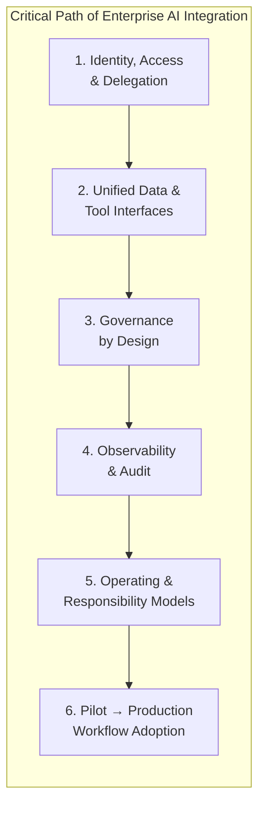
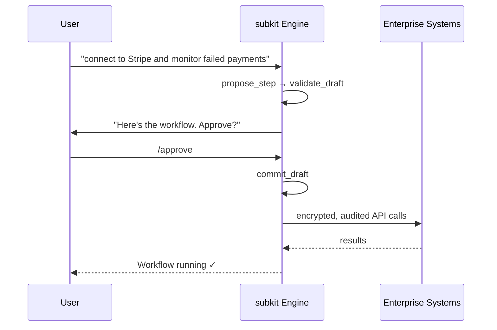
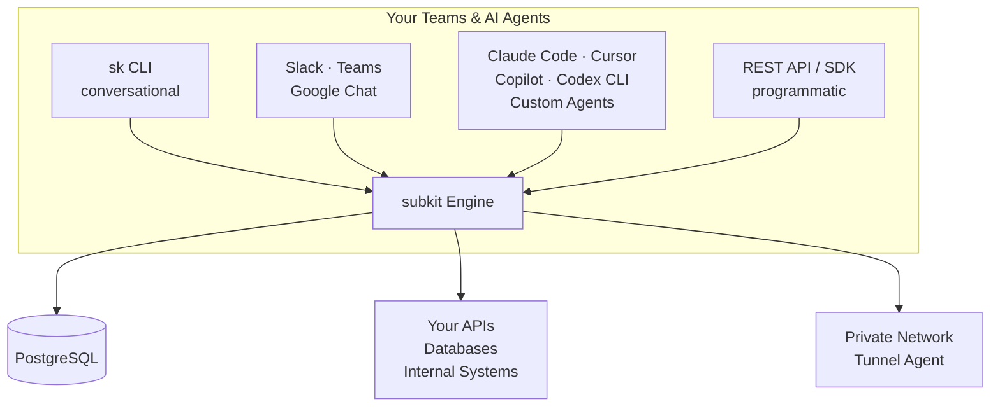
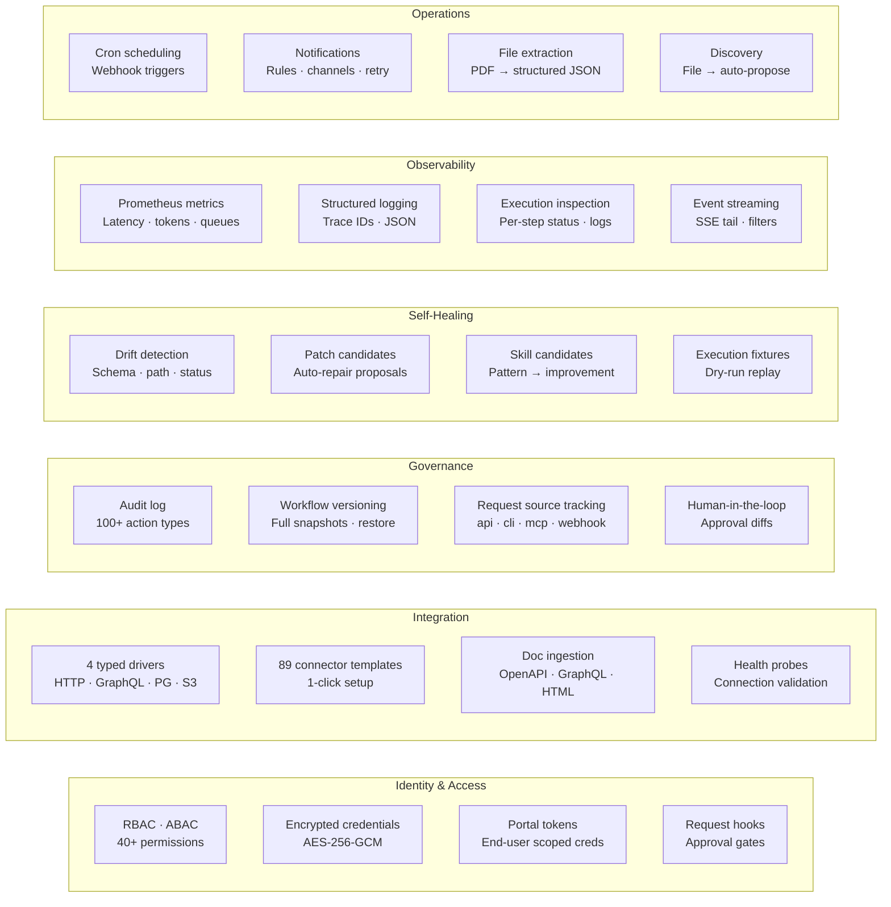
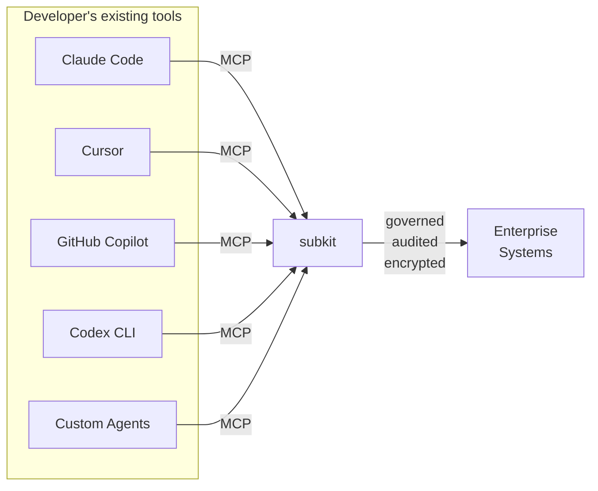
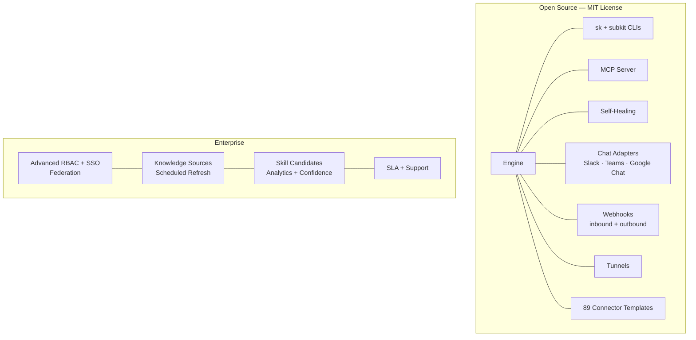

# subkit

**Enterprise AI fails at scale not because of the model — but because of controlled access to systems, data, and actions.**

When AI agents need to read across multiple sources, act on behalf of users, and deliver auditable results, everything collides: data silos, identity chaos, missing standards, and no governance. subkit is the missing control layer.

[](LICENSE)

---

## The Problem



| # | Enterprise Pain | What breaks at scale | subkit's answer |
|---|---|---|---|
| 1 | **Identity, Access & Delegation** | Every source has own auth; agents act on behalf of users; "may this agent do this action in this context?" is unanswerable | Encrypted credentials (AES-256-GCM) with auto-rotation, RBAC (40+ permissions, roles, groups, resource grants with TTL), ABAC, portal tokens, per-tenant isolation |
| 2 | **Fragmented data & tool interfaces** | Each source has different APIs, semantics, auth — zero consistent policy enforcement | 4 typed drivers (HTTP, GraphQL, PostgreSQL, S3), OAuth2 auto-refresh, 89 Connector Templates, Documentation Ingestion, private-network Tunnels |
| 3 | **No governance by design** | "How was this decision made?" — silence | Immutable audit log (100+ action types), human-in-the-loop approval, request-source tracking, workflow versioning with full snapshots and restore |
| 4 | **Missing observability** | Can't secure, improve, or audit what you can't see | Prometheus metrics, structured logging, per-request tracing, drift detection, token budget enforcement per tenant |
| 5 | **Org silos vs cross-functional AI** | Departments have different goals and approval flows | Multi-tenant, conversation-first across teams (CLI, Slack, Teams, Google Chat), shared Connectors + Skills + Knowledge Sources, 4 persona model |
| 6 | **Pilot → Production gap** | 50 AI pilots, 1–2 in production | Conversation → production workflow, Discovery (file analysis → auto-proposed connectors/skills/knowledge), Skill Candidates (pattern detection → human-approved evolution), self-healing |
| 7 | **Agents outpace guardrails** | Real actions, real consequences — governance lags behind | 5-tier sandboxing, approval flow with structured diffs, bounded repair loop, circuit breakers, rate limiting |

---

## What subkit is

The missing control layer between AI agents and enterprise systems — consistent access, secure credentials, governed execution, self-healing operations.



---

## Architecture

```mermaid
graph TB
  subgraph "1 — Identity & Policy"
    SSO["SSO · RBAC · ABAC"] --- AgentID["Agent Identities\nDelegation · Least Privilege"]
  end
  subgraph "2 — Connectivity"
    Drivers["HTTP · GraphQL · PostgreSQL · S3"] --- Templates["89 Connector Templates"]
    Drivers --- TN["Private Network Tunnels"]
  end
  subgraph "3 — Data Context"
    DocIng["Documentation Ingestion"] --- Skills["Curated Skills"]
    DocIng --- KS["Knowledge Sources\nsemantic search · scheduled refresh"]
    Skills --- SC["Skill Candidates\npattern detection → human approval"]
  end
  subgraph "4 — Agent Orchestration"
    Conv["Conversations"] --- Tools["14+ Tools: Propose · Validate\nApprove · Commit"]
    Conv --- Flows["Generate · Repair\nExtract · Converse"]
    Conv --- Disc["Discovery\nfile → auto-proposed connectors/skills"]
  end
  subgraph "5 — Safety & Governance"
    Audit["Immutable Audit Log\n100+ action types"] --- Sand["5-Tier Sandboxing"]
    Audit --- HITL["Human-in-the-Loop\nApproval Flow"]
  end
  subgraph "6 — Observability"
    Met["Prometheus Metrics"] --- Log["Structured Logging\nTrace IDs"]
    Met --- Heal["Self-Healing\nDrift Detection"]
  end
  subgraph "7 — Workflow Adoption"
    WF["Versioned Workflows\nFull DAG Snapshots"] --- Sched["Cron · Webhooks · Events"]
    WF --- Imp["Self-Improvement\nExecution Patterns → Skills"]
  end
```



---

## How you interact



| Surface | For | How |
|---|---|---|
| **sk CLI** | End users, admins | Conversational — describe what you need, approve what it builds |
| **Slack / Teams / Google Chat** | Teams | Same conversation loop, native chat UX, approval buttons |
| **MCP Server** | AI coding tools | Drop-in for Claude Code, Cursor, Copilot, Codex — one config line |
| **subkit CLI** | Operators, CI/CD | Noun-verb commands: `subkit workflows list`, `subkit connectors test` |
| **REST API** | SDKs, automation | Typed OpenAPI contract at `/openapi.json` |

---

## Quick Start

```bash
# Install
curl -fsSL https://raw.githubusercontent.com/mikebild/subkit/main/scripts/install.sh | bash

# Connect
sk login --engine-url https://your-engine.example.com --api-key <key>

# Talk
sk -p "create a workflow that fetches users from JSONPlaceholder and summarizes them"
```

---

## What you can say

- "connect to our Stripe API and monitor failed payments"
- "show me all failed integrations from today across all teams"
- "add exponential backoff to the payment step"
- "who changed the invoice workflow last week?"
- "set up a nightly sync between Salesforce and our data warehouse"
- "analyze these PDF docs and propose connectors and skills"

---

## What the engine handles for you



| Capability | What it does | Enterprise benefit |
|---|---|---|
| **89 Connector Templates** | 1-click setup for Stripe, Salesforce, HubSpot, Jira, GitHub, Slack, and 83 more | Minutes to connect, not weeks — each template includes auth config, doc ingestion, and setup hints |
| **Documentation Ingestion** | Auto-indexes OpenAPI specs, GraphQL schemas, HTML docs, Markdown into searchable context | AI agents understand your APIs without manual prompt engineering |
| **End-User Credentials** | Per-user credential overrides on connectors (merge or replace mode) | Agents act as the requesting user, not as admin — proper delegation |
| **Connector Health Probes** | `POST /v1/connectors/{id}/test` validates connectivity and measures latency | Know instantly if Stripe is down before your workflow fails |
| **Workflow Versioning** | Full DAG snapshot per version, restore to any prior version | Rollback bad deployments in seconds, full change history |
| **Request Source Tracking** | Every execution tagged: api, cli, mcp, webhook, chat, tool-chain, scheduler | Know exactly how every workflow was triggered — for audit, metrics, and policy |
| **Drift Detection** | Detects schema changes, missing fields, new error shapes from connected APIs | Catch breaking API changes before they cascade through your workflows |
| **Patch Candidates** | LLM proposes smallest safe repair, dry-runs against execution fixtures, classifies safe/unsafe | Auto-repair breaking changes with human approval — no manual debugging |
| **Skill Candidates** | Detects recurring patterns from executions → proposes permanent skill improvements | System gets smarter over time, but only with human approval — never auto-promoted |
| **Knowledge Sources** | Persistent document stores with semantic search and scheduled refresh | Upload PDFs, runbooks, compliance docs — AI agents search them in every conversation |
| **Discovery** | Upload enterprise files → LLM auto-proposes connectors, skills, knowledge sources | Onboard a new system by dropping its docs — subkit figures out the integration |
| **Prometheus Metrics** | Request latency, execution duration, retry counts, token usage, queue depth | Enterprise-grade observability without building your own metrics pipeline |
| **Event Streaming** | SSE stream of all execution events with pattern filtering | Real-time visibility: `subkit events tail --pattern "execution.failed"` |
| **Notifications** | Rule-based fan-out to channels (Slack, webhook) with circuit breakers and retry | "On any payment failure, alert #ops-critical" — with rate limiting and delivery replay |
| **File Extraction** | Upload PDF/image/doc → LLM extracts structured JSON against a schema | Turn unstructured documents into workflow inputs |
| **Execution Replay & Abort** | Abort in-flight workflows, replay failed ones, tail logs in real-time | Operational control: stop runaway workflows, retry without re-creating |

---

## MCP — Drop subkit into the tools you already use

Developers already work in Claude Code, Cursor, Copilot, Codex CLI. subkit becomes their MCP server — one config line, and their AI assistant gains governed access to every enterprise system.



| MCP concept | What subkit exposes | Example |
|---|---|---|
| **Tools** | Workflows as callable tools | `run_invoice_sync`, `check_payment_status` |
| **Resources** | Connectors as structured data access | `stripe://customers`, `salesforce://opportunities` |
| **Prompts** | Skills as curated context | `stripe-best-practices`, `gdpr-compliance-checklist` |

```json
{ "mcpServers": { "subkit": { "url": "https://your-engine/v1/mcp" } } }
```

**What makes this different from raw API access:**
- Credentials never leave subkit — agents call tools, subkit handles auth
- Every tool call is audited with actor, context, and result
- Sensitive operations require human approval before execution
- Skills inject domain knowledge into the AI's context automatically
- Self-healing — if a connector breaks, subkit detects and proposes a fix

---

## Open Source (MIT) + Open Core



| Layer | Channel |
|---|---|
| **Developer adoption** | MCP ecosystem directories, IDE integrations (Claude Code, Cursor, Copilot) |
| **Community growth** | Connector template contributions, curated skill library as community recipes |
| **Enterprise conversion** | Multi-tenancy, audit trail, self-healing, Knowledge Sources, Skill Candidates |
| **Partnerships** | LLM providers, chat platforms (Slack/Teams as AI operations center), cloud marketplaces |

---

## Documentation

Full technical reference in [`docs/`](docs/) — 36 documents covering architecture, data model, execution engine, security, deployment, and every subsystem.

| Group | Documents |
|---|---|
| **Foundation** | [Concept](docs/01-concept.md) · [Domain Model](docs/02-domain-model.md) · [Architecture](docs/03-architecture.md) · [Data Model](docs/04-data-model.md) |
| **Engine Core** | [Execution Engine](docs/05-execution-engine.md) · [Queue & Scheduler](docs/06-queue-scheduler-pubsub.md) · [Streaming](docs/07-streaming-and-reactivity.md) · [Sandboxing](docs/08-sandboxing.md) |
| **Integrations** | [Connectors](docs/09-connectors.md) · [Doc Ingestion](docs/10-documentation-ingestion.md) · [Webhooks](docs/13-webhooks.md) · [Chat Platforms](docs/14-chat-platforms.md) · [Tunnels](docs/15-tunnels.md) · [Templates](docs/23-templates.md) |
| **AI Surfaces** | [AI Flows](docs/16-ai-flows.md) · [Conversations](docs/17-conversations.md) · [Skills](docs/18-skills.md) · [Self-Healing](docs/19-self-healing.md) · [MCP Server](docs/12-mcp-server.md) |
| **Knowledge & Discovery** | [Knowledge Sources](docs/35-knowledge-sources.md) · [Discovery](docs/36-discovery.md) |
| **Operational** | [Identity & Access](docs/11-identity-and-access.md) · [Versioning](docs/20-versioning-and-history.md) · [Run Search](docs/21-run-search.md) · [Extract](docs/22-extract.md) · [Streaming Interfaces](docs/25-streaming-interfaces.md) |
| **Surfaces** | [subkit CLI](docs/26-cli.md) · [sk CLI](docs/27-sk-cli.md) · [REST API](docs/27-api-surface.md) · [OpenAPI & Clients](docs/24-openapi-and-clients.md) |
| **Platform** | [Security](docs/28-security.md) · [Observability](docs/29-observability.md) · [Defaults & Limits](docs/30-defaults-and-limits.md) · [Developer Tooling](docs/31-developer-tooling.md) · [Deployment](docs/32-deployment.md) · [Verification](docs/33-verification.md) · [Installation](docs/34-installation.md) |

---

## For AI coding agents

subkit is prepared for agentic coding (Claude Code, Copilot, Codex, Cursor).
Start with [`AGENTS.md`](AGENTS.md) — canonical repo-wide rules, subsystem map,
quality gates. See [`SKILLS.md`](SKILLS.md) for the skill index and
[`docs/00-agent-navigation.md`](docs/00-agent-navigation.md) for the
task → subsystem cross-reference.

---

## License

[MIT](LICENSE) — Copyright (c) 2026 Mike Bild
