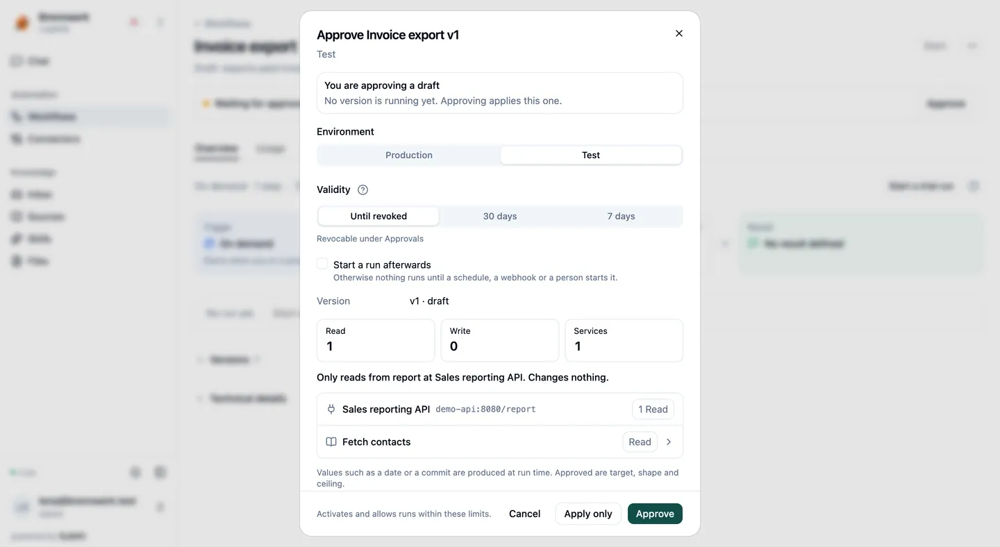
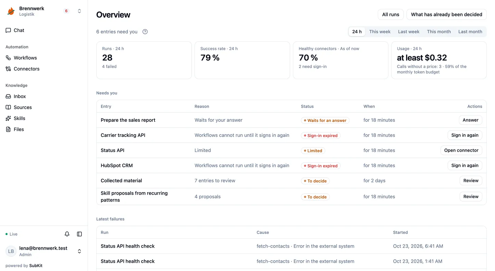
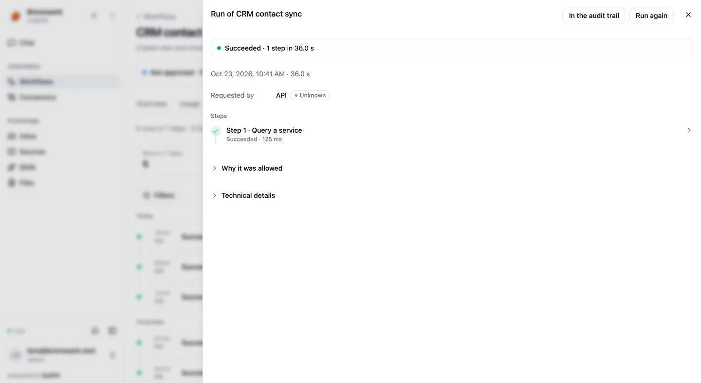
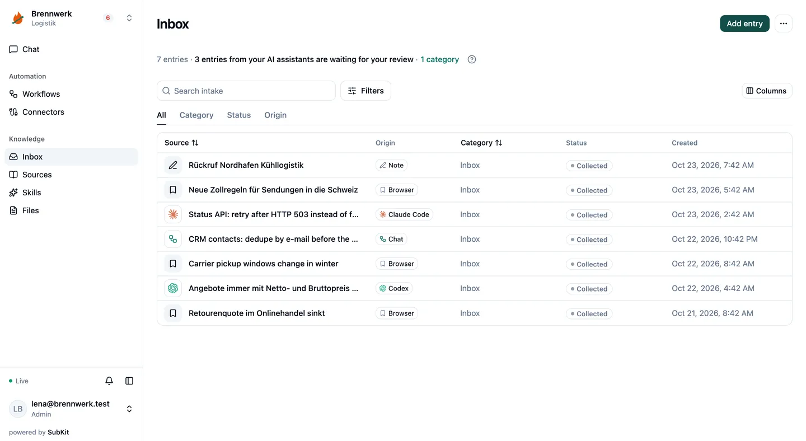
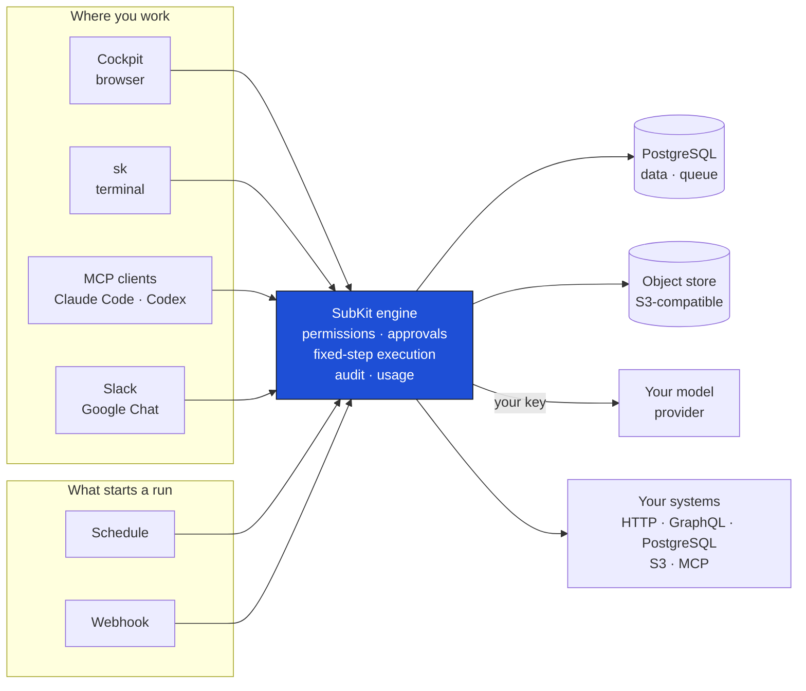
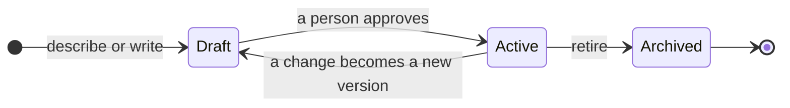

```mermaid
sequenceDiagram
  autonumber
  actor You
  participant SubKit as SubKit engine
  participant AI as Your model
  participant Systems as Your systems
  You->>SubKit: Describe the task in your own words
  SubKit->>AI: Draft a workflow from it
  AI-->>SubKit: Steps, connectors, trigger
  SubKit-->>You: Preview with reads, writes and services
  You->>SubKit: Approve environment, validity and boundary
  Note over SubKit,Systems: From here on the steps are fixed
  SubKit->>Systems: Run the steps with the approved permissions
  Systems-->>SubKit: Results
  SubKit-->>You: Run result, history and audit trail
```

<p align="center">
  <a href="https://subkit.mikebild.dev/en/#gh-dark-mode-only"></a>
  <a href="https://subkit.mikebild.dev/en/#gh-light-mode-only"></a>
</p>

<p align="center">
  <strong>SubKit runs the recurring work that spans several systems and today hangs on one person or a fragile script.</strong><br />
  You describe the task, the AI drafts a workflow, and a person approves what it may touch.
</p>

<p align="center">
  <a href="https://subkit.mikebild.dev/en/"><strong>Website</strong></a> ·
  <a href="https://subkit.mikebild.dev/en/documentation/"><strong>Documentation</strong></a> ·
  <a href="https://subkit.mikebild.dev/en/use-cases/"><strong>Use cases</strong></a> ·
  <a href="#run-subkit"><strong>Run SubKit</strong></a>
</p>

<p align="center">
  <a href="LICENSE"></a>
  
  
  
  
</p>

<br />

<p align="center">
  
  
</p>

<p align="center">The AI helps you design a workflow. It does not decide what the workflow may do.<br />That stays with a person, and it is written down before the first run.</p>

<p align="center">
  
  
</p>

[](https://subkit.mikebild.dev/en/documentation/first-workflow/)

<p align="center">Before anything runs, you see what the workflow reads, what it writes and which services it reaches.<br />You approve it for one environment and for as long as you choose.</p>

[](https://subkit.mikebild.dev/en/documentation/)

<p align="center">The Overview shows what ran, what failed and what waits for your decision.</p>

[](https://subkit.mikebild.dev/en/documentation/first-workflow/)

<p align="center">Every run says what happened, which version ran and why it was allowed.</p>

<br />

<p align="center">
  
  
</p>

<p align="center">The jobs that come back every day, every week or with every order.<br />SubKit runs them on demand, on a schedule or when a webhook arrives.</p>

<p align="center">
  
  
</p>

<p align="center">
  SubKit ships with <strong>61 connector templates</strong> and <strong>248 ready-made recipes</strong>, among them GitHub, Slack, Notion, Jira, Linear,<br />
  HubSpot, Salesforce, Stripe, Shopify, Google Workspace, Airtable, Supabase and AWS.<br />
  <a href="https://subkit.mikebild.dev/en/use-cases/">More use cases</a>
</p>

<table>
  <tr>
    <td width="50%"><strong>Cockpit, in the browser.</strong><br />Design, approve and follow workflows without writing code. English and German.</td>
    <td width="50%"><strong><code>sk</code>, in the terminal.</strong><br />Draft, change and run workflows as files that you can review before they land.</td>
  </tr>
  <tr>
    <td><strong>MCP, from your AI client.</strong><br />Every approved workflow is a tool in Claude Code, Codex and other MCP clients.</td>
    <td><strong>Chat, where your team works.</strong><br />Ask questions and start approved workflows from Slack or Google Chat.</td>
  </tr>
</table>

<br />

<p align="center">
  
  
</p>

<p align="center">Explain how you work once, not with every task.</p>

[](https://subkit.mikebild.dev/en/documentation/)

<table>
  <tr>
    <td width="50%"><strong>An inbox for everything you find.</strong><br />Notes, chat findings and web pages from the Web Clipper land in one list.</td>
    <td width="50%"><strong>You decide what becomes knowledge.</strong><br />Turn an entry into a source or a skill, or drop it. Nothing is adopted on its own.</td>
  </tr>
  <tr>
    <td><strong>Every change is a version.</strong><br />For each source and skill you see who saved it and when.</td>
    <td><strong>Search stays in the engine.</strong><br />Full-text search in PostgreSQL plus a local embedding model. No external search service.</td>
  </tr>
</table>

<br />

<p align="center">
  
  
</p>

- **Runs on your server or in SubKit Cloud.** Self-hosted, the database, files and keys stay on your server.
- **Uses the model you choose.** Anthropic, OpenAI, Google Gemini, Azure, Amazon Bedrock or Vertex AI, with your own key.
- **Stays inside the approved boundary.** An approval names the environment, how long it is valid and what the workflow reads and writes. A new version that reaches further needs a new approval.
- **Asks before it writes.** A write tool called from an AI client pauses until a person allows it once or declines.
- **Gives each person only their rights.** Roles, permissions and scoped API keys apply to the Cockpit, the CLI, the API and MCP alike.
- **Keeps credentials encrypted.** Connector secrets are stored with AES-256-GCM under the master key of the installation.
- **Shows what it costs.** Usage lists AI cost per run, workflow, person and model. A monthly token budget pauses AI authoring when it is used up, while approved workflows keep running.

<p align="center">
  <a href="https://subkit.mikebild.dev/en/documentation/execution-identity-and-permission/">Identity and permission</a> · <a href="https://subkit.mikebild.dev/en/documentation/usage-and-costs/">Usage and costs</a> · <a href="https://subkit.mikebild.dev/en/documentation/engine-operator/">Operating the engine</a>
</p>

<br />

<p align="center">
  
  
</p>

<p align="center">One engine binary with the Cockpit built in, a PostgreSQL database and an object store.</p>



<p align="center">From one sentence to a recorded run:</p>



<p align="center">A workflow never changes in place. Every change is a new version:</p>



- **Fixed steps, not a free-running agent.** A workflow is built from eight step kinds: request, transform, call, wait, wait for event, branch, parallel and loop.
- **Tasks: a goal with limits.** Where the way to a result differs from case to case, a task takes a goal, a plan and the workflows and connectors it may use. It asks a person before anything that writes, it cannot author workflows, and it starts on its own only with a standing permission that ends when the task changes. What proves itself in a task becomes a workflow.
- **A desktop app that runs nothing locally.** SubKit Desktop is a window onto your server's Cockpit with a menu bar icon, native notifications and launch at login. It signs in through the browser, every computer is a device of its own that can be revoked, and no API key or workflow ever lives on the machine. The Cockpit can also be installed as a web app.
- **Chat asks unless you asked.** In Automatic mode an action runs without a question only when you asked for it in your own words, named the target and wrote or saw the content; payments, deletions, publications, settings, new accounts and credentials always ask.
- **Schedules explain themselves.** A schedule that fails five times in a row for the same reason pauses and says so once; a schedule history shows what became of every scheduled time.
- **Code runs in a sandbox.** Code in transform steps runs in a QuickJS sandbox, not in the engine process itself.
- **One contract for every door.** The HTTP API is described in OpenAPI 3.1 at `/openapi.json`, and the engine describes itself to AI clients at `/llms.txt`.
- **Built with** TypeScript on Bun, Hono, Drizzle, PostgreSQL with pg-boss, Zod, React and the Model Context Protocol SDK.

<br />

<p align="center">
  
  
</p>

<p align="center">Every release has to pass the same gate. These numbers come from the files in this repository.</p>

<table align="center">
  <tr>
    <td align="center" valign="top" width="25%"><h1>3,021</h1><strong>test files</strong><br /><sub>unit, integration, journey, end-to-end, Docker and regression</sub></td>
    <td align="center" valign="top" width="25%"><h1>100%</h1><strong>mutation score required</strong><br /><sub>on the pure decision cores</sub></td>
    <td align="center" valign="top" width="25%"><h1>90%</h1><strong>line coverage floor</strong><br /><sub>for permissions and the audit log</sub></td>
    <td align="center" valign="top" width="25%"><h1>52</h1><strong>AI eval cases</strong><br /><sub>with stored baselines</sub></td>
  </tr>
</table>

<p align="center">
  <sub>Counted on November 19, 2026. The thresholds are in <a href="stryker.config.json"><code>stryker.config.json</code></a> and <a href="apps/engine/.coverage-floor.json"><code>apps/engine/.coverage-floor.json</code></a>. They are test requirements, not a guarantee.</sub>
</p>

<br />

<p align="center">
  
  
</p>

<details>
<summary><strong>What does it cost?</strong></summary>
<br />

SubKit is open source under the Apache License 2.0. You bring your own model provider, which bills you directly. [Usage](https://subkit.mikebild.dev/en/documentation/usage-and-costs/) shows what the AI calls cost and stops AI authoring at your monthly token budget.

</details>

<details>
<summary><strong>Does the AI act on its own while a workflow runs?</strong></summary>
<br />

No. The AI helps while you design. At run time the workflow follows its fixed steps. A step can ask a model for a summary or a classification, but it cannot add steps, reach other systems or widen its own permissions.

</details>

<details>
<summary><strong>Where does my data go?</strong></summary>
<br />

Self-hosted, the database, files and keys stay on your server. Your model provider gets what a draft or an AI step needs, and each connected system gets the requests of the workflows you approved. Knowledge search runs inside the engine.

</details>

<details>
<summary><strong>What happens when a workflow breaks?</strong></summary>
<br />

The run fails visibly and shows up on the Overview. SubKit can propose a fix. By default it applies only patches it classifies as safe; everything else waits for your review. You can turn automatic fixes off.

</details>

<details>
<summary><strong>Do I need to write code?</strong></summary>
<br />

No. You can design, approve and run workflows in the Cockpit. If you prefer files and reviews, the same workflows are available with `sk` and over the HTTP API.

</details>

<details>
<summary><strong>Is it ready for my team?</strong></summary>
<br />

SubKit is in beta. [SubKit Cloud](https://subkit.mikebild.dev/en/documentation/subkit-cloud/) is hosted and by invitation, and the self-hosting package follows with the public beta. The Web Clipper works in Chrome only.

</details>

<br />

<a name="run-subkit"></a>

<p align="center">
  
  
</p>

<p align="center">Use SubKit Cloud, or run the engine on your own server.</p>

<table>
  <tr>
    <td width="50%" valign="top"><strong>SubKit Cloud</strong><br />SubKit runs for you, and you sign in from the browser. The cloud is a hosted beta by invitation.<br /><br /><a href="https://subkit.mikebild.dev/en/contact/">Ask for an invitation</a></td>
    <td width="50%" valign="top"><strong>Your own engine</strong><br />SubKit is built to run on your own server: the engine with the Cockpit, a PostgreSQL database and an object store, started with Docker Compose. The self-hosting package follows with the public beta.<br /><br /><a href="https://subkit.mikebild.dev/en/documentation/run-the-engine/">How self-hosting works</a></td>
  </tr>
</table>

<p align="center">Then connect the tools you already use: the <code>sk</code> CLI in the terminal,<br />and AI clients such as Claude Code and Codex over MCP.</p>

<details>
<summary><strong>Develop from source</strong></summary>
<br />

Install the Bun version from [`.bun-version`](.bun-version) and Docker. Then run:

```bash
git clone https://github.com/MikeBild/subkit.git
cd subkit
bun install --frozen-lockfile
bun run verify        # the full local release gate
```

The engine lives in `apps/engine`, the CLI in `apps/sk`, the Cockpit in `apps/cockpit` and the Web Clipper in `apps/clipper`.

</details>

<p align="center">
  <a href="https://subkit.mikebild.dev/en/documentation/run-the-engine/">Run the engine</a> · <a href="https://subkit.mikebild.dev/en/documentation/first-run-setup/">First-run setup</a> · <a href="https://subkit.mikebild.dev/en/documentation/first-workflow/">Your first workflow</a> · <a href="https://subkit.mikebild.dev/en/documentation/mcp-clients/">Connect AI clients</a>
</p>

<br />

<p align="center">
  <sub>Copyright 2026 Mike Bild · <a href="LICENSE">Apache License 2.0</a> · <a href="https://subkit.mikebild.dev/en/contact/">Contact</a><br />Every release ships <code>THIRD_PARTY_NOTICES.txt</code> with the license texts of all bundled components.</sub>
</p>
