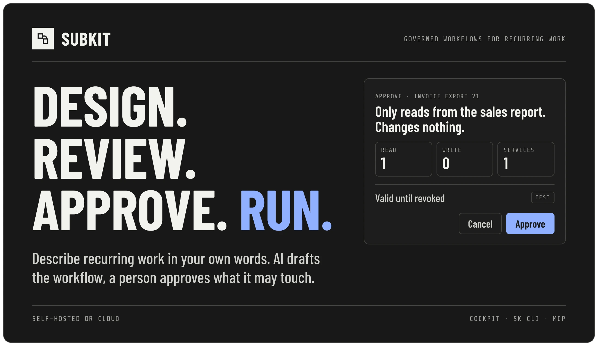
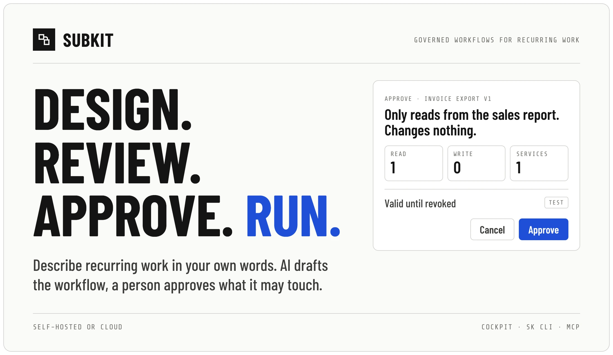
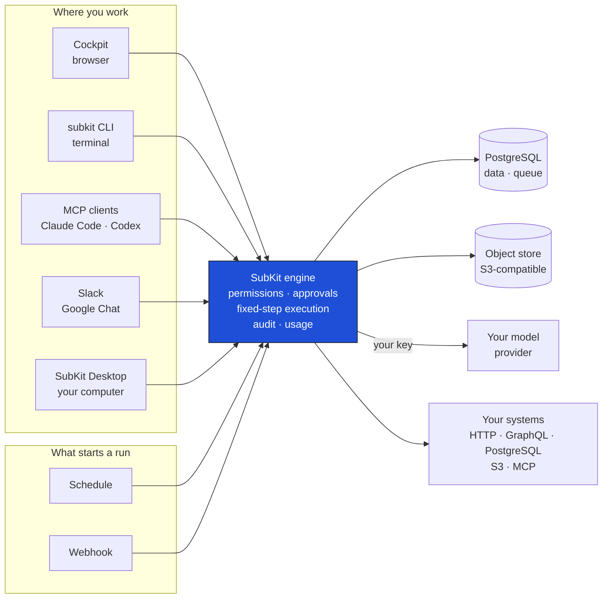
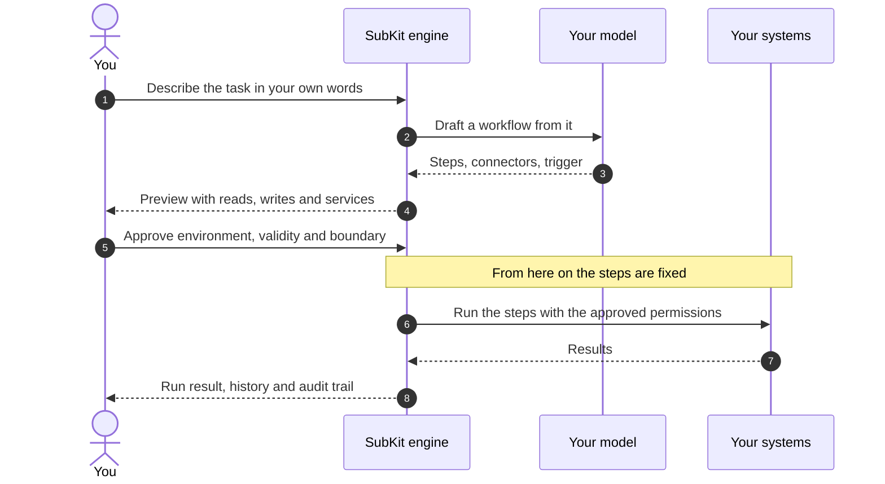
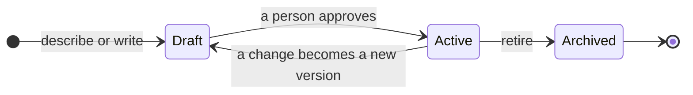

<p align="center">
  <a href="https://subkit.mikebild.dev/en/#gh-dark-mode-only"></a>
  <a href="https://subkit.mikebild.dev/en/#gh-light-mode-only"></a>
</p>

<p align="center">
  <strong>The AI assistant your team can trust.</strong><br />
  It takes over the tasks your team does over and over. You decide what it can access, and you can look up every run in the history.
</p>

<p align="center">
  <a href="https://subkit.mikebild.dev/en/"><strong>Website</strong></a> ·
  <a href="https://subkit.mikebild.dev/en/documentation/"><strong>Documentation</strong></a> ·
  <a href="https://subkit.mikebild.dev/en/use-cases/"><strong>Use cases</strong></a> ·
  <a href="#sign-up-for-subkit-cloud"><strong>Sign up</strong></a> ·
  <a href="#run-subkit"><strong>Run SubKit</strong></a> ·
  <a href="#subkit-desktop"><strong>Desktop app</strong></a>
</p>

<p align="center">
  <a href="https://github.com/MikeBild/subkit/releases/latest"></a>
  <a href="https://github.com/MikeBild/subkit/releases/latest"></a>
  <a href="https://github.com/MikeBild/subkit/releases/latest"></a>
  <a href="https://github.com/MikeBild/subkit/actions/workflows/quality.yml"></a>
  <a href="https://github.com/MikeBild/subkit/actions/workflows/security.yml"></a>
  <a href="https://github.com/MikeBild/subkit/actions/workflows/release.yml"></a>
  <a href="https://github.com/MikeBild/subkit/actions/workflows/desktop-release.yml"></a>
  <a href="https://github.com/MikeBild/subkit/commits/main"></a>
  <a href="https://github.com/MikeBild/subkit/graphs/commit-activity"></a>
  <a href="https://github.com/MikeBild/subkit/issues"></a>
</p>

<p align="center">
  <a href="LICENSE"></a>
  
  
  
  
  
  
  <a href="https://subkit-cloud.mikebild.dev"></a>
</p>

<br />

<table>
  <tr>
    <td width="50%" valign="top"><strong>Hands the recurring work over.</strong><br />Approved workflows run on demand, on a schedule or on a webhook.<br /><a href="#hands-the-recurring-work-over">The work</a></td>
    <td width="50%" valign="top"><strong>Your team’s second brain.</strong><br />Shared knowledge and skills that teach it your house rules.<br /><a href="#your-teams-second-brain">Knowledge</a></td>
  </tr>
  <tr>
    <td valign="top"><strong>Works on your computer.</strong><br />Files, browser and apps, only where you allow it.<br /><a href="#works-on-your-computer">Desktop</a></td>
    <td valign="top"><strong>Reach it from anywhere.</strong><br />Cockpit, Slack, Google Chat, MCP clients and the terminal.<br /><a href="#reach-it-from-anywhere">Access</a></td>
  </tr>
</table>

<br />

<p align="center">
  
  
</p>

<p align="center">The AI helps you design. It never decides what a workflow may do.<br />A person does, in writing, before the first run.</p>

<p align="center">
  
  
</p>

[](https://subkit.mikebild.dev/en/documentation/first-workflow/)

<p align="center">See what it reads, writes and reaches before anything runs.<br />Approve it for one environment, for as long as you choose.</p>

<br />

<a name="hands-the-recurring-work-over"></a>

<p align="center">
  
  
</p>

<p align="center">The jobs that come back daily, weekly or with every order.<br />SubKit does them, the same way every time.</p>

<p align="center">
  
  
</p>

<table>
  <tr>
    <td width="50%" valign="top"><strong>Workflows with fixed steps.</strong><br />Every change is a new version that needs a new approval.</td>
    <td width="50%" valign="top"><strong>Schedules and webhooks.</strong><br />Runs start on demand, on time or when an event arrives.</td>
  </tr>
  <tr>
    <td valign="top"><strong>Tasks for work that varies.</strong><br />A goal, a plan and limits. A task asks before it writes.</td>
    <td valign="top"><strong>An audit trail for every run.</strong><br />What happened, which version ran and why it was allowed.</td>
  </tr>
</table>

[](https://subkit.mikebild.dev/en/documentation/)

<p align="center">The Overview shows what ran, what failed and what waits for you.</p>

[](https://subkit.mikebild.dev/en/documentation/first-workflow/)

<p align="center">
  <strong>61 connector templates</strong> and <strong>248 ready-made recipes</strong>: GitHub, Slack, Notion, Jira, Linear,<br />
  HubSpot, Salesforce, Stripe, Shopify, Google Workspace, Airtable, Supabase, AWS and more.<br />
  <a href="https://subkit.mikebild.dev/en/use-cases/">More use cases</a>
</p>

<br />

<a name="your-teams-second-brain"></a>

<p align="center">
  
  
</p>

<p align="center">Explain how your team works once. Everyone with the right permissions reuses it.</p>

[](https://subkit.mikebild.dev/en/documentation/collect-ideas-and-turn-them-into-knowledge-or-skills/)

<table>
  <tr>
    <td width="50%" valign="top"><strong>One inbox for what you find.</strong><br />Notes, chat findings, files and pages from the Web Clipper.</td>
    <td width="50%" valign="top"><strong>You decide what becomes knowledge.</strong><br />Make it a source or a skill, or drop it. Nothing is adopted on its own.</td>
  </tr>
  <tr>
    <td valign="top"><strong>Skills teach your house rules.</strong><br />Reusable instructions for chat and for drafting workflows.</td>
    <td valign="top"><strong>Shared across the team.</strong><br />Sources and skills are versioned. Every search hit names its source.</td>
  </tr>
</table>

<br />

<a name="works-on-your-computer"></a>

<p align="center">
  
  
</p>

<p align="center">SubKit Desktop does the work that lives on your computer.<br />Nothing runs there until you turn it on.</p>

<table>
  <tr>
    <td width="50%" valign="top"><strong>Computer use.</strong><br />Buttons and fields in apps you allowed. Sensitive apps stay blocked.</td>
    <td width="50%" valign="top"><strong>Browser use.</strong><br />Websites you allowed, in a browser of its own.</td>
  </tr>
  <tr>
    <td valign="top"><strong>Local files.</strong><br />Read or read-and-write, per folder you allowed.</td>
    <td valign="top"><strong>A live view and a stop key.</strong><br />Every step with a redacted screenshot. ⌘⇧⎋ stops it.</td>
  </tr>
  <tr>
    <td valign="top"><strong>A fully local workspace.</strong><br />Your own AI key or a local model server. Move it to a server later.</td>
    <td valign="top"><strong>Approved per device.</strong><br />A workflow’s approval names the device, folders, websites and apps.</td>
  </tr>
</table>

<p align="center"><sub>SubKit Desktop runs on macOS 13+ with Apple Silicon. The Windows app is coming soon.</sub></p>

<br />

<a name="reach-it-from-anywhere"></a>

<p align="center">
  
  
</p>

<p align="center">One assistant, the same permissions, wherever your team works.</p>

<table>
  <tr>
    <td width="50%" valign="top"><strong>Cockpit, in the browser.</strong><br />Design, approve and follow workflows. No code. English and German.</td>
    <td width="50%" valign="top"><strong>Chat, where your team works.</strong><br />Ask and start approved workflows from Slack or Google Chat.</td>
  </tr>
  <tr>
    <td valign="top"><strong>MCP, from your AI client.</strong><br />Every approved workflow is a tool in Claude Code, Codex and others.</td>
    <td valign="top"><strong><code>subkit</code>, in the terminal.</strong><br />Workflows as files you review before they land.</td>
  </tr>
</table>

<br />

<p align="center">
  
  
</p>

- **SubKit Cloud, your server or your computer.** Self-hosted, your data, files and keys stay with you.
- **Your model.** Anthropic, OpenAI, Google Gemini, Azure, Amazon Bedrock or Vertex AI, with your own key.
- **The approved boundary.** An approval names environment, validity, reads, writes and the vault items it uses.
- **One vault for every secret.** Workspace, personal and device secrets. Values reach only approved runs and their connector, never the model.
- **Device secrets stay on the device.** SubKit Desktop keeps them in the operating system’s secure storage.
- **“Always ask first.”** Turn it on, and every write asks you, in chat, in tasks and on your computer.
- **Each person’s rights, nothing more.** Roles, permissions and scoped API keys, in Cockpit, CLI, API and MCP alike.
- **A monthly AI budget in US dollars.** At 100%, chat, tasks and model steps pause. Other workflows keep running.

<p align="center">
  <a href="https://subkit.mikebild.dev/en/documentation/execution-identity-and-permission/">Identity and permission</a> · <a href="https://subkit.mikebild.dev/en/documentation/usage-and-costs/">Usage and costs</a> · <a href="https://subkit.mikebild.dev/en/documentation/engine-operator/">Operating the engine</a>
</p>

<br />

<p align="center">
  
  
</p>

<p align="center">One engine binary with the Cockpit built in, PostgreSQL and an object store.</p>



<p align="center">From one sentence to a recorded run:</p>



<p align="center">A workflow never changes in place. Every change is a new version:</p>



- **Fixed steps, not a free-running agent.** Eight step kinds: request, transform, call, wait, wait for event, branch, parallel and loop.
- **Chat asks unless you asked.** Payments, deletions, publications, settings and credentials always ask.
- **Schedules explain themselves.** After five failures in a row for one reason, a schedule pauses and says why.
- **Code runs in a sandbox.** Transform steps run in QuickJS, outside the engine process.
- **One contract for every door.** OpenAPI 3.1 at `/openapi.json`, and `/llms.txt` for AI clients.
- **Built with** TypeScript on Bun, Hono, Drizzle, PostgreSQL with pg-boss, Zod, React, Electron and the MCP SDK.

<br />

<p align="center">
  
  
</p>

<p align="center">Every release passes the same gate. The numbers come from this repository.</p>

<table align="center">
  <tr>
    <td align="center" valign="top" width="25%"><h1>3,455</h1><strong>test files</strong><br /><sub>unit, integration, journey, end-to-end, Docker and regression</sub></td>
    <td align="center" valign="top" width="25%"><h1>100%</h1><strong>mutation floor</strong><br /><sub>the gate’s break threshold for the pure decision cores</sub></td>
    <td align="center" valign="top" width="25%"><h1>90%</h1><strong>line coverage floor</strong><br /><sub>for permissions and the audit log</sub></td>
    <td align="center" valign="top" width="25%"><h1>55</h1><strong>AI eval cases</strong><br /><sub>with stored baselines</sub></td>
  </tr>
</table>

<p align="center">
  <sub>Counted on November 22, 2026. The thresholds are in <a href="stryker.config.json"><code>stryker.config.json</code></a> and <a href="apps/engine/.coverage-floor.json"><code>apps/engine/.coverage-floor.json</code></a>. They are test requirements, not a guarantee.</sub>
</p>

<br />

<p align="center">
  
  
</p>

<details>
<summary><strong>What does it cost?</strong></summary>
<br />

SubKit is open source under the Apache License 2.0. Your model provider bills you directly. [Usage](https://subkit.mikebild.dev/en/documentation/usage-and-costs/) shows the AI cost, and your monthly budget in US dollars caps it.

</details>

<details>
<summary><strong>Does the AI act on its own while a workflow runs?</strong></summary>
<br />

No. The AI helps you design. At run time the workflow follows its fixed steps. A model step can summarize or classify, but it cannot add steps, reach other systems or widen its permissions.

</details>

<details>
<summary><strong>Where does my data go?</strong></summary>
<br />

Self-hosted, your data, files and keys stay on your server, or on your computer with a fully local workspace. Your model provider gets what a draft or an AI step needs. Each connected system gets only the requests you approved.

</details>

<details>
<summary><strong>What happens when a workflow breaks?</strong></summary>
<br />

The run fails visibly on the Overview. SubKit can propose a fix. It applies only fixes it classifies as safe; the rest waits for your review. You can turn this off.

</details>

<details>
<summary><strong>Do I need to write code?</strong></summary>
<br />

No. Design, approve and run workflows in the Cockpit. If you prefer files and reviews, use the `subkit` CLI or the HTTP API.

</details>

<details>
<summary><strong>Is it ready for my team?</strong></summary>
<br />

SubKit is in Preview. [Sign up for SubKit Cloud](#sign-up-for-subkit-cloud) yourself, no invitation needed. Everything for self-hosting, from the Compose file to SubKit Desktop, is in the [latest release](https://github.com/MikeBild/subkit/releases/latest). The Web Clipper works in Chrome only.

</details>

<br />

<a name="run-subkit"></a>

<p align="center">
  
  
</p>

<p align="center">Use SubKit Cloud, your own server or your computer.</p>

<table>
  <tr>
    <td width="50%" valign="top"><strong>SubKit Cloud</strong><br />SubKit runs for you. Create an account and set up your workspace in the browser. Preview, open to everyone.<br /><br /><a href="https://subkit-cloud.mikebild.dev">Sign up for SubKit Cloud</a> · <a href="https://subkit.mikebild.dev/en/documentation/subkit-cloud/">How SubKit Cloud works</a></td>
    <td width="50%" valign="top"><strong>Your own engine</strong><br />Engine with Cockpit, PostgreSQL and an object store, started with Docker Compose.<br /><br /><a href="https://github.com/MikeBild/subkit/releases/latest/download/docker-compose.yml">Download <code>docker-compose.yml</code></a> · <a href="https://subkit.mikebild.dev/en/documentation/run-the-engine/">How self-hosting works</a></td>
  </tr>
  <tr>
    <td width="50%" valign="top"><a name="subkit-desktop"></a><strong>SubKit Desktop</strong><br />Your Cockpit as a desktop app, plus files, browser and computer use.<br /><sub>macOS 13+ on Apple Silicon, Windows coming soon</sub><br /><br /><a href="https://github.com/MikeBild/subkit/releases/latest/download/subkit-desktop-mac-arm64.dmg">Download for Mac</a> · <a href="https://subkit.mikebild.dev/en/documentation/subkit-desktop/">How to get SubKit Desktop</a></td>
    <td width="50%" valign="top"><strong>Fully local workspace</strong><br />A whole workspace on your computer, with backups and your own AI key or local model. No server needed.<br /><sub>Inside SubKit Desktop</sub><br /><br /><a href="https://subkit.mikebild.dev/en/documentation/subkit-desktop/">Set up a local workspace</a></td>
  </tr>
</table>

<a name="sign-up-for-subkit-cloud"></a>

**Sign up for SubKit Cloud** in three steps:

1. Open [subkit-cloud.mikebild.dev](https://subkit-cloud.mikebild.dev) and select **Sign in with work account**.
2. Select **Create an account** and confirm your email address with the link you receive.
3. Sign in, name your workspace and add the API key of your AI provider.

<p align="center">Then connect your tools: <code>subkit</code> in the terminal,<br />Claude Code, Codex and other AI clients over MCP.</p>

<p align="center">Collect pages from Chrome with the Web Clipper: <a href="https://chromewebstore.google.com/detail/odefbnmjeehgfbanpaajiaocliccldma">add it from the Chrome Web Store</a>, where it updates itself. For offline setups, <a href="https://github.com/MikeBild/subkit/releases/latest/download/subkit-clipper.zip">download the ZIP file</a> and follow the <a href="https://subkit.mikebild.dev/en/documentation/web-clipper/">install guide</a>.</p>

<details>
<summary><strong>Develop from source</strong></summary>
<br />

Install the Bun version from [`.bun-version`](.bun-version) and Docker. Then run:

```bash
git clone https://github.com/MikeBild/subkit.git
cd subkit
bun install --frozen-lockfile
bun run verify        # the full local release gate
```

The engine lives in `apps/engine`, the CLI in `apps/subkit`, the Cockpit in `apps/cockpit`, SubKit Desktop in `apps/desktop` and the Web Clipper in `apps/clipper`.

Every root command groups one concern: `gen`, `build`, `test`, `verify`, `quality`, `demo`, `release`, `eval`, `db` and `compose`. `bun run <command> help` lists its subcommands, for example `bun run verify help`. [RELEASING.md](RELEASING.md) describes a release, [SECURITY.md](SECURITY.md) how to report a vulnerability.

</details>

<p align="center">
  <a href="https://subkit.mikebild.dev/en/documentation/run-the-engine/">Run the engine</a> · <a href="https://subkit.mikebild.dev/en/documentation/first-run-setup/">First-run setup</a> · <a href="https://subkit.mikebild.dev/en/documentation/first-workflow/">Your first workflow</a> · <a href="https://subkit.mikebild.dev/en/documentation/mcp-clients/">Connect AI clients</a>
</p>

<br />

## Features at a glance

<!-- release-history -->

| What your team gets done | Since |
| --- | --- |
| Work on your computer: computer use, browser use and local files, with a live view | 12.1.0 |
| A fully local workspace | 12.1.0 |
| One vault for workspace, personal and device secrets | 12.1.0 |
| A monthly AI budget in US dollars | 12.1.0 |
| “Always ask first” for every write | 12.1.0 |
| SubKit Desktop | 11.2.0 |
| Tasks: a goal, a plan and limits | 11.0.0 |
| SubKit Cloud | 10.1.4 |
| A shared inbox for knowledge, fed by the Web Clipper | 9.10.0 |
| Ready-made recipes | 9.5.0 |
| Approvals bound to environment, validity and effects | 6.45.0 |
| Recurring work handed over: workflows on demand, on a schedule or on a webhook | 1.0.0 |
| Shared knowledge sources and skills for the whole team | 1.0.0 |
| Roles, permissions and an audit trail for every run | 1.0.0 |
| Chat in Slack and Google Chat | 1.0.0 |
| [All features](https://subkit.mikebild.dev/en/documentation/features/) | – |

<!-- /release-history -->

<br />

<p align="center">
  <sub>Copyright 2026 Mike Bild · <a href="LICENSE">Apache License 2.0</a> · <a href="https://subkit.mikebild.dev/en/contact/">Contact</a><br />Every release ships <code>THIRD_PARTY_NOTICES.txt</code> with the license texts of all bundled components.</sub>
</p>
