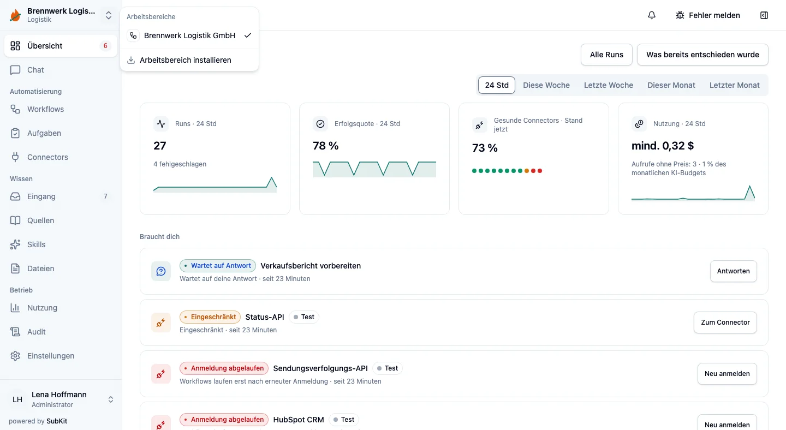

## Cockpit als App

Dieses Kapitel ist für alle, die täglich im Cockpit arbeiten und es nicht jedes Mal in einem Browser-Tab suchen wollen. Du installierst das Cockpit eines Arbeitsbereichs als App auf dem Rechner oder Handy, sofern dein Browser Web-Apps installieren kann. Danach startest du es wie jedes andere Programm, in eigenem Fenster und mit Name, Symbol und Farben des Arbeitsbereichs.

### Was du brauchst

- Zugang zu einem Arbeitsbereich in SubKit Cloud unter https://subkit-cloud.mikebild.dev oder auf einer selbst betriebenen Engine.
- Ein Konto, mit dem du dich über **Mit Firmenkonto anmelden** anmeldest. Mit einem API-Schlüssel kann sich eine installierte App nicht neu anmelden.
- Einen Browser, der die Installation von Web-Apps unterstützt.
- Für das Branding: die Rechte `settings:write` und `identity:write` im Arbeitsbereich.

### Cockpit eines Arbeitsbereichs installieren

1. Öffne das Cockpit im Browser und melde dich an.
2. Öffne in der Seitenleiste das Menü des Arbeitsbereichs und wähle **Arbeitsbereich installieren**.

   

3. Prüfe Name und Symbol im Installationsdialog und wähle **App installieren**.
4. Das Cockpit wechselt zur eigenen Adresse dieses Arbeitsbereichs und zeigt den Dialog erneut. Wähle noch einmal **App installieren**.
5. Bestätige die Installation im Dialog deines Browsers.

Die App heißt wie der Arbeitsbereich. Sie nutzt das hinterlegte App-Icon oder das SubKit-Symbol und übernimmt die Farbe der gewählten Farbpalette.

### In Chrome, Edge und Safari installieren

Den letzten Schritt der Installation macht dein Browser. Er sieht je Browser anders aus.

| Browser | So geht es |
| --- | --- |
| Chrome und Edge auf dem Rechner | Wähle im Cockpit **App installieren** und bestätige den Dialog des Browsers. |
| Safari auf dem Mac | Öffne in Safari das Menü „Ablage“ und wähle „Zum Dock hinzufügen“. |
| Safari auf iPhone und iPad | Tippe in Safari auf „Teilen“ und dann auf „Zum Home-Bildschirm“. |
| Andere Browser | Du liest „Installation nicht möglich“. Nutze das Cockpit weiter im Browser oder öffne es in einem der Browser oben. |

Im **Benutzermenü** steht zusätzlich **SubKit installieren**, solange die App auf diesem Gerät nicht installiert ist. Der Eintrag öffnet dieselbe Anleitung.

Ob die App installiert ist, siehst du unter **Einstellungen › Dein Profil** bei „Ist SubKit auf diesem Gerät installiert?“: **Installiert** oder **Nicht installiert**, dazu **Benachrichtigungen an** oder **Benachrichtigungen aus**.

### Ohne Verbindung und nach einem Update

Die App braucht deinen Server. Sie hält nur ihre Programmdateien vor, keine Daten.

- **Ohne Verbindung** zeigt die App die Seite „Keine Verbindung zum Server“ mit **Erneut versuchen**. Daten siehst du dann nicht, und die App sammelt keine Eingaben, um sie später zu senden.
- **Nach einem Update des Servers** erscheint der Hinweis „Neue Version verfügbar“ mit **Neu laden**. Bis dahin arbeitet das offene Fenster mit seinem bisherigen Stand weiter.
- **Mit ungespeicherten Eingaben** lädt **Neu laden** nicht neu. Du liest „Erst speichern – beim Neuladen gingen die Eingaben verloren.“ Speichere und wähle **Neu laden** noch einmal.

### Benachrichtigungen, Zahl am Symbol und Links

- **Benachrichtigungen.** Je offenem Punkt bekommst du eine Benachrichtigung. Der Titel sagt, was passiert ist, zum Beispiel „Eine Entscheidung wartet auf dich“. Der Text sagt, was zu tun ist, zum Beispiel „Prüf die Änderung und entscheide.“ Mehr als drei auf einmal fasst die App zu „Neue Einträge brauchen dich“ zusammen.
- **Klick.** Ein Klick auf die Benachrichtigung öffnet genau diesen Punkt in der App oder holt das offene Fenster dorthin.
- **Offenes Fenster.** Ist die App sichtbar, erscheint keine Benachrichtigung des Betriebssystems. Der Hinweis steht dann in der App.
- **Zahl am Symbol.** Das App-Symbol trägt die Zahl der offenen Punkte, höchstens 99. Ist nichts offen, verschwindet sie. Das geht nur, wo Browser und Betriebssystem es unterstützen.
- **Links.** Links mit dem Schema `web+subkit` öffnen eine Seite in der App, zum Beispiel `web+subkit://tasks` oder `web+subkit://chat/{id}`. Ein unbekanntes Ziel führt auf die Startseite.

Wann Benachrichtigungen kommen, legst du in „Benachrichtigungen und Ruhezeiten“ fest.

### Web-App oder SubKit Desktop

Neben der installierten Web-App gibt es SubKit Desktop, eine App für Macs mit Apple Silicon; die App für Windows folgt. Beide zeigen dasselbe Cockpit deines Servers. Nur SubKit Desktop kann außerdem mit Dateien, einem Browser und Apps auf deinem Mac arbeiten, und nur, wenn du es erlaubst.

| | Installierte Web-App | SubKit Desktop |
| --- | --- | --- |
| Installation | Aus dem Browser, je Arbeitsbereich eine App | Ein Programm, je Server ein Profil |
| Geräte | Rechner und Handy | Mac mit Apple Silicon (ab macOS 13); Windows folgt |
| Benachrichtigungen | Push über den Browser | Benachrichtigungen des Betriebssystems, solange das Programm läuft |
| Ruhezeiten | Unter **Einstellungen › Einrichtung** | In den Einstellungen des Programms |
| Symbol in der Menüleiste oder im Infobereich | Nein | Ja, mit der Zahl der offenen Punkte |
| Beim Anmelden am Computer starten | Nein | Ja |
| Inhalte aus anderen Apps teilen | Ja | Dateien auf die App oder ihr Symbol ziehen |
| Dateien, Browser und Apps auf deinem Gerät | Nein | Ja, was du erlaubst |
| Updates | Kommen mit dem Server | Eigene Updates des Programms |

Mehr in „SubKit Desktop“.

### Mehrere Arbeitsbereiche als getrennte Apps nutzen

Arbeitest du in mehreren Arbeitsbereichen, bekommt jeder seine eigene App.

1. Wechsle im normalen Cockpit im Menü des Arbeitsbereichs zum nächsten Arbeitsbereich.
2. Installiere ihn wie oben über **Arbeitsbereich installieren**.
3. Starte jede App einzeln. Jede App öffnet immer nur ihren eigenen Arbeitsbereich.

Jede App hat ihre eigene Anmeldung. Deine Anmeldung im normalen Cockpit bleibt davon unberührt.

### In der App anmelden und abmelden

1. Zum Abmelden öffne in der App das **Benutzermenü** und wähle **Abmelden**.
2. Zum erneuten Anmelden starte die App und wähle **Mit Firmenkonto anmelden**.
3. Klappt das nicht, melde dich im normalen Cockpit an und öffne die App dort über **Arbeitsbereich installieren** erneut.

**Abmelden** meldet nur diese App ab, nicht deine anderen Apps und nicht das normale Cockpit.

### Branding eines Arbeitsbereichs festlegen

1. Öffne **Einstellungen** → **Arbeitsbereich** und darin unter **Wie soll SubKit bei euch aussehen?** den Bereich **Arbeitsbereich-Branding**.
2. Lade unter **App-Icon (1:1)** ein quadratisches PNG mit mindestens 512 Pixeln Kantenlänge hoch.
3. Wähle unter **Farbpalette** zwischen **Standard**, **Indigo** und **Teal**.

   

4. Prüfe die Vorschau und wähle **Änderungen speichern**.

Ohne beide Rechte kannst du das Branding nur ansehen.
Den App-Namen bestimmt der Name des Arbeitsbereichs, nicht der **Organisationsname** im Branding.
**Branding zurücksetzen** stellt das SubKit-Erscheinungsbild für alle Mitglieder wieder her.

### Installierte App entfernen

1. Öffne das normale Cockpit im Browser und wechsle zum Arbeitsbereich der App.
2. Wähle im Menü des Arbeitsbereichs **Installation widerrufen** und bestätige. Die installierte Web-App ist damit sofort abgemeldet. Desktop-Geräte bleiben angemeldet; sie meldest du unter **Einstellungen** › **Dein Profil** › **Wo bist du angemeldet?** ab.
3. Entferne die App danach wie jede andere App von deinem Gerät.

Installierst du später neu, entsteht eine neue App-Adresse. Alte Links funktionieren nicht mehr.

### Gut zu wissen

- Benachrichtigungen schaltest du in der App unter **Benachrichtigungen** mit **Neutrale Benachrichtigungen aktivieren** ein. Die Hinweise enthalten keine Details zu Arbeitsbereich oder Workflow.
- Texte und Dateien, die du mit der App teilst, landen erst nach deiner Bestätigung im **Eingang**. Sie werden dadurch weder Wissen, noch starten sie einen Workflow.
- Name und Symbol einer installierten App kann dein Browser oder Betriebssystem auch nach dem Abmelden weiter anzeigen.

### Wenn etwas nicht klappt

| Was du siehst | Was du tust |
| --- | --- |
| „Installation nicht möglich“ | Nutze das Cockpit weiter im Browser oder öffne es in einem Browser, der Web-Apps installieren kann. |
| „Installierte Apps benötigen für die erneute Anmeldung ein bestehendes OIDC-Konto. …“ | Melde dich im normalen Cockpit an und öffne die App dort über **Arbeitsbereich installieren** erneut. |
| „Browser-Berechtigung verweigert. Bitte in den Einstellungen erlauben.“ | Erlaube Benachrichtigungen für die Cockpit-Adresse in den Einstellungen deines Browsers. |
| "Open the app, sign in and share again." | Starte die App, melde dich an und teile den Inhalt erneut. |
| „Verwende ein nicht animiertes PNG, JPEG oder WebP mit maximal 2 MiB und 4 Megapixeln.“ | Lade als App-Icon ein quadratisches PNG mit mindestens 512 Pixeln Kantenlänge und höchstens 2 MiB hoch. |
