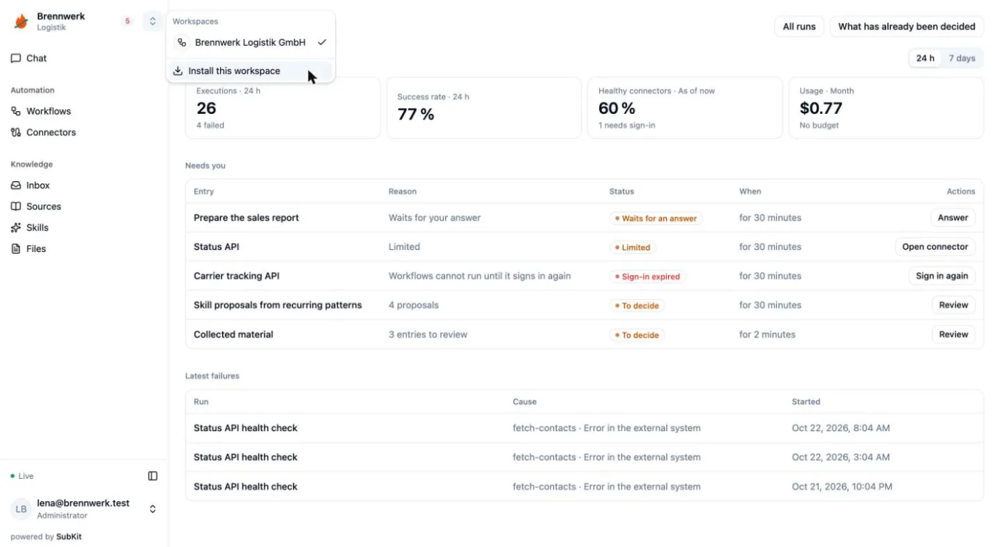

## Cockpit as an app

Install the Cockpit of a workspace as its own app in its own window.
If you work in several workspaces, each one gets its own app with its own name, icon and colors.

### What you need

- Access to a workspace in SubKit Cloud at https://subkit-cloud.mikebild.info or on a self-hosted engine.
- An account you sign in with through **Sign in with work account**. An installed app cannot sign in again with an API key.
- A browser that supports web app installation.
- For branding: the `settings:write` and `identity:write` permissions in the workspace.

### Install the Cockpit of a workspace

1. Open the Cockpit in the browser and sign in.
2. Open the workspace menu in the sidebar and choose **Install this workspace**.

   

3. Check the name and icon in the install dialog and select **Install app**.
4. The Cockpit moves to this workspace's own address and shows the dialog again. Select **Install app** once more.
5. Confirm the installation in your browser's dialog.

The app carries the workspace name, uses the stored app icon or the SubKit icon, and takes the color of the selected color palette.

### Use several workspaces as separate apps

1. In the regular Cockpit, switch to the next workspace from the workspace menu.
2. Install it as above through **Install this workspace**.
3. Start each app on its own. Each app only ever opens its own workspace.

Each app has its own sign-in. Your sign-in in the regular Cockpit stays untouched.

### Sign in and sign out in the app

1. To sign out, open the **User menu** in the app and choose **Sign out**.
2. To sign in again, start the app and choose **Sign in with work account**.
3. If that fails, sign in to the regular Cockpit and reopen the app there through **Install this workspace**.

**Sign out** only signs out this app, not your other apps and not the regular Cockpit.

### Set the branding of a workspace

1. Open **Settings** and, under **Working with sk**, the **Workspace branding** section.
2. Under **App icon (1:1)**, upload a square PNG with at least 512 pixels per side.
3. Under **Color palette**, choose **Standard**, **Indigo** or **Teal**.

   

4. Check the preview and select **Save changes**.

Without both permissions you can only view the branding.
The app name comes from the workspace name, not from the **Organization name** in the branding.
**Reset branding** restores the SubKit look for all members.

### Remove an installed app

1. Open the regular Cockpit in the browser and switch to the app's workspace.
2. Choose **Revoke installation** in the workspace menu and confirm. This signs the app out on all its devices.
3. Then remove the app from your device like any other app.

If you install again later, the app gets a new address. Old links stop working.

### Good to know

- In the app, open **Notifications** and turn on **Enable neutral notifications**. The alerts contain no workspace or workflow details.
- Text and files you share with the app only reach the **Inbox** after you confirm them. This neither admits them to knowledge nor starts a workflow.
- Your browser or operating system may keep showing an installed app's name and icon after you sign out.

### If something does not work

| What you see | What to do |
| --- | --- |
| "Installation unavailable" | Keep using the Cockpit in the browser, or open it in a browser that can install web apps. |
| "Installed apps require an existing OIDC account to sign in again. …" | Sign in to the regular Cockpit and reopen the app there through **Install this workspace**. |
| "Browser permission was denied. Allow notifications in your browser settings." | Allow notifications for the Cockpit address in your browser settings. |
| "Open the app, sign in and share again." | Start the app, sign in and share the content again. |
| "Use a still PNG, JPEG or WebP up to 2 MiB and 4 megapixels." | Upload a square PNG of at least 512 pixels per side and at most 2 MiB as the app icon. |
