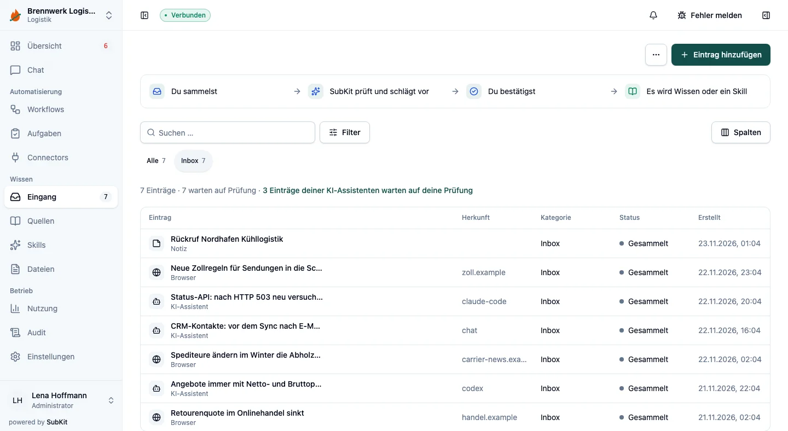

## Ideen sammeln und in Wissen oder Skills verwandeln

Sammle jetzt Seiten und Ideen und entscheide später, was zu Wissen oder einem Skill wird. Nichts Gesammeltes ist Wissen, bis eine angemeldete Person es im Cockpit bestätigt.

Der Weg ist immer gleich: **sammeln → im Chat prüfen → bestätigen → Wissen oder Skill**.

### Was du brauchst

- Für Webseiten: den Web Clipper in Chrome, installiert und verbunden. Installation, Updates und Fehlerbehebung des Web Clippers stehen im Kapitel „Webseiten mit dem Web Clipper sammeln“.
- Zum Sammeln: ein Konto mit `intake:read` und `intake:write`.
- Zum Bestätigen: eine Browsersitzung im Cockpit mit `intake:confirm`, dazu `knowledge:write` für Wissen oder `skill:write` und `skill:activate` für einen Skill. Wer Skills ersetzt, braucht zusätzlich `skill:archive` für jeden ersetzten Skill.

### Etwas sammeln

1. Öffne die Seite.
2. Optional: Markiere den Text, den du als Ausschnitt willst.
3. Wähle in der Symbolleiste das Symbol des Web Clippers („SubKit Clipper“).
4. Prüfe die Vorschau. Die Quelladresse wird automatisch erfasst.
5. Optional: Ergänze, warum es wichtig ist.
6. Wähle eine Kategorie. Deine Standardkategorie ist vorausgewählt, anfangs `inbox`.
7. Wähle **Sammeln**.

Erkenntnisse aus Sitzungen mit KI-Assistenten landen im selben Eingang. Als Herkunft steht dort der Assistent mit seinem Zeichen, etwa **Claude Code**, **Codex** oder **Chat**. Ist der Assistent unbekannt, steht dort **KI-Assistent**. Gesammelte Seiten tragen die Herkunft **Browser**.

### Eine Notiz hinzufügen

Eine Notiz ist ein Eintrag ohne Quelladresse, etwa ein Gedanke oder eine Idee.

1. Öffne im Cockpit **Eingang** und wähle **Eintrag hinzufügen**. Ist der Eingang noch leer, wähle **Notiz hinzufügen**.
2. Gib im Dialog **Zum Eingang hinzufügen** einen **Titel** ein.
3. Schreib unter **Inhalt** den Text. Markdown ist erlaubt.
4. Wähle eine **Kategorie** oder lege mit **Neue Kategorie …** eine neue an.
5. Wähle **Hinzufügen**.

Die Notiz trägt die Herkunft **Notiz**. Auf der Seite der Notiz fehlt der Link **Ursprüngliche Seite öffnen**, denn es gibt keine Quelle.

### Einträge prüfen und ordnen

1. Öffne im Cockpit **Eingang**.

   

2. Optional: Klicke in der Zeile über der Liste auf den Hinweis, zum Beispiel „3 Einträge deiner KI-Assistenten warten auf deine Prüfung“. Dann siehst du nur Einträge deiner KI-Assistenten. Der Filter **Herkunft: KI-Assistent** steht neben der Suche; ein Klick darauf hebt ihn auf.
3. Klicke auf einen Eintrag. Im Tab **Inhalt** nennt ein Satz die Herkunft, etwa „Gesammelt von Chat in der Sitzung … · für … · …“. Rechts daneben öffnet **Unterhaltung öffnen** die Chat-Unterhaltung; bei gesammelten Seiten öffnet **Ursprüngliche Seite öffnen** die Quelle.
4. Optional: Wähle **Eintrag bearbeiten**, um Titel, Inhalt oder Kategorie zu ändern. Das erfasste Original bleibt erhalten.
5. Optional: **Verwerfen** oder **Wiederherstellen**.

Die Sichtbarkeit im Eingang folgt den Rechten deines Arbeitsbereichs. Kategorien sind nicht privat.

### Im Chat prüfen

Einen Eintrag prüfen:

1. Öffne den Eintrag im **Eingang**.
2. Wähle **Im Chat prüfen**. Der Chat zeigt den Eintrag als `@`-Verweis.

Eine ganze Kategorie prüfen:

- Starte in einem neuen Chat den Prüfvorschlag der Kategorie oder frag: „Sieh meine neuen Research-Einträge durch und schlag vor, was wir behalten.“

Der Chat bereitet einen Vorschlag mit Inhalt, Quellen und Ziel vor und verlinkt ihn. Der Link öffnet den Tab **Prüfen** des Eintrags. Abgeschlossene Entscheidungen stehen im Tab **Verlauf** unter **Vorschläge und Entscheidungen**.

### Einen Vorschlag bestätigen

Du brauchst eine Browsersitzung im Cockpit, `intake:confirm` und das Recht des Ziels. API-Schlüssel, MCP-Clients und der Web Clipper können nicht bestätigen.

1. Öffne den Eintrag und wähle **Prüfen**.
2. Prüfe den Vorschlag: Inhalt, Quellen und Ziel.
3. Wähle **Als Quelle bestätigen** oder **Als Skill bestätigen**.

Erst danach kann die gewöhnliche Wissensabfrage das Ergebnis nutzen oder können Agenten-Briefings den Skill tragen. Bei einem Skill archiviert das Bestätigen auch die Skills, die er ersetzt. Der Vorschlag zeigt jede Änderung.

Gut zu wissen:

- Verschieben, Bearbeiten oder Verwerfen macht einen Eintrag nie zu Wissen.
- Ändert sich ein Vorschlag oder seine Quellen, prüfst du ihn erneut.
- SubKit ersetzt Zugangsdaten wie API-Schlüssel und Tokens, bevor ein Eintrag gespeichert wird.
- Das Original des Eintrags bleibt mit dem Wissen oder Skill verknüpft.
- Bestätigte Quellen und Skills pflegst du weiter, wie im Kapitel „Quellen, Skills und Dateien pflegen“ beschrieben.

### Wenn etwas nicht klappt

| Was du siehst | Was du tust |
| --- | --- |
| Der Web Clipper meldet keine Verbindung oder einen ungültigen Schlüssel | Folge „Wenn etwas nicht klappt“ im Kapitel „Webseiten mit dem Web Clipper sammeln“. |
| Ein Eintrag fehlt im **Eingang** | Prüfe Kategorie und Herkunft. Hebe den Filter **Herkunft** auf. |
| „Dafür fehlen dir die Rechte. …“ | Bitte eine Administratorin oder einen Administrator um `intake:confirm` und das Recht des Ziels. |
| „Dieser Vorschlag hat sich geändert. Prüfe den aktuellen Inhalt, bevor du bestätigst.“ | Lies den aktuellen Inhalt und bestätige dann erneut. |
| „Ein Skill, auf den sich dieser Vorschlag bezieht, lässt sich nicht mehr laden. …“ | Überarbeite den Vorschlag im Chat, bevor du bestätigst. |
