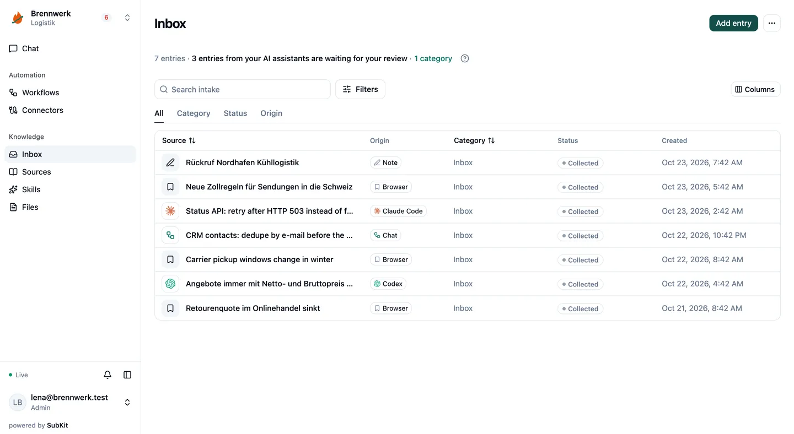

## Collect ideas and turn them into knowledge or skills

Collect pages and ideas now, and decide later what becomes knowledge or a skill. Nothing you collect is knowledge until a signed-in person confirms it in the Cockpit.

The path is always the same: **collect → review in chat → confirm → knowledge or skill**.

### What you need

- The Web Clipper in Chrome, installed and connected. To install, update or troubleshoot the Web Clipper, see "Collect web pages with the Web Clipper".
- To collect: an account with `intake:read` and `intake:write`.
- To confirm: a browser session in the Cockpit with `intake:confirm`, plus `knowledge:write` for knowledge, or `skill:write` and `skill:activate` for a skill. Replacing skills also needs `skill:archive` for each replaced skill.

### Collect something

1. Open the page.
2. Optional: select the text you want as an excerpt.
3. In the toolbar, select the Web Clipper icon ("SubKit Clipper").
4. Check the preview. The source address is captured automatically.
5. Optional: add why it matters.
6. Pick a category. Your default category is preselected, at first `inbox`.
7. Select **Collect**.

Learnings from coding-agent sessions arrive in the same Inbox as items with origin `session`. The Inbox shows the origin as a filter and badge.

### Review and organize items

1. In the Cockpit, open **Inbox**.

   

2. Open an item to see its content and original source.
3. Optional: edit title, content or category. The captured original is preserved.
4. Optional: move, discard or restore the item.

Inbox visibility follows the permissions of your workspace. Categories are not private.

### Review in chat

Review one item:

1. In the **Inbox**, open the item.
2. Select **Review in chat**. The chat shows the item as an `@` reference.

Review a whole category:

- In a new chat, start the category's review suggestion, or ask: "Look through my new Research entries and suggest what to keep."

The chat prepares a proposal with content, sources and destination, and links to it. Completed decisions stay in the chat history.

### Confirm a proposal

You need a browser session in the Cockpit, `intake:confirm` and the destination right. API keys, MCP clients and the Web Clipper cannot confirm.

1. Review the proposal: content, sources and destination.
2. Select **Confirm as knowledge** or **Confirm as skill**.

Only then can ordinary knowledge retrieval use the result, or agent briefings carry the skill. For a skill, confirming also archives the skills it replaces. The proposal shows each change.

Good to know:

- Moving, editing or discarding an item never makes it knowledge.
- If a proposal or its sources change, you review it again.
- SubKit replaces secrets such as API keys and tokens before saving a clip.
- The original clip stays linked to the knowledge or skill.

### If something does not work

| What you see | What to do |
| --- | --- |
| The Web Clipper reports no connection or an invalid key | Follow "If something does not work" in the chapter "Collect web pages with the Web Clipper". |
| An item is missing in the **Inbox** | Check the category and the origin filter. |
| The proposal says "Confirming needs: …" | Ask an administrator for the rights it names. |
| "This suggestion changed. Review the current content before confirming it." | Read the current content, then confirm again. |
| "A skill this suggestion refers to can no longer be loaded. …" | Revise the suggestion in the chat before you confirm. |
