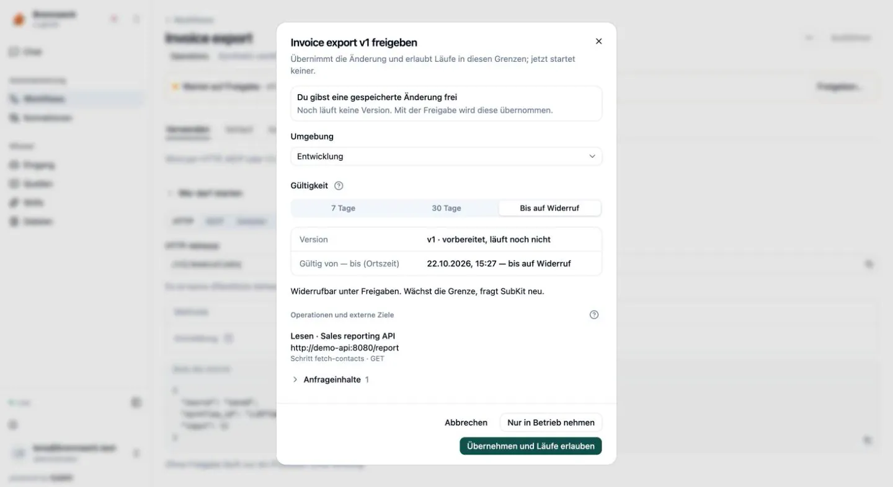
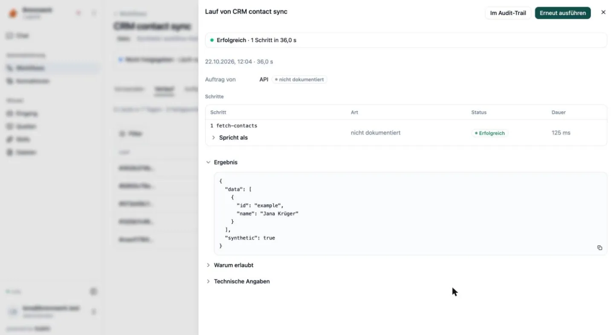

## Dein erster Workflow

Am Ende dieses Kapitels hast du einen freigegebenen Workflow und einen ersten Run, dessen Schritte du nachlesen kannst.
Du beschreibst eine Aufgabe im Chat, speicherst den Workflow, gibst ihn frei, startest ihn und liest das Ergebnis.
Das funktioniert in SubKit Cloud und auf einer selbst betriebenen Engine gleich.

### Was du brauchst

- Ein SubKit-Konto in einem Arbeitsbereich.
  - Cloud: `https://subkit-cloud.mikebild.dev`
  - Selbst betrieben: `https://<deine-engine>`. Die Adresse öffnet im Browser das Cockpit.
- Das Recht, Workflows anzulegen und zu starten. Fehlt ein Button, bitte eine Administratorin oder einen Administrator darum.
- Einen KI-Anbieter. Die Cloud stellt ihn bereit. Eine selbst betriebene Engine nutzt den Anbieter, den du bei `subkit init` gewählt hast.

### Anmelden

1. Öffne das Cockpit.
2. Wähle **Mit Firmenkonto anmelden**.

Du landest in deinem Arbeitsbereich auf **Übersicht**.
Selbst betrieben ohne Anmeldeanbieter? Wähle stattdessen **Mit API-Schlüssel anmelden** und gib deinen Schlüssel ein.

### Die Aufgabe beschreiben

1. Öffne in der Navigation **Chat**.
2. Wähle **Neue Unterhaltung**.
3. Beschreibe die Aufgabe in eigenen Worten: was hineingeht, was passieren soll, was herauskommt.
   Beispiel: „Hol die offenen Issues meines GitHub-Repositorys und gib mir eine kurze Liste mit Titel und Link.“
4. Beantworte die Rückfragen von SubKit. Braucht die Aufgabe einen Dienst, bittet dich SubKit,
   ihn zu verbinden oder dich dort anzumelden.

Gut zu wissen: Eine kleine Aufgabe lässt sich leichter prüfen. Erweitern kannst du den Workflow später im selben Chat.

### Den Workflow speichern

Ist der Workflow fertig, speichert SubKit ihn ohne Rückfrage als inaktive Version. Speichern startet nichts. Der Workflow erscheint jetzt unter **Workflows**.

Mit der Regel **Immer vorher fragen** zeigt SubKit vorher eine Karte **Workflow-Entwurf speichern**:

1. Öffne **Was sich ändert** und lies, welche Schritte und Ziele enthalten sind.
2. Wähle **Inaktive Version speichern**.

[Wann SubKit fragt](setup.md#wann-subkit-fragt) erklärt, welche Schritte fragen und welche ohne Frage laufen.

Ohne Chat legst du einen Workflow unter **Workflows** mit **Workflow erstellen** an. Der Assistent führt dich durch **Wie**, **Was**, **Wann** und **Prüfen**.

### Freigeben, worauf er zugreifen darf

Eine neue Version berührt nichts außerhalb von SubKit, bis ein Mensch sie freigibt.
Ohne Freigabe startet ein Run nur als Probe-Run ohne Wirkung.

1. Öffne **Workflows** und klicke auf deinen Workflow. Seine Seite öffnet sich mit dem Tab **Übersicht**.
   Die Statuszeile zeigt **Wartet auf Freigabe** oder **Nicht freigegeben**.
2. Wähle in der Statuszeile **Freigeben**.
3. Prüfe **Umgebung**, **Gültigkeit** sowie **Operationen und externe Ziele**.
4. Bestätige mit **Freigeben**.
   **Nur übernehmen** übernimmt die Version, ohne Runs freizugeben.



Die Freigabe startet keinen Run. Eine Freigabe gilt für eine Umgebung und eine Dauer.
Eine neue Version braucht keine neue Freigabe, solange sie nicht mehr Systeme, Adressen oder Schreibrechte anfasst als die freigegebene. Greift sie weiter, fragt SubKit erneut und nennt den Unterschied.
Unter **Übersicht › Freigaben** kannst du sie jederzeit widerrufen.
Hat eine Freigabe noch ein Ablaufdatum, macht **Unbefristet machen** im selben Tab daraus eine Freigabe bis auf Widerruf und hebt auch eine Run-Grenze auf. Ist nur noch eine Run-Grenze übrig, heißt die Aktion **Run-Grenze aufheben**.
Bietet dir der Chat eine Freigabe an, öffnet sie denselben Dialog.

| Feld | Was es festlegt |
| --- | --- |
| **Umgebung** | Wo die Runs erlaubt sind, zum Beispiel **Echtbetrieb**. |
| **Operationen und externe Ziele** | Welche Dienste und Adressen der Workflow erreicht. Jeder Dienst trägt das Logo seines Anbieters. |
| **Gültigkeit** | Wie lange die Freigabe gilt: **7 Tage**, **30 Tage** oder **Bis auf Widerruf**. **Bis auf Widerruf** ist vorausgewählt. Dieselbe Wahl hast du, wenn du im Chat eine gespeicherte Änderung prüfst. |

**Start aus dem Chat.** Auch mit **Immer vorher fragen** fragt SubKit vor einem Start nicht, wenn eine gültige Freigabe genau diesen Run deckt: dieselbe Version, dieselbe Umgebung und unveränderte Wirkung. Der Audit-Trail nennt die Freigabe, die den Start gedeckt hat. In zwei Fällen fragt SubKit weiterhin: wenn ein Run Daten aus einem früheren Run weitergibt und wenn du der Unterhaltung gesagt hast, jeden Start zu bestätigen.

**Wenn SubKit ohne neue Version erneut fragt.** Eine Freigabe gilt für die Connectors, wie sie geprüft wurden. Wird ein Connector neu angemeldet oder ändert sich seine Konfiguration, braucht der Workflow heute eine neue Prüfung, auch wenn seine Schritte gleich geblieben sind.

**Wenn Freigeben fehlt.** Ein Schritt braucht eine Grenze, bevor eine Freigabe ihn abdecken kann. Eine Grenze legt fest, wohin der Schritt senden oder speichern darf, welche Werte sich ändern dürfen und wie viel er senden darf. Fehlt eine Grenze, lautet der Status **Umbau nötig vor der Freigabe** und bietet **Grenzen festlegen** an.

1. Wähle **Grenzen festlegen**. SubKit liest, was der Schritt in früheren Runs getan hat, und listet die vorgeschlagenen Grenzen auf.
2. Prüfe die Liste und wähle **Grenzen übernehmen**. SubKit speichert eine neue Version und zeigt sie dir zur Freigabe. Werte, die eine Grenze auflistet, werden im Workflow gespeichert, prüfe sie deshalb vor der Freigabe.
3. Ist der Schritt noch nie gelaufen, wähle **Probe-Run starten**. Ein Probe-Run liest wirklich aus deinen Systemen und hält jede Anfrage zurück, die etwas ändern würde. So wird nichts geschrieben.

Vier Arten von Schritten können eine Grenze bekommen, die sie bisher nicht bekommen konnten:

- **Ein Connector, der eigene Query-Parameter anhängt.** Die festen Parameter des Connectors zählen zur Adresse. Der Dialog nennt sie, aber nicht ihre Werte.
- **Blättern im Inhalt, den ein Schritt sendet.** Die Grenze enthält die höchste Zahl von Seiten. Von Seite zu Seite ändern sich nur die Felder zum Blättern.
- **Ein Kopffeld, dessen Wert sich je Run ändert, etwa `Idempotency-Key`.** Die Grenze nennt das Kopffeld und die Regel, die sein Wert erfüllen muss. Der Name des Kopffelds bleibt fest. Ändern sich Name oder Regel, prüfst du den Schritt erneut.
- **Ein Tool-Aufruf an einem MCP-Server.** Die Grenze nennt das eine Tool, welche Argumentwerte sich ändern dürfen und ob der Aufruf liest oder Daten ändert. Ein Aufruf, der Daten ändern kann, wird nie automatisch wiederholt. Sein Schritt trägt `max_retries: 0`. SubKit prüft die Beschreibung des Tools vor jedem Aufruf. Beschreibt der Server das Tool später anders, hält der nächste Run an, und du prüfst erneut.

Manches bleibt außerhalb jeder Grenze, weil die Grenze sonst nichts mehr aussagen würde:

- Blättern ohne höchste Zahl von Seiten,
- eine Anfrage, deren Adresse zur Laufzeit frei gewählt wird,
- ein Löschen ohne Liste dessen, was gelöscht werden darf, außer es entfernt nur, was der Workflow selbst angelegt hat (siehe unten),
- eine Mail, deren Empfänger aus Daten stammen,
- Daten, die aus einem früheren Run weitergegeben werden.

Wähle bei solchen Schritten **Im Chat beheben**: SubKit baut genau diese Schritte um, prüft sie ohne Live-Wirkungen und speichert einen Entwurf. Danach gibst du die neue Version frei.

**Entfernen, was der Workflow angelegt hat.** Ein Workflow, der etwas anlegt und später wieder entfernt, kann diese IDs nicht im Voraus auflisten. SubKit führt stattdessen ein Verzeichnis dessen, was jeder Workflow angelegt hat:

- Der anlegende Schritt nennt, wo die eine neue ID in seiner Antwort steht, zum Beispiel `records_created: {"id_path": "id"}`. Er braucht einen Connector und `POST` oder `PUT` an einen festen Pfad ohne Platzhalter, etwa `/jobs`. Ein Schritt, der eine bestehende Ressource anspricht, kann nichts vermerken (`records_created_misplaced`), und eine Antwort mit einer Liste von IDs, etwa ein Suchergebnis, vermerkt nichts. SubKit vermerkt jede ID einmal, je Workflow, Connector, Umgebung und diesem Pfad, auch wenn sich der Run wiederholt. Der Freigabe-Dialog zeigt, welche ID der Schritt wo vermerkt.
- Der entfernende Schritt spricht `<dieser Pfad>/${…}` an, markiert diesen letzten Wert mit `{"created_by_workflow": true}` und trägt `destructive: true`, `max_retries: 0`, kein `retry_on_status` und keine `pagination`, damit die Entfernung genau einmal gesendet wird. Der Dialog sagt, dass dieser Wert nur eine ID sein darf, die der Workflow selbst angelegt hat. Eine unter `/jobs` angelegte ID lässt sich nur unter `/jobs` entfernen.
- Bevor die Entfernung gesendet wird, prüft SubKit das Verzeichnis. Eine ID, die der Workflow nicht angelegt hat oder in einer anderen Umgebung angelegt hat, wird mit `delete_target_not_created_by_workflow` abgelehnt, und nichts wird gesendet.
- Eine ID wird höchstens einmal entfernt. Wiederholt sich die Entfernung, durch einen erneuten Versuch oder einen späteren Run, sendet SubKit nichts, und der Schritt gelingt mit dem gespeicherten Ergebnis, markiert mit `replayed: true` und mit dem Run und Schritt, die die ID entfernt haben. Bleibt der Ausgang einer Entfernung unklar, etwa nach einer Zeitüberschreitung oder einem Serverfehler, lehnt SubKit jede weitere Entfernung dieser ID mit `delete_target_outcome_unknown` ab. Prüfe dann das Zielsystem.
- Ein Probe-Run hält beide Schritte zurück und vermerkt nichts.

### Den Workflow starten

1. Wähle auf der Workflow-Seite **Starten**.
2. Fülle das Formular aus, wenn der Workflow Eingaben verlangt. JSON gibst du nur unter **Als JSON eingeben** ein.
3. Wähle **Starten**, um zu bestätigen. Der Dialog sagt **Startet einen Run mit der freigegebenen Version.**
   Ohne Freigabe heißt der Button **Probe-Run starten**.

Du siehst **Run gestartet**. Ist der Button nicht verfügbar, nennt der Hinweis den Grund, zum Beispiel
**Schalte den Workflow vor dem Starten ein.**

### Das Ergebnis prüfen

1. Öffne auf der Workflow-Seite den Tab **Verlauf**.
   Der neueste Run steht oben, mit seinem Status. **Erfolgreich** heißt, der Run ist durchgelaufen.
2. Klicke auf den Run.
   Du siehst jeden Schritt mit seiner Ausgabe. Ein fehlgeschlagener Schritt zeigt **Fehler in Schritt „…“** mit der Ursache.

   

3. Optional: Wähle **Im Audit-Trail**, um zu sehen, wer den Run gestartet und freigegeben hat.

### Einen einzelnen Schritt ausprobieren

Du kannst einen Schritt allein laufen lassen, etwa nachdem du ihn geändert hast. Lesende Zugriffe laufen gegen die echten Systeme. Alles, was schreibt, wird zurückgehalten und nicht gesendet.

1. Klappe auf der Workflow-Seite **Aufbau** auf und klicke auf den Schritt.
2. Wähle unter **Probe-Run** die **Eingabe**. **Aus dem letzten Run** nutzt, was die Schritte davor im letzten Run geliefert haben. Unter **Eigene Werte** gibst du die früheren Ergebnisse als JSON ein: ein Eintrag je früherem Schritt, benannt nach seinem Schritt-Schlüssel, mit dem Ergebnis unter `data`.
3. Wähle **Probe-Run dieses Schritts**. Zum Abbrechen wähle **Probe-Run stoppen**.
4. Lies das Ergebnis. **Run öffnen** zeigt den ganzen Run.

| Was du liest | Bedeutung |
| --- | --- |
| „Der Schritt war erfolgreich.“ | Das Ergebnis steht darunter, mit **Rohantwort** und **Anfrage**. |
| „Der Schritt schreibt und wurde deshalb zurückgehalten. Es wurde nichts gesendet.“ | Der Schritt würde etwas in einem anderen System ändern. Im Probe-Run sendet er nichts. |
| „Der Schritt ist fehlgeschlagen.“ | Der Fehler steht darunter. |
| „Der Probe-Run konnte nicht starten.“ | Der Schritt ließ sich nicht starten. |

Gut zu wissen:

- Ein Probe-Run endet spätestens nach 60 Sekunden.
- Bei vertraulichen Workflows (`execution_privacy: sensitive`) fehlt der Probe-Run, ebenso wenn deine Rolle den Workflow nicht starten darf.
- Über die HTTP-API startet `POST /v1/executions` mit `"source": "step"` und dem Schritt unter `step` einen solchen Probe-Run. Er braucht `workflow:run`. Schreibende Zugriffe werden immer zurückgehalten. Die Antwort kommt sofort mit `execution_id`. Das Ergebnis liest du mit `GET /v1/executions/{id}`, stoppen kannst du ihn mit `POST /v1/executions/{id}/cancel`.

### Wenn etwas nicht klappt

| Was du siehst | Was du tust |
| --- | --- |
| Das Ergebnis des Runs ist mit **Ergebnis des Probe-Runs – nicht geschrieben** überschrieben | Die Version ist noch nicht freigegeben. Folge „Freigeben, worauf er zugreifen darf“. |
| „Nicht gestartet (…): Für diesen Run gibt es keine gültige Freigabe.“ | Die Freigabe fehlt, ist abgelaufen oder aufgebraucht. Gib erneut frei oder verlängere sie. |
| „… muss neu verbunden werden“ | Öffne den Connector unter **Connectors** und wähle **Neu anmelden**. |
| **Du darfst diesen Workflow nicht starten.** | Bitte eine Administratorin oder einen Administrator um eine Rolle, die Workflows starten darf. |
| Ein Schritt ist fehlgeschlagen | Öffne den Run, lies den Fehler und beschreibe ihn im selben Chat. SubKit schlägt eine Korrektur vor, die du erneut prüfst. |

### Dasselbe im Terminal

Mit der Kommandozeile `subkit` legst du Workflows mit `subkit workflows create` an, änderst sie mit `subkit workflows update` und planst sie mit `subkit schedules create` ein.
Braucht ein Schritt einen Umbau vor der Freigabe, melden diese Befehle `automation: repair required`.
Runs prüfst du so:

```bash
subkit executions list --limit 5
subkit executions steps <run-id>
subkit executions result <run-id>
```

`subkit workflows run <workflow-slug> --follow` startet einen weiteren Run und zeigt seine Schritte live.
Mehr steht in „Die subkit-CLI auf deinem Rechner verwenden“.
