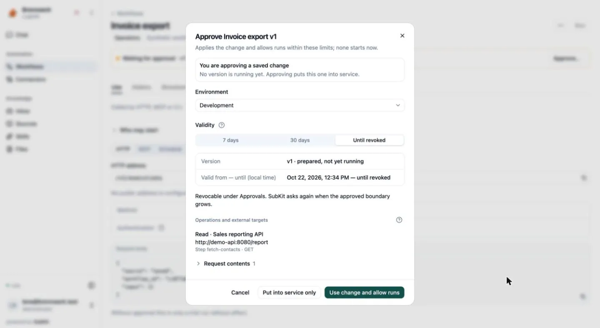

## Your first workflow

Go from signing in to your first successful run.
You describe a task in the chat, save the workflow, approve it, start it and read the result.
It works the same in SubKit Cloud and on a self-hosted engine.

### What you need

- A SubKit account in a workspace.
  - Cloud: `https://subkit-cloud.mikebild.info`
  - Self-hosted: `https://<your-engine>/cockpit`
- Permission to create and run workflows. Ask your administrator if a button is missing.
- An AI provider. Cloud provides one. A self-hosted engine uses the provider you chose in `sk init`.

### Sign in

1. Open the Cockpit.
2. Select **Sign in with work account**.

You land on **Overview** in your workspace.
Self-hosted without an identity provider? Select **Sign in with API key** instead and enter your key.

### Describe the task

1. In the navigation, open **Chat**.
2. Select **New conversation**.
3. Describe the task in plain words: what goes in, what should happen, what comes out.
   Example: "Fetch the open issues of my GitHub repository and give me a short list with title and link."
4. Answer the questions SubKit asks. If the task needs a service, SubKit asks you to connect it
   or to sign in to it.

Good to know: a small task is easier to check. You can extend the workflow later in the same chat.

### Save the workflow

When the workflow is ready, SubKit shows a card **Save workflow draft**.

1. Open **What will change** and read which steps and targets are included.
2. Select **Save inactive version**.

Saving starts nothing. The workflow now appears under **Workflows**.

Without the chat, you create a workflow under **Workflows** with **Create workflow**. The wizard guides you through **How**, **What**, **When** and **Check**.

### Approve what it may touch

A new version does not touch anything outside SubKit until a person approves it.
Without an approval, a run starts only as a trial run without effects.

1. Open **Workflows** and click your workflow. Its page opens on the **Overview** tab.
   The status line shows **Waiting for approval** or **Not approved**.
2. In the status line, select **Approve**.
3. Check **Environment**, **Validity** and **Operations and external targets**.
4. Confirm with **Approve**.
   **Apply only** applies the version without approving runs.



Approving starts no run. An approval covers one environment and a duration.
It also follows a new version whose boundary does not grow.
You can revoke it at any time in the **Approvals** tab.
If the chat offers an approval, it opens the same dialog.

| Field | What it controls |
| --- | --- |
| **Environment** | Where the runs are allowed, for example **Production**. |
| **Operations and external targets** | Which services and addresses the workflow reaches. Each service shows its provider's logo. |
| **Validity** | How long the approval applies: **7 days**, **30 days** or **Until revoked**. |

### Start the workflow

1. On the workflow page, select **Start**.
2. Fill in the form if the workflow asks for inputs. You only type JSON under **Enter as JSON**.
3. Select **Start** to confirm. The dialog says **Starts a run of the approved version.**
   Without an approval, the button reads **Start a trial run**.

You see **Run started**. If the button is unavailable, the hint says why, for example
**Switch the workflow on before starting it.**

### Check the result

1. On the workflow page, open the **History** tab.
   The newest run is at the top, with its status. **Succeeded** means the run finished.
2. Click the run.
   You see every step with its output. A failed step shows **Error in step "…"** with the cause.

   

3. Optional: Select **In the audit trail** to see who started and approved the run.

You can check the same with the sk CLI:

```bash
sk executions list --limit 5
sk executions steps <run-id>
sk executions result <run-id>
```

`sk workflows run <workflow-slug> --follow` starts another run and streams its steps.

### If something does not work

| What you see | What to do |
| --- | --- |
| The run result is headed **Trial run result — not written** | The version has no approval yet. Follow "Approve what it may touch". |
| "Not started (…): no valid approval covers this run." | The approval is missing, expired or used up. Approve again or extend it. |
| "… must be reconnected" | Open the connector under **Connectors** and select **Sign in again**. |
| **You may not start this workflow.** | Ask your administrator for a role that may run workflows. |
| A step failed | Open the run, read the error and describe it in the same chat. SubKit suggests a fix that you review again. |
