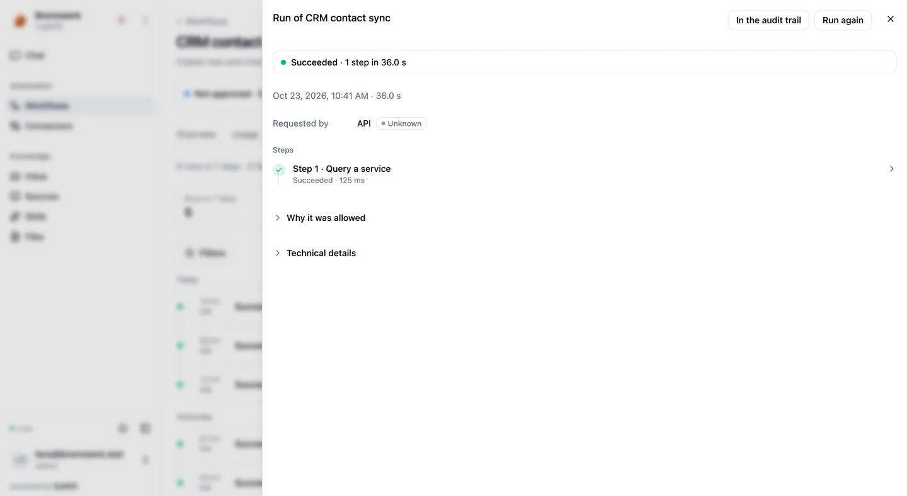

## Your first workflow

By the end of this chapter you have an approved workflow and a first run whose steps you can read.
You describe a task in the chat, save the workflow, approve it, start it and read the result.
It works the same in SubKit Cloud and on a self-hosted engine.

### What you need

- A SubKit account in a workspace.
  - Cloud: `https://subkit-cloud.mikebild.dev`
  - Self-hosted: `https://<your-engine>`. In a browser the address opens the Cockpit.
- Permission to create and run workflows. Ask your administrator if a button is missing.
- An AI provider. Cloud provides one. A self-hosted engine uses the provider you chose in `sk init`.

### Sign in

1. Open the Cockpit.
2. Select **Sign in with work account**.

You land on **Overview** in your workspace.
Self-hosted without an identity provider? Select **Sign in with API key** instead and enter your key.

### Describe the task

1. In the navigation, open **Chat**.
2. Select **New conversation**.
3. Describe the task in your own words: what goes in, what should happen, what comes out.
   Example: "Fetch the open issues of my GitHub repository and give me a short list with title and link."
4. Answer the questions SubKit asks. If the task needs a service, SubKit asks you to connect it
   or to sign in to it.

Good to know: a small task is easier to check. You can extend the workflow later in the same chat.

### Save the workflow

When the workflow is ready, SubKit shows a card **Save workflow draft**.

1. Open **What will change** and read which steps and targets are included.
2. Select **Save inactive version**.

Saving starts nothing. The workflow now appears under **Workflows**.

Without the chat, you create a workflow under **Workflows** with **Create workflow**. The wizard guides you through **How**, **What**, **When** and **Check**.

### Approve what it may touch

A new version does not touch anything outside SubKit until a person approves it.
Without an approval, a run starts only as a trial run without effects.

1. Open **Workflows** and click your workflow. Its page opens on the **Overview** tab.
   The status line shows **Waiting for approval** or **Not approved**.
2. In the status line, select **Approve**.
3. Check **Environment**, **Validity** and **Operations and external targets**.
4. Confirm with **Approve**.
   **Apply only** applies the version without approving runs.


Approving starts no run. It covers one environment and a duration.
A new version needs no new approval as long as it touches no more systems, addresses or write permissions than the approved one. If it reaches further, SubKit asks again and names the difference.
You can revoke it at any time in the **Approvals** tab.
If an approval still has an end date, **Remove expiry** on the same tab makes it apply until revoked and lifts a run limit as well. If only a run limit is left, the action reads **Remove run limit**.
If the chat offers an approval, it opens the same dialog.

| Field | What it controls |
| --- | --- |
| **Environment** | Where the runs are allowed, for example **Production**. |
| **Operations and external targets** | Which services and addresses the workflow reaches. Each service shows its provider's logo. |
| **Validity** | How long the approval applies: **7 days**, **30 days** or **Until revoked**. **Until revoked** is preset. You get the same choice when you review a saved change in the chat. |

**Starting from the chat.** Even with **Always ask first** on, SubKit does not ask before a start when a valid approval covers exactly this run: the same version, the same environment and unchanged effects. The audit trail names the approval that covered the start. SubKit still asks in two cases: when a run passes on data from an earlier run, and when you told the conversation to confirm every start.

**When SubKit asks again without a new version.** An approval is tied to the connectors as they were reviewed. If a connector is signed in again or its configuration changes, the workflow needs a new review today, even though its steps are the same.

**When Approve is missing.** A step needs a limit before an approval can cover it. A limit says where the step may send or store something, which values may change, and how much it may send. When a limit is missing, the status reads **Change needed before approval** and offers **Set limits**.

1. Select **Set limits**. SubKit reads what the step did in earlier runs and lists the limits it suggests.
2. Check the list and select **Apply limits**. SubKit saves a new version and shows it for approval. Values that a limit lists are saved in the workflow, so check them before you approve.
3. If the step has never run, select **Start trial run**. A trial run reads from your systems for real and holds back every request that would change something, so nothing is written.

Three kinds of steps can get a limit that they could not get before:

- **A connector that adds its own query parameters.** The fixed parameters of the connector count as part of the address. The dialog names them, but not their values.
- **Paging in the content a step sends.** The limit contains the highest number of pages. From page to page only the paging fields change.
- **A tool call on an MCP server.** The limit names the one tool, which argument values may vary, and whether the call reads or changes data. A call that may change data is never repeated automatically; its step carries `max_retries: 0`. SubKit checks the description of the tool before every call. If the server describes the tool differently later, the next run stops and you review it again.

Some things stay outside every limit, because the limit would no longer say anything:

- paging without a highest number of pages,
- a request whose address is chosen freely at run time,
- a deletion without a list of what may be deleted,
- a mail whose recipients come from data,
- data passed on from an earlier run.

For those steps, select **Fix it in the chat**: SubKit changes exactly those steps, checks them without live effects and saves a draft. Approve the new version afterwards.

### Start the workflow

1. On the workflow page, select **Start**.
2. Fill in the form if the workflow asks for inputs. You only type JSON under **Enter as JSON**.
3. Select **Start** to confirm. The dialog says **Starts a run of the approved version.**
   Without an approval, the button reads **Start a trial run**.

You see **Run started**. If the button is unavailable, the hint says why, for example
**Switch the workflow on before starting it.**

### Check the result

1. On the workflow page, open the **History** tab.
   The newest run is at the top, with its status. **Succeeded** means the run finished.
2. Click the run.
   You see every step with its output. A failed step shows **Error in step "…"** with the cause.

   

3. Optional: Select **In the audit trail** to see who started and approved the run.

### If something does not work

| What you see | What to do |
| --- | --- |
| The run result is headed **Trial run result — not written** | The version has no approval yet. Follow "Approve what it may touch". |
| "Not started (…): no valid approval covers this run." | The approval is missing, expired or used up. Approve again or extend it. |
| "… must be reconnected" | Open the connector under **Connectors** and select **Sign in again**. |
| **You may not start this workflow.** | Ask your administrator for a role that may run workflows. |
| A step failed | Open the run, read the error and describe it in the same chat. SubKit suggests a fix that you review again. |

### The same in the terminal

With the `sk` command line you create workflows with `sk workflows create`, change them with `sk workflows update` and schedule them with `sk schedules create`.
If a step needs a change before approval, these commands report `automation: repair required`.
Check runs like this:

```bash
sk executions list --limit 5
sk executions steps <run-id>
sk executions result <run-id>
```

`sk workflows run <workflow-slug> --follow` starts another run and streams its steps.
For more, see "Use the sk CLI on your machine".
