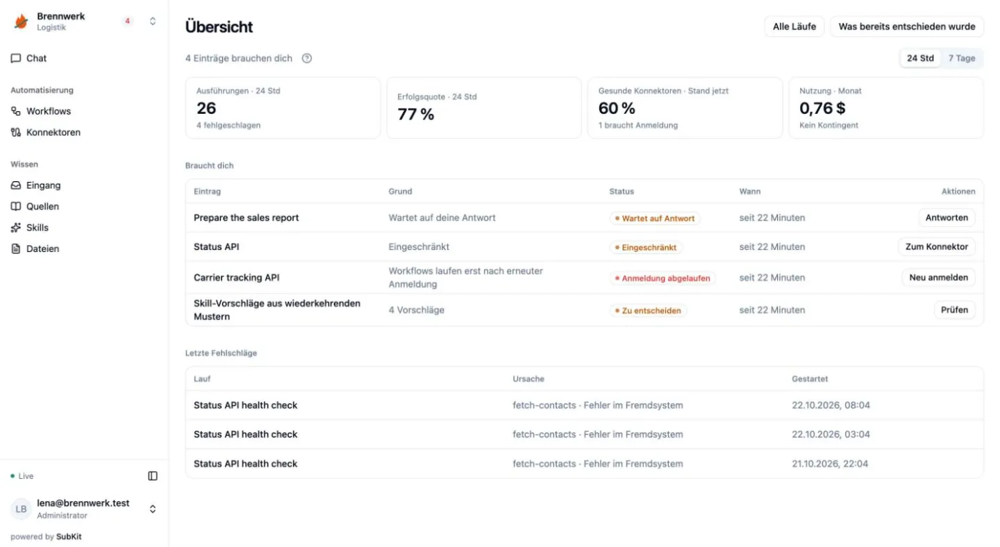

## Was ist SubKit?

SubKit übernimmt wiederkehrende Geschäftsaufgaben, die über mehrere Systeme laufen und heute an einer Person oder einem anfälligen Skript hängen.
Es ist für Teams gedacht, die solche Routine verlässlich laufen lassen wollen, ohne dafür Software zu entwickeln.
Du beschreibst die Aufgabe in eigenen Worten, die KI entwirft daraus einen Workflow, und eine Person prüft ihn und gibt frei, worauf er zugreifen darf.
Danach läuft er in festen Schritten, nur mit den freigegebenen Rechten.
Jeder Run wird aufgezeichnet.

Du arbeitest im Cockpit im Browser, als installierte App oder im Programm SubKit Desktop, mit der Kommandozeile `subkit` oder aus KI-Clients wie Claude Code über MCP; der Web Clipper sammelt dazu Webseiten in deinem Eingang.

Die **Übersicht** zeigt dir auf einen Blick, was gelaufen ist, was gescheitert ist und was auf deine Entscheidung wartet.
Wie du Kosten und das KI-Budget verfolgst, steht in „Nutzung und Kosten im Blick“.

Nutze SubKit Cloud oder betreibe deine eigene Engine:

- „SubKit Cloud nutzen“: SubKit läuft für dich, und du meldest dich im Browser an.
- „Die Engine betreiben“: Du betreibst SubKit auf deinem eigenen Server.

Danach baust du mit „Dein erster Workflow“ deinen ersten Workflow.
Jede Funktion mit ihrer Verfügbarkeit findest du unter [SubKit-Funktionen im Überblick](setup.md#subkit-funktionen-im-überblick).

