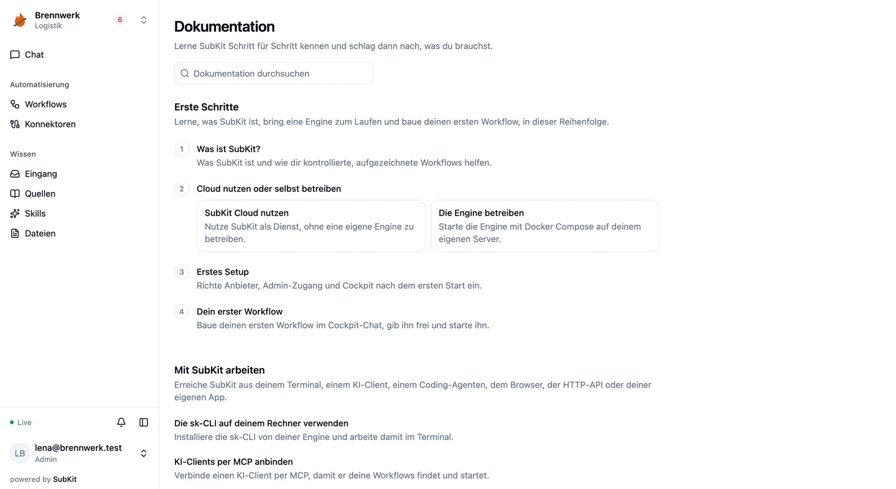

## Was ist SubKit?

SubKit führt deine Geschäftsaufgaben als kontrollierte Workflows aus.
Du beschreibst die Arbeit in einfacher Sprache. Du gibst frei, was sie berühren darf. Jeder Lauf wird aufgezeichnet.

Nutze SubKit Cloud oder betreibe deine eigene Engine:

- „SubKit Cloud nutzen“: SubKit läuft für dich, und du meldest dich im Browser an.
- „Die Engine betreiben“: Du betreibst SubKit auf deinem eigenen Server.

Danach baust du mit „Dein erster Workflow“ deinen ersten Workflow.

