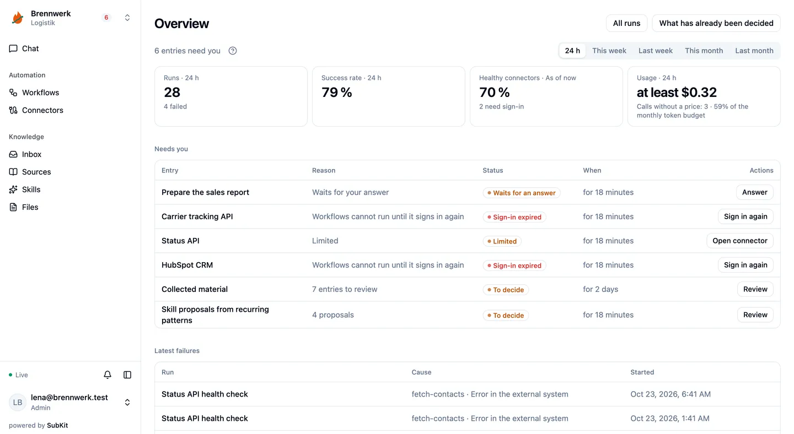
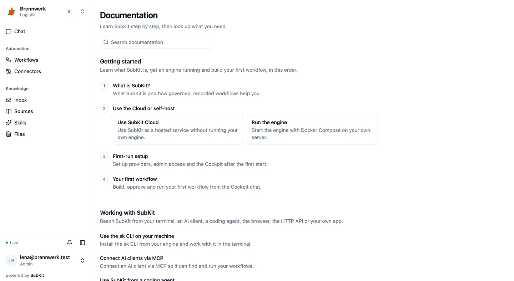

## What is SubKit?

SubKit runs recurring business tasks that span several systems and today depend on one person or a fragile script.
It is for teams that want such routine work to run reliably without writing software for it.
You describe the task in your own words, the AI drafts a workflow from it, and a person checks it and approves what it may touch.
After that it runs in fixed steps, with only the approved permissions.
Every run is recorded.

You work in the Cockpit in the browser, as an installed app or in the SubKit Desktop program, with the `sk` command line, or from AI clients such as Claude Code over MCP; the Web Clipper also collects web pages into your inbox.

The **Overview** shows at a glance what ran, what failed and what is waiting for your decision.
How to track cost and budget is in "Keep track of usage and costs".

Use it as SubKit Cloud or run your own engine:

- "Use SubKit Cloud": SubKit runs for you, and you sign in from the browser.
- "Run the engine": you run SubKit on your own server.

Then build your first workflow with "Your first workflow".

