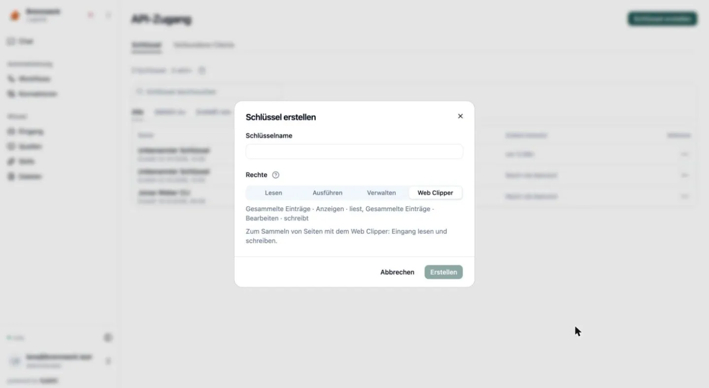

## Webseiten mit dem Web Clipper sammeln

Dieses Kapitel ist für alle, die beim Lesen im Browser Material für ihr Team sammeln.
Du installierst den Web Clipper, verbindest ihn mit deiner Engine und sammelst die erste Seite.
Danach landet, was du für wichtig hältst, mit Quelle in deiner Inbox (im Cockpit **Eingang**) und wartet dort auf eine Prüfung.

Der Web Clipper ist eine Chrome-Erweiterung. Er legt eine Seite, eine markierte Stelle oder ein YouTube-Transkript als Markdown in deine Inbox; Wissen wird daraus erst, wenn eine Person es bestätigt. Du installierst ihn aus dem [Chrome Web Store](https://chromewebstore.google.com/detail/odefbnmjeehgfbanpaajiaocliccldma); dann aktualisiert er sich selbst. Für nicht verwaltete oder Offline-Umgebungen gibt es eine ZIP-Datei und `subkit clipper install`.

Der Weg ist immer gleich: **sammeln → im Chat prüfen → bestätigen → Wissen oder Skill**.

### Was du brauchst

- **Google Chrome.** Microsoft Edge und andere Chromium-Browser sind nicht getestet. Firefox wird nicht unterstützt, weil die Erweiterung einen Hintergrund-Service-Worker von Chrome nutzt.
- **Eine Engine-Adresse** mit HTTPS. Reines HTTP geht nur mit `localhost`, `127.0.0.1` oder `[::1]`. In SubKit Cloud ist es `https://subkit-cloud.mikebild.dev`, ohne `/cockpit`.
- **Ein Konto mit `intake:read` und `intake:write`.** Fehlen sie, bitte eine Administratorin oder einen Administrator darum.
- **Für die Installation per CLI:** die `subkit`-CLI, angemeldet an deiner Engine. Siehe „Die subkit-CLI auf deinem Rechner verwenden“. Sonst nimmst du den Chrome Web Store oder die ZIP-Datei.

### Die Erweiterung installieren

Installier den Web Clipper aus dem Chrome Web Store. ZIP-Datei und CLI sind der Ausweg für nicht verwaltete oder Offline-Umgebungen; alle Wege laden dieselbe Erweiterung.

| Weg | Engine-Adresse | Geeignet für |
| --- | --- | --- |
| [Chrome Web Store](https://chromewebstore.google.com/detail/odefbnmjeehgfbanpaajiaocliccldma) | trägst du beim Verbinden ein | alle; aktualisiert sich selbst |
| ZIP-Datei aus dem neuesten Release | trägst du beim Verbinden ein | alle, auch ohne CLI |
| ZIP-Datei von deiner Engine | trägst du beim Verbinden ein | genau die Version, die deine Engine nutzt |
| `subkit clipper install` | kommt aus deinem aktiven Profil | alle, die die CLI nutzen |

#### Aus dem Chrome Web Store installieren

1. Öffne [SubKit Clipper im Chrome Web Store](https://chromewebstore.google.com/detail/odefbnmjeehgfbanpaajiaocliccldma) und wähle **Hinzufügen** (in englischem Chrome: **Add to Chrome**).
2. Hefte die Erweiterung „SubKit Clipper“ an die Symbolleiste.

#### Die ZIP-Datei herunterladen

1. Lade die neueste Version von [github.com/MikeBild/subkit/releases/latest/download/subkit-clipper.zip](https://github.com/MikeBild/subkit/releases/latest/download/subkit-clipper.zip) herunter. Die Version deiner Engine liegt unter `<Engine-Adresse>/install/clipper.zip`, zum Beispiel `https://subkit-cloud.mikebild.dev/install/clipper.zip`.
2. Entpacke die Datei in einen Ordner, den du behältst. Chrome lädt die Erweiterung aus diesem Ordner.
3. Öffne in Chrome `chrome://extensions` und schalte oben rechts den **Entwicklermodus** ein.
4. Wähle **Entpackte Erweiterung laden** (in englischem Chrome: **Load unpacked**) und den entpackten Ordner.
5. Hefte die Erweiterung „SubKit Clipper“ an die Symbolleiste.

#### Mit der CLI installieren

1. Starte den Installer:

   ```sh
   subkit clipper install
   ```

   Der Befehl entpackt die Erweiterung nach `~/.subkit/clipper`, übernimmt die Engine-Adresse deines aktiven Profils und versucht, die Erweiterungsseite von Chrome zu öffnen. Die Ausgabe nennt den Ordner.
2. Öffne in Chrome `chrome://extensions`, falls es sich nicht selbst geöffnet hat, schalte den **Entwicklermodus** ein und wähle **Entpackte Erweiterung laden** mit dem Ordner aus der Ausgabe.
3. Hefte die Erweiterung „SubKit Clipper“ an die Symbolleiste.

Der Befehl kennt drei Optionen:

| Option | Wirkung |
| --- | --- |
| `--dir <directory>` | Installiert in einen anderen Ordner. |
| `--engine-url <url>` | Nutzt diese Engine-Adresse statt der des aktiven Profils. |
| `--no-open` | Öffnet Chrome nicht. |

### Die Erweiterung aktualisieren

Der Web Clipper aus dem Chrome Web Store aktualisiert sich selbst und zeigt nie einen Update-Hinweis. Ein entpackt geladener Web Clipper bleibt auf seiner Version, bis du ihn ersetzt. Deshalb passt er für dich auf:

- Öffnest du Popup oder Einstellungen, fragt er deine Engine höchstens einmal am Tag nach ihrer Version. Er schickt dabei keinen API-Schlüssel und nichts über deine Seiten.
- Läuft auf der Engine eine neuere Version, zeigen Popup und Einstellungen „Update verfügbar: Version …“ mit dem Link **Herunterladen** zu `<Engine-Adresse>/install/clipper.zip`.

So aktualisierst du:

1. Lade die neue ZIP-Datei herunter und entpacke sie in denselben Ordner, sodass sie die alten Dateien ersetzt. Mit der CLI aktualisierst du zuerst die CLI und führst dann `subkit clipper install` erneut aus.
2. Lade die Erweiterung „SubKit Clipper“ auf `chrome://extensions` neu.

Engine-Adresse und Sprache bleiben erhalten. Den API-Schlüssel fügst du nach dem Neuladen erneut ein.

### Mit deiner Engine verbinden

Der Web Clipper meldet sich mit einem eigenen API-Schlüssel an.

1. Öffne im Cockpit **API-Zugang**.
2. Wähle **Schlüssel erstellen** und die Vorlage **Web Clipper**. Sie gewährt genau `intake:read` und `intake:write`.

   

3. Kopiere den Schlüssel und bewahre ihn in einem Passwortmanager auf.
4. Wähle im Web Clipper das Zahnrad (⚙). Die Einstellungen öffnen sich in einem neuen Tab.
5. Prüfe die **Engine-Adresse** und füge den Schlüssel unter **API-Schlüssel** ein.
6. Wähle **Verbindung speichern**.
7. Erlaube den Zugriff, wenn Chrome danach fragt.

Der Web Clipper prüft die Verbindung, lädt deine Kategorien und bestätigt, dass der Schlüssel Einträge speichern darf.
Nach einem Neustart des Browsers fügst du den Schlüssel erneut ein; warum, steht unter „Datenschutz“.

Ändert sich die Engine-Adresse, brauchst du den Schlüssel der neuen Engine. **API-Schlüssel löschen** entfernt den Schlüssel aus der Erweiterung.

### Eine Seite sammeln

1. Wähle in der Symbolleiste das Symbol „SubKit Clipper“.
2. Prüfe den **Titel**.
3. Optional: Fülle **Warum ist das interessant?** aus.
4. Wähle eine **Kategorie** oder **Neue Kategorie**. Namen bestehen aus Kleinbuchstaben, Ziffern und Bindestrichen, höchstens 40 Zeichen.
5. Prüfe die Vorschau.
6. Optional: Öffne **Details und Inhalt bearbeiten**, um Autor und Datum zu sehen und das Markdown zu ändern.
7. Wähle **Sammeln**.

Schneller geht es per Rechtsklick mit **Seite in SubKit sichern** oder **Auswahl in SubKit sichern**, oder mit **Alt+Shift+K**. Das Tastenkürzel änderst du unter `chrome://extensions/shortcuts`.

Bei Erfolg meldet das Popup zum Beispiel „Gesammelt: research. Noch nicht als Wissen oder Skill übernommen.“ Mit **Im Chat prüfen** startest du die Prüfung sofort.
Schlägt das Speichern fehl, bleibt dein Entwurf im Web Clipper. Ein erneuter Versuch legt nie einen zweiten Eintrag an. Sammelst du eine Seite, deren Eintrag im **Eingang** noch offen ist, fügt SubKit die neue Erfassung diesem Eintrag hinzu, statt einen weiteren anzulegen.

### Wie es weitergeht

1. **Eingang:** Öffne im Cockpit **Eingang** und klicke auf den Eintrag. Auf seiner Seite liest, bearbeitest oder verwirfst du ihn.
2. **Prüfen:** Wähle **Im Chat prüfen** im Web Clipper oder im Menü des Eintrags. Der Chat bereitet einen Vorschlag vor: genauer Inhalt, Quellen und Ziel (Wissen oder Skill).
3. **Bestätigen:** Eine Person, die im Browser am Cockpit angemeldet ist, bestätigt den Vorschlag im Tab **Prüfen** des Eintrags als Quelle oder Skill.

Zum Bestätigen braucht diese Person `intake:confirm` und das Recht des Ziels:

| Ziel | Nötige Rechte |
| --- | --- |
| Wissen | `knowledge:write` |
| Skill | `skill:write` und `skill:activate` |
| Skill, der andere ersetzt | zusätzlich `skill:archive` für jeden ersetzten Skill |

API-Schlüssel, MCP-Clients und der Web Clipper selbst können nicht bestätigen.
Bis zur Bestätigung ist ein Eintrag kein Wissen, und die normale Wissenssuche findet ihn nicht. Verschieben oder Bearbeiten ändert daran nichts; ändert sich der Vorschlag, prüfst du ihn erneut.
Mehr dazu im Kapitel „Ideen sammeln und in Wissen oder Skills verwandeln“.

### Was der Web Clipper erfasst

- **Eine Seite:** den Haupttext des Artikels als Markdown, Links als vollständige Adressen, ohne Navigation und Empfehlungen.
- **Eine markierte Stelle:** nur die Markierung. Über Symbolleiste oder Tastenkürzel nimmt der Web Clipper die Markierung, sonst den ganzen Artikel.
- **Ein YouTube-Video:** Titel, Autor, Veröffentlichungsdatum, Beschreibung und Transkript in der Originalsprache. Beschreibung und Transkript schaltest du unter **Details und Inhalt bearbeiten** einzeln ein oder aus.

Dazu kommen Quelladresse, Autor und Veröffentlichungsdatum, sofern die Seite sie angibt. Bildlinks bleiben im Text; Bilddateien und Screenshots lädt der Web Clipper nicht hoch.

### Datenschutz

- **Ziel:** Einträge und die tägliche Update-Prüfung gehen nur an die Engine, die du eingestellt hast. Für ein Transkript lädt der Web Clipper eventuell Seite und Untertitel direkt von YouTube.
- **Zugangsdaten werden geschwärzt:** Vor dem Speichern ersetzt SubKit erkennbare Zugangsdaten (API-Schlüssel, Tokens, private Schlüssel, Signaturen signierter Links) durch eine Markierung. Die Werte werden nie gespeichert. Personenbezogene Daten bleiben erhalten; sammle deshalb keine Seiten, die Passwörter oder Schlüssel zeigen.
- **Dein API-Schlüssel** liegt nur im Sitzungsspeicher des Browsers und wird nie auf dein Gerät geschrieben. Deshalb fügst du ihn nach einem Neustart des Browsers oder einem Neuladen der Erweiterung erneut ein. Ein Schlüssel aus der Vorlage **Web Clipper** darf nur gesammelte Einträge ansehen und bearbeiten (`intake:read`, `intake:write`), auch die Clips anderer in diesem Arbeitsbereich. Widerrufe ihn im Cockpit, wenn du ihn nicht mehr brauchst.
- **Reichweite des Schlüssels:** Die Vorlage **Web Clipper** erlaubt nur Anzeigen und Bearbeiten gesammelter Einträge (`intake:read`, `intake:write`), auch der Clips anderer Personen in deinem Arbeitsbereich. Widerrufe den Schlüssel im Cockpit, wenn du ihn nicht mehr brauchst.
- **Originale bleiben:** Die Engine bewahrt den ursprünglich erfassten Stand. Spätere Änderungen überschreiben ihn nicht, und der Eintrag bleibt mit dem daraus entstandenen Wissen oder Skill verknüpft.
- **Sichtbarkeit:** Einträge folgen den Rechten deines Arbeitsbereichs. Kategorien sind gemeinsam, nicht privat.

### Wenn etwas nicht klappt

Der Web Clipper zeigt Meldungen in der eingestellten Sprache. **Hilfe** im Popup und in den Einstellungen öffnet dieses Kapitel auf deiner Engine.
Schlägt eine Erfassung per Kontextmenü oder Tastenkürzel fehl, öffnet der Web Clipper sein Popup in einem Tab und zeigt den Fehler dort.

#### Verbindung und Schlüssel

| Was du siehst | Was du tust |
| --- | --- |
| „Lege zuerst eine Engine-Adresse und einen API-Schlüssel fest. …“ oder „Lege vor dem Erfassen eine Engine-Adresse fest.“ | Trage beides in den Einstellungen (⚙) ein und speichere. Nach einem Neustart des Browsers fügst du den Schlüssel erneut ein. |
| „Der API-Schlüssel ist ungültig oder abgelaufen. …“ | Erstelle unter **API-Zugang** einen neuen Schlüssel mit der Vorlage **Web Clipper** und speichere ihn in den Einstellungen. |
| „Dem API-Schlüssel fehlt intake:read. …“ oder „… fehlt intake:write. …“ | Erstelle unter **API-Zugang** einen Schlüssel mit der Vorlage **Web Clipper**. Dein Entwurf bleibt erhalten. |
| „Die SubKit-API ist nicht erreichbar. …“ | Prüfe Engine-Adresse und Internetverbindung und ob Chrome auf die Adresse zugreifen darf. |
| „Nutze HTTPS oder HTTP auf localhost.“ | Nutze `https://`, oder `http://` nur mit `localhost`, `127.0.0.1` oder `[::1]`. Die Adresse darf keinen Benutzernamen, kein Passwort, keine `?query` und kein `#fragment` enthalten. |
| „Erlaube den Zugriff auf diese Engine, um die Verbindung zu speichern.“ | Speichere erneut und erlaube den Zugriff, wenn Chrome fragt. |
| „Gib einen API-Schlüssel für die neue Engine ein.“ | Du hast die Engine-Adresse geändert. Füge den Schlüssel der neuen Engine ein. |
| „Kategorien gerade nicht verfügbar“ | Wähle **Verbindung prüfen**. |

#### Erfassen

| Was du siehst | Was du tust |
| --- | --- |
| „Der Hauptinhalt konnte nicht zuverlässig erfasst werden. …“ | Markiere den relevanten Text und wähle **Neu erfassen**. |
| „Der Inhalt wurde vereinfacht als Text erfasst. …“ | Prüfe in der Vorschau, ob alles da ist. |
| „Es wurde kein Text erfasst. …“ | Wähle **Neu erfassen**. Für einen Ausschnitt markierst du vorher den Text. |
| „Kein Transkript verfügbar.“ | Für dieses Video konnte der Web Clipper kein Transkript lesen. |
| „Öffne den Clipper über die Symbolleiste auf dieser Seite erneut.“ | Chrome braucht Zugriff auf diese Seite. Wähle dort das Symbol in der Symbolleiste. |
| „Die Seite hat sich während der Erfassung geändert. Erfasse sie erneut.“ | Erfasse erneut. |
| „Die Seite konnte nicht erfasst werden.“ | Lade die Seite neu und versuche es erneut. |

#### Sammeln

| Was du siehst | Was du tust |
| --- | --- |
| „Die Speicherung ist noch nicht bestätigt. Versuche es erneut; dein Entwurf bleibt erhalten.“ | Netzwerk oder Engine hatten einen Fehler. Wähle **Erneut versuchen**. |
| „SubKit hat den Clip abgelehnt. …“ | Prüfe Kategorie und Inhalt und versuche es erneut. |
| „Dieser Clip existiert bereits.“ | Dieser Clip wurde schon mit anderem Inhalt gesendet. Erfasse erneut. |
| „Wähle eine gültige Kategorie, bevor du sammelst.“ oder „Gib eine gültige Kategorie ein.“ | Nutze Kleinbuchstaben, Ziffern und Bindestriche, höchstens 40 Zeichen. |
| „Die gespeicherte Kategorie ist nicht verfügbar. Wähle eine andere Kategorie.“ | Wähle eine andere Kategorie. |
| „Dieser Entwurf gehört zu einer anderen Engine.“ | Wechsle zu der Engine zurück, für die er entstand, um ihn zu senden. |
