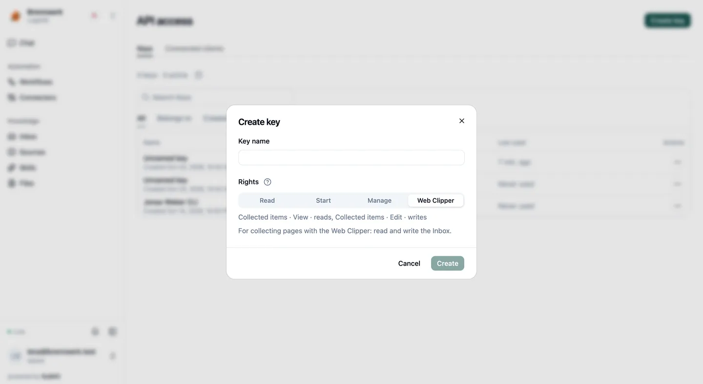

## Collect web pages with the Web Clipper

The Web Clipper sends a web page, a text selection or a YouTube transcript to your engine.
The item waits in the Cockpit **Inbox** until you review it.
Collecting alone never turns anything into knowledge or a skill.

The path is always the same: **collect → review in chat → confirm → knowledge or skill**.

### What you need

- **Google Chrome.** Microsoft Edge and other Chromium browsers are untested. Firefox is not supported: the extension uses a Chrome background service worker.
- **The `sk` CLI**, signed in to your engine. See "Use the sk CLI on your machine".
- **An engine address** that uses HTTPS. Plain HTTP works only on `localhost`, `127.0.0.1` or `[::1]`. In SubKit Cloud it is `https://subkit-cloud.mikebild.info`, without `/cockpit`.
- **An account with `intake:read` and `intake:write`.** If it lacks them, ask an administrator.

The Web Clipper is not in the Chrome Web Store. You install it from the CLI or from a ZIP file of your engine.

### Install the extension

The installer copies your active profile's engine address into the extension. You only add an API key later.

1. Run `sk clipper install`. The command unpacks the extension to `~/.sk/clipper` and tries to open Chrome's extension page.

   ```text
   sk: clipping extension installed to /Users/you/.sk/clipper
   sk: in Chrome, enable Developer mode, select Load unpacked, and choose the directory above. Reload the extension there after a future install.
   ```

   The output names the install folder and the next steps in Chrome.

2. In Chrome, open `chrome://extensions`.
3. Turn on **Developer mode** (top right).
4. Select **Load unpacked** and choose the folder the command printed.
5. Pin the "SubKit Clipper" extension to the toolbar.

If Chrome does not open, the command prints `sk: could not open Chrome automatically`. Open `chrome://extensions` yourself.

### Install without the CLI

Your engine also offers the extension as a ZIP file. It contains no engine address, so you enter it yourself.

1. Download `<engine address>/install/clipper.zip`, for example `https://subkit-cloud.mikebild.info/install/clipper.zip`.
2. Unpack the file into a folder you keep. Chrome loads the extension from that folder.
3. In Chrome, open `chrome://extensions`, turn on **Developer mode** and select **Load unpacked** with the unpacked folder.
4. When you connect, enter the **Engine address** yourself.

To update, unpack the new ZIP file into the same folder and reload the extension.

### Update the extension

After you update the `sk` CLI, install the Web Clipper again. The engine address and language stay. Enter the API key again after the reload.

1. Run `sk clipper install`.
2. On `chrome://extensions`, reload the "SubKit Clipper" extension.

### Connect it to your engine

The Web Clipper signs in with its own API key.

1. In the Cockpit, open **API access**.
2. Select **Create key** and pick the **Web Clipper** preset. It grants exactly `intake:read` and `intake:write`.

   

3. Copy the key.
4. In the Web Clipper, select the gear icon (⚙). The settings open in a new tab.
5. Check the **Engine address** and paste the key into **API key**.
6. Select **Save connection**.
7. Allow access when Chrome asks for it.

The Web Clipper checks the connection, loads your categories and confirms that the key may save items.

If the engine address changes, you also need the key for the new engine. **Clear API key** removes the stored key from the extension.

The Web Clipper keeps the API key only in the browser's session storage and never writes it to this device. After a browser restart or a reload of the extension, paste the key again. Keep it in a password manager, or create a new key with the **Web Clipper** preset.

### Collect a page

1. In the toolbar, select the Web Clipper icon ("SubKit Clipper").
2. Check the **Title**.
3. Optional: fill in **Why is this interesting?**.
4. Pick a **Category**, or select **New category**. Names use lowercase letters, digits and hyphens, up to 40 characters.
5. Check the preview.
6. Optional: open **Details and edit content** to see author and date and to edit the Markdown.
7. Select **Collect**.

You can also right-click and select **Save page to SubKit** or **Save selection to SubKit**, or press **Alt+Shift+K**.

On success, the popup says for example "Collected: research. Not yet admitted as knowledge or a skill." Select **Review in chat** to start the review right away.

Good to know:

- If saving fails, your draft stays in the Web Clipper.
- The same page is never collected twice.
- Change the shortcut at `chrome://extensions/shortcuts`.

### What happens next

1. **Inbox:** in the Cockpit, open **Inbox** and click the item. On its page you read, edit or discard it.
2. **Review:** select **Review in chat** in the Web Clipper or in the item's menu. The chat prepares a proposal: the exact content, its sources and the destination (knowledge or skill).
3. **Confirm:** only a person signed in to the Cockpit in the browser confirms the proposal on the item's **Review** tab as a source or skill.

To confirm, that person needs `intake:confirm` and the right of the destination:

| Destination | Needed rights |
| --- | --- |
| Knowledge | `knowledge:write` |
| Skill | `skill:write` and `skill:activate` |
| Skill that replaces others | also `skill:archive` for each replaced skill |

API keys, MCP clients and the Web Clipper cannot confirm.

Until someone confirms it, an item is not knowledge, and ordinary knowledge search does not find it.
Moving or editing it does not admit it either.
If the proposal changes, you review it again.
The chapter "Collect ideas and turn them into knowledge or skills" walks through review and confirmation.

### What the Web Clipper captures

- **A page:** the main article text as Markdown, links as absolute addresses, without navigation and recommendations.
- **A selection:** only the selected text. From the toolbar or the shortcut, the Web Clipper uses your selection if there is one, otherwise the whole article.
- **A YouTube video:** title, author, publish date, description and the transcript in the original audio language. Include or exclude description and transcript under **Details and edit content**.

It also keeps the source address, author and publish date when the page provides them. Image links stay in the text. Image files and screenshots are not uploaded.

### Privacy

- **Destination:** items go only to the engine you configured. For the transcript, the Web Clipper may also load the page and captions directly from YouTube.
- **Originals stay:** the engine keeps the original captured snapshot. Later edits do not overwrite it, and the item stays linked to the knowledge or skill made from it.
- **Credentials are replaced:** before saving, SubKit replaces recognizable credentials (API keys, tokens, private keys, signed-link signatures) with a marker. The values are never stored. Personal data is kept. Don't clip pages that show passwords or keys.
- **Your API key** stays in the extension only until the browser closes and is not written to this device. A key made from the **Web Clipper** preset grants only collecting. Revoke it in the Cockpit when you no longer need it.
- **Visibility:** items follow the permissions of your workspace. Categories are shared, not private.

### Install options

| Option | What it does |
| --- | --- |
| `--dir <directory>` | Installs to another folder. |
| `--engine-url <url>` | Uses this engine address instead of the active profile's. |
| `--no-open` | Does not open Chrome. |

### If something does not work

The Web Clipper shows messages in the selected language. **Help** in the popup and in the settings opens this chapter on your engine. If a capture from the context menu or the shortcut fails, the Web Clipper opens its popup in a tab and shows the error there.

#### Connection and key

| What you see | What to do |
| --- | --- |
| "Set an engine address and API key first. …" or "Set an engine address before capturing." | Enter both in the settings (⚙) and save. After a browser restart, paste the key again. |
| "The API key is invalid or expired. …" | Create a new key with the **Web Clipper** preset under **API access** and save it in the settings. |
| "The API key lacks intake:read. …" or "… lacks intake:write. …" | Create a key with the **Web Clipper** preset under **API access**. Your draft stays. |
| "The SubKit API could not be reached. …" | Check the engine address, your internet connection and whether Chrome may access the address. |
| "Use an HTTPS address or HTTP on localhost." | Use `https://`, or `http://` only with `localhost`, `127.0.0.1` or `[::1]`. The address must not contain a user name, a password, a `?query` or a `#fragment`. |
| "Allow access to this engine to save the connection." | Save again and allow access when Chrome asks. |
| "Enter an API key for the new engine." | You changed the engine address. Paste the key for the new engine. |
| "Categories currently unavailable" | Select **Check connection**. |

#### Capturing

| What you see | What to do |
| --- | --- |
| "The main content could not be captured reliably. …" | Select the relevant text, then select **Capture again**. |
| "The content was captured as simplified text. …" | Check the preview for completeness. |
| "No text was captured. …" | Select **Capture again**. For an excerpt, select the text first. |
| "No transcript is available." | The Web Clipper could not read a transcript for this video. |
| "Open the clipper from the toolbar on this page again." | Chrome needs access to this site. Select the toolbar icon on that page. |
| "The page changed while it was being captured. Capture it again." | Capture again. |
| "The page could not be captured." | Reload the page and try again. |

#### Collecting

| What you see | What to do |
| --- | --- |
| "Saving is not confirmed yet. Retry; your draft remains available." | The network or the engine failed. Select **Try again**. |
| "SubKit rejected the clip. …" | Check the category and the content, then try again. |
| "This clip already exists." | It was already collected. |
| "Choose a valid category before collecting." or "Enter a valid category." | Use lowercase letters, digits and hyphens, at most 40 characters. |
| "The saved category is unavailable. Choose another category." | Pick another category. |
| "This draft belongs to a different engine." | Switch back to the engine it was made for to send it. |
