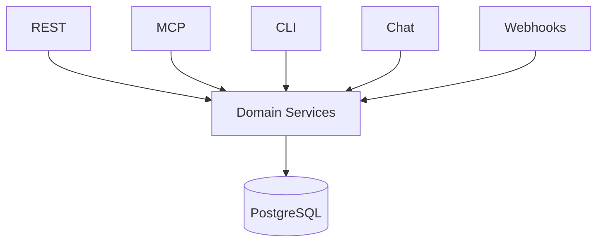

# 01 — Concept

## Problem statement

| Approach | Strength | Weakness |
| --- | --- | --- |
| Visual builders | Fast to demo | Brittle under VCS, impossible for AI to drive |
| Code-first runners | Full control | Credentials, retries, scheduling, tenancy on operator |
| subkit | AI-assisted, headless | No GUI, no visual builder |

subkit sits in the gap: a headless backend workflow engine that runs as a single compiled binary next to PostgreSQL, speaks an explicit domain language, and exposes every operation through typed contracts an LLM can propose, test, and commit with a human checking its work.

- The surface is the domain language plus the handful of primitives needed to operate it
- When the engine needs to do something unusual, it uses the same primitives an external user would: a Connector, a Step, a Skill, a Tool call

## Product shape

| Surface | Description |
| --- | --- |
| REST | Canonical surface. Every operation via `/v1/...` routes generated from a single Zod schema, published as `openapi.json` |
| MCP | Model Context Protocol server over Streamable HTTP and stdio. Workflows are tools, Connectors are resources, Skills are prompts, Conversations are a tool cluster. Long calls stream progress notifications |
| CLI | Typed `subkit` command-line client consuming the in-repo typed REST client with an Ink-based conversational authoring mode |
| Chat | Slack, Microsoft Teams, Google Chat. Slash commands, native interactive approvals, severity-routed alerts |
| Webhooks | Standard Webhooks compliant inbound/outbound. Inbound endpoints verify signatures per connector. Outbound subscriptions fan out internal events with signed, retried, replay-protected delivery |

- A small companion agent binary opens an outbound WebSocket Tunnel to the engine, registers target names, and routes connector calls through the open socket
- The agent ships from the same codebase as a separate compile target

## Non-goals

subkit is explicit about what it does not do:

- **No GUI.** There is no visual dashboard, no web console, no drag-and-drop canvas.
- **No low-code visual builder.** Workflows are authored through the typed REST API, the MCP server, the CLI, or a chat thread — never a graphical editor.
- **No email notifications.** Email is not a notification channel. A tenant who needs email can build an email connector and drive it from a workflow.
- **No workflow templates.** Only connector templates are curated. Complete pre-built workflows are out of scope.
- **No automatic skill evolution.** Skills are hand-authored. The engine does not generate, mutate, or reflect on skills from past executions.
- **No horizontal cluster mode.** Multiple instances can share Postgres behind a load balancer, but there is no formal cluster protocol.
- **No pluggable queue.** The queue is `pg-boss` and only `pg-boss`. Postgres is the only stateful dependency the engine itself requires.

## Operating principle: compact dependency surface

The stack is tuned for a single Bun-compiled binary with the smallest credible dependency tree.

| Concern | Rule | Implementation |
| --- | --- | --- |
| Stateful deps | Postgres only | pg-boss, LISTEN/NOTIFY, outbox — queues, cron, pub/sub all inside Postgres |
| Libraries | One library per two concerns | `openid-client` (OIDC login + connector OAuth2), `jose` (JWT verify for Teams, Google Chat, signed cookies) |
| Small problems | Refuse libraries for fifty lines of app code | API-key hashing, webhook signing, LISTEN reconnect, Docker Engine HTTP, Slack sig verify, tunnel framing, in-process event bus — all hand-written |
| Streaming | Native Web Streams and AsyncIterables | Replace RxJS everywhere. Only WebSocket surface is the Tunnel agent; everything else streams over SSE with `Last-Event-ID` resumption |
| Justification | Every pick carries a one-line trade-off | Choices that cannot be justified in one sentence get replaced with application code |

- Trade-off: the dependency budget sits at roughly twenty runtime packages, enforced in the lockfile
- Trade-off: the binary boots in seconds, ships as a distroless image, and is cheap to read in full
