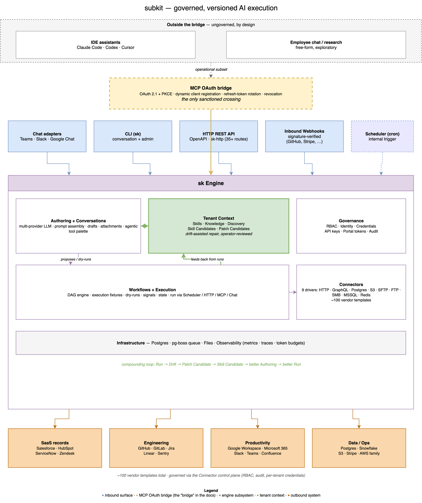

# The Platform

sk is a self-hostable, multi-tenant engine for **governed, versioned, AI-assisted
workflow execution** against the systems an organisation already runs. It uses AI grounded
on the organisation's own context to lower the cost of *authoring* a workflow, while keeping
*execution* deterministic and auditable.

The problem it addresses: models, agents, and integration platforms are all mature, but
turning an organisation's specific structure, knowledge, and ways of working into
repeatable, reviewable automation still happens ad-hoc — in private scripts and chat
histories that do not compose across teams.

Concretely, sk produces a versioned, reviewable workflow artefact in the authoring phase,
then governs and runs it deterministically in production — with a closed feedback loop
(drift detection → operator-reviewed Patch and Skill Candidates → improved next authoring
run). The contextual grounding lowers the cost of authoring; the engine guarantees that what
runs in production is exactly what a human approved; the learning loop makes each subsequent
run better-grounded than the last.

*The full architecture at a glance. Inbound surfaces (Chat · CLI · HTTP REST API · Inbound Webhooks · Scheduler) reach the engine directly; external AI clients cross the **MCP OAuth bridge** (yellow, dashed). The engine groups into six clusters: Authoring + Conversations, Tenant Context, Governance, Workflows + Execution, Connectors, Infrastructure. Source: [`overview.drawio`](overview.drawio).*

---

## What sk Is

sk is a governed workflow platform. It combines a conversational authoring surface with a strict execution engine, connected by an explicit human approval step.

When a user describes what they need in natural language, the AI proposes a workflow. That proposal is reviewed and approved by a human. Once approved, the workflow runs deterministically — no AI inference, no hallucination risk, no hidden behavior. The platform records every state change in an immutable audit log.

sk is built for enterprise use: multi-tenant by design, RBAC-enforced at every boundary, and observable by default.

In addition to the conversation-driven authoring loop, sk exposes direct workflow and execution APIs. Clients can list workflows, manage versions, and execute persisted workflows, draft definitions, or single steps through the same governed runtime contract centered on `POST /v1/executions`.

---

## What sk Is Not

Understanding what sk is not helps clarify where it fits.

- **Not a chatbot.** Conversations in sk produce versioned, executable workflows — not advice or summaries. The AI is an authoring assistant, not a product in itself.
- **Not a no-code tool.** There is no visual canvas, no drag-and-drop builder, no GUI dashboard. Authoring happens through the CLI, the MCP server, chat platforms, or the REST API.
- **Not an AI wrapper.** The execution engine is not an AI agent. Once a workflow is approved and committed, it runs as a typed, deterministic DAG. The AI is not involved at execution time.
- **Not a general workflow SaaS.** sk does not aspire to be a horizontal automation platform. It is purpose-built for enterprises that need AI-assisted authoring, strong governance, and traceable execution.

---

## The Three-Layer Story

Every interaction with sk flows through three layers.

### Layer 1 — Input Surfaces

Users reach sk through multiple entry points: the sk CLI (a conversational terminal interface), the REST API, the MCP server (for AI coding tools like Claude Code or GitHub Copilot), chat platforms (Slack, Teams, Google Chat), webhooks, and scheduled triggers. Each surface leads to the same governed pipeline. The platform does not privilege one entry point over another — all paths carry the same identity, RBAC, and audit semantics.

### Layer 2 — AI-Assisted Authoring

When a user starts a Conversation, the AI enters an authoring loop. It proposes workflow structure, suggests Connectors and Steps, validates the draft against available integrations and Knowledge Sources, and iterates based on user feedback. The AI uses structured authoring actions internally — it does not generate free-form code. Every proposal is surfaced to the human for review. Nothing advances to production without an explicit approval gate.

### Layer 3 — Deterministic Execution

Once a workflow is approved and committed, the execution engine runs it as specified. Executions are immutable records: each run carries its own state, step-by-step results, logs, and final status. The engine does not re-interpret or adapt the workflow at runtime. Schedules, webhooks, and direct API calls all trigger the same deterministic path through the same governance layer.

---

## Core Design Principles

These principles are not aspirational — they are enforced by the architecture.

### 1. Conversation First

All authoring starts with natural language. A user describes their goal; the AI proposes a structured workflow. The Conversation is the primary authoring session, and it is persistent and resumable. Users do not write workflow definitions by hand.

### 2. Human in the Loop

The AI proposes; humans approve. Before any workflow reaches production, an operator or authorized user explicitly commits it. Sensitive authoring actions within a Conversation — such as committing a Draft or applying a Patch Candidate — pause the AI loop and wait for a human decision. Approval is not a UX feature; it is an architectural checkpoint.

### 3. Deterministic Execution

The execution engine is not an AI agent. Once a workflow is committed, it runs exactly as defined: a typed DAG of Steps, each with declared inputs, outputs, retry policy, and error handling. There is no inference, no re-planning, and no emergent behavior at runtime. What was approved is what runs.

### 4. Tenant Isolation

Every resource in sk — workflows, connectors, credentials, users, skills, conversations — belongs to exactly one Tenant. Multi-tenancy is not a configuration option; it is structural. No shared state crosses tenant boundaries. Every API route, every execution, and every audit entry is scoped to a tenant.

### 5. Audit by Default

Every state change produces an immutable entry in the Audit Log: what changed, who initiated it, from which surface, and when. Workflow commits, credential writes, skill promotions, approval decisions, and schedule fires all generate audit entries. The audit log cannot be modified or deleted.

### 6. Provider Agnostic

The AI layer is not tied to a single model provider. Claude, OpenAI, and Gemini are all supported and interchangeable. The platform abstracts the AI provider so that operator preferences, compliance requirements, or cost trade-offs can drive model selection without changing the authoring or execution architecture.

---

## Who sk Is For

sk is designed around three distinct personas, each interacting with the platform differently.

**End Users** are the people describing workflow goals. They may be business analysts, operations staff, or developers who want to automate a process without building infrastructure from scratch. They interact through whichever conversational surface they already live in — the sk CLI's conversational REPL (interactive prompt with `/`-slashes for approval, listing, draft inspection, and execution, and `@`-mentions for connectors, skills, workflows, executions, and patch candidates as first-class context), a chat workspace (Slack, Teams, or Google Chat), or an MCP-connected AI client (Claude.ai, ChatGPT custom connectors, Cursor). The authoring loop, the slash commands, and the mention semantics are the *same* across these surfaces — only the render target differs. They need the platform to understand their intent, propose something useful, and make approval and execution straightforward.

**Operators** run the engine for teams and organizations. They configure connectors, manage credentials, set RBAC policies, curate skills, review Patch Candidates, and monitor execution health. They need visibility into what is running, confidence that the governance controls are working, and tools to intervene when something drifts.

**Developers** build on the platform — extending it with custom connectors, integrating it into existing systems via the REST API or MCP server, or embedding sk's capabilities into their own products. They need well-typed, stable interfaces; a reliable audit trail; and a clear separation between the platform's concerns and their own.

---

## What to Read Next

- [docs/02-concepts.md](02-concepts.md) — Authoritative glossary. Every term used across all sk documentation is defined exactly once here.
