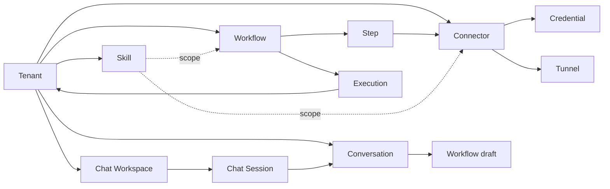

# 02 — Domain Model

This file defines every noun the rest of the documentation uses. Terms are grouped by concern. The glossary is authoritative: if a doc uses a term, the definition lives here.

## Automation Core

### Workflow
A declarative, versioned DAG of Steps with typed input and output schemas. Every upsert produces a new Workflow Version. A workflow is tenant-scoped and has a lifecycle (`draft | active | archived`). Example: a workflow that fetches yesterday's invoices from a billing system, filters them by status, and posts a summary to a reporting channel.

### Step
A node in a Workflow DAG. Kinds are `request`, `transform`, `call`, `wait`, `branch`, `parallel`, and `loop`. Each Step declares retry policy, timeout, `onError: fail | continue`, an optional `response_filter` for sensitive-field masking, and an optional `data_selector` that projects a JSONPath-style subset of the output. Example: a `request` Step that issues a `GET /invoices` against a Stripe Connector, masks `customer.email`, and selects `$.data[*].id`.

### Connector
A typed handle to an external system. Drivers include HTTP, Postgres, S3, GraphQL, and message-bus targets. A Connector bundles `baseUrl` or DSN, authentication configuration, ingested documentation, a driver, an optional Tunnel binding, and an Environment tag. Example: a HubSpot Connector in the `prod` Environment bound to a Tunnel that reaches the customer VPC.

### Credential
An encrypted secret bound to a Connector. Modes are `none`, `header`, `query`, `bearer`, `basic`, and `oauth2`. OAuth2 Credentials auto-refresh. All Credentials are encrypted at rest with AES-256-GCM.

### End-User Credential
A Credential supplied by an end user rather than by a tenant operator. At request time it combines with the Connector's Credential in either MERGE mode, where end-user fields overlay operator fields, or REPLACE mode, where end-user fields fully override operator fields. Enables third-party end-user flows.

### Environment
A tag on a Connector: `dev` or `prod`. The composite identity `(connector_id, environment)` lets the same logical Connector exist independently in each environment. Every Execution carries an `execution_mode` of `dev` or `prod` and is routed accordingly.

### Execution
A concrete run of a Workflow. Its state transitions are `queued → running → succeeded | failed | aborted | timed_out`. An Execution carries a Request Source, an `execution_mode`, an optional `parent_execution_id` for `call` chains, and a `result_storage_uri` when its payload is offloaded to object storage. Executions are queryable by filter and free-text search.

### Request Source
A first-class dimension recorded on every Execution: `api`, `cli`, `scheduler`, `mcp`, `webhook`, `tool-chain`, or `ui`. Used for filtering, metrics, Notification Rule matching, and Policy decisions.

### Schedule
A cron expression bound to a Workflow. Schedules are reconciled at boot and on writes, and their fires are enqueued onto `execution.run` via the scheduler. Example: a Schedule that runs the invoice-summary Workflow every weekday at 06:00 UTC.

## Identity & Access

### Tenant
The top multi-tenancy boundary. Every row in the schema carries `tenant_id`. A Tenant owns its Users, System Accounts, Connectors, Workflows, Skills, Conversations, and Chat Workspaces.

### User
A human identity inside a Tenant. Users sign in through an Auth Provider and carry a role of `admin`, `member`, or `enduser`.

### System Account
A non-human identity inside a Tenant. System Accounts are used by external systems and cannot log into any interactive surface; they authenticate exclusively via API Keys.

### API Key
A revocable bearer token bound to either a User or a System Account. Stored as a public `prefix` plus a `sha256(token)` digest. Carries `scopes`, `allowed_workflows`, `allowed_connectors`, `not_before`, `expires_at`, `last_used_at`, and `rotated_from_id`. Supports overlap-window rotation and batched async `last_used_at` flushing.

### Portal Token
A scoped, expiring token issued to a specific end user that grants access to exactly one or a named set of Workflows. Portal Tokens are a specialized flavor of API Keys with tighter default TTL. They enable third-party end-user flows without provisioning full User accounts.

### Policy
The RBAC plus ABAC rules enforced at REST, MCP, and webhook edges, and re-checked inside the Execution Engine when a Step invokes another Workflow through a `call`.

### Auth Provider
A pluggable driver that resolves an inbound request — HTTP, MCP handshake, or CLI session — into a Principal and an effective Policy. Every edge request walks an Auth Provider chain in configured order; the first provider that returns a non-null Principal wins. Providers optionally implement login, refresh, and revoke hooks for interactive flows. v1 ships with `oidc` and `api_key`. New providers are added as single-file plugins without changes to the engine core. Example: a tenant enables the `api_key` provider for machine traffic and the `oidc` provider for human traffic, in that order.

### Before-Request Hook
A per-role interceptor that runs before every outbound `request` Step. Receives the Principal, Connector, method, URL, headers, query, body, Step configuration, and a `is_mutating` flag. Hook expressions are JavaScript executed inside the same QuickJS-WASM sandbox used by `transform` Steps, with a tight interrupt budget and no host-globals or network access. Any error, timeout, or unexpected throw fails closed and denies the request. Hooks are versioned and audited per role.

## AI & Context

### Skill
A curated LLM-context record. Scopes are `global`, `connector`, or `workflow`. Each Skill carries body, examples, best practices, pitfalls, doc references, version, and lifecycle (`draft | active | archived`). Skills are authored by operators through CLI, REST, or the admin surface, or promoted from Skill Candidates with human approval. Example: a Stripe Connector Skill that documents idempotency-key conventions and the platform's 429 behaviour.

### Skill Candidate
A proposed skill improvement detected from execution patterns. Kinds: `repair_pattern`, `failure_pattern`, `success_pattern`. Each candidate carries a confidence level (`low | medium | high`), evidence linking to source executions/patches, and a lifecycle (`proposed | approved | rejected | superseded`). Skill Candidates are never auto-promoted — a human must approve each one before it becomes an active Skill.

### Knowledge Source
A persistent, tenant-scoped knowledge base from uploaded files (PDF, DOCX, HTML, Markdown, plaintext, CSV, XLSX). Each source is chunked into `Knowledge Source Chunks` indexed via tsvector for semantic search. Scopes: `global` or `workflow`. Refresh strategies: `manual`, `scheduled` (cron), `webhook`. Loaded into Context Enhancement between Skills and Connector Docs at a 15% token budget allocation.

### Knowledge Source Chunk
A paragraph-level segment of a Knowledge Source, indexed for full-text search. Chunks carry content, tsvector index, byte size, and ordering within the parent source.

### Context Enhancement
The prompt-assembly pipeline. A base prompt is augmented with Skills in scope order, then with Knowledge Sources, then with Connector documentation, then with prior failures when the flow is a repair run, then with the user's turns. A per-tenant token budget caps the assembled prompt against the effective model's context window.

### Discovery Run
A one-shot LLM analysis of uploaded enterprise files. The engine analyzes files and synthesizes Discovery Artifacts — proposed Connectors, Skills, and Knowledge Sources inferred from the content. Each run tracks status (`pending | analyzing | synthesizing | completed | failed`) and links to uploaded Discovery Files.

### Discovery Artifact
A proposed entity (Connector, Skill, or Knowledge Source) inferred by a Discovery Run. Each artifact carries a confidence score (0–100), evidence (file excerpts + file IDs), and a lifecycle (`proposed | approved | rejected | superseded`). Approved artifacts are materialized into real entities.

### Conversation
A persistent, resumable AI authoring session that targets a draft Workflow or Connector. Conversations stream over SSE on REST and over MCP progress notifications on the MCP surface. The tool-use loop is bounded and operates over a palette of 14+ structured-intent tools (`list_skills`, `fetch_connector_docs`, `propose_step`, `update_param`, `connect_steps`, `dry_run_step`, `validate_draft`, `request_human_approval`, `commit_draft`, `search_knowledge`, `propose_connector`, `propose_skill`, `list_skill_suggestions`). Sensitive tools pause the loop by creating an approval row and resume on decision.

### Self-healing
The engine's bounded repair loop. When a Step fails with a drift signal, the engine diffs the response against the last known Schema Version, refreshes upstream documentation, runs a narrow LLM tool loop (`update_field_path`, `rename_param`, `change_type`, `add_header`), dry-runs candidate patches against a recorded Execution Fixture, and writes a Patch Candidate. The default auto-apply policy is safe-patches only; anything else parks for review.

### Execution Fixture
A recorded `(request, response)` sample captured from a past successful Step run. Fixtures are the dry-run corpus for Self-healing patches.

### Schema Version
A tracked schema snapshot for a specific Connector endpoint. Schema Versions let the engine diff new responses against historical shapes and classify drift.

### Patch Candidate
A proposed repair generated by Self-healing. Each Patch Candidate carries the diff, a classification (`safe` or `unsafe`), the fixture it was dry-run against, and an audit trail. Policy decides whether to auto-apply, queue for review, or notify.

## Eventing & Integrations

### Event
An internal message written to the `events` outbox table inside the same transaction as the domain write that produced it. Examples include `execution.succeeded`, `execution.failed`, `workflow.updated`, `connector.oauth.refreshed`, `patch.proposed`, and `apikey.rotated`.

### Subscription
A tenant-owned outbound route: `(event_pattern, target_url, secret, filters, active)`. A Subscription matches Events and fans them out to external systems as Webhook Outbound deliveries.

### Webhook Inbound
A `/v1/hooks/:slug` endpoint bound to a Workflow. Verifies signatures using the Standard Webhooks spec by default, with connector-native verifiers (for example GitHub or Stripe) pluggable per row. Replay-id dedup protects against double delivery.

### Webhook Outbound
An outbound delivery signed per the Standard Webhooks spec, with `webhook-id`, `webhook-timestamp`, and `webhook-signature` headers, multi-signature rotation support, and a five-minute replay window. Delivery retries follow a Stripe-style cadence with jitter, dead-letter on permanent failure, and trip a per-subscriber circuit breaker after repeated failures.

### Chat Adapter
A pluggable driver for a chat platform. Implementations exist for Slack, Microsoft Teams, and Google Chat. Every adapter implements a common interface to receive inbound events (mentions, slash commands, interaction callbacks, modal submissions), post outbound messages, update messages in place for progressive streaming, and render approval prompts as platform-native interactive elements. A single engine instance can host multiple adapters simultaneously.

### Chat Workspace
A per-tenant binding `(tenant_id, platform, workspace_id, bot_credentials, default_channel)` between a chat installation and a Tenant. One row per Slack workspace, one per Teams team, one per Google Chat space. Install-time OAuth flows populate `bot_credentials`.

### Chat Identity
A per-user binding `(user_id, platform, workspace_id, platform_user_id, linked_at)` mapping a chat-platform user to a User inside the Tenant. Linking is user-initiated through a `/subkit link` slash command that issues a signed, short-lived, single-use deeplink back to the engine's OIDC login.

### Chat Session
A binding between a chat thread (Slack thread, Teams reply chain, Google Chat thread) and exactly one Conversation. The same structured-intent tool loop that powers `subkit chat` runs inside the Chat Session, with approval prompts rendered as interactive buttons or cards. Chat Sessions are resumable and outlive client restarts.

### Chat Event
A normalized internal envelope for inbound events from any Chat Adapter. Carries `platform`, `workspace_id`, `thread_id`, `user_id`, `kind` (`mention`, `slash_command`, `interaction`, `modal_submit`), `text`, `args`, and a `raw` payload.

### Chat Delivery
An outbound chat message queued for delivery. Lives on the `chat.deliver` queue with retries and a per-workspace rate-limit gate that honors each platform's published caps.

### Notification Rule
A tenant-defined rule that matches `(event_pattern, workflow_id_pattern, status, request_source[], severity)` and targets one or more chat workspaces or channels. Severity buckets control routing and per-channel quiet hours. Notification Rules never target email.

### Tunnel
A first-class reachability primitive for private networks. A companion agent binary opens a persistent outbound WebSocket from inside the customer network, registers one or more named targets, and the engine routes specific Connector requests through the open socket. Keepalive, reconnect, and per-target concurrency caps are built in.

## Relationships

