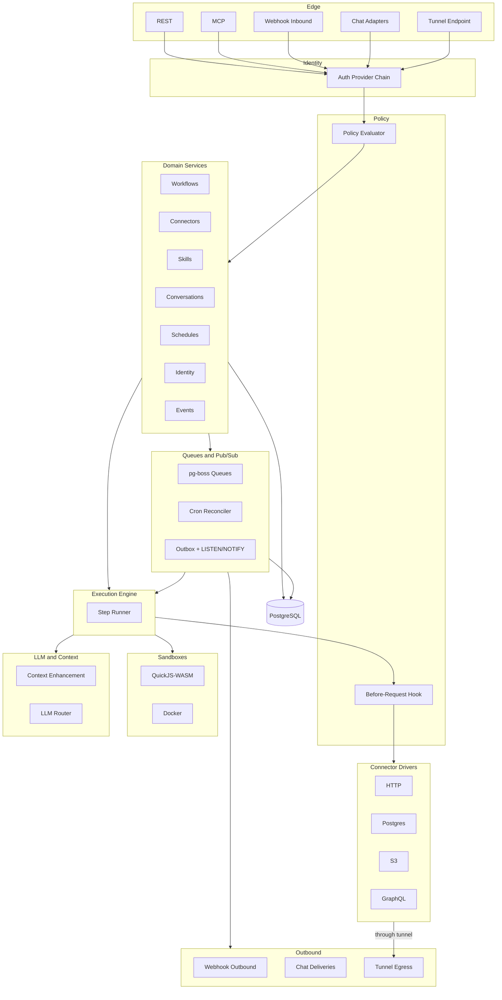
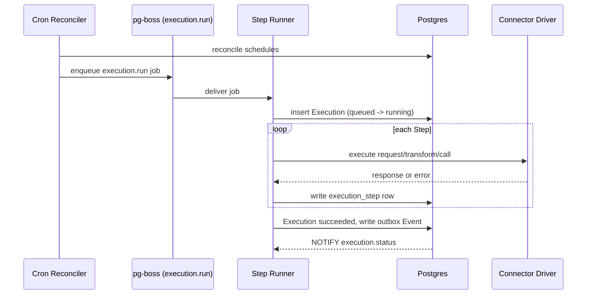
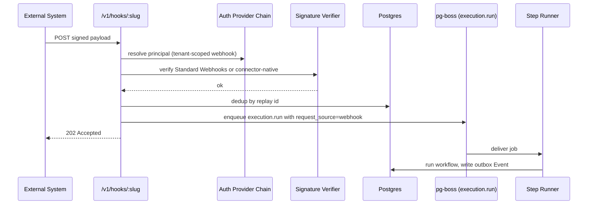
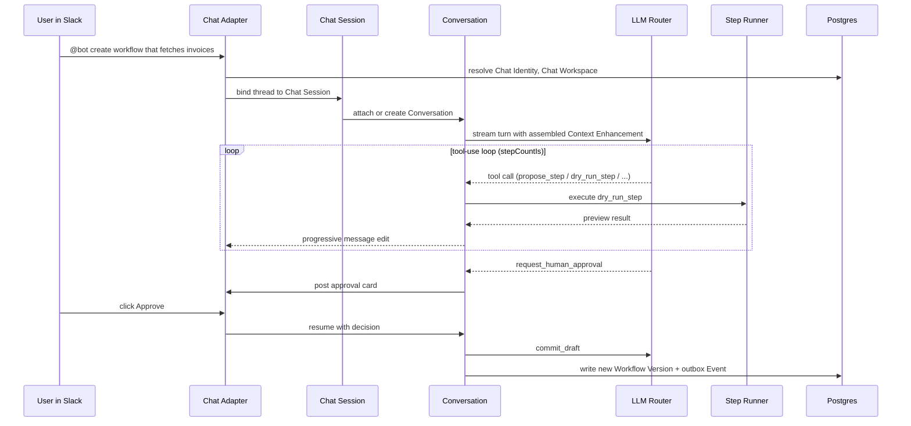
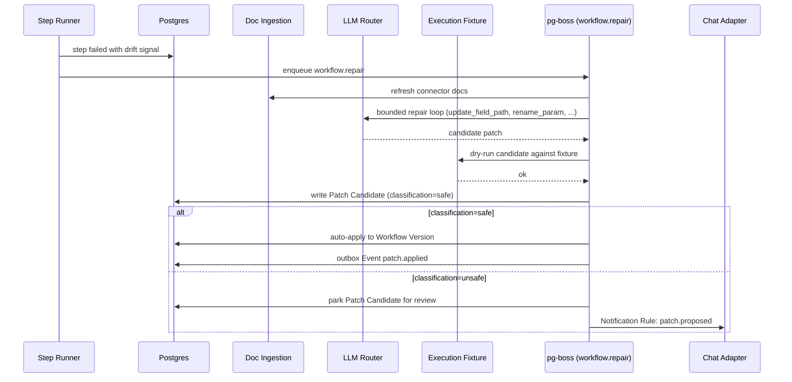
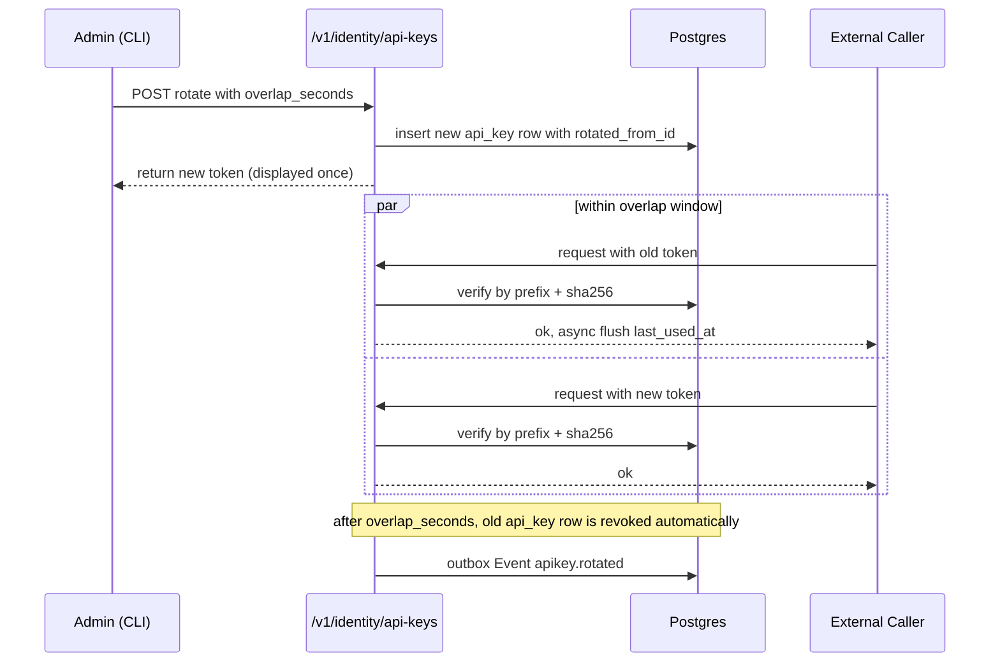

# 03 — Architecture

The engine is a single Bun-compiled binary organized into layers. Edge protocols (REST, MCP, inbound webhooks, chat adapters, tunnel endpoints) funnel every request through a single Auth Provider chain that resolves a Principal; the Principal then flows into a Policy check before domain services touch any state. Domain services mutate Postgres inside transactions that also write to the outbox; the Execution Engine walks Workflow DAGs and dispatches Step work to in-process sandboxes, Docker sandboxes, or Connector Drivers. Background work is scheduled through pg-boss queues and cron, and pub/sub happens through Postgres LISTEN/NOTIFY fed by the outbox. Outbound surfaces — webhook deliveries, chat deliveries, tunnel egress — are just consumers of those queues.

## System diagram



## Sequence: scheduled workflow run



## Sequence: inbound-webhook-triggered workflow run



## Sequence: conversational authoring inside a chat thread



## Sequence: self-healing patch proposal and safe-patch auto-apply



## Sequence: API-key rotation with overlap window



## Boot sequence

The process starts by validating environment variables against a Zod schema and failing fast on any missing or malformed value. It then opens a Postgres connection pool and runs pending migrations. Once the schema is current, the Auth Provider registry imports every enabled provider file, each provider declares its capability surface, and the registry orders the chain per edge. pg-boss initializes its internal tables and starts its queue workers. The Cron Reconciler then walks every Schedule row and aligns it with pg-boss's cron registry so that schedule writes made while the engine was offline are not lost. The MCP server mounts onto the Hono router, the HTTP server binds and starts listening, and finally a dedicated `pg.Client` opens a LISTEN connection for every outbox channel and begins draining any events produced while the listener was offline by querying `events` rows whose id exceeds the `outbox_cursors` watermark.

```ts
// illustrative boot outline (not production code)
async function boot() {
  const env = validateEnv(process.env);                       // zod schema, fail fast
  const db = await connectPostgres(env.DATABASE_URL);
  await runMigrations(db);
  const auth = new AuthProviderRegistry();
  await auth.loadEnabled(env.AUTH_PROVIDERS);
  const boss = new PgBoss(env.DATABASE_URL);
  await boss.start();
  await reconcileSchedules(db, boss);
  const app = buildHonoApp(db, auth, boss);
  mountMcpServer(app, db, auth);
  const server = Bun.serve({ port: env.PORT, fetch: app.fetch });
  await openOutboxListener(db);                               // LISTEN + catch-up
  return { db, boss, server };
}
```
