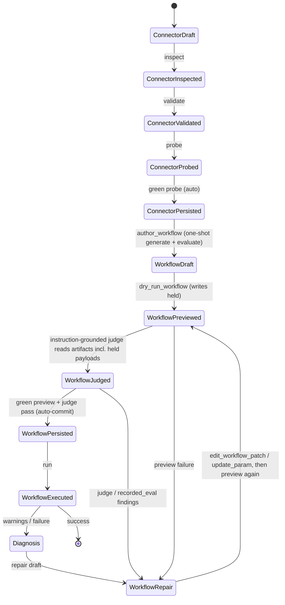
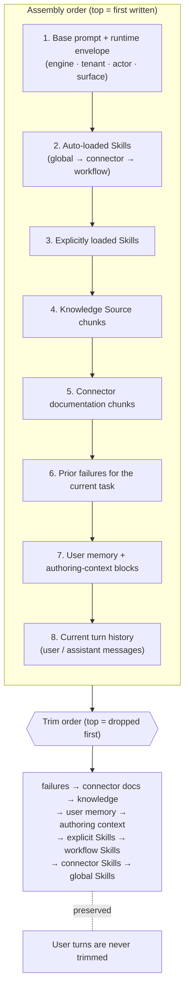

# AI-Assisted Authoring

> **Reading time:** ~18 min
> **Audience:** Engineers integrating with the reference implementation's authoring, operators curating Skills & Knowledge
> **Strategy context:** developer view of contextualised AI authoring; the economic argument behind it (vs. classical builders / BPMN / low-code / engineering) lives in [§2 of positioning](./positioning.md#2-the-core-contextualised-operational-ai-authoring--governed-execution), the system requirement is [context as authoring input (R2)](./system-requirements.md#r2--context-as-a-first-class-input-to-authoring).

Traditional enterprise workflow tools put the burden of construction on the builder. You need to know the connector, understand the configuration syntax, and map it all onto a blank canvas. The result is a workflow that reflects what developers can build, not what the business actually needs.

The reference implementation inverts that burden. The authoring layer is a conversational interface where a user describes a goal in natural language and the AI does the structural work: grounding the goal in connector evidence, generating the complete workflow in one `author_workflow` pass, previewing it with writes held, and repairing specific findings. The user's job is to review and approve — not to build.

This is what separates this reference implementation from traditional workflow tools, and it is what this document explains: how Conversations produce governed, production-ready workflows, and why the human-in-the-loop model is the right architecture for enterprise AI.

---

## The Conversation Model

A Conversation is the primary authoring interface in this reference implementation. When a user starts one, they describe what they want in natural language. The AI responds not with advice or summaries but with a structured proposal — a Draft workflow that can be inspected, modified, and eventually approved.

Conversations are persistent and resumable. They survive page reloads, reconnects, and multi-day authoring sessions. A user can start a Conversation on Monday, return on Wednesday, and pick up exactly where they left off. The AI recalls the context, the draft state, and the pending questions.

Internally, the AI operates over a palette of structured authoring actions. It does not generate free-form code or make autonomous decisions. The primary entry is `author_workflow` — one call that takes the user's goal verbatim, grounds generation in recorded endpoint samples and ingested docs, emits the complete evaluated draft, and returns structured `recorded_eval` findings. Around it sit grounding actions (probing a connector, searching docs), the hold-writes preview, and repair actions that apply one specific finding each. This structure is what makes the authoring process reliable and auditable — the AI's reasoning is visible as a sequence of explicit authoring actions, not as opaque text generation.

For operators and scripted clients that already know the target definition, the same authoring model is also available through the direct workflow and execution surface. That path skips the conversational proposal loop and works directly with workflow definitions plus `POST /v1/executions` for preview and execution.

---

## The Authoring State Machine

Conversations are no longer just a loose draft plus a few helper actions. The engine maintains an explicit Authoring State Machine for every conversation and uses it to decide which actions are visible, which moves are blocked, and what the next valid move is.

The canonical progression:



*Probe persists the connector inline; a green, judged dry-run commits the workflow inline. There is no separate "save" step on the happy path — verification is persistence. Dry-runs hold writes: read steps execute live, write steps are fully resolved (URL, headers, materialized body) but never dispatched, and the held request is recorded as the step artifact the judge evaluates. Any draft mutation invalidates downstream checkpoints automatically.*

The workflow side of the machine carries a **stage gate**: `propose_step` and `update_param` are repair-stage tools. While the draft is in its initial stage — no recorded preview and no recorded-eval/judge findings — they refuse with `authoring_stage_violation`, and the refusal names the exact next valid actions (`author_workflow`, `build_workflow`, `dry_run_workflow`, `edit_workflow_patch`), none of which is ever gated. The moment a preview or findings exist, both unlock unconditionally. Initial authoring is ONE `author_workflow` call, not a micro-iterated step-by-step build.

This state is persisted in the conversation draft summary and exposed as:

- `mode` — `connector`, `workflow`, `execution`, or `diagnosis`
- `stage` — the concrete state-machine stage such as `connector_probed` or `workflow_previewed`
- `lifecycle_state` — whether the active target is still `draft_only` or already `persisted`
- `blocked_by` — the exact missing checkpoints or fields that currently prevent the next durable action
- `next_required_action` — the next state-advancing action the assistant should take or ask the user to approve
- `checkpoints[]` — freshness state for `inspect`, `validate`, `probe`, `preview`, `persist`, `execute`, and `diagnose`

The authoring loop is designed so that the model does not have to infer progress from transcript history. The current stage, active target, and checkpoint freshness are part of the runtime contract, not just prompt advice.

The same grounding rule applies to explanatory follow-up questions. When a user asks why a connector, workflow, or field was named or configured a certain way, the assistant must answer from recorded state, audit history, ingested docs, or a fresh grounding tool call. If that reason is not recorded, the assistant says so plainly and does not speculate.

### New draft versus saved workflow

A conversation can stay bound to a saved workflow after rename, commit, and execution so follow-up runs and repairs stay grounded. That binding is intentional, but it is not sticky against explicit new-workflow intent.

When the user says they want to create a new workflow after inspecting or running an existing saved workflow, the engine clears the saved workflow binding before the next authoring move. The next `author_workflow` or `build_workflow` call therefore targets a fresh draft, not an in-place update of the earlier saved workflow. Updating a saved workflow remains an explicit path: keep the bound target and commit back into it.

---

## The Human-in-the-Loop Approval Gate

The most important architectural decision in this reference implementation is the approval gate.

Nothing reaches the execution engine without an explicit human approval. When the AI finishes building a Draft, it does not automatically promote it to a live workflow. It pauses the authoring loop and presents the Draft for human review. The operator sees every Step, every connector reference, every parameter, and every branching condition. They can push back, ask for changes, and iterate. When they are satisfied, they explicitly approve.

This is not a UX convenience — it is the governance model. The approval gate is what makes AI-authored workflows auditable and enterprise-safe. It is the structural answer to the question every compliance team asks: "How do we know the AI did the right thing?" The answer is: because a human checked and signed off before anything ran.

After approval, the Draft is committed as a new versioned Workflow. The Conversation transitions to an active state, and the workflow is ready to run.

The approval gate sits on top of additional hard quality gates:

- A connector cannot be saved from the guided conversation flow until inspection, validation, and probe checkpoints are fresh.
- A workflow cannot be committed from the guided conversation flow until inspection, validation, and preview checkpoints are fresh.
- A workflow run always targets a persisted workflow version, never an ambiguous draft.
- A green `probe_connector_draft` is the persistence trigger for a connector: the probe tool calls `saveConnectorAtomic` inline (audit reason `auto_persist_on_green_probe`) and returns the saved-connector envelope (`auto_saved: true`). The two-step "approve · Save the connector" prompt is gone for the happy path.
- A clean, judged `dry_run_workflow` is the persistence trigger for a workflow. The preview holds writes (write steps resolved but never dispatched, recorded as held request artifacts), the instruction-grounded judge evaluates the artifacts — held payloads included — against the stashed goal, and a green preview with a passing judge verdict calls `commitWorkflowAtomic` inline (audit reason `auto_persist_on_green_dry_run`) and returns the committed-workflow envelope (`auto_committed: true`). The "yes — yes — commit this" loop is gone for the happy path.
- Force overrides remain available for both: `force_save: true` on `save_connector_draft` after a failed probe, `force_commit: true` on `save_workflow_draft` after a failed dry-run. Both go through the explicit `ask_user_confirm` carrier so the operator's deviation from the green path is auditable.

This matters because the approval is not meant to compensate for missing technical checks. It is the final human sign-off after the state machine has already established that the draft is internally coherent.

---

## Probe Before Save, Preview Before Commit

The clean authoring experience depends on treating intermediate verification as first-class product steps rather than optional debugging.

For connectors, the canonical path is:

1. Start or update the connector draft
2. Inspect the current draft
3. Validate required fields and config shape
4. Probe the real upstream boundary — a green probe persists the connector inline; the response envelope carries `auto_saved: true`

For workflows, the canonical path is:

1. Ground — `list_connectors`, `probe_connector` for any connector that has never been called (a green probe records the real response shape that grounds generation), `search_docs` / `search_knowledge` when the endpoint surface is unclear
2. `author_workflow` (one call) — the engine generates the COMPLETE definition (steps, transforms, input/output schema, trigger) grounded in recorded endpoint samples + docs, evaluates it against recorded evidence with bounded auto-repair, and stashes it as the draft; read the returned `recorded_eval` findings
3. `dry_run_workflow` — hold-writes preview: read steps execute live; write steps are fully resolved (URL, headers, materialized body) but never dispatched, recorded as held request artifacts
4. Judge — after a green preview the instruction-grounded judge evaluates the artifacts (held payloads included) against the stashed goal; green preview + judge pass auto-commits (`auto_committed: true`)
5. Repair on findings — apply specific recorded-eval/judge findings via `edit_workflow_patch` (structural) or `update_param` (single field), iterate a transform against the recorded scope with `dry_run_transform`, then preview again
6. Run the persisted workflow

There is no separate "save" or "commit" step on the happy path; the verification step is the persistence step. Executing write steps for real during a preview is the rare exception, available only behind explicit user confirmation (`execute_writes: true`) — externally visible destinations (recipient addresses, channels, webhook URLs) must always come from the user, never from fabricated placeholders.

The engine tracks these as fresh or stale checkpoints. Any draft mutation invalidates later checkpoints automatically. For example, editing a workflow after a successful preview makes the preview checkpoint stale, so the workflow must be previewed again before it can be committed.

The result is a much more deterministic authoring loop: the assistant does not "think" a connector is ready or a workflow is runnable; it reads that from checkpoint state. The draft summary also carries the concrete next suggested tool so prompt assembly, follow-up confirmations, and surface-specific evaluations all reason from the same state contract.

### CLI parity

The `sk` CLI mirrors the conversational gates so operators get the same guarantees when they drive authoring from a script or pipeline:

| Conversation tool | sk CLI subcommand |
|---|---|
| `validate_draft` | `sk workflows validate <file.json>` |
| `dry_run_workflow` / `dry_run_step` | `sk workflows preview <file.json>` (alias: `dry-run`) |
| `save_workflow_draft` | `sk workflows create <file.json>` |
| `validate_connector_draft` (shape check) | — (use the conversational loop for structural checks) |
| `probe_connector_draft` / `test` | `sk connectors probe <id>` (alias of `test`) |
| `inspect_connector_draft` | `sk connectors inspect <id>` (alias of `get`) |

`sk workflows create` runs `validate` + `preview` as a pre-flight by default. `sk connectors create` runs a driver probe after the create returns. Both commands accept `--skip-checks` as an explicit escape hatch — this surfaces a stderr warning and is reserved for cases where the caller has already validated elsewhere. The same `inspect → validate → preview/probe → commit/save` state machine gates the persisted write on both surfaces.

### Warnings feed the next turn

When a dry-run (`dry_run_workflow`, `dry_run_step`) produces structured warnings — unresolved identifiers, rate-limit signals, pagination edges — the warnings are attached to the draft's `latest_preview` and fed automatically into the next turn's `prior_failures` block. The assistant sees the warnings as structured context on its next prompt without the user having to quote them back. The `sk workflows run` CLI mirrors this by printing a `WARN step=<key> code=<code> msg=<text>` line per warning on stderr while keeping the JSON payload on stdout unchanged.

### Submit/abort retry loop

Every structured LLM flow — `generate`, `extract`, `repair`, `discover` — goes through the same tool loop in `AiSdkModel.generateObject`. The model must call either `submit` (to return the final structured object) or `abort` (to give up with a reason). Unknown tool calls trigger another iteration with the tool result appended to the transcript so the model can self-correct. The loop is hard-capped at `MAX_TOOL_LOOP_ATTEMPTS = 8`; callers can tighten it per-flow by passing `maxAttempts`.

### Prompt caching

Stable context (skills, ingested docs, knowledge chunks) is marked with an Anthropic ephemeral `cache_control: { type: "ephemeral", ttl: "1h" }` breakpoint. Volatile context (user memory, prior failures, the current turn's messages) is refreshed every call. The `llm.cache.hit_rate` metric (derived from `llm_cache_hit_tokens_total` / `llm_prompt_tokens_total`) tracks how often stable blocks are reused within the 1-hour window, and the mock provider simulates the same accounting so tests can assert on cache behaviour.

### Tools for context

The assembler pre-loads Skills + docs + Knowledge chunks before every turn. On-demand retrieval is available through four conversation tools, used in this precedence order:

1. `search_knowledge` — semantic search over tenant Knowledge Sources.
2. `search_docs` — ranked search over a connector's ingested documentation (OpenAPI, GraphQL, HTML, Markdown chunks). Hits carry a `match_type` so the loop can tell whether the result is endpoint-oriented, auth-oriented, schema-oriented, or just a general text match. Use when `search_knowledge` is empty and the answer is connector-specific.
3. `fetch_connector_docs` — full doc overview for a connector.
4. `web_search` — Anthropic-native server-side web search (provider-side, billed per search; Claude models only). On by default. Advisory escalation policy in `apps/engine/src/conversations/policies/web-search-escalation.ts`; gated per tenant by the `llm.web_search` config leaf (toggle off via /settings).

### Self-healing retry

When drift is detected, the repair flow proposes a patch, classifies it, and dry-runs it against the most recent `execution_fixtures` row. If either gate rejects the proposal, the loop re-prompts the LLM with the structured rejection reason folded into `prior_failures`, up to `REPAIR_MAX_ATTEMPTS = 2` total attempts. The final patch candidate carries a `metadata.rejection_chain` array recording every prior rejection, so reviewers can see what was tried before the final proposal landed. Rate-limit-class drift (HTTP 429 / 503 with a template `rate_limits` hint) produces a distinct `kind: "rate_limited"` patch candidate — the same retry loop, but the patch only adjusts backoff metadata.

---

## Diagnosis Is Part of Authoring

Execution is not the end of the authoring loop. When a persisted workflow runs and produces warnings or a suspicious result, the conversation enters diagnosis mode instead of falling back to generic retry behaviour.

Diagnosis mode keeps the latest execution and its causal context attached to the draft summary:

- `latest_execution` records the exact persisted workflow id and version that ran
- `diagnosis_available` signals that the latest run should be inspected before editing
- `latest_diagnosis` captures the structured reason, warning sources, and step-level summaries from the diagnosis pass

This is especially important for expression-heavy workflows. A run may technically succeed while still carrying warnings such as unresolved identifiers in scope paths. The static verifier now blocks the most common version of this mistake — writing `$scope.step.field` instead of `$scope.step.data.field` — before the draft is committed. In the remaining cases, the right recovery is not "run it again" but "diagnose, repair the draft, preview again, commit again, then run again."

Diagnosis is therefore a first-class authoring phase, not an operator-only debugging escape hatch.

---

## Stage-Aware Prompting And Tool Narrowing

The authoring loop now constrains both prompt guidance and the visible authoring-action surface by mode and stage.

When the conversation is in connector mode, the model is guided to stay inside connector work until the connector is persisted. During workflow drafting, the prompt shifts to inspection, validation, preview, and commit guidance. During execution and diagnosis, the prompt focuses on the latest persisted run and its repair path.

The same state machine also narrows the visible authoring palette. The model does not just see every authoring action all the time and rely on runtime rejection. Premature actions such as connector save, workflow commit, or diagnosis only become visible when the relevant stage and checkpoint state permit them.

This is one of the key reasons the authoring flow stays consistent across turns: prompt guidance, action visibility, and runtime gates all read from the same state model.

---

## Multi-AI Provider

The reference implementation is not tied to a single AI model. It supports Claude (Anthropic), OpenAI GPT models, and Google Gemini. Providers are interchangeable: swapping models does not require changes to Connectors, workflows, or skills.

The platform routes to the best available provider based on operator configuration and task type. Token budgets are enforced per tenant and per Conversation to prevent runaway costs. An operator can set a monthly ceiling; the platform tracks consumption and surfaces usage in the audit log.

The AI provider is an implementation detail of the authoring layer. Once a workflow is approved and committed, the execution engine runs it without any AI involvement. The provider you chose during authoring has no bearing on what runs in production.

### OpenAI-compatible endpoints

The `openai` provider also drives any **OpenAI-compatible** endpoint — a self-hosted open-weight model, an internal gateway, or a third-party API that speaks the OpenAI wire format. Point the slot at the endpoint:

```
llm.provider                  = openai
llm.providers.openai.base_url = https://llm.internal.example/v1   # your endpoint
llm.providers.openai.api_key  = <key>                             # sent as a Bearer token
llm.providers.openai.model    = <model-id>
llm.summarize_provider        = openai                            # optional
llm.summarize_model           = <fast-model-id>                   # optional
```

Two behaviours switch on automatically whenever `base_url` is non-empty, because a custom host generally implements only a subset of the OpenAI surface:

- **Transport.** Requests use `POST <base_url>/chat/completions` (Chat Completions), not the OpenAI Responses API — which custom endpoints typically do not implement.
- **Attachments.** The Files API upload path and audio/video inputs are disabled; files fall back to inline content or extracted text. Inline images and small documents still work.

Leaving `base_url` empty keeps the slot on real OpenAI with its full Responses API and Files API behaviour unchanged. Structured-output authoring works on any tool-calling endpoint — it runs through a provider-agnostic tool loop rather than relying on OpenAI-specific JSON-schema response formats.

> **Known limitation.** The attachment downgrade is a conservative default: it assumes an arbitrary custom endpoint serves text and inline images only. Some OpenAI-compatible servers (e.g. vLLM, SGLang) do serve vision/audio and a real Files API — there is currently no per-endpoint opt-back-in, so those richer capabilities aren't used on a custom `base_url`. A per-endpoint capability override is a tracked follow-up.

---

## Skills: Curated Context

The AI is only as useful as the context it has. Without organization-specific context, it can propose generic workflows — but it cannot propose a workflow that follows your GDPR handling policy, or one that uses your organization's specific Salesforce field mappings, or one that respects your internal API versioning conventions.

Skills are the mechanism for injecting that context. A Skill is a curated, reusable piece of context loaded into the AI's context window during a Conversation and other AI-assisted authoring flows such as discovery, diagnosis, and bounded repair. Skills encode best practices, integration patterns, security policies, and domain knowledge specific to your organization. When the AI is proposing a workflow that involves your Stripe connector, the Stripe Skill is loaded automatically — and the AI's proposals reflect your organization's conventions, not just generic Stripe API knowledge.

Operators create and manage Skills. They can be scoped globally (available in all Conversations), per-Connector (loaded when that Connector is referenced), or per-Workflow.

Skills are not auto-generated and not auto-promoted. The platform detects recurring patterns from execution history and surfaces them as Skill Candidates for operator review. A candidate becomes an active Skill only through explicit operator promotion. The system learns from what works, but humans decide what becomes canonical guidance.

---

## Knowledge Sources: Enterprise Documents

Skills are concise and curated. For richer, document-scale context — runbooks, API specifications, compliance frameworks, architecture diagrams — the reference implementation provides Knowledge Sources.

A Knowledge Source is a persistent document store. Operators upload PDFs, runbooks, API specs, compliance documents, and architecture diagrams. The platform chunks and indexes them for semantic search. During a Conversation, discovery pass, or diagnosis/repair loop, the AI searches Knowledge Sources to ground its proposals in organization-specific context. A workflow that correctly follows your GDPR compliance runbook is possible because the runbook is a Knowledge Source the AI can search.

When a document is uploaded interactively — from chat, an attached file, or `sk knowledge-sources create` — the AI auto-analyzes its content to generate a short description and a set of topical tags. This makes each source self-describing: the AI can list sources and decide which one covers a topic before searching, and a search can be narrowed to sources carrying a given tag. The description is only generated when one was not supplied; tags are a deduped set that re-analysis replaces wholesale. Auto-analysis is best-effort — if it fails (for example, the tenant's model budget is exhausted) the upload still succeeds, just without enrichment. An operator can re-run analysis at any time (`sk knowledge-sources analyze <id>`, or the `analyze_knowledge_source` tool in chat). Bulk ingestion paths — crawled pages, scheduled refreshes — stay mechanical and are not auto-analyzed.

Knowledge Sources have configurable refresh strategies: manual, scheduled, or webhook-triggered. When a runbook is updated, the source can be refreshed automatically so the AI is always working from current documentation. Sources can be scoped to a tenant (available globally) or to specific workflows.

The distinction between Skills and Knowledge Sources matters. Skills are dense, operator-authored guidance — specific instructions the AI should follow. Knowledge Sources are broader organizational artifacts — the AI searches them for relevant context but does not treat them as prescriptive rules.

Committed workflow execution does not query Skills or Knowledge Sources. Those systems improve
authoring and repair quality; the runtime path stays deterministic once a workflow is committed.

## Context Assembly And Trimming

For each AI-assisted authoring turn, the engine assembles prompt context in a fixed order. Order matters twice — it shapes how the model sees context (top is most foundational) and it shapes how the trimmer drops it under pressure (top survives longest, bottom goes first):



This order is part of the contract, not just an implementation detail. Operator-curated connector and workflow guidance survives longer than incidental historical context under tight budgets — so the AI's deep grounding in a tenant's own conventions is the *last* thing dropped, not the first.

Conversation replay is still bounded. Tool results are truncated before they are fed back into later turns, explicit compaction markers suppress older replay, and oversized message histories are collapsed into a deterministic summary plus the recent tail. The model keeps the current task context without dragging every historical tool payload back through the prompt window.

---

## The Connector Catalog

When a user mentions an external connector boundary — "pull data from our Salesforce instance" or "post a message to Slack" — the AI needs accurate, connector-specific knowledge to propose a useful integration. Generic HTTP knowledge is not enough.

The reference implementation ships 105 Connector Templates covering the most common enterprise services. When a user mentions a connector target, the AI draws on the matching template to propose an accurate integration. Templates include the driver type, authentication configuration, documentation references, and setup guidance. The AI understands the target API, not just the idea of it.

Documentation Ingestion is part of Connector setup. OpenAPI specs, GraphQL schemas, and HTML documentation are automatically indexed and become part of the AI's context for that Connector. The AI can refer to specific endpoints, parameters, and error codes because the documentation is available to it.

The central Credential Vault means users never handle raw secrets during authoring. The AI can propose "use your Stripe connector" without knowing or seeing the API key. Credentials are referenced by name, not by value, throughout the entire authoring process.

---

## Discovery: From Files to Proposals

Discovery is how the reference implementation accelerates onboarding new systems. Rather than requiring an operator to manually configure every connector and skill for a new integration, Discovery starts with the documentation that already exists.

An operator uploads files — API specs, data dictionaries, architecture diagrams, runbooks — and sk analyzes them to produce a set of structured proposals. Each Discovery Artifact is a proposed Connector, Skill, or Knowledge Source, with a confidence score and links to the specific evidence in the uploaded files. The operator reviews each proposal and decides what to approve.

Nothing is automatically configured. The proposals are starting points, not decisions.

Discovery is designed for the scenarios enterprises actually encounter: a new vendor relationship, an acquired company's systems, a newly discovered internal API. The goal is to turn documentation into a working starting point in minutes rather than weeks — while keeping every configuration decision in human hands.

---

## How Authoring Improves Over Time

The reference implementation's authoring layer is not static. It improves as the platform accumulates execution history and operator feedback.

Skill Candidates surface patterns from production. When the platform detects that certain Connectors or step sequences are used together frequently — and that those combinations tend to succeed — it proposes a new Skill. The proposal includes confidence scores and links to the executions that support it. Operators review and promote or reject.

Self-healing drift detection keeps workflows healthy as connected systems evolve. External APIs change: endpoints move, field names shift, new error codes appear. When a Connector's behavior diverges from what the workflow expects, the engine detects the drift and proposes a repair as a Patch Candidate. The AI analyzes the failure and proposes the smallest safe change. Operators review the proposal before anything is applied.

In both cases, the pattern is the same: the platform surfaces improvement proposals, humans make the decisions. The system gets smarter over time, but only with human approval at each step.

---

## The sk-Stdlib In The Sandbox

JavaScript that operators author — transform steps with `language: "javascript"`, before-request hooks — runs inside a QuickJS-WASM sandbox with zero host globals. To keep that user-code concise, uniform, and reviewable, every sandbox context ships with a curated `sk` global: a frozen, versioned, deterministic standard library.

The surface is intentionally small. It covers the patterns that showed up repeatedly in real tenant code: HTTP-method classification, null-safe property access, allow/deny decision builders, common array reshapers, and type guards. Authors call `sk.http.isMutating(method)` instead of maintaining a POST/PUT/PATCH/DELETE list by hand, `sk.deny("reason")` instead of hand-coding `{ allow: false, reason }`, and `sk.get(input, "request.method", "")` instead of chained null checks. Nothing in the stdlib touches the host — no `Date.now`, no `Math.random`, no I/O — so dry-runs stay reproducible and self-healing stays deterministic.

The stdlib is versioned with semantic versioning. Additive changes are minor bumps; signature or semantic changes are major bumps that must be paired with a migration proposal. When the engine's stdlib version drifts past the major recorded on a persisted workflow, self-healing surfaces a Patch Candidate so operators can review the migration before anything runs.

The conversational authoring layer is aware of the stdlib and proposes `sk.*` forms by default. Operators can still write raw comparisons in edge cases, but the stdlib form is the norm — it shortens code review and keeps policy uniform across tenants.

---

## Further reading

- [Connectors & integration](./05-connectors.md) — how Connectors, Drivers, and Credentials form the integration fabric that authoring draws on.
- [Workflow execution](./06-execution.md) — how approved workflows run deterministically, what governance looks like at execution time, and how self-healing keeps workflows healthy.
- [glossary — authoring terms](./02-concepts.md#group-2-authoring) — Conversation, Draft, Skill, Skill Candidate, Knowledge Source, Discovery.
- [positioning §2](./positioning.md#2-the-core-contextualised-operational-ai-authoring--governed-execution) — the economic argument for AI-assisted authoring.
