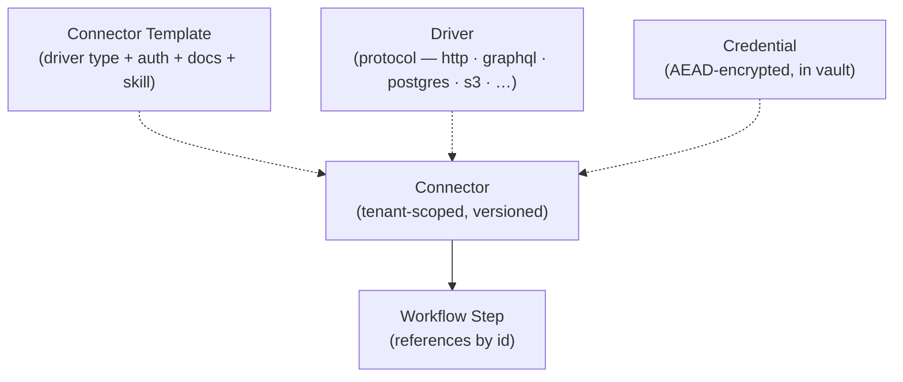
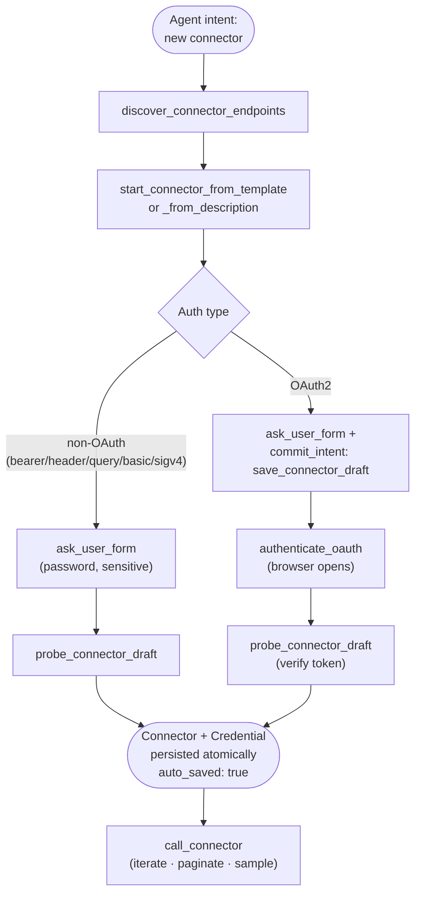

# Connectors & Integration

> **Reading time:** ~14 min
> **Audience:** Engineers wiring sk to external systems, operators curating the catalogue
> **Strategy context:** developer view of connectors as a governed integration layer ([positioning §5.3](./positioning.md#53-organisation--principles)) and [secrets isolation (R8)](./system-requirements.md#r8--secrets-isolation-from-the-ai-context). The point is not the *number* of templates but the integration behaviour: credentials isolated from the AI context, versioned per-endpoint behaviour, per-endpoint drift detection.

Automation is only as valuable as the connectors it can reach. An AI that can propose a perfect workflow but cannot connect to your CRM, your billing platform, or your internal database is not useful to an enterprise.

Connectors are the integration fabric of sk. They represent every external integration boundary the platform can reach — typed, authenticated, monitored, and secured. Understanding Connectors is essential to understanding how sk connects enterprise AI to real integrations.



*Three layers — Template, Driver, Credential — combine into a Connector. Each layer evolves independently. A Workflow Step references the Connector by id; the raw credential never enters the workflow definition, the AI context, or any log.*

---

## What a Connector Is

A Connector is a configured, authenticated connection to an external integration boundary. It is not a generic HTTP client, and it is not an ad hoc integration configured per-workflow. A Connector is a first-class platform resource: typed, validated, monitored, and reusable across any number of workflows.

The design separates three concerns that are often conflated. The Driver handles the protocol — how requests are formed, sent, and parsed. The Connector Template provides connector-specific configuration and context — what this particular integration target looks like and how to work with it. The Credential provides secure authentication — the secrets needed to connect. Each layer has a distinct responsibility, and each can evolve independently.

This separation has practical consequences. Multiple Connectors can share the same Template — for example, a production Stripe account and a staging Stripe account can each be a separate Connector built from the same Stripe Template, with different Credentials and different Environment tags. The platform can route workflows to the appropriate account based on execution mode without any workflow-level logic.

---

## The Nine Drivers

Drivers are the protocol layer. Every Connector in sk uses one of nine built-in drivers: `http`, `graphql`, `postgres`, `s3`, `ftp`, `sftp`, `smb`, `mssql`, and `redis`.

The **HTTP driver** handles REST APIs. It manages request construction, response parsing, pagination patterns, and error normalization. When a Step calls an HTTP Connector, the driver handles the protocol details so the workflow step only needs to describe what to call and what to do with the result.

The **GraphQL driver** handles GraphQL APIs. It manages query and mutation construction, variable binding, and schema awareness. Workflows that target GraphQL APIs benefit from the driver's understanding of the schema structure — the AI can propose specific queries rather than generic HTTP calls.

The **PostgreSQL driver** handles direct database connections. It manages query execution, parameterized inputs, and result set handling. This driver enables workflows that read from or write to relational databases directly, without requiring an intermediate API layer. The **MSSQL driver** covers Microsoft SQL Server with the same model.

The **S3 driver** handles object storage. It manages bucket operations, presigned URL generation, and streaming transfers. This covers not just AWS S3 but any S3-compatible object store. The **FTP**, **SFTP**, and **SMB** drivers complete the file-transfer surface for enterprise file-exchange scenarios.

The **Redis driver** handles key-value + pub/sub patterns for cache-backed workflows and lightweight inter-step coordination.

Every Connector in sk uses one of these nine drivers. Custom drivers are not part of the platform.

### GraphQL vs REST: when to pick which

Several major APIs — GitHub, GitLab, Linear, Monday, Shopify — offer both REST and GraphQL endpoints. The built-in template catalogue ships both where appropriate (for example `github` and `github-graphql`). Choose by what the workflow actually does:

- **Deep read traversals** (repository → issues → comments → labels): prefer GraphQL. One query replaces many REST roundtrips; the cost-based rate limit is more forgiving than REST's per-request budget.
- **Write operations** (create an issue, merge a PR, commit a file): prefer REST. GraphQL mutations at these providers are incomplete — organisation-admin mutations often don't exist.
- **Simple CRUD on one resource**: REST is usually shorter to author and debug.

The two connectors can coexist in a tenant — one `github` connector for writes, one `github-graphql` connector for reads — sharing the same credential (a PAT with `repo + read:org` works on both endpoints).

---

## The Connector Template Catalog

Templates are what make the AI's proposals accurate. Without templates, the AI can suggest "use an HTTP connector to call Salesforce" — but it cannot propose the correct authentication pattern, suggest the right endpoints, or explain the connector target's specific behaviors and limitations.

sk ships 90 Connector Templates covering the most common enterprise services: Stripe, Salesforce, HubSpot, GitHub, Jira, Slack, Microsoft Teams, Google services, AWS services, databases, and more.

A Template is more than a configuration skeleton. It includes: the appropriate driver, the authentication configuration for that service (OAuth2 scopes, API key placement, basic auth conventions), links to documentation that the platform will index, setup guidance the AI presents when a user configures the Connector, and example Skill content the AI can draw on when proposing integrations.

Templates are the reason the AI can propose accurate integrations rather than generic API calls. The curated knowledge about each connector target is baked into the template, not assembled from general training data at authoring time.

---

## Authentication and Credential Management

sk supports the authentication patterns that enterprise systems actually use: API key, OAuth2 (both authorization code and client credentials flows), basic auth, and custom header schemes.

OAuth2 flows are managed entirely by the platform. The engine handles token refresh, expiry detection, and token rotation automatically. An operator configures an OAuth2 Connector once; the platform handles re-authentication as tokens expire. No workflow needs to manage token lifecycle.

All secrets are stored in the Credential Vault: encrypted at rest, never logged, and never exposed outside the engine. Workflows and Steps reference Credentials by name, not by value. This means sk can propose, configure, and audit integrations without any secret ever appearing in a workflow definition, a log file, or a conversation transcript.

End-User Credentials extend this model for multi-user scenarios. An individual user can supply their own credentials for a Connector, and the platform will act as that user when executing on their behalf rather than as the tenant operator. This is the right model for workflows that need to act under a specific user's identity — proper delegation, not credential sharing.

---

## Schema Versions and Drift

External APIs change. Fields are renamed, endpoints move, new error codes appear, response shapes evolve. A Connector that worked last month may not work the same way today.

sk tracks schema versions for each Connector endpoint. As the engine executes Steps against a Connector, it observes the response shapes and compares them against the recorded schema. When a discrepancy appears — a field that was present is missing, a type that was a string is now an object — the engine classifies it as drift.

Drift is detected from actual execution results, not from periodic polling. The signal comes from real workflow runs encountering real changes in the connected boundary. When drift is detected, it becomes the trigger for the self-healing process described in the execution document.

---

## Health and Validation

Every Connector can be tested independently of any workflow. The engine validates the connection, authenticates with the configured Credentials, and reports the result along with connection latency. Connector tests and workflow request steps share the same underlying request execution path, so a successful connector test reflects the same transport behavior a workflow will use.

Connector validation is available on demand and during authoring. Operators do not need to wait for a full workflow failure before checking whether a Connector is reachable, authenticated, and returning the expected shape.

A draft connector that does not yet have a saved credential cannot be probed. The probe path returns a structured `credential_required` envelope rather than silently sending an unauthenticated request. The conversational layer treats this as a signal to collect the credential through a masked form before the next probe.

---

## Live API Discovery

Connectors that ship with an `ingestion_url` (the OpenAPI or Swagger spec) can be inspected without authoring a single workflow step. The conversational tool `discover_connector_endpoints` and the matching HTTP route fetch and parse the spec server-side, returning a curated index of endpoints with auth schemes, parameters, and pagination hints.

Three fetch strategies run in order — direct fetch of the declared spec URL, a regex extraction from a Swagger UI page, and a last-resort scan of well-known paths under the connector's base URL. The first strategy that produces a valid spec wins. Each attempt is logged so operators can see where a discovery succeeded or failed.

Discovery results cache for 24 hours per tenant in `knowledge_sources` of kind `connector_endpoint_index`. Pass `force_refresh: true` to bypass the cache. Refreshes write an audit row of kind `knowledge_source.refreshed` with `reason: "discovery_cache_refresh"`.

The conversational agent is expected to call `discover_connector_endpoints` BEFORE proposing endpoints to a workflow. Endpoint guesses against an unfamiliar API are an anti-pattern.

CI scripts and SDK callers can drive the same pipeline directly via `POST /v1/connectors/discover`. The route requires the `connector:read` permission and accepts one of `template_id`, `ingestion_url`, or `base_url` plus an optional `force_refresh: true`.

```bash
curl -X POST "$SK_BASE_URL/v1/connectors/discover" \
  -H "Authorization: Bearer $SK_API_KEY" \
  -H "Content-Type: application/json" \
  -d '{ "template_id": "stripe" }'
```

The response is `{ source: "cache" | "fresh", cache_key, result: DiscoveryResult }`. Failed discoveries (every strategy bailed) surface as HTTP 503 with `code: "discovery_unavailable"`; bad input (no template_id / base_url / ingestion_url, or an unknown template id) is HTTP 400.

---

## Ad-hoc Invocation

Once a connector is persisted, the agent can invoke any endpoint against it for sampling, pagination validation, or response-shape inspection. The conversational tool `call_connector` accepts `{ connector_id, method, path, query?, headers?, body?, timeout_ms? }` and returns the response status, headers, body, latency, and a truncation flag.

`call_connector` is RBAC-checked (`connector:read`), audited (`connector.invoked`), and always confirm-before-execution per the conversational tool policies. Response bodies above ~8 KB are truncated in the tool result with `truncated: true` and `body_byte_count` so the prompt budget stays bounded; the full response is available via the egress telemetry.

Driver coverage: HTTP and GraphQL. For Postgres / S3 / SQL Server / file-transfer drivers, `call_connector` returns a structured `driver_not_supported_for_call_connector` envelope and points at `start_workflow_from_goal` as the path to author a single-step workflow that invokes the driver.

The same surface is reachable as `POST /v1/connectors/{id}/call` for CI scripts and SDK callers. The route applies the saved credential, emits a `connector.invoked` audit row, and returns `{ status, headers, body, latency_ms, body_byte_count, truncated, metadata }`.

```bash
curl -X POST "$SK_BASE_URL/v1/connectors/$CONNECTOR_ID/call" \
  -H "Authorization: Bearer $SK_API_KEY" \
  -H "Content-Type: application/json" \
  -d '{ "method": "GET", "path": "/v2/droplets", "query": { "per_page": 10 } }'
```

Errors are typed: 403 on policy denial, 404 when the connector id is unknown, 422 when the connector exists but is unprocessable (no credential, unsupported driver, GraphQL body shape mismatch). Unsupported drivers carry `details.error_code: "driver_not_supported_for_call_connector"` so SDK callers can disambiguate without parsing the message.

---

## Conversational Creation Contract

Connector creation through the conversational surface follows a single, observable contract. Two persistence paths, one for non-OAuth credentials and one for OAuth2:



*Both paths end at the same atomic persistence: a green probe (non-OAuth) or a successful OAuth callback (OAuth2) commits the connector and the encrypted credential in one transaction. The diagnostic tools `save_connector_draft` remain available for force-saves and credential rotation.*

**Non-OAuth (bearer / header / query / basic / aws_sigv4):**

1. The agent calls `discover_connector_endpoints` to ground its endpoint choices in real spec data.
2. The agent calls `start_connector_from_template` (or `start_connector_from_description`) to create a draft.
3. The agent calls `ask_user_form(type: password, sensitive: true)` to collect the credential. The form value lands on the draft via the credential cache; no `commit_intent` is needed.
4. The agent calls `probe_connector_draft`. A green probe (`ok: true`) persists the connector + credential atomically inside the same tool call — DB row, encrypted credential, audit entry — and the response envelope carries `auto_saved: true` plus the saved connector shape. The agent does NOT need to call `save_connector_draft` afterward.
5. The agent calls `call_connector` to iterate / paginate / sample.

**OAuth2:**

1–2. As above.
3. `ask_user_form` collects `client_id` + `client_secret` and carries `commit_intent: { kind: "save_connector_draft", payload, description }`. The harness persists the connector + OAuth config on form submit (`authenticate_oauth` needs a persisted connector_id).
4. `authenticate_oauth` opens the authorization URL; tokens land via the OAuth callback.
5. `probe_connector_draft` verifies the access token works.

The diagnostic tools `save_connector_draft` and `save_workflow_draft` remain available for credential rotation, recovery from a partial write, or a force-save after a failed probe (`force_save: true`). They are idempotent — a re-issue against an already-persisted connector returns `{ ok: true, data: { already_persisted: true } }` without a double-write. Audit rows distinguish the three persistence paths via `reason`:

| Reason | Surface | Trigger |
|---|---|---|
| `auto_persist_on_green_probe` | `probe_connector_draft` (inline) | A successful probe |
| `auto_persist_on_confirmation` | harness auto-persist | An `ask_user_form` carrying `commit_intent` (OAuth2 happy path, plus delete/revoke confirmations) |
| `manual_re_issue` | `save_connector_draft` / `save_workflow_draft` (direct) | Operator-driven re-save, force-save, credential rotation |

Credentials only flow through the masked form path. The `update_connector_draft` tool rejects any credential-shaped key in `config` with a structured `credential_must_use_form` envelope. Drivers no longer accept inline credentials from `connector.config` at probe time. There is no shortcut.

---

## Vendor-drift Sweep

Connector templates pin vendor base URLs (`base_url`), probe endpoints, and OAuth issuers. Vendors retire or rename these surfaces over time. The Layer-3 vendor-drift sweep proves the surfaces are still live and stamps `verified_at` per template so operators can spot stale entries before a workflow fails on them.

The catalogue ships three layers of validation:

- **Layer 1 — structural lint.** `apps/engine/src/connectors/templates.test.ts` runs at every PR: every template must parse `ConnectorTemplateSchema`, slugs are globally unique, recipes pass `WorkflowDefSchema`, etc. No network.
- **Layer 2 — cross-reference invariants.** Same test file: every `default_skill` resolves to a known entry in `template-skills.json`, recipe placeholders are bound, no credential-shaped literals leak into recipe workflows. No network.
- **Layer 3 — vendor-drift sweep.** `scripts/audit/template-vendor-sweep.ts` HEADs every `base_url`, calls every declared `probe_endpoint`, and fetches `<oauth.issuer_url>/.well-known/openid-configuration` for OAuth templates. Writes `apps/engine/src/connectors/template-audit-report.json`. **Never runs in CI** — it is gated by `RUN_TEMPLATE_AUDIT=1` so a careless pipeline can't hammer vendors.

### Running the sweep

```bash
# Full sweep — concurrency=3, 1s/host backoff, identifies as
# subkit-template-audit/<engine version>. Takes a few minutes.
RUN_TEMPLATE_AUDIT=1 bun run scripts/audit/template-vendor-sweep.ts

# Smoke-test a single template before the full run.
RUN_TEMPLATE_AUDIT=1 bun run scripts/audit/template-vendor-sweep.ts --only=stripe

# Stamp `verified_at` on every template that came back OK or
# auth_required. Off by default so the operator can review the report
# before mutating templates.json.
RUN_TEMPLATE_AUDIT=1 bun run scripts/audit/template-vendor-sweep.ts --update-templates
```

The sweep classifies every template as one of:

- `ok` — base URL + probe + OAuth discovery all responded with the expected status.
- `auth_required` — vendor answered with 401/403 (the URL is real; we just don't send credentials).
- `drift` — vendor returned 404 / 410 / persistent 5xx. Triage required.
- `error` — network-level failure (DNS, TLS, timeout). May be transient.
- `skipped` — `base_url` is null or carries placeholder segments (`{tenant}`, `{cloudId}`).

Per-vendor backoff escalates exponentially on 429/5xx (cap 30s, 4 attempts). Output is sorted by slug so re-runs produce a byte-stable report when nothing changed.

### What `verified_at` means

`verified_at` is a wall-clock ISO8601 timestamp of the last successful sweep. `null` means the template has never been swept (newly authored, or the script has not been run since the field landed).

The Layer-1 test emits a `console.warn` (it does **not** fail the suite) when a template's `verified_at` is `null` or older than 90 days. Sample output:

```
[connector-templates] vendor-drift sweep stale on 101/101 templates.
Run: RUN_TEMPLATE_AUDIT=1 bun run scripts/audit/template-vendor-sweep.ts --update-templates
  - airtable (verified_at=null, never swept)
  - apify (verified_at=null, never swept)
  …
```

The deliberate non-fail-on-stale design lets the catalogue ship even when the sweep hasn't run recently — running the sweep is an operator decision (vendor surfaces don't drift on a PR's schedule), and a stale stamp should never block an unrelated change.

---

## Further reading

- [Recipe authoring contract](./05a-recipe-authoring.md) — schema, conventions, multi-connector binding, quality gate, promotion checklist for pre-built workflows shipped on every connector template.
- [Workflow execution](./06-execution.md) — how workflows that use Connectors actually run: the execution model, step kinds, triggers, versioning, and self-healing.
- [glossary — integration terms](./02-concepts.md#group-3-integration) — Connector, Connector Template, Driver, Credential.
- [secrets isolation (R8)](./system-requirements.md#r8--secrets-isolation-from-the-ai-context) — the requirement this layer realises.
