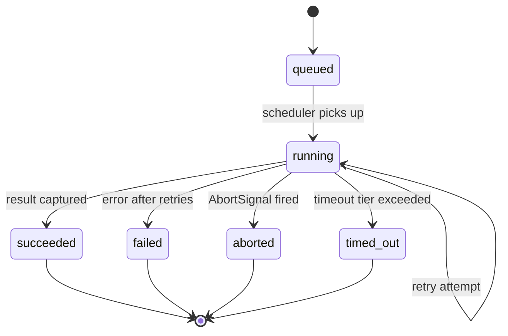
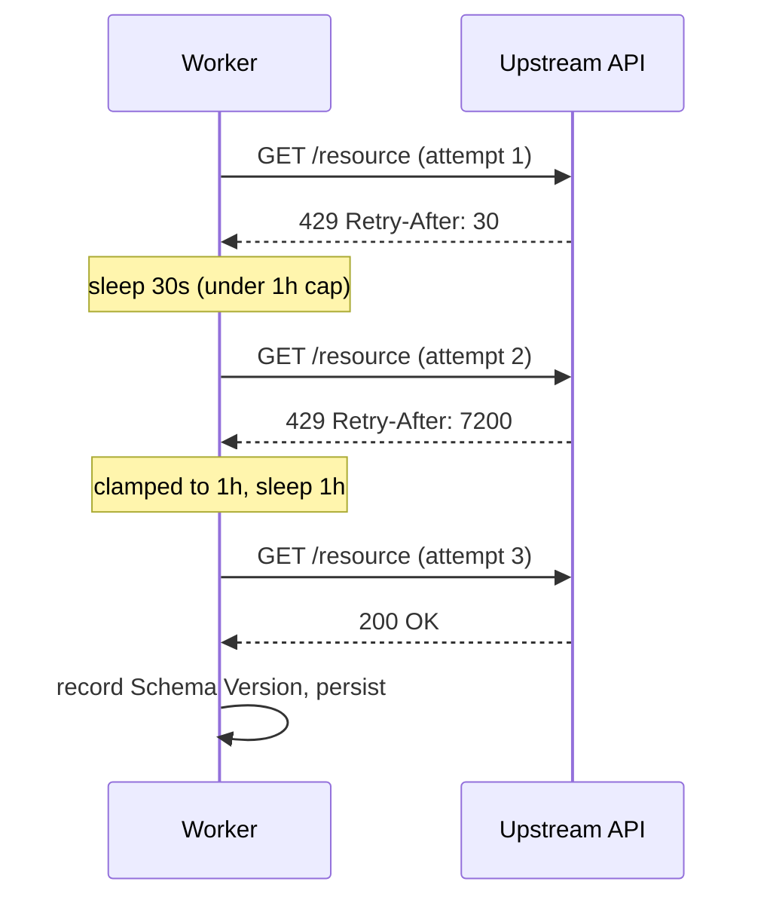

# 05 — Execution Engine

The execution engine walks a Workflow DAG one Step at a time, enforces the policy and limit budget on each Step, records every transition into Postgres, and emits outbox Events for every externally visible side effect. It is a single in-process state machine inside the Bun binary; there is no separate orchestrator process.

## Step state machine

Every Step transitions through the same lifecycle. Terminal states are absorbing.



A Step is `queued` from the moment its inputs are resolved and its predecessors are terminal. It becomes `running` when the worker takes it. `failed`, `aborted`, and `timed_out` all close the Step as terminal-error; the difference is the cause attribution recorded on the row.

The Execution wrapping the Step graph carries its own status (`queued | running | succeeded | failed | aborted | timed_out`) which is derived from the Step terminal states and the configured `onError` mode.

## Step kinds

| Kind | Semantics |
|---|---|
| `request` | Issues an outbound call through a Connector driver. Honors the Before-Request Hook, Credential merging, response filters, data selectors, pagination, and Schema Version recording. |
| `transform` | Pure data shaping. Either JSONata (in-process) or JavaScript (QuickJS-WASM sandbox). No I/O, no network, no host globals. |
| `call` | Invokes another Workflow as a sub-Execution. The child Execution carries `parent_execution_id` and `request_source = tool-chain`. Policy is re-evaluated on the child as if it were a fresh request. |
| `wait` | Suspends the Execution for a duration or until an external Event matches a predicate. Suspension is durable: the Execution row remains `running` while the worker yields. |
| `branch` | Evaluates one or more predicates and routes the DAG into the matching arm. The first matching arm wins; an explicit `else` arm is supported. |
| `parallel` | Fans out to N child Steps concurrently and joins on completion. The `onError` mode of the `parallel` Step decides whether one failure aborts siblings or whether siblings drain. |
| `loop` | Iterates a sub-DAG over a collection or until a predicate becomes false. Hard-capped at 10,000 iterations regardless of input size. |

## Retry policy

Every Step kind that can fail retries up to **5 attempts** (one initial attempt plus four retries). Backoff is exponential with full jitter:

```
delay = random(0, base * 2^attempt)
base  = 1 second
cap   = 60 seconds per individual sleep
```

Retries are skipped for non-retryable error classes: schema validation failures on the Step input, Policy denials, Credential decryption failures, and any error the driver flags as `terminal`. A 429 response is retryable and is handled by the rate-limit branch below rather than the generic backoff.

## Timeout tiers

Three nested timeouts apply to every Execution. The smallest enclosing tier wins.

| Tier | Default | Scope |
|---|---|---|
| Transform | 10 minutes | A single `transform` Step (JSONata or JavaScript). |
| Step | 1 hour | Any other Step kind, end-to-end including all retries and pagination. |
| Workflow total | 6 hours | The entire Execution. When tripped, the in-flight Step is aborted and the Execution moves to `timed_out`. |

Each tier is overridable per Workflow or per Step; the documented numbers are the out-of-box default.

## `onError` modes

Every Step declares one of two error modes:

- **`fail`** — a terminal error on this Step fails the enclosing Execution (or, inside a `parallel`, fails the parallel branch). This is the default.
- **`continue`** — a terminal error on this Step is recorded as `failed` but the engine continues with the next Step in topological order. The error payload is exposed to downstream Steps under a well-known key so a `branch` can react to it.

`onError: continue` does not relax timeout tiers, retry counts, or Policy checks — it only changes whether the error is fatal to the Execution.

## Pagination strategies

`request` Steps can declare a pagination strategy. The engine implements three:

- **`offset`** — increments an offset query parameter by the page size each round.
- **`page`** — increments a page-number query parameter and stops when the response page is empty or short.
- **`cursor`** — extracts a cursor token from the previous response via a configured selector and forwards it as the next request's cursor parameter.

All three honor a hard cap of **1,000 requests per Step**. The default page size is 1,000, clamped to `[1, 1000]`. Pagination output is always merged into a single concatenated array on the Step output unless the Step opts into a streaming variant.

## Loop iteration cap

`loop` Steps stop unconditionally after **10,000 iterations**. The cap fires regardless of source: a too-large input collection, an unbounded predicate, or a runaway sub-DAG that grows the queue. When the cap fires, the loop terminates as `failed` with a typed `loop_iteration_cap` error.

## Large-payload offload

When a Step input or output serializes to **more than 10 KB of JSON**, the engine writes the full payload to object storage via the S3 driver and stores only a `result_storage_uri` reference plus a truncated preview on the row. Downstream Steps receive the full payload, lazily fetched on access. This keeps `executions` and `execution_steps` rows small enough to scan and search efficiently.

## DB preview truncation

Every `execution_steps` row stores an `input_preview` and `output_preview` rather than full payloads. The truncation rules are uniform across the engine:

- Maximum object depth: **5 levels**. Anything deeper is replaced with `"<truncated:depth>"`.
- Maximum array length: **5 elements**. The remainder is replaced with `"<truncated:N more>"`.
- Maximum object keys per object: **1,000**. Excess keys are dropped with a `"<truncated:N more keys>"` marker.

Previews are advisory. The full payload always lives either in the offload bucket or inline below the threshold.

## Response filters

Every `request` Step can declare a `response_filter` that runs over the response body before it is persisted or passed downstream. A filter is a triple of `(target, action)`:

| Target | Meaning |
|---|---|
| `KEYS` | Match against object key names. |
| `VALUES` | Match against value contents (regex or literal). |
| `BOTH` | Match if either the key or the value matches. |

| Action | Meaning |
|---|---|
| `REMOVE` | Delete the matching key/value pair from the body. |
| `MASK` | Replace the value with a fixed mask token while preserving the key. |
| `FAIL` | Fail the Step terminally — the response carried something the Workflow declared it must never see. |

Filters compose: a Step can declare an ordered list of filters and the engine applies them top-to-bottom.

## Data selectors

Every Step output can be projected through a JSONPath-style **data selector** before it is exposed to downstream Steps. Selectors are evaluated after response filters and after pagination merging. A selector that resolves to nothing yields an empty result; a selector that resolves to multiple matches yields an array. Selectors are documented per Step on the Workflow definition; they are not Turing-complete, do not perform I/O, and are validated at Workflow upsert time.

## 429 and `Retry-After` handling

When a `request` Step receives a `429 Too Many Requests`, the engine inspects the `Retry-After` header.

- Numeric seconds: sleep for that many seconds, then retry.
- HTTP date: sleep until that timestamp, then retry.
- Missing header: fall back to the standard exponential backoff with jitter.

The total wait imposed by `Retry-After` is **capped at 1 hour**. A `Retry-After` larger than the cap is clamped to 1 hour and the Step proceeds; if the upstream is still 429 after the clamped wait, the standard retry counter still applies.



The 429 wait counts against the Step timeout tier but not against the retry-attempt budget — a Step that is being throttled by the upstream is not punished as if it were failing.

## Abort and cancel propagation

Cancellation is one mechanism end-to-end. The HTTP route `POST /v1/executions/:id/cancel` flips a row in Postgres and emits an `execution.status` outbox Event. Inside the worker, the Step is running with an `AbortController` whose `signal` is wired into:

- The `fetch` call in the HTTP driver and the underlying connection in the Postgres / S3 / GraphQL drivers.
- The QuickJS interrupt handler for the `transform` JavaScript sandbox.
- The `pg-boss` job heartbeat so the queue knows the job did not silently die.
- Any in-flight `wait` Step, which yields immediately on signal.

When the signal fires, the Step transitions to `aborted`, the Execution becomes `aborted`, and any downstream Steps remain `queued → aborted` without ever entering `running`. Sub-Executions started via `call` propagate the signal to the child via the same controller chain.

## Tool chaining via `call`

The `call` Step invokes another Workflow as a child Execution. The semantics are:

1. The parent persists a row with `parent_execution_id` set to itself.
2. The child's `request_source` is recorded as `tool-chain`, regardless of how the parent was triggered.
3. Policy is re-evaluated on the child against the **parent's Principal** — a `call` cannot escalate.
4. The child's terminal status is hoisted into the parent Step as the `call` Step's result.
5. Cancellation propagates parent → child but not child → parent.

Tool chains are how a Workflow assembles other Workflows into composite automations and how AI authoring flows compose previously committed Workflows as building blocks. Every chain hop is searchable on `request_source = tool-chain` and traceable through the `parent_execution_id` pointer.

## Schema-version tracking

Every successful `request` Step canonicalizes the response shape into a JSON schema and writes a row to `schema_versions` keyed by `(connector_id, endpoint_key)`. The endpoint key is `method + path-template`, not the materialized URL, so query parameters and path arguments do not fragment the version history.

The latest Schema Version per endpoint is the reference shape used by self-healing to detect drift. Drift is the diff between a freshly observed shape and the most recent Schema Version that matches the same endpoint key — for example, a renamed field, a removed field, or a type widening.

## Execution fixture recording

A Step that succeeds with a non-empty response is eligible to be recorded as an **Execution Fixture**: a `(request, response)` pair stored in `execution_fixtures` keyed by `(connector_id, endpoint_key)`. Fixtures are the dry-run corpus for the self-healing loop.

Recording is sampled per endpoint to keep storage bounded: the engine retains the most recent N fixtures per `(connector_id, endpoint_key)` and discards older entries. Fixtures are always read-only after capture; self-healing patches are evaluated against them, never written through them. When a Patch Candidate is produced, the engine replays the patch against a stored Fixture to confirm that the patched call would still parse the historical response correctly before classifying the patch as `safe` or `unsafe`.
