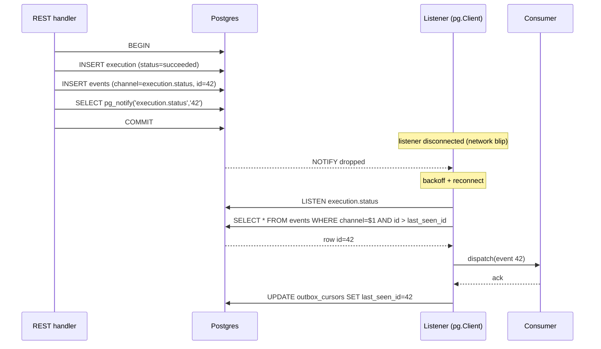

# 06 — Queue, Scheduler, and Pub/Sub

The engine has exactly one durable work primitive (pg-boss) and exactly one notification primitive (raw `pg.Client` LISTEN over a transactional outbox). Both live in the same Postgres database the rest of the engine already uses. There is no Redis, no Kafka, no NATS, no second message broker.

## pg-boss as queue and cron engine

**Trade-off**: pg-boss covers durable named queues and cron schedules in one library backed by the existing Postgres. Alternatives (BullMQ, RabbitMQ, NATS JetStream) all introduce a second stateful infrastructure component and a second client driver — pg-boss avoids both at the cost of pure Postgres throughput, which is sufficient for this engine's job mix.

pg-boss brings the `pg` driver as a transitive dependency. The engine reuses the same `pg` for the LISTEN/NOTIFY listener so there is no second Postgres client.

## Named queues

Every background concern in the engine maps to one of a fixed set of named queues. The queue name is stable over the engine's lifetime and shows up in metrics labels and logs.

| Queue | Purpose |
|---|---|
| `execution.run` | Workers that pull a queued Execution and walk its Step DAG. |
| `execution.notify` | Fan-out of Execution status changes into outbound Subscriptions and Notification Rules. |
| `connector.refresh-oauth` | Background refresh of OAuth2 Credentials before expiry. |
| `connector.ingest-docs` | Documentation ingestion runs (OpenAPI fetch, HTML scrape, file parsing). |
| `workflow.repair` | The self-healing loop: drift detection, doc refresh, narrow LLM repair, fixture dry-run. |
| `workflow.generate` | The conversational authoring loop running outside an interactive session (background drafts). |
| `schema.extract` | Asynchronous body of `/v1/extract` for large file uploads. |
| `webhook.deliver` | Outbound Webhook delivery with the Standard Webhooks retry cadence. |
| `event.fanout` | Outbox dispatcher that maps an Event to its downstream queue jobs. |
| `chat.event` | Inbound Chat Events normalized into the engine's tool loop. |
| `chat.deliver` | Outbound Chat Deliveries (new message, update, ephemeral, card). |
| `apikey.last-used-flush` | Batched async writer for `api_keys.last_used_at`. |
| `conversation.tool-call` | Background dispatch for sensitive Conversation tool calls awaiting approval. |
| `tunnel.heartbeat` | Tunnel agent keepalive bookkeeping and disconnect detection. |

## Per-queue retry and dead-letter

Each queue declares its own retry policy at boot. The engine standardizes on three profiles:

- **Idempotent fast-fail** (`execution.notify`, `event.fanout`, `apikey.last-used-flush`, `tunnel.heartbeat`): 5 retries, 1 s base, 30 s cap. Drops to dead-letter on exhaustion.
- **External delivery** (`webhook.deliver`, `chat.deliver`): the Standard Webhooks retry schedule of `[1m, 5m, 30m, 2h, 5h, 10h, every 12h up to 3 days]` with jitter. Dead-letter rows are replayable from the API.
- **Long-running** (`execution.run`, `workflow.repair`, `workflow.generate`, `schema.extract`, `connector.ingest-docs`, `connector.refresh-oauth`, `chat.event`, `conversation.tool-call`): 5 retries with the same exponential-backoff-with-jitter the Step retry policy uses, capped at 60 s per sleep. The job lives or dies with its Execution / Conversation row, which carries the authoritative status.

Dead-letter rows for every queue land in pg-boss's built-in failed-job table and are exposed through the `/v1/admin/jobs` admin endpoints for inspection and manual replay.

## Cron reconciliation

Schedules live in the `workflows_schedules` table. They are not stored inside pg-boss directly. Two reconciliation triggers keep pg-boss's cron registrations in sync with the table:

1. **Boot**: on engine startup, the cron reconciler reads every active row from `workflows_schedules` and registers (or updates, or removes) the matching pg-boss schedule.
2. **Writes**: every successful insert, update, pause, or delete on `workflows_schedules` enqueues a reconciliation tick that runs the same logic.

Between these, a periodic reconciler runs every **60 seconds** and re-reads the table as a safety net against missed writes, manual SQL edits, and pg-boss state drift. Reconciliation is idempotent: identical rows produce no register/unregister churn.

## Why LISTEN/NOTIFY alone is not enough

Postgres `LISTEN/NOTIFY` is a fire-and-forget signal. It has three properties that make it unsafe as a sole notification primitive:

- **It is not durable.** A NOTIFY emitted while no listener is connected is gone forever.
- **It has no replay.** A listener that disconnects and reconnects has no way to ask "what did I miss".
- **It has a payload size limit** of roughly 8 KB and no guarantee of ordering against the transaction that produced it under all replication topologies.

The engine therefore always pairs NOTIFY with the **transactional outbox pattern**. NOTIFY is a wake-up signal; the outbox is the source of truth.

## The outbox pattern

Every domain write that has externally visible consequences (an Execution finishing, a Workflow being upserted, a Patch Candidate being proposed, an API key being rotated, a Tunnel changing state) writes a row into the `events` outbox table **inside the same transaction** as the domain write. After the transaction commits, the same connection issues a `pg_notify` carrying only the new event id.

Defer to `04-data-model.md` for the table shape. The relevant fields here are `id` (a monotonically increasing `bigserial` per channel), `channel`, `type`, and `payload`.

## NOTIFY wake-up payload

The wake-up payload is intentionally tiny. Postgres caps `NOTIFY` payloads at roughly 8 KB; the engine stays well under that by carrying only the event id as a decimal string:

```ts
// inside the same transaction that wrote the domain row
await tx.execute(sql`SELECT pg_notify(${channel}, ${String(eventId)})`);
```

A consumer that receives a wake-up reads the event id, fetches the row from `events`, and dispatches it. A wake-up that races a slow transaction commit is harmless: the row will appear under the catch-up query on the next tick.

## `outbox_cursors` catch-up protocol

For every channel the engine listens on, an `outbox_cursors` row tracks the highest event id that has been successfully dispatched. The catch-up query is the same in every code path:

```ts
// pseudocode for the listener loop
async function drain(channel: string) {
  const cursor = await db.outboxCursors.find(channel);
  const rows = await db.events.findAll({
    channel,
    where: { id: { gt: cursor.last_seen_id } },
    orderBy: { id: "asc" },
    limit: 500,
  });
  for (const row of rows) await dispatch(row);
  if (rows.length > 0) {
    await db.outboxCursors.advance(channel, rows.at(-1)!.id);
  }
}
```

The drain runs in three situations:

- **On listener startup or reconnect**, before any wake-ups are processed.
- **On every NOTIFY wake-up**, because the wake-up is only a hint that *at least one* new row exists.
- **On a periodic safety-net tick** (the same 60 s cadence as cron reconciliation) so a silently broken NOTIFY path still drains.

Every consumer dedupes on `event_id`, so replaying a row that was already dispatched is a no-op. The protocol is intentionally simple because every component is idempotent.

## The dedicated `pg.Client` listener

The listener is a single dedicated `pg.Client` (not a pooled connection — pooling and `LISTEN` do not mix). Its lifecycle is:

1. Connect.
2. `LISTEN <channel>` for every channel the engine cares about.
3. Run the catch-up drain for every channel.
4. Process incoming `notification` events from the driver.
5. On error or unexpected disconnect, disconnect cleanly, sleep with exponential-backoff and jitter, then reconnect and re-`LISTEN` from step 2.

The reconnect backoff is the same shape as the Step retry backoff: base 1 s, cap 60 s, with full jitter. There is no maximum retry count — the listener reconnects forever, because losing the listener entirely would silently break every downstream consumer.

## Channel specs

The engine declares a fixed set of outbox channels. New event types fit into one of these channels rather than introducing new channels.

| Channel | Carries |
|---|---|
| `execution.status` | Execution lifecycle transitions (`queued`, `running`, `succeeded`, `failed`, `aborted`, `timed_out`). |
| `workflow.chain` | Workflow upsert, version commit, `call`-step parent-child linkage, restore-to-version. |
| `connector.oauth` | Connector OAuth2 refresh outcomes and refresh-token rotation. |
| `conversation.stream` | Conversation turn deltas, structured-intent tool calls, approval requests and decisions. |
| `event.emitted` | Tenant-visible Events (the same rows that drive Subscriptions and Notification Rules). |
| `notification.emitted` | Notification Rule matches resolved into per-channel deliveries. |
| `tunnel.state` | Tunnel agent register, connect, disconnect, reconnect, target add/remove. |

## End-to-end flow with a listener disconnect

The diagram traces a single domain write through the outbox, across a listener reconnect, to a downstream consumer.



The wake-up dropped during the disconnect did not need to be retransmitted. The cursor-based catch-up query picked the row up the moment the listener came back, and the consumer's `event_id` dedup ensured that even if the wake-up had been redelivered later, no duplicate work would have occurred.
