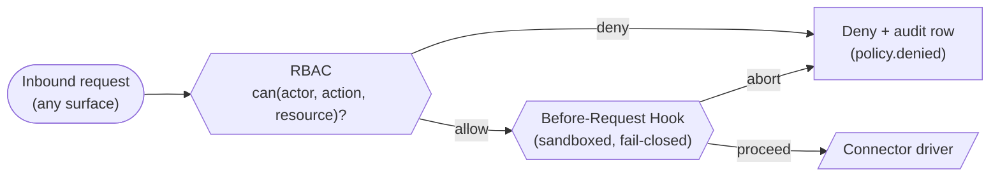
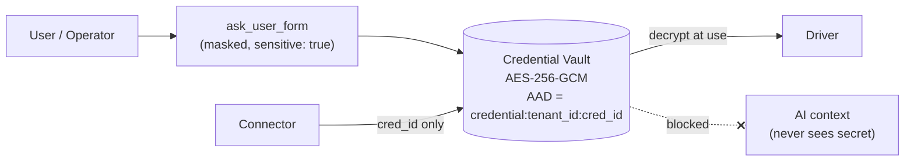

# Security & Governance

> **Reading time:** ~12 min
> **Audience:** Security engineers, compliance reviewers, operators wiring access

Enterprise AI requires enterprise-grade security from the start. A platform that touches production integrations, sensitive credentials, and automated business processes cannot treat security as a layer added later. It has to be the foundation.

sk is designed so that the right security behaviour is the default behaviour. Every interaction is authorised, every action is auditable, and every secret is protected — by architecture, not by configuration.

---

## Multi-Tenancy as a First-Class Concern

sk is multi-tenant from the ground up. Every resource in the platform — workflows, connectors, credentials, users, skills, conversations, audit log entries — belongs to exactly one Tenant. This is not a deployment mode or a configuration setting. It is the data model.

Tenant isolation is enforced at every layer. Database queries always filter by tenant identity. API responses never include cross-tenant data. The audit log is tenant-scoped. A single engine instance can serve multiple organizations with complete isolation between them.

This design means there is no "global" namespace to accidentally share, no configuration flag to toggle isolation on or off, and no way for one tenant's data to appear in another tenant's context. Isolation is structural.

---

## Identity and Authentication

sk supports multiple authentication methods in a pluggable chain. Organisations choose the combination that fits their security posture.

**OIDC** enables enterprise SSO. Users log in with their organization's identity provider — Azure AD, Okta, Google Workspace, or any OIDC-compliant provider. The engine provisions tenant accounts from the claims in the identity token. For organizations with existing SSO infrastructure, this is the right path: users get seamless access through the same credential they use everywhere else, and the organization retains control over provisioning and deprovisioning.

**API Keys** are the standard programmatic credential. They are long-lived, revocable, and scoped to a tenant and a specific permission set. Every key is hashed before storage — the raw key is shown exactly once at creation. There is no way to retrieve a plaintext key after that point. If a key is lost, a new one is issued and the old one revoked. API keys support overlap-window rotation: a new key can be issued before the old one expires, so access is never interrupted during rotation.

**Portal Tokens** are short-lived, single-purpose credentials issued for specific end-user flows. They expire automatically. They carry only the permissions required for their specific purpose — nothing more. Portal tokens are the right choice for customer-facing integrations and controlled access flows where a user needs to interact with a specific workflow without becoming a full tenant member.

---

## Role-Based and Attribute-Based Access Control

Every API route, MCP call, and workflow trigger is protected by RBAC. The permission check happens before any resource is accessed or any action is taken. There is no path through the platform that bypasses authorization.

sk ships four built-in roles: **admin** (full platform control), **member** (can author and trigger workflows), **end-user** (can trigger and view, cannot modify), and **service account** (programmatic access, no interactive surface). Operators can create custom roles for more granular control, define resource-level grants with expiration times, and group users for assignment.

**Before-Request Hooks** add a dynamic policy layer on top of static RBAC. A Before-Request Hook is a sandboxed script that runs before a Connector request executes. The hook receives the full request context — caller identity, target connector, operation type, request parameters — and can enforce policy that is impossible to express in static roles. Examples: blocking write operations during a maintenance window, requiring additional approval for specific production connectors, enforcing data residency constraints, or logging requests that match a specific pattern.

Hooks run in an isolated QuickJS-WASM sandbox with a strict CPU budget. They cannot access the network, the file system, or the database. An error or timeout in a hook fails closed: the request is denied. Hook execution is recorded in the audit log.

**Policy evaluation order:** RBAC is evaluated first. If the caller has no permission for the action, the request is denied before the hook is consulted. If RBAC passes, the Before-Request Hook runs. If the hook aborts, the request is denied with the hook's reason. Only if both pass does the request proceed.

**`stats:read` exposes process-scoped operational signals.** The operator health digest (`GET /v1/operator/health-digest`, the `subkit://operator/health-digest` MCP resource, and the on-connect MCP `instructions` summary) is gated on `stats:read`. Its **failing-runs** and **pending-patch** sections are tenant-scoped, but its predictive-maintenance **risk signals** (Postgres-pool saturation, dead-letter-queue growth, transient-DB-retry rate, connector-health mix, LLM-fallback fraction, RSS high-water) read *engine-wide* gauges — the pool, the DLQs, and the host RSS are shared infrastructure, not per-tenant. A principal with `stats:read` on a multi-tenant deployment can therefore infer host-level load that other tenants contribute to. This is intentional — `stats:read` is the operator-tier permission, and "your runs are fine but the host is about to OOM" is exactly the warning the per-tenant lagging signals cannot give in time — but grant `stats:read` only to operator/admin principals on a shared deployment. The risk values themselves are also written to the audit trail under the **system** tenant (`operator.risk_signal_raised` / `operator.risk_signal_cleared`), not the reading tenant's, so the SIEM trail attributes a host condition once rather than per reader.

---

## The Credential Vault

All integration secrets — API keys, OAuth2 access and refresh tokens, database passwords, connection strings — are stored in the credential vault, encrypted with AES-256-GCM.

*Secrets are never logged, never returned in API responses, never visible to the AI during conversations. Connectors reference credentials by identifier; the vault resolves the identifier to the actual secret at the moment of use. Outside that moment, the raw value does not exist in memory or in any logged context.*

OAuth2 token refresh is automatic. The engine manages the full OAuth2 lifecycle — access token expiry, refresh token rotation, re-authorization when needed. Connectors never deal with expired tokens; the vault handles it transparently.

End-user credential overrides are supported. Individual users can supply their own credentials for a connector without operator involvement — for example, a user connecting sk to their personal GitHub account rather than the organization's shared integration. Overrides are stored in the same vault with the same encryption guarantees.

---

## The Audit Trail

Every state change in sk produces an immutable audit log entry. This is not selective logging — it is comprehensive.

The audit log captures: workflow creation, modification, approval, and deletion; connector operations; credential creation, rotation, and revocation; user provisioning and role changes; execution triggers and final results; approval events; skill promotions; patch candidate reviews; and more — over 100 distinct action types across all platform surfaces.

Each entry captures the full context of the event: what action was taken, who took it (user or service account identity), from which surface (API, CLI, MCP, chat, webhook, or scheduler), what changed (a structured diff where applicable), and precisely when. The metadata field on every entry is scrubbed for token-shaped values before persistence — bearer tokens, JWTs, AWS access keys, and any value under a key matching a sensitive name (`password`, `token`, `secret`, `credential`, `*_token`, `authorization`) become `***REDACTED:<kind>***` at write time, regardless of how they reached the audit recorder.

The audit log cannot be modified or deleted. It is the compliance and forensics record for the platform. It is designed to answer the question every audit or incident review requires: "Who did what, when, and from where?"

Audit emissions go through typed recorders under `apps/engine/src/audit/recorders/` — one helper per resource family (connector, workflow, credential, knowledge source, policy). Each recorder requires a non-null `reason` for state-changing rows. Reasons are part of the contract: `auto_persist_on_confirmation` distinguishes harness auto-persist writes from `manual_re_issue` (explicit `save_connector_draft` calls), `force_save_override` / `force_save_override` mark force-flag overrides of failed probes or previews, `credential_must_use_form` records rejected credential attempts at the draft layer, and `confirm_before_execution` records every tool-policy decision that paused for an operator confirmation.

New audit kinds for the conversational surface include `tool_policy.confirmation_required` (every confirmation gate the policy resolver fires), `connector.draft.credential_rejected` (rejections by the `update_connector_draft` contract), `connector.invoked` (each `call_connector` round-trip), `connector.saved_override` (a save persisted with `force_save: true` despite a failed probe), and `knowledge_source.refreshed` (each discovery cache refresh).

Operators can query the audit log by actor, action type, resource, time range, and request source. The `sk audit-log tail` command provides a real-time stream for operational monitoring. The API exposes the same query surface programmatically.

**Asymmetric coverage on `data.exported` from `POST /v1/extract`.** Binary-format extracts (PDF / DOCX / XLSX / XLS / PPTX) emit an `action = "data.exported"` audit row for both success and parse-failure paths — these formats can carry whole tenant documents (CVs, contracts, financial spreadsheets), so the egress trail is explicit. Text-format extracts (JSON / CSV / YAML / XML / plaintext) deliberately skip the audit row because they are shape-only (the caller is sending data the engine already knows about for schema inference). Operators monitoring `data.exported` for *all* extract calls should be aware of this gradient. The 413 body-cap denial path is audited for every format. See `docs/08-operations.md` for the full operator-controlled metadata surface (`audit_log.metadata.filename`, `audit_log.metadata.error`).

---

## The Compliance Posture

The following properties hold by construction — they are not optional configurations.

**Encryption at rest.** All credentials are encrypted with AES-256-GCM before being written to the database. The encryption key is managed at the engine configuration layer.

**Encryption in transit.** All engine endpoints are served over TLS. The engine does not serve unencrypted HTTP in production configurations.

**API key storage.** Keys are stored as hashes. The comparison during authentication is always against the hash, never against a stored plaintext value. There is no way to recover a key after issuance.

**Webhook signatures.** All inbound webhooks use the Standard Webhooks signature scheme (HMAC-SHA256). The engine verifies signatures before processing any webhook payload. Requests with missing or invalid signatures are rejected.

**Sandboxing.** Untrusted code — transforms, Before-Request Hooks, and self-healing patch scripts — runs in an isolated QuickJS-WASM sandbox with a strict CPU budget. Sandbox code cannot access the network, the file system, or the database. The sandbox is not a trust boundary that can be configured away; it is where all runtime code execution occurs.

**Egress governance.** Connector requests go through the engine. Clients never call external connector boundaries directly. All egress is logged in the audit log with request source, caller identity, and outcome.

**Request source tracking.** Every platform interaction — API call, MCP invocation, webhook delivery, chat message, CLI command, scheduled trigger — is tagged with its source. "Who initiated this?" is always answerable from the audit log.

---

## Secret Hygiene at the Conversational Surface

The conversational surface introduces additional pressure on secret handling: an LLM may attempt to type a credential into a tool argument, an operator may paste a token into the chat input, or a debug log may capture a verbose elicitation payload. sk applies multiple defences so any one of these doesn't propagate into a persistent surface.

The `update_connector_draft` tool rejects any credential-shaped field in `config` with a structured `credential_must_use_form` envelope. The agent is steered, by both the tool contract and the seed skill content, toward the masked-form path: `ask_user_form(type: password, sensitive: true)` collects the value, the harness auto-persists the connector and credential atomically, and the LLM never sees the secret in any tool argument or transcript.

The HTTP / GraphQL / S3 drivers no longer honour inline credentials from `connector.config`. Probing a draft without a saved credential row returns a structured `credential_required` envelope, which the conversational layer turns into the next ask-form turn. The previous shortcut that lifted `config.token` into the Authorization header has been removed — it made the wrong thing look like progress.

Engine logs, audit metadata, conversation event payloads, and the `~/.sk/debug.log` file pass through a centralized scrubber before write. The scrubber matches known token shapes — DigitalOcean, GitHub, GitLab, Slack, Anthropic, Bearer-prefixed bearer tokens, JWTs, AWS access keys — and any value whose key name matches the sensitive-name pattern. Matches become `***REDACTED:<kind>***` at the file-write boundary.

The sk CLI composer detects token-shaped paste in the chat input. When matched, the input is replaced with a one-keystroke confirmation prompt; on confirmation the CLI sends a redirect message that asks the agent to re-prompt through the masked form, instead of forwarding the literal paste to the engine. The detector catches the same regex catalog as the engine scrubber.

Tool policies (`apps/engine/src/conversations/tools/tool-policies.ts`) decide execution mode dynamically per call. Inputs containing token-shaped values or sensitive key names force the policy resolver to `confirm_before_execution`, which inserts an `ask_user_confirm` gate before the tool runs. Every such pause writes a `tool_policy.confirmation_required` audit row with the tool name and the matched sensitive shape — operators can review every policy-gated decision in the audit trail.

The `authenticate_oauth` flow surfaces an authorization URL that the sk CLI auto-launches in the operator's browser. That URL is tenant-controlled input: it is derived from the connector's `oauth.issuer_url` config, which a tenant admin can write. The proportionate control is a scheme clamp — `BrowserUrlSchema` accepts only `http`/`https`, closing `file:`, `javascript:`, and `data:` URLs — so the worst a tenant admin can do is cause the CLI to open an arbitrary http(s) page for an operator who has paused on that connector. This is acceptable because connector-config writes are already an audited, RBAC-gated action: the admin who could set a hostile `issuer_url` is the same admin already trusted to configure the connector's real endpoints, and every such write lands in the audit trail.

---

## Further reading

- [Deployment & operations](./08-operations.md) — how sk is deployed, how operators monitor it in production, and how it handles failure gracefully.
- [glossary — governance terms](./02-concepts.md#group-5-governance) — Audit Log, RBAC, Before-Request Hook, Self-Healing, Patch Candidate.
