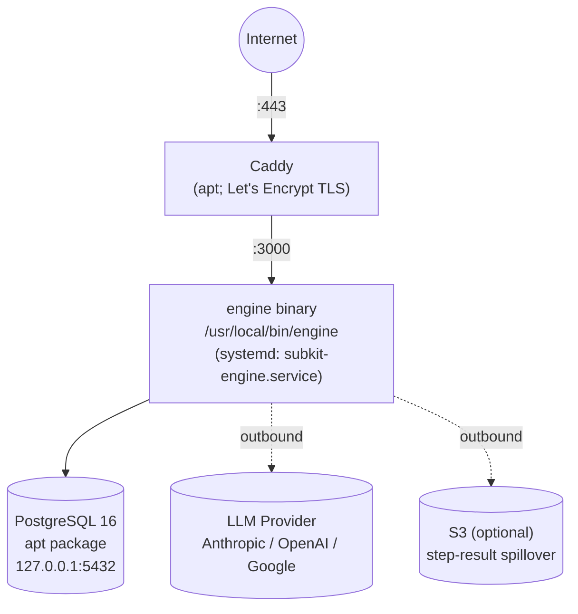
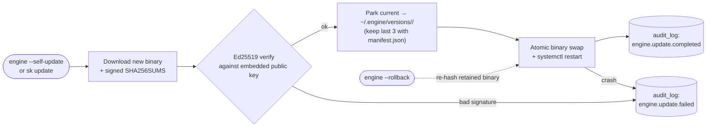

# Deployment & Operations

> **Reading time:** ~16 min
> **Audience:** SREs, platform engineers, operators running the reference implementation in production
> **Strategy context:** developer view of [cost attribution (R10)](./system-requirements.md#r10--cost-attribution-and-per-tenant-budget), [one governance gate (R12)](./system-requirements.md#r12--multiple-entry-surfaces-one-governance-point), and the drift-assisted-repair side of the [closed learning loop (R5)](./system-requirements.md#r5--closed-learning-loop-with-operator-reviewed-remediation). For the structural changes operators can expect, see [structural changes in positioning](./positioning.md#7-part-2b--structural-changes-sk-specific-not-generic-outcomes).

The reference implementation is designed for enterprise deployment. That means it has to be reliable enough to run unattended, observable enough to diagnose problems quickly, and self-correcting enough to handle the inevitable drift that comes from running in a changing environment.

This document explains how the reference implementation is deployed, how operators monitor it day-to-day, and how it handles failure — from a single connector going down to an external API changing its schema.

---

## Deployment Topology

The reference implementation compiles to a single binary. The only stateful dependency is PostgreSQL.

There is no separate message broker to manage, no distributed queue service to operate, and no coordination system to keep in sync. The job queue, the cron scheduler, and the pub/sub event bus all run within the engine process, using PostgreSQL as their durable backing store. This is a deliberate architectural choice: it reduces the operational footprint to a single dependency and eliminates an entire category of distributed systems failure modes.

The standard deployment model is straightforward: one engine service and one PostgreSQL instance. For teams that need higher availability, the engine is horizontally scalable — run multiple instances behind a load balancer. The queue and scheduler subsystems are designed for concurrent execution across multiple engine instances without coordination overhead.

### Deployment layout



*Single host, three apt-installed system services. No message broker, no distributed queue — pg-boss + outbox in PostgreSQL cover scheduling, queueing, and pub/sub. Horizontal scaling is multiple engine instances behind a load balancer against the same PostgreSQL.*

4.2.0 retired the docker-compose production deploy. The engine is now a single `bun build --compile` binary deployed under systemd; postgres + caddy are apt-installed system services on the host.

- **Engine** — `/usr/local/bin/engine` managed by `subkit-engine.service` (see [`deploy/systemd/subkit-engine.service`](../deploy/systemd/subkit-engine.service)).
- **Postgres** — `postgresql-16` apt package, native systemd unit, listening on `127.0.0.1:5432`.
- **Caddy** — apt package, fronts the engine with always-on Let's Encrypt TLS (see [`deploy/caddy/Caddyfile`](../deploy/caddy/Caddyfile); upstreams `127.0.0.1:3000`).
- **Local dev** — the repo's `docker-compose.yml` brings up postgres only (and an optional MinIO under `--profile storage`); `bun run dev` runs the engine on the host.

On the host (`scripts/do-bootstrap.sh` provisions the layout), `scripts/release/deploy-body.sh` performs an atomic-binary swap: scp `engine.next` into `/usr/local/bin/`, rename over `engine`, `systemctl restart subkit-engine.service`, poll `/v1/health` for the new version, roll back to `engine.prev` on timeout. The laptop `scripts/deploy.sh` orchestrator pipes the same body file into `bash -s` over SSH so the two paths cannot drift.

---

## Installation

The reference implementation ships pre-compiled binaries for macOS (Intel and Apple Silicon), Linux (x64 and ARM64), and Windows (x64). The primary binaries are `sk` and the engine. Some release channels also publish a `subkit` compatibility alias for the CLI, but contributor docs and operator examples use `sk`.

A one-line install script covers the common cases for bash and PowerShell environments. The engine is also published as a container image for Kubernetes and cloud-native deployments.

Auto-update is supported: binaries check for new versions on startup and can update in place.

---

## Configuration

The engine is configured entirely through environment variables. The core settings are the database connection string, AI provider API keys, authentication mode, and tenant seed configuration.

There is no configuration file format to author or maintain. Environment variables are the operator interface. Secrets — database passwords, API keys — belong in a secrets manager or environment variable injection, never in committed configuration files.

The engine validates its configuration at boot and exits with a descriptive error if required settings are missing or invalid. There is no silent degraded mode from a misconfiguration.

To point the `openai` provider at a self-hosted or third-party **OpenAI-compatible endpoint** (custom `base_url`), see [AI-Assisted Authoring → OpenAI-compatible endpoints](04-authoring.md#openai-compatible-endpoints).

---

## Observability

**Metrics.** The engine exposes a Prometheus-compatible `/metrics` endpoint. Metrics cover every operational concern: request latency by route, execution duration and step counts, error rates and retry counts, queue depth, token usage per tenant, and connection pool statistics. No external metrics system is required for collection — any Prometheus-compatible scraper works.

**Structured Logging.** All engine output is structured JSON on stdout. Every log entry carries a trace ID, tenant ID, request source, and severity level. Logs can be shipped to any standard log aggregation system — Datadog, Grafana Loki, CloudWatch, Elasticsearch — without transformation. The structured format means you can query and alert on log fields directly, not just on log message text.

**Execution Inspection.** Every workflow execution has per-step logs accessible through the API and CLI. Operators can follow a running execution in real time with `sk executions tail <execution-id>`. Failed steps include the full error, the inputs that were passed to the step, and the raw connector response. There is no guesswork about what happened.

**Event Streaming.** A tenant-wide Server-Sent Events stream delivers real-time execution events. External monitoring systems, dashboards, and alerting integrations can subscribe to this stream for custom logic. The SSE stream carries the same events that drive the CLI's live-tail mode.

### Telemetry Surface

Every code path that an operator may need to debug emits at least one
structured event with a stable `action` field. The full surface:

| Action | Module | When | Key fields |
|---|---|---|---|
| `request.telemetry` | `http` | Every HTTP response (2xx/3xx/4xx) | `method`, `path`, `status_code`, `duration_ms`, `tenant_id`, `trace_id`, `request_source` |
| `request.error` | `http` | 5xx responses | as above + `error` |
| `context.assembled` | `llm` | Every LLM context assembly | `flow`, `model`, `cap_tokens`, `total_tokens`, per-section token counts, `dropped_sections[]` |
| `fallback.triggered` | `llm` | Primary provider error → fallback | `flow`, `primary`, `fallback`, `kind` |
| `tool.loop_detected` | `conversation` | Per-tool loop-breaker fires | `conversation_id`, `tool`, `tool_count` |
| `execution.<status>` | `execution` | Every workflow terminal transition | `execution_id`, `status` |
| `webhook.send_failed` | `notifications` | Webhook adapter exhausted retries | `url`, `last_error` |
| `notification.dispatch_failed` | `notifications` | Per-rule dispatch threw | `rule_id`, `channel_id`, `event_type` |
| `metrics.label_dropped` | `observability` | Metric write used an unknown label | `metric`, `label` (logged once per pair) |
| `metrics.write_failed` | `observability` | Metric write threw | `error` |

Identity envelope: every record above carries `tenant_id` (where
applicable), `trace_id`, and `request_source`. Operators correlate
across surfaces (HTTP → execution → notification) by `trace_id`.

The full Prometheus metric registry is built in
[`apps/engine/src/observability/metrics.ts`](../apps/engine/src/observability/metrics.ts).
New metrics added in this revision:

- `llm_context_assembled_total{flow,request_source}` — assemblies per
  flow.
- `llm_context_dropped_sections_total{flow,section}` — which sections
  the trimmer is dropping per flow.
- `llm_context_total_tokens{flow}` — histogram of total prompt tokens
  per call.

#### Tenant-scoped runtime stats (`/v1/stats/*`)

Where `/metrics` is a process-wide Prometheus snapshot that resets on
redeploy and is **not** tenant-scoped, the `/v1/stats/*` surface answers
per-tenant operational questions over time-bucketed history. It
aggregates at read time from `executions`, `audit_log`, and `llm_usage`
— no new tables. Every route filters `tenant_id = principal.tenant_id`
as the first predicate and is gated by the single `stats:read`
permission (admins hold it by default; members opt in via a custom
role).

| Route | Aggregates over | Answers |
|---|---|---|
| `GET /v1/stats/executions` | `executions` | run volume + duration distribution (p50/p95/p99/max) by workflow / status / request_source |
| `GET /v1/stats/connectors` | `audit_log` (`action='connector.invoked'`) | connector-call volume + latency + outcome + status-class (`4xx_auth`/`4xx_rate_limited`/…) |
| `GET /v1/stats/events` | `audit_log` (per `?class=`) | webhook / chat / schedule / self-healing / discovery / policy / external-write event volume |
| `GET /v1/stats/llm` | `llm_usage` | token usage + cache-hit rate + latency by model / flow |

Common bucket grammar: `bucket` (`minute|hour|day|month|year`), required
`from`, optional `to` (default now) and `tz` (default UTC). Hard window
caps reject scans that would explode (`minute ≤ 24h`, `hour ≤ 31d`, `day
≤ 366d`, …) with `400 bucket_window_too_large`. Audit-backed routes clamp
`from` to the tenant's audit-retention horizon and surface
`truncated_at` on the envelope. Every response carries three rollups:
per-bucket (`groups[].buckets[]`), per-group totals (`groups[].totals`),
and window totals (top-level `totals`).

Two btree indexes back these routes:
`executions (tenant_id, status, started_at)` and
`audit_log (tenant_id, action, ts)`.

Operators read this surface from the CLI: `sk stats
executions|connectors|events|llm` (human ASCII table + sparkline by
default, `--json` for cron/CI/ETL), and it feeds the `sk` settings
Status heatmap + Usage token bar.

---

## Resource Limits and Operational Safety

The reference implementation enforces limits at multiple levels to protect overall system reliability.

Per-execution and per-step timeouts prevent runaway workflows from consuming resources indefinitely. Per-tenant token budgets cap AI usage costs. Rate limits on API endpoints prevent any single caller from monopolizing capacity. Circuit breakers on connector requests detect when an external connector boundary is degraded and fail fast — after a configurable number of consecutive failures, the circuit opens and requests fail immediately until the boundary recovers. Queue depth caps prevent unbounded work accumulation.

These limits have documented defaults and can be tuned by operators for their specific workloads. They are designed so that no single workflow, tenant, or external connector dependency can degrade the platform for others.

### Documentation & Knowledge Tunables

Documentation ingestion and Knowledge Source budgets are env-configurable so operators can raise them on hardware that warrants larger corpora. Defaults are conservative and match the docs in [`04-authoring.md`](04-authoring.md).

| Env var | Default | Effect |
|---|---|---|
| `DOCS_INGESTION_MAX_BYTES_PER_CONNECTOR` | `10485760` (10 MB) | Total ingest budget per connector per run. |
| `DOCS_INGESTION_MAX_BYTES_PER_DOC` | `3145728` (3 MB) | Per-page / per-document hard cap. |
| `DOCS_INGESTION_MAX_LINKS` | `20` | Links followed from `llms.txt` / markdown indices. |
| `DOCS_INGESTION_MAX_SPECS` | `100` | OpenAPI / GraphQL specs per ingest run. |
| `DOCS_INGESTION_MAX_CONCURRENT` | `25` | Concurrent fetches per ingest run. |
| `KNOWLEDGE_SOURCE_MAX_BYTES` | `52428800` (50 MB) | Per-source upload cap. |
| `KNOWLEDGE_TENANT_MAX_BYTES` | `524288000` (500 MB) | Per-tenant total knowledge bytes. |
| `KNOWLEDGE_MAX_FILES_PER_MESSAGE` | `10` | Max files attached in a single conversation message. |
| `DOCS_CRAWL_POSITIVE_HIGH` | `api,apis,endpoints,reference,docs` | URL keywords that score `+5` during the playwright fallback crawl. |
| `DOCS_CRAWL_POSITIVE_LOW` | `swagger,openapi` | URL keywords that score `+3`. |
| `DOCS_CRAWL_NEGATIVE` | `pricing,login,signin,signup,/blog/,careers,/locale/,/legal/,/privacy/,/terms/,/contact/` | URL keywords that score `-10`. |

Each value falls back to the default when the env var is unset, empty, zero, or unparseable — there is no half-configured state.

### Binary file parser tunables (compile-time)

The binary office-document parsers (PDF / DOCX / XLSX / PPTX) are guarded by per-format ceilings that are deliberately not env-configurable — the values are workload-defensive defaults, and an operator who needs to change them should do it in code with a code review. Their absence from `subkit.config.json` is intentional (zero-conf principle).

| Constant | Default | Where | Effect |
|---|---|---|---|
| `EXTRACT_BODY_CAP_BYTES` | `104857600` (100 MB) | `http/routes/ai/extract.ts` | Hard request-body cap on `POST /v1/extract` and `POST /v1/ai/extract`. Enforced twice: declared `content-length` and streaming fallback. |
| `TEXT_EXTRACT_PER_FILE_MAX_BYTES` | `1048576` (1 MB) | `llm/core/file-context.ts` | Per-file ceiling on TEXT bytes that reach the LLM context. Applies to the *parsed* output for binary formats. |
| `TEXT_EXTRACT_BINARY_PER_FILE_MAX_BYTES` | `26214400` (25 MB) | `llm/core/file-context.ts` | Per-file ceiling on RAW bytes read for the binary `text_extract` branch. Binaries above this size emit a `[file: <name>] (too large to parse)` placeholder. |
| `TEXT_EXTRACT_PER_TURN_CAP_BYTES` | `4194304` (4 MB) | `llm/core/file-context.ts` | Per-turn cumulative TEXT cap across all files. Subsequent files get a skip placeholder. |
| `PARSER_TIMEOUT_MS.pdf` | `30000` (30 s) | `docs-ingestion/parsers/strategy.ts` | `withParserTimeout` hard kill for PDF. |
| `PARSER_TIMEOUT_MS.docx` | `30000` (30 s) | `docs-ingestion/parsers/strategy.ts` | `withParserTimeout` hard kill for DOCX. |
| `PARSER_TIMEOUT_MS.pptx` | `30000` (30 s) | `docs-ingestion/parsers/strategy.ts` | `withParserTimeout` hard kill for PPTX. |
| `PARSER_TIMEOUT_MS.xlsx` / `.xls` | `60000` (60 s) | `docs-ingestion/parsers/strategy.ts` | Longer budget; SheetJS can hit O(n²) layouts on pathological workbooks. |
| `XLSX_ROW_CAP_PER_SHEET` | `200` | `docs-ingestion/parsers/xlsx.ts` | Per-sheet row cap (mirrors the CSV row cap). |
| `PPTX_SLIDE_CAP` | `2000` | `docs-ingestion/parsers/pptx.ts` | Per-archive slide cap; short-circuits ZIP walk when exceeded. |

When a parser trips its timeout, the request fails with a typed `BinaryParseError` mapped to HTTP 400 and the structured logger records a `docs_ingestion.binary_parsers.parse_failed` row. The `subkit_docs_binary_parse_total{format,result="error"}` counter increments so operators can chart per-format failure rates.

**Audit-log surface for binary extracts.** Successful and failed binary `POST /v1/extract` calls emit `audit_log` rows under `action = "data.exported"`. Each row carries up to ~455 bytes of operator-controlled input inside `metadata`:

- `metadata.filename` — the validated `x-filename` header (≤ 255 chars, no path separators or NULs; rejected at the Zod boundary before parse).
- `metadata.error` — the parser's diagnostic (≤ 200 chars, ASCII control characters stripped via `audit/sanitize.ts`).

SIEM consumers should expect both fields to be free-form text from the caller's side. Both are passed through `sanitizeForAudit` in `apps/engine/src/audit/sanitize.ts` so a malformed PDF whose parser message embeds a few bytes of the input can't smuggle TAB / NUL / CR into the audit row.

**Metric vs audit denominator gradient.** The `subkit_docs_binary_parse_total{format,result}` counter increments on *every* binary parse dispatch path — the `/v1/extract` HTTP route, the docs-ingestion file-upload source, **and** the LLM `text_extract` context-assembly branch. The `audit_log` `data.exported` rows, by contrast, are written only by the `/v1/extract` route and the docs-ingestion service (not the LLM context path, which is read-only assembly with no egress). An operator charting parse errors should therefore expect `subkit_docs_binary_parse_total{result="error"}` to be a strict superset of `audit_log` `data.exported` rows with `result="error"` — the metric is the broader denominator. Reconcile by parsing surface, not 1:1.

When a circuit breaker trips, the audit log records it and the event stream delivers a notification. Operators see the failure before users do.

---

## Self-Healing in Operations

From an operational perspective, self-healing is how the reference implementation stays healthy as the external world changes.

External APIs evolve. Fields are renamed. Endpoints move. Error codes change. New required parameters appear. Without a mechanism to detect and respond to these changes, workflows that were working yesterday fail silently or noisily today — and the operator has to diagnose and repair them manually.

When a Connector's external API changes in a way that causes Step failures, the engine detects the discrepancy during normal execution. It does not require a separate health check job or a manual test run. Drift is detected when it matters: when a workflow is trying to do real work and something unexpected comes back.

The operator receives a **Patch Candidate**: a proposed repair with a structured diff showing exactly what changed, a classification of the repair as safe or unsafe based on the scope of the change, and dry-run results validated against recorded execution history. Reviewing and applying the patch is a single operator action.

Self-healing does not apply repairs automatically. The operator decides. But the operator is presented with a ready-to-apply, validated proposal rather than a raw failure to diagnose from scratch. The operational burden of maintaining integrations in a changing API landscape is substantially reduced.

---

## Backup and Recovery

The reference implementation's complete state lives in PostgreSQL. A standard PostgreSQL backup strategy — `pg_dump`, WAL archiving, or managed backup from a cloud database service — covers everything: workflows, connectors, credentials, executions, audit log, skills, and knowledge sources.

The engine itself is stateless. It can be stopped, replaced with a new version, and restarted without data loss. All in-flight jobs are durably queued in PostgreSQL and resume automatically on restart. There is no in-memory state that needs to be preserved across restarts.

Workflow versioning provides application-level recovery. Every workflow change creates a new immutable version. If a deployment goes wrong, rolling back to a known-good version is a single command. The history is always available.

---

## Upgrading an existing database to the v3 baseline

The 2.x line shipped 41 incremental Drizzle migrations. The first official v3 release replaces them with a single `0000_v3_baseline.sql` covering the full schema. Existing deployments must mark the baseline as already applied; a fresh deployment just runs `bun run db:migrate` and gets the baseline.

The path is one short script per database, run before deploying the v3 engine binaries.

```bash
# 1. Take a verified backup. Mandatory — the upgrade script refuses
#    without it, so this isn't optional.
DUMP=/backups/subkit-pre-v3-$(date +%Y%m%d-%H%M%S).sql
pg_dump "$DATABASE_URL" --no-owner --no-privileges > "$DUMP"

# 2. Diagnose the current state.
#    Outputs JSON: { state: FRESH | PRE_UPGRADE | BASELINED | UNEXPECTED, rows, ... }
DATABASE_URL=... bun run scripts/db/verify-baseline.ts

# 3. Run the upgrade. Exits zero on success or no-op (already baselined).
DATABASE_URL=... scripts/db/upgrade-to-v3-baseline.sh "$DUMP"

# 4. Re-verify. State must be BASELINED.
DATABASE_URL=... bun run scripts/db/verify-baseline.ts

# 5. Deploy the v3 engine binary. `bun run db:migrate` is now a no-op.
```

The upgrade script wraps everything in a single transaction. If anything inside fails, the bookkeeping table is left untouched — the operator can investigate and retry. The script refuses to proceed if the bookkeeping table contains an unexpected row count (anything other than 41, 42 from a pre-upgrade DB, or 1 from an already-baselined DB).

`scripts/db/upgrade-to-v3-baseline.sh` requires a working `psql` on the host and `jq` for reading the journal `when` value.

---

## Self-update + release signing

The engine and `sk` binaries verify a signed `SHA256SUMS` (Ed25519) on
every `engine --self-update` / `sk update` before they will replace the
running binary. The release workflow signs `SHA256SUMS` with the
`RELEASE_SIGNING_KEY` GitHub secret; the matching public key is
committed to `packages/cli-core/src/release-public-key.ts` and embedded
in every binary at build time.



*Atomic swap; failure rolls back automatically; every transition lands in the audit log under the system tenant. Losing the private key bricks future updates for any binary that hasn't yet picked up a key rotation — treat it like the database master key.*

### Audit trail

Every binary swap writes a pair of rows to `audit_log` under
`tenant_id = 00000000-0000-0000-0000-000000000000` (system tenant) with
`actor_type = system`, `actor_id = null` (the change is process-level —
there is no `system_accounts` row backing it). `metadata.request_source`
distinguishes `self-update` from `rollback`:

| Action | Emitted when | `result` |
|---|---|---|
| `engine.update.initiated` | Before download / before retained-binary swap | `success` |
| `engine.update.completed` | `engine --self-update` succeeded | `success` |
| `engine.update.rolled_back` | `engine --rollback` succeeded | `success` |
| `engine.update.failed` | The swap threw at any point after INITIATED | `error` |

`metadata` carries `from_version`, `to_version`, `channel`,
`sha256` (64-char hex of the verified binary, or empty before
verification), and `request_source ∈ {self-update, rollback}`.

Both flags also emit a structured log entry under
`module: "self-update"` and bump
`engine_update_total{result, channel}` (Prometheus). The `result` label
is one of `success`, `failed`, `rollback` — kept in lockstep with the
audit-action vocabulary so a SRE joining the metric to `audit_log`
doesn't have to remember an off-by-one.

### Rollback

The updater retains the last 3 signed binaries under
`~/.engine/versions/<version>/` together with a sidecar `manifest.json`
recording the SHA256 captured at retention time. `rollbackTo` re-hashes
the retained binary against the manifest and refuses to swap on hash
drift.

```bash
engine --rollback              # restore the most recent retained binary
engine --rollback --to=4.2.0   # restore a specific past version
```

`sk update --rollback` is the same path. The rolled-back binary is
itself parked, so re-rollback works.

### Key rotation procedure

The Ed25519 release-signing key is rotated through a transitional
release that contains the *new* public key signed by the *old* key.
Any operator who self-updates to that transitional release picks up
the new public key; from the next release onward the old private key
is retired.

```bash
# 1. Generate a fresh keypair. Writes the new public key into the repo;
#    prints the matching private key once to stdout.
bun run scripts/generate-release-key.ts

# 2. Paste the printed private key into the GitHub secret.
gh secret set RELEASE_SIGNING_KEY --repo MikeBild/subkit

# 3. Commit the public-key change.
git add packages/cli-core/src/release-public-key.ts
git commit -m "chore: rotate release signing key"

# 4. Cut the transitional release on the BRANCH containing the new
#    public key, signed with the OLD private key (so existing binaries
#    still accept it). The release workflow signs with whatever the
#    secret holds at run time, so rotate the secret only AFTER cutting
#    the transitional release.
git tag -a vX.Y.Z -m "transitional release — new public key"
git push origin vX.Y.Z

# 5. Once the transitional release is in the wild, flip the secret to
#    the new private key. Subsequent releases sign with the new key,
#    and only binaries that picked up the transitional release will
#    accept them.
```

Losing the private key bricks future updates for any binary that
hasn't yet picked up a key rotation. Treat it like the database master
key — back it up, rotate after operator handover.

---

## Further reading

- [AGENTS contract](../AGENTS.md) — canonical repo-wide contract for contributors: subsystem map, quality gates, and non-negotiables.
- [Operator quickstart](./quickstart/operator.md) — step-by-step: engine up, admin key minted, first connector registered, in 10 minutes.
- [cost attribution (R10)](./system-requirements.md#r10--cost-attribution-and-per-tenant-budget) — strategy-level requirement this operations layer realises.
- [structural changes (positioning §7)](./positioning.md#7-part-2b--structural-changes-sk-specific-not-generic-outcomes) — what operators concretely experience after the reference implementation is in place.
