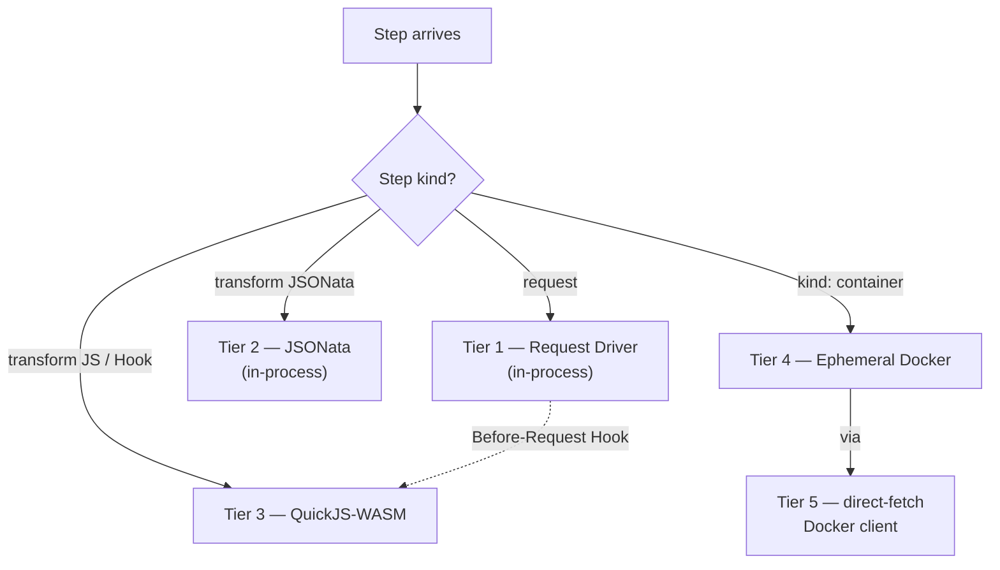
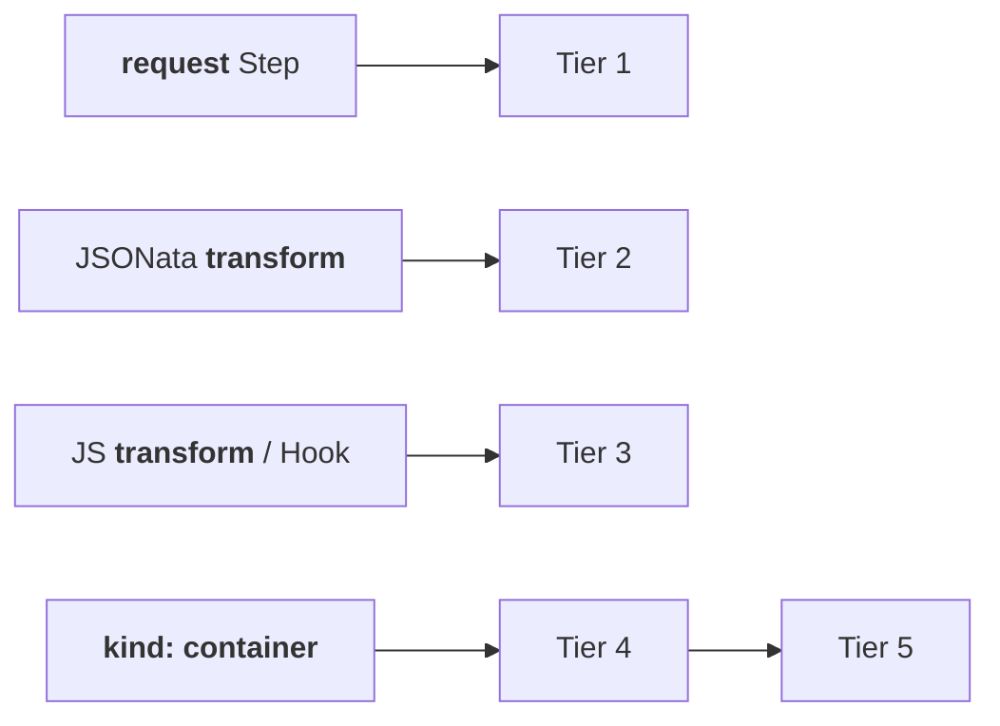

# 08 — Sandboxing

The engine runs untrusted or semi-trusted code in five tiers, each with its own isolation strength, resource caps, and operational cost.

- The right tier is chosen per Step kind and per custom tool unit.
- The engine never escalates a Step into a stricter tier silently.
- The engine never relaxes a stricter tier into a weaker one.

## The five tiers

| Tier | Used for | Configuration | Resource caps |
|---|---|---|---|
| **In-process — request driver** | `request` Steps. Outbound HTTP / Postgres / S3 / GraphQL via the engine's own drivers. | Scoped Credential injection per call, Before-Request Hook gating, response filters, data selectors. | Per-Step timeout (default 1 h), pagination cap (1,000 pages), 429 wait cap (1 h). |
| **In-process — JSONata** | `transform` Steps written in JSONata. | The `jsonata` v2.x evaluator. No host bindings, no I/O, no async. | Transform timeout (default 10 min). Memory bounded by the JSONata expression's own data size. |
| **QuickJS-WASM** | `transform` Steps written in JavaScript. Before-Request Hooks. | `quickjs-emscripten` WASM, bundled into the Bun binary at compile time. No host globals, no `fetch`, no `process`, no `Bun`, no FS. | 128 MB memory cap, 10 million opcode interrupt budget, 10 min wall-clock cap inherited from the transform tier. |
| **Ephemeral Docker container** | Custom tool units: shell scripts, custom images, long-running compute. Anything the operator declares as `kind: container`. | A fresh container per invocation, `--rm`, restricted egress network, mounted only with the inputs it declared, optional `sysbox-runc` runtime for stronger isolation. | 2 GB memory default, 1.0 vCPU default, both overridable per tool unit. Step timeout (default 1 h). No host networking by default; the tool declares the egress hosts it needs. |
| **Direct-`fetch` Docker client** | The engine's own client to the Docker Engine. Not a step kind — this is the layer underneath the Docker tier above. | Bun's native `fetch` over the unix socket at `/var/run/docker.sock`. No `dockerode`, no `node-docker-api`. | N/A — this is the control plane for the container tier, not a sandbox in itself. |

## Tier interaction flow



## Tier 1 — request driver, in process

- **Isolation method**: Runs in the engine process; no untrusted code is evaluated.
- **How it works**: The driver handles Credential decryption, header injection, and URL composition before the call leaves the process.
- **Hook caveat**: The Before-Request Hook, when configured, runs in Tier 3 (QuickJS) and is treated as untrusted JavaScript even though its caller is trusted.
- **When to use**: All `request` Steps.

## Tier 2 — JSONata, in process

- **Isolation method**: Pure data-shaping expression language with no I/O, no host bindings, no way to call out to JavaScript.
- **Resource limits**: Transform timeout (10 min); implicit memory ceiling of the worker.
- **Why in-process**: The worst it can do is be slow or allocate memory — the timeout and worker memory ceiling are sufficient guards.
- **When to use**: All `transform` Steps written in JSONata.

## Tier 3 — QuickJS-WASM

- **Isolation method**: WASM build of the QuickJS interpreter via `quickjs-emscripten`; fresh runtime per evaluation, no shared global state across evaluations.
- **Resource limits**: 128 MB memory cap, 10 million opcode interrupt budget, 10 min wall-clock cap.
- **No host access**: No `fetch`, `process`, `Bun`, FS, module loader, or `import`.
- **When to use**: JavaScript `transform` Steps and Before-Request Hooks.

### QuickJS vs isolated-vm

| Aspect | QuickJS-WASM | isolated-vm |
|---|---|---|
| **JS engine** | QuickJS (WASM) | V8 (native) |
| **Speed** | Slower per opcode | Faster (V8) |
| **Binary story** | Compiles once, ships inside the Bun binary, runs on every target Bun supports | Native module, requires per-platform binaries, breaks `bun build --compile` single-binary |
| **Dependency surface** | Smaller, more inspectable threat surface | Historically has had supply-chain and rebuild friction |

Trade-off: QuickJS-WASM is slower per opcode but preserves the single-binary build and has a smaller attack surface. `isolated-vm` is faster but adds native-module complexity.

### QuickJS configuration details

| Setting | Value | Mechanism |
|---|---|---|
| Memory cap | 128 MB | `setMemoryLimit` |
| Interrupt budget | 10 million opcodes | `setInterruptHandler` with counter |
| Host globals | None | No `fetch`, `process`, `Bun`; stub `console.log` writes to captured buffer |
| Input marshalling | Single JSON value via QuickJS marshalling helpers | Never a live JS reference |
| Output marshalling | JSON parsed once on the host side | Same as input |
| Wall-clock guard | 10 min default | Runs on host alongside opcode counter; whichever fires first wins |

```ts
import { getQuickJS } from "quickjs-emscripten";

export async function evalTransform(source: string, input: unknown): Promise<unknown> {
  const QuickJS = await getQuickJS();
  const rt = QuickJS.newRuntime();
  rt.setMemoryLimit(128 * 1024 * 1024);          // 128 MB

  let opcodes = 0;
  rt.setInterruptHandler(() => ++opcodes > 10_000_000);

  const ctx = rt.newContext();
  try {
    // marshal input as a JSON string the script reads via globalThis.__input__
    const inputHandle = ctx.newString(JSON.stringify(input));
    ctx.setProp(ctx.global, "__input__", inputHandle);
    inputHandle.dispose();

    // wrap the user source so we always get a JSON-serializable result back
    const wrapped = `JSON.stringify((function(input){ ${source} })(JSON.parse(__input__)))`;
    const result = ctx.evalCode(wrapped);

    if (result.error) {
      const err = ctx.dump(result.error);
      result.error.dispose();
      throw new Error(`transform failed: ${JSON.stringify(err)}`);
    }
    const out = ctx.getString(result.value);
    result.value.dispose();
    return JSON.parse(out);
  } finally {
    ctx.dispose();
    rt.dispose();
  }
}
```

## Tier 4 — ephemeral Docker container

- **Isolation method**: Fresh container per invocation, `--rm` always; destroyed immediately after the run regardless of exit status.
- **Resource limits**: 2 GB memory, 1.0 vCPU (both overridable per tool unit), Step timeout (default 1 h).
- **When to use**: Custom tool units declared with `kind: container` — shell scripts, custom images, long-running compute.

### Container defaults

| Setting | Default |
|---|---|
| **Memory** | 2 GB |
| **CPU** | 1.0 vCPU |
| **Filesystem** | Read-only root + tmpfs writable scratch (bounded size); declared inputs mounted read-only, declared output paths captured after exit |
| **Network** | No host network; tool unit declares needed egress hosts, engine wires only those via Docker network policy |
| **Lifetime** | `--rm` always; destroyed immediately after run |
| **User** | Non-root UID via `--user`; further isolated by `sysbox-runc` user namespace when available |

Trade-off: `sysbox-runc` is opt-in, not required. It provides VM-grade isolation (own kernel namespace surface) and is recommended for third-party code on shared hosts. It is opt-in because:
- It is a separate runtime that must be installed alongside Docker.
- Not all hosting environments allow custom OCI runtimes.
- For tenants running only their own tool units, default `runc` plus engine resource caps are already adequate.

The engine reads a per-tenant or per-host configuration flag and selects `runtime: sysbox-runc` on the container create call when present.

## Tier 5 — direct-`fetch` Docker client

- **Isolation method**: Not a sandbox — this is the control plane for Tier 4.
- **Implementation**: Bun's native `fetch` over the unix socket at `/var/run/docker.sock`; no `dockerode`, no `node-docker-api`.
- **Endpoints used**: `containers/create`, `containers/{id}/start`, `containers/{id}/wait`, `containers/{id}/logs`, `images/create`, `containers/exec`, `containers/{id}/attach`.
- **Streaming**: Streaming endpoints return `ReadableStream<Uint8Array>`, piped through the engine's existing streaming machinery (see `07-streaming-and-reactivity.md`).

### direct-`fetch` vs `dockerode`

| Aspect | direct-`fetch` | `dockerode` |
|---|---|---|
| **Code size** | ~60 lines of app code | Full client library dependency |
| **API style** | Direct Docker Engine HTTP API calls | Callback-flavored wrapper API |
| **Bun compatibility** | Native — uses Bun's `fetch` with unix socket | Partial Bun compatibility |
| **Streaming** | `ReadableStream` — same plumbing as the rest of the engine | Separate streaming model |
| **Dependency footprint** | Zero additional dependencies | Extra dependency tree |

Trade-off: `dockerode` is battle-tested but adds a dependency, has partial Bun compatibility, and wraps an HTTP API the engine would need to learn anyway. Direct `fetch` removes the dependency and integrates with the engine's existing `ReadableStream` plumbing.

```ts
const SOCKET = "/var/run/docker.sock";

// Bun's fetch supports unix:// URLs natively
async function dockerRun(image: string, cmd: string[], opts: {
  memory: number; nanoCpus: number; networkMode: string;
}): Promise<{ id: string; exitCode: number; logs: ReadableStream<Uint8Array> }> {
  const create = await fetch(`unix://${SOCKET}/v1.43/containers/create`, {
    method: "POST",
    headers: { "content-type": "application/json" },
    body: JSON.stringify({
      Image: image,
      Cmd: cmd,
      HostConfig: {
        AutoRemove: true,
        Memory: opts.memory,
        NanoCpus: opts.nanoCpus,
        NetworkMode: opts.networkMode,
        Runtime: process.env.DOCKER_RUNTIME ?? "runc", // "sysbox-runc" when opted in
      },
    }),
  });
  const { Id: id } = await create.json();

  await fetch(`unix://${SOCKET}/v1.43/containers/${id}/start`, { method: "POST" });

  const wait = await fetch(`unix://${SOCKET}/v1.43/containers/${id}/wait`, { method: "POST" });
  const { StatusCode: exitCode } = await wait.json();

  const logs = await fetch(
    `unix://${SOCKET}/v1.43/containers/${id}/logs?stdout=1&stderr=1&follow=0`,
  );
  return { id, exitCode, logs: logs.body! };
}
```

## Tier selection summary



- A `request` Step always runs in **Tier 1**.
- A JSONata `transform` always runs in **Tier 2**.
- A JavaScript `transform` and every Before-Request Hook always run in **Tier 3**.
- A custom tool unit declared with `kind: container` always runs in **Tier 4**, talking through **Tier 5**.
- The engine never silently downgrades a Step from a stricter tier into a weaker one.
- Misconfiguring a Step into the wrong tier fails Workflow validation at upsert time.
