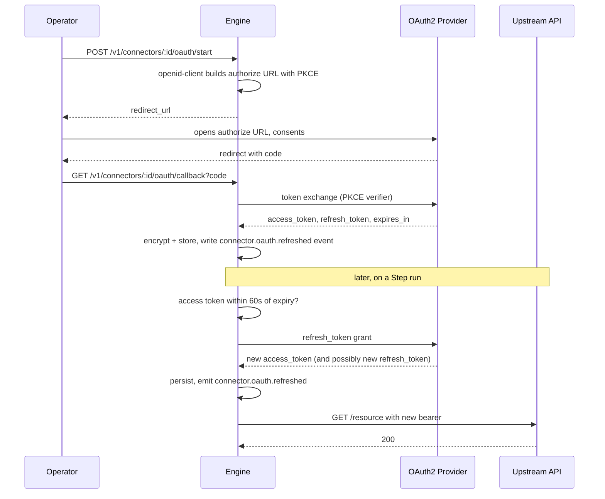

# 09 — Connectors

- A Connector is a typed handle to an external system.
- The engine treats every Connector through a single driver-shaped abstraction.
- Workflow Steps, Self-healing, Documentation Ingestion, and Health Checks all speak to the same surface.
- This file specifies the abstraction, the four built-in drivers, OAuth2 flows via `openid-client`, the Environment model, schema-version tracking, and health checks.

## The driver abstraction

Every driver implements one small TypeScript contract. The engine never branches on `connector.driver` outside the driver layer.

```ts
type ConnectorContext = {
  tenantId: string;
  environment: "dev" | "prod";
  baseUrlOrDsn: string;
  credential: ResolvedCredential;
  tunnel?: TunnelHandle;
  signal: AbortSignal;
};

type Driver = {
  kind: "http" | "postgres" | "s3" | "graphql";
  request(ctx: ConnectorContext, op: DriverOp): Promise<DriverResult>;
  introspect(ctx: ConnectorContext): Promise<IngestedDocBundle>;
  health(ctx: ConnectorContext): Promise<HealthReport>;
};
```

Trade-off: a single contract keeps Step execution, Self-healing, and ingestion identical across drivers; the cost is that every driver carries an `introspect` even when the underlying system has no schema.

- A Connector row in the database carries a `slug`, a `driver`, a `base_url` or DSN reference, and an optional `tunnel_id` for private-network reach.
- One `connector_environments` row exists per Environment.
- Resolved Credentials are looked up at runtime through the `(connector_id, environment)` pair so the engine never mixes `dev` and `prod` secrets.

## Built-in drivers

| Driver | Purpose | Key Library | Trade-off |
|---|---|---|---|
| HTTP | REST APIs (default driver). Honors one-hour timeout, retries on transient classes with jitter, respects upstream `Retry-After`. Pagination (offset, page, cursor, 1,000-page cap) belongs to the Step Runner; the driver issues one request at a time. | `fetch` | Built on `fetch` rather than a higher-level HTTP client because the engine already needs custom retry, abort, and Tunnel routing — additional libraries would duplicate logic. |
| Postgres | SQL via parameterized statements, transaction-scoped operations, and `information_schema` introspection. Opens a per-Connector pool sized to the workflow concurrency cap. | `pg` (same client the engine reuses for the outbox listener) | Reusing `pg` adds zero dependency surface; a dedicated DB driver per dialect would be clearer but expensive in dependency budget. |
| S3 | Object storage. Operations: `getObject`, `putObject`, `headObject`, `listObjectsV2`, `deleteObject`. Streams payloads when the Step Runner offloads large outputs. | `s3-lite-client` | `s3-lite-client` ships a tiny implementation sufficient for the engine's needs; the AWS SDK v3 would add ~10 MB for features the engine never uses. |
| GraphQL | Query, mutation, and introspection in a single shape with persisted-query support. Introspection produces an `IngestedDocBundle` consumed directly by the Documentation Ingestion pipeline. | Thin layer over HTTP driver | A full GraphQL client like Apollo would carry caching layers the engine does not need. |

## Authentication modes

- A Credential row carries one of six modes.
- The driver layer never sees raw secrets; it sees a `ResolvedCredential` after the credential service decrypts and combines operator credentials with End-User Credentials in MERGE or REPLACE mode.

| Mode | Where the secret lands | Notes |
|---|---|---|
| `none` | nowhere | Public endpoints. |
| `header` | a configurable request header | Static API keys carried as headers. |
| `query` | a query parameter | Legacy systems that expect `?api_key=...`. |
| `bearer` | `Authorization: Bearer <token>` | Static long-lived tokens. |
| `basic` | `Authorization: Basic <b64>` | Username + password pair. |
| `oauth2` | `Authorization: Bearer <access_token>` | Auto-refreshed by the engine. |

Trade-off: keeping the modes flat (instead of one polymorphic `auth` blob) means audit logs and policy rules can target a specific mode without parsing nested JSON.

## OAuth2 via `openid-client`

- The engine uses `openid-client` for every OAuth2 flow on the Connector side and for the `oidc` Auth Provider on the Identity side — one library, two concerns.

Trade-off: a dedicated OAuth2-only library would be smaller but would force a second OIDC-aware client just for human login.

Supported flows:

- **Authorization code with PKCE** — for human-consented Connectors. The operator visits a one-time authorization URL the engine generates; the engine exchanges the code, stores the access token plus the encrypted refresh token, and refreshes automatically before expiry.
- **Client credentials** — machine-to-machine. The engine holds a client id and client secret and mints access tokens on demand.
- **Device flow** — for headless installs. The engine prints a verification URL and code, polls the token endpoint, and stores the result.
- **Refresh** — every flow that issues a refresh token gets transparent renewal. Refresh runs automatically when the access token enters its last 60 seconds, and synchronously on a 401 from the upstream system as a fallback.

Refreshed credentials are written back inside a single transaction along with a `connector.oauth.refreshed` Event so any chat or notification consumer can react.



## Environments

- A Connector exists once logically and one row per Environment in `connector_environments`.
- The composite identity `(connector_id, environment)` carries everything that differs between `dev` and `prod`: `base_url` overrides, headers, the Credential row, and the OAuth2 client id.
- Every Execution carries an `execution_mode` of `dev` or `prod`; the Step Runner refuses to mix them inside a single Execution.
- Promoting a Workflow from `dev` to `prod` is therefore a Connector-level operation rather than a Workflow-level one.

Trade-off: hard-coding two Environments instead of an open enum keeps the schema and policy small. Tenants who need more (`staging`, `eu-prod`) can model them as additional Connectors with a slug suffix.

## Schema versions

- Every successful HTTP and GraphQL response is canonicalized into a JSON Schema sketch (key set, types, optionality) and written to `schema_versions` keyed by `(connector_id, endpoint_key)`.
- The engine compares the latest snapshot against the previous one whenever a Step's response shape changes; when the diff is non-trivial, the Self-healing loop is the consumer.
- The driver layer captures the raw response and hands it to the schema indexer; classification (`safe`, `unsafe`) lives in Self-healing.

Trade-off: storing canonical sketches rather than full responses keeps the table cheap; the cost is that some drift signals (for example a value-domain change) are visible only when the Step actually runs.

## Health checks

Every Connector exposes `GET /v1/connectors/:id/health`. The driver's `health` method runs a cheap, idempotent operation appropriate to its kind:

- **HTTP** — `OPTIONS` on `base_url`, falling back to `GET /` if `OPTIONS` is unsupported.
- **Postgres** — `SELECT 1`.
- **S3** — `headBucket`.
- **GraphQL** — a minimal introspection query that returns the schema name only.

- Health reports are cached for 30 seconds per Connector to avoid hammering upstream systems.
- A failed health report writes an `events` row of type `connector.health.degraded`, which Notification Rules can target.

## Tunnel binding

- A Connector with a non-null `tunnel_id` does not call the upstream system from the engine host.
- The driver wraps every operation in a Tunnel request frame and lets the Tunnel layer route it through the agent's WebSocket.
- The Tunnel layer itself is documented in `15-tunnels.md`.
- The driver layer treats Tunnel routing as an opaque transport switch — the same `request(ctx, op)` call returns the same `DriverResult`.

Trade-off: putting the Tunnel switch inside the driver layer instead of at every call site means Self-healing, Health Checks, and Documentation Ingestion all reach private systems through the same path with no extra plumbing.
