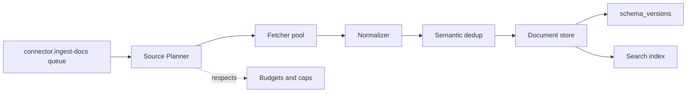

# 10 — Documentation Ingestion

The Documentation Ingestion pipeline pulls structured and unstructured reference material into a Connector so that AI flows can ground their generation in real upstream contracts. Ingestion is per-Connector, idempotent, deduplicated, and bounded by hard byte and link budgets so a single connector cannot starve the rest of the tenant.

## What gets ingested

| Source kind | How it is fetched | Typical content |
|---|---|---|
| OpenAPI direct URL | `fetch` against a known URL | Single spec file (JSON or YAML). |
| SwaggerHub catalog | `fetch` the catalog index, then per-spec | Many specs under one publisher. |
| SwaggerUI page | HTML scrape, locate the embedded spec URL | Specs hidden behind a docs site. |
| GraphQL introspection | The GraphQL driver's `introspect()` | A SDL converted to canonical JSON. |
| HTML site | Headless browser via the optional `playwright` dep | Reference docs that require JavaScript to render. |
| Markdown | `fetch` then parse | README-style operator docs. |
| `llms.txt` | `fetch` then parse | Curated index file for AI consumers. |
| Postgres introspection | The Postgres driver against `information_schema` | Tables, columns, types. |
| Uploaded files | Multipart upload to `/v1/connectors/:id/docs/upload` | PDF, DOCX, CSV, Excel, JSON, XML, YAML, ZIP, GZIP. |

Trade-off on `playwright`: HTML-rendered docs are unavoidable for some upstream systems, but bundling a headless browser is heavy. The engine ships **without** `playwright` by default and lazy-loads it only when an HTML source is configured. Operators who never touch HTML scraping never pay the disk or memory cost.

## Pipeline shape



The pipeline is a queue worker. A row in the `connector.ingest-docs` pg-boss queue carries a Connector id and a source list; the worker plans the source set, fans out fetches, normalizes each result into a canonical `IngestedDocBundle`, deduplicates against what is already stored, writes the new pages, and updates the per-endpoint `schema_versions` rows.

## Budgets and caps

Every cap is enforced at fetch time and at write time. Exceeding a cap stops the run gracefully and writes a partial-result row with the reason; it never silently drops content.

| Concern | Default |
|---|---|
| Per-connector total documentation budget | 10 MB |
| Per-page cap | 3 MB |
| Maximum links followed from a single source | 20 |
| Maximum concurrent OpenAPI fetches | 25 |
| Maximum OpenAPI specs per ingestion run | 100 |
| Semantic-search dedup similarity threshold | 90% |

Trade-off: hard byte budgets make ingestion predictable and prompt-assembly cheap, at the cost of refusing to ingest the long tail of a very large doc site. Operators who hit the cap can curate the source list explicitly or split a Connector into smaller ones.

The 90% similarity threshold uses the engine's internal embedding helper (the same one Context Enhancement uses) — pages whose canonicalized text is within 10% of an existing page are dropped. This catches the common case of a docs site duplicating one section under several URLs.

## Normalization

Every fetched artifact is converted into a canonical `IngestedDocBundle`:

```ts
type IngestedDocBundle = {
  connectorId: string;
  source: { kind: string; uri?: string; uploadedFileId?: string };
  pages: Array<{
    key: string;            // stable hash of normalized content
    title?: string;
    contentType: "openapi" | "graphql-sdl" | "markdown" | "html-text" | "table-schema" | "raw-text";
    body: string;           // canonical text the LLM will read
    bytes: number;
  }>;
  endpoints?: Array<{ endpointKey: string; schema: unknown }>;
  fetchedAt: string;
};
```

OpenAPI specs become one page per operation plus an index page; HTML and Markdown become one page per top-level section; uploaded archives (ZIP, GZIP) are unpacked and each member is normalized as if it had arrived directly. Postgres introspection becomes one page per table plus a schema-overview page.

Trade-off: normalizing everything to a flat page list means prompt assembly never branches on source kind; the cost is that the original structure (for example an OpenAPI tag hierarchy) is recovered from `key` prefixes rather than carried as a tree.

## Auto-refresh schedule

Each Connector carries a `docs_refresh_interval` (default seven days). The Cron Reconciler enqueues a `connector.ingest-docs` job per Connector when the interval elapses. Manual refresh is always available through `POST /v1/connectors/:id/docs/refresh`. Trade-off: a fixed interval is simpler than diffing upstream `Last-Modified` headers, and seven days catches the realistic rate of upstream API changes without spamming the queue.

A refresh run is incremental: only new or changed pages are written, and the dedup pass keeps the per-connector total under the 10 MB budget by evicting the lowest-similarity tail when the cap would be exceeded.

## Storage

Ingested documents live in two places. Canonical text is stored in a `connector_documents` table (one row per page, indexed on `(connector_id, key)`), and embedding vectors are computed lazily by the Context Enhancement layer when a prompt is assembled. The `schema_versions` rows are written from the same transaction as the document rows so a Self-healing run that needs both schema and reference text always reads them consistently.

Trade-off: storing the canonical text in Postgres rather than object storage keeps prompt assembly latency predictable (one indexed `IN` query) at the cost of bloating the DB; the 10 MB per-connector cap keeps the bloat bounded.

## Retrieval at prompt-assembly time

When an AI flow assembles a prompt for a Conversation, a generation, a repair, or an extract turn, Context Enhancement walks scopes in this order: global Skills, then Connector-scoped Skills, then ingested Connector documents (most relevant first, capped by the per-tenant token budget), then prior failures (only on repair), then user turns. The ingested-doc layer therefore sits between the operator's curated Skills and the live conversation, giving the LLM fresh upstream reference material without overwriting the human-authored guidance.

A Connector with no ingested documentation is still usable; the AI flows simply skip the ingested-doc step in prompt assembly. Trade-off: optional, not mandatory, ingestion lets simple Connectors stay simple.

## Health and observability

Each ingestion run writes a row to the engine's metrics surface (`ingestion_pages_total`, `ingestion_bytes_total`, `ingestion_dedup_dropped_total`, `ingestion_failed_total`) labelled by `tenant_id` and `connector_id`. A failed run also emits a `connector.docs.ingest_failed` Event, which Notification Rules can target.
