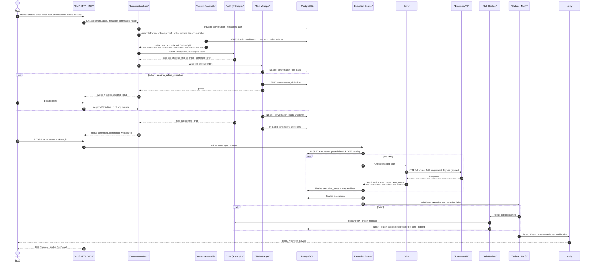
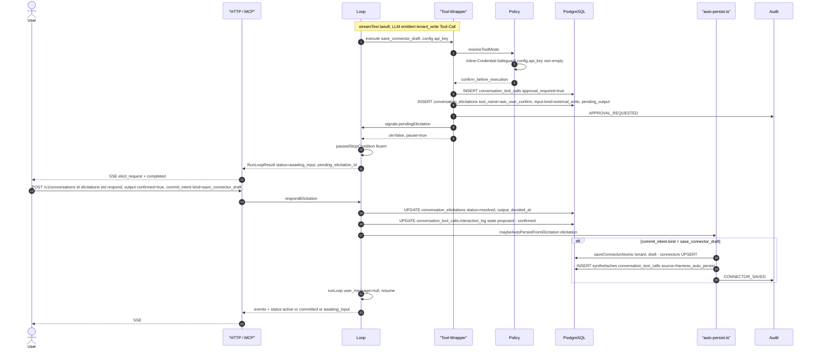
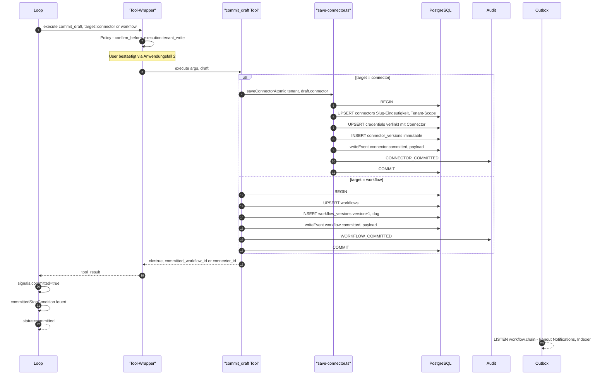
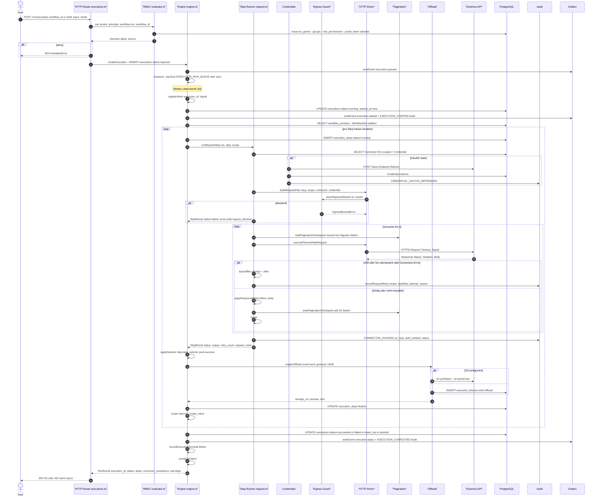
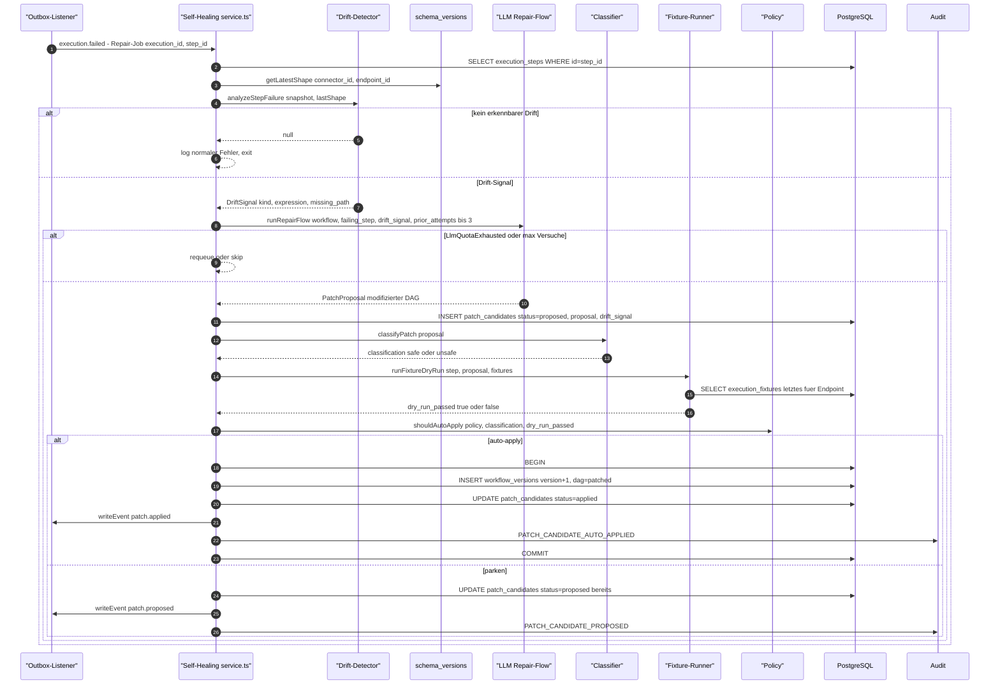
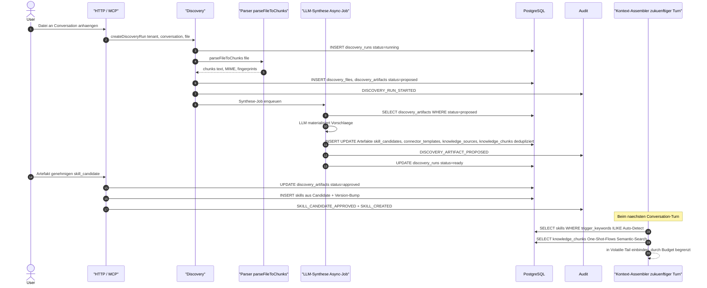
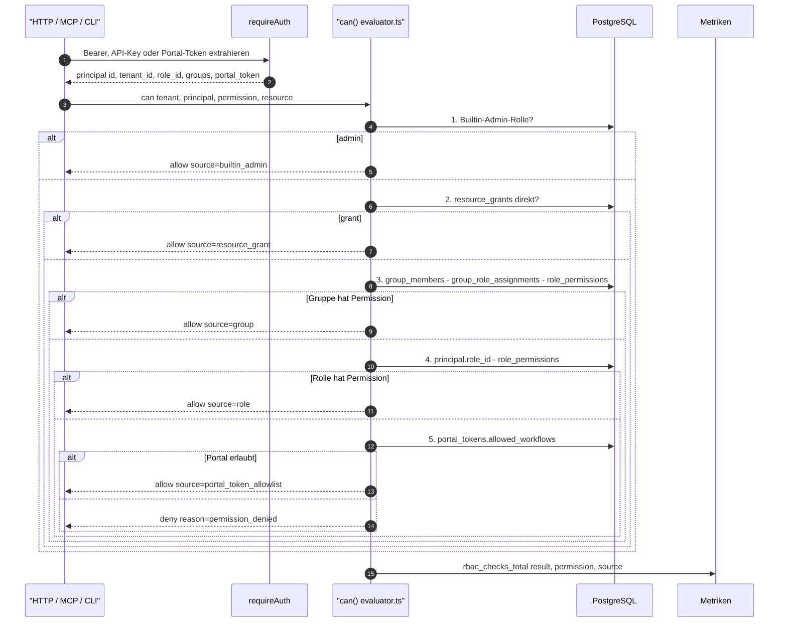
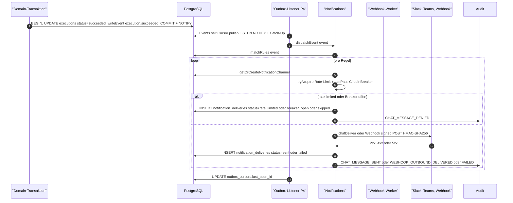

# End-to-End Sequenzdiagramme — Kunden-Pipeline

## Kontext

Dieses Dokument beschreibt die komplette Kundenreise durch die subkit-Pipeline — vom Prompt bis zur Ausführung — als eine Sammlung von Mermaid-Sequenzdiagrammen, gruppiert nach Anwendungsfall. Es existiert, weil das System viele bewegliche Teile hat (HTTP-/MCP-/CLI-Oberflächen, Conversation Loop, LLM-Kontextaufbau, Tool-Policies, Drafts, Persistenz, Executions, Driver, Self-Healing, Audit, Notifications) und es kein einzelnes Bild gibt, das alles zusammenführt.

Die Diagramme sind **deskriptiv für den aktuellen Code** (reine Recherche, keine Änderungen). Wo ein Pfad sich verzweigt (Genehmigung, Drift-Reparatur, Quota), wird der Branch explizit gezeigt.

---

## Akteure & Systeme (Legende)

| Akteur | Was er ist | Wo er lebt |
|---|---|---|
| **User** | Menschlicher Kunde (oder Operator) | Browser, Terminal, MCP-Client |
| **CLI** | `sk` Ink-REPL | `apps/sk/src/{ink-app.tsx,ink-repl.ts,engine-client.ts}` |
| **HTTP** | Hono-Routen (Auth, RBAC) | `apps/engine/src/http/routes/*` |
| **MCP** | MCP-Capabilities | `apps/engine/src/mcp/capabilities/*` |
| **Loop** | Conversation-Runtime | `apps/engine/src/conversations/loop.ts` |
| **Ctx** | LLM-Kontext-Assembler | `apps/engine/src/llm/core/context-assembler.ts`, `runtime-context.ts`, `tenant-summary.ts` |
| **Tools** | Tool-Registry + Wrapper | `apps/engine/src/conversations/tools/{index.ts,sdk-wrap.ts,*.ts}` |
| **Policy** | Tool-Policy-Resolver | `apps/engine/src/conversations/tool-policies.ts` |
| **Draft** | Draft-Snapshots | `apps/engine/src/conversations/draft.ts`, `persistence/*` |
| **LLM** | Anthropic-Provider | `apps/engine/src/llm/core/invoke.ts`, Provider |
| **Engine** | Workflow-Execution-Engine | `apps/engine/src/execution/{engine.ts,state.ts,steps/*,pagination.ts,offload.ts}` |
| **Driver** | Connector-Driver | `apps/engine/src/connectors/drivers/{http,graphql,postgres,s3}.ts` |
| **Heal** | Self-Healing | `apps/engine/src/self-healing/{service.ts,drift-detector.ts,classifier.ts,fixture-runner.ts,policy.ts}` |
| **Audit** | Append-Only-Audit | `apps/engine/src/audit/{audit.ts,recorders/*,types.ts}` |
| **Outbox** | Transaktionale Outbox + LISTEN/NOTIFY | `apps/engine/src/db/events.ts`, Listener-Prozess |
| **Notify** | Notifications & Webhooks | `apps/engine/src/notifications/*`, `webhooks/outbound/delivery-worker.ts` |
| **DB** | PostgreSQL | Tabellen pro Nachricht angegeben |
| **External** | Kunden-API / SaaS | über HTTPS |

---

## Übersicht (zusammengefasste End-to-End-Sicht)



Das ist das Rückgrat. Die folgenden Abschnitte zerlegen jedes Segment in den Detailgrad, den Implementierende benötigen.

---

## Anwendungsfall 1 — Conversation: Prompt → Kontext → Tool → Draft

Wie eine einzelne User-Nachricht zu einem LLM-Turn wird, inklusive Kontextaufbau und einem draft-mutierenden Tool-Call (noch keine externe Schreiboperation).

```mermaid
sequenceDiagram
  autonumber
  actor U as User
  participant H as "HTTP-Route conversations.ts"
  participant S as "Service service.ts"
  participant LP as "Loop loop.ts"
  participant I as "Intent intent-detector.ts"
  participant K as "Context context-assembler.ts"
  participant Sk as "Skills skills/service.ts"
  participant TS as "Tenant Summary tenant-summary.ts"
  participant LLM as "LLM-Provider"
  participant W as "Tool-Wrapper sdk-wrap.ts"
  participant P as "Policy tool-policies.ts"
  participant T as "Tool z.B. propose_step"
  participant D as "Draft draft.ts persistence"
  participant DB as PostgreSQL
  participant A as Audit

  U->>H: POST /v1/conversations message, permission_mode, runtime_context
  H->>H: requireAuth + Principal-Resolution
  H->>S: createConversation params
  S->>DB: INSERT conversations status=active, draft=empty
  S->>A: CONVERSATION_CREATED
  S->>LP: runLoop conversation_id, user_message

  Note over LP: Phase 1 - Append + Intent
  LP->>DB: INSERT conversation_messages role=user
  LP->>I: detectUserIntent text
  I-->>LP: forceTool, forceNoTools, startNewWorkflow

  Note over LP,K: Phase 2 - Kontextaufbau
  LP->>DB: SELECT loaded_skills, draft, attachments
  LP->>K: detectIntentSkills mimes, text, hasFailedExecution
  K->>DB: SELECT skills WHERE trigger_keywords ILIKE
  LP->>K: assembleEnhancedPrompt draft, skills, runtime, prior_failures
  K->>TS: renderTenantSummaryBlock
  TS->>DB: SELECT workflows max 40, connectors max 40
  K->>K: renderRuntimeContextBlock engine_url, actor, surface
  K->>DB: SELECT connectorEndpointSchemas Doc-Analysis-Summary
  K->>DB: SELECT conversation_tool_calls ok=false letzte 8 + draft warnings letzte 10
  K-->>LP: AssembledContext stable_head, volatile_tail, budget_report

  Note over LP: Phase 3 - Budget-Gate
  LP->>DB: SELECT llm_monthly_token_budget; SUM llm_usage.total_tokens
  LP->>LP: checkBudget, checkAndDecrement

  Note over LP,LLM: Phase 4 - streamText mit gecachten System-Bloecken
  LP->>LLM: streamText system stable+volatile, messages, tools, toolChoice
  LLM-->>W: tool_call propose_step, args

  Note over W: Phase 5 - wrap, policy, execute
  W->>W: Prerequisite-Skill-Gate
  W->>DB: INSERT conversation_tool_calls input
  W->>P: resolveToolMode tool, category, input, overrides, permission_mode
  P-->>W: no_confirm draft_write
  W->>T: execute args
  T->>D: ctx.setDraft next withWorkflowStep
  D->>DB: INSERT conversation_drafts snapshot, version+1
  T->>A: AUDIT tool-spezifisch
  T-->>W: ok=true, data
  W->>DB: UPDATE conversation_tool_calls output
  W-->>LLM: tool_result

  Note over LP: Phase 6 - onStepFinish
  LLM-->>LP: Step beendet Usage
  LP->>DB: INSERT llm_usage pro Step
  LP->>DB: INSERT conversation_messages role=assistant, text
  LP->>DB: UPDATE parent_message_id auf pending tool_calls, elicitations
  LP-->>S: RunLoopResult events, status=active
  S-->>H: events + status
  H-->>U: SSE-Frames
```

**Wichtige Code-Referenzen**

- HTTP-Eintritt: `apps/engine/src/http/routes/conversations.ts:229-300`
- Service create/append: `apps/engine/src/conversations/service.ts:144-376`
- Loop-Body: `apps/engine/src/conversations/loop.ts:229-1167`
- Intent: `apps/engine/src/conversations/intent-detector.ts`
- Kontextaufbau: `apps/engine/src/llm/core/context-assembler.ts:194-540`
- Tenant Snapshot: `apps/engine/src/llm/core/tenant-summary.ts:41-101`
- Runtime Context: `apps/engine/src/llm/runtime-context.ts:14-81`
- Wrapper: `apps/engine/src/conversations/tools/sdk-wrap.ts:150-468`
- Policy-Resolver: `apps/engine/src/conversations/tool-policies.ts:194-452`

---

## Anwendungsfall 2 — Genehmigung / Elicitation Pause-Resume (tenant_write)

Wenn das LLM einen Schreibvorgang vorschlägt, den die Policy als `confirm_before_execution` markiert, erstellt die Loop eine Elicitation, hält an, präsentiert dem User eine strukturierte Rückfrage und nimmt nach der Antwort wieder auf — optional mit Auto-Persist über den Harness.



**Verzweigungen**
- `output.confirmed === false` → State `declined`, kein Auto-Persist, ein synthetisches Decline-Tool-Result wird injiziert, damit das LLM weiterläuft.
- Neue Elicitation kommt, während eine andere noch offen ist → die vorherige wird *superseded*; die alte tool_call-Output wird mit `{ok:false, abandoned:true, reason:"elicitation_superseded"}` rückgefüllt (`elicitations.ts:79-115`).
- `permission_mode=yolo` → Policy kürzt alle Confirms ab (Inline-Credential-Safeguard bleibt aktiv).

**Wichtige Code-Referenzen**
- Policy-Resolution-Stack: `apps/engine/src/conversations/tool-policies.ts:407-452`
- Pre-Execution-Confirm-Gate: `apps/engine/src/conversations/tools/sdk-wrap.ts:362-468`
- Pause Stop-Condition: `apps/engine/src/conversations/loop.ts:169-182`
- Elicitation auflösen + Transition + Auto-Persist: `apps/engine/src/conversations/service.ts:378-end`
- Auto-Persist-Dispatch: `apps/engine/src/conversations/persistence/auto-persist.ts`

---

## Anwendungsfall 3 — Commit: Draft → Tenant-Write (CRUD)

Die `commit_draft`-Familie persistiert den Draft in echte `connectors`-/`workflows`-Zeilen mit standardmäßiger expliziter Bestätigung und setzt den Conversation-Status auf `committed`.



**Wichtige Code-Referenzen**
- Commit-Tool: `apps/engine/src/conversations/tools/commit-draft.ts` (oder ähnlich; in `tools/index.ts:196-301`)
- Atomares Speichern: `apps/engine/src/conversations/persistence/save-connector.ts`
- Outbox: `apps/engine/src/db/events.ts`
- Stop-Condition: `apps/engine/src/conversations/loop.ts:142-161`

---

## Anwendungsfall 4 — Execution: Workflow-Lauf End-to-End (Request-Driver)

POST → enqueue → runExecution → Driver-Call pro Step mit Retries, Pagination, Offload, Audit und finalem Status.



**Wichtige Code-Referenzen**
- HTTP-Route + RBAC: `apps/engine/src/http/routes/executions.ts`, `apps/engine/src/rbac/evaluator.ts:1-120`
- Engine: `apps/engine/src/execution/engine.ts`
- State-Writes: `apps/engine/src/execution/state.ts:32-209`
- Request-Step: `apps/engine/src/execution/steps/request.ts:1-end`
- Pagination: `apps/engine/src/execution/pagination.ts`
- Offload: `apps/engine/src/execution/offload.ts:96-143`
- HTTP-Driver + Auth + Egress: `apps/engine/src/connectors/drivers/http.ts`, `apps/engine/src/connectors/egress-guard.ts`
- Execution-Audit-Recorder: `apps/engine/src/audit/recorders/execution.ts`

---

## Anwendungsfall 5 — Self-Healing: Drift-Detection → Patch-Candidate → Auto-Apply oder Park

Wenn ein Step mit strukturell diagnostizierbarem Drift fehlschlägt (JSONata-Path-Miss, HTTP-Shape-Änderung), weckt der Outbox-Fanout Self-Healing. Das LLM schlägt einen Patch vor, der gegen Fixtures dry-run wird, und je nach Policy entweder auto-applied wird (wenn safe) oder zur Operator-Review geparkt wird.



**Wichtige Code-Referenzen**
- Pipeline: `apps/engine/src/self-healing/service.ts:69-240`
- Drift: `apps/engine/src/self-healing/drift-detector.ts:49-100`
- Repair-LLM: `apps/engine/src/llm/flows/repair.ts`
- Classifier / Fixtures / Policy: gleiches Verzeichnis
- Crash-Reaper (Boot): `apps/engine/src/execution/recovery.ts` → `EXECUTION_CRASH_RECOVERED`

---

## Anwendungsfall 6 — Discovery & Knowledge-Ingestion

Ein User hängt eine Datei (OpenAPI, Postman, GraphQL-Schema, PDF) an die Conversation an → Discovery parst sie → produziert Vorschläge (Skill-Candidates, Connector-Templates, Knowledge-Sources) → Operator genehmigt → Assets werden ab dem nächsten Turn im Conversation-Kontext verfügbar.



**Wichtige Code-Referenzen**
- Discovery: `apps/engine/src/connectors/discovery/{index.ts,graphql-introspect.ts,types.ts}`
- Knowledge-Ingestion: `apps/engine/src/knowledge/service.ts:1-263` (Chunk-Dedup bei `:102-106`)
- Skill-Candidates → Skills-Promotion: `apps/engine/src/skills/service.ts:84-156`
- Auto-Detection pro Turn: `apps/engine/src/llm/core/context-assembler.ts:538-683`

---

## Anwendungsfall 7 — RBAC-Gate auf jeder Oberfläche

Derselbe Evaluator unterstützt HTTP, MCP, Webhook, CLI und Tool-Policy-Entscheidungen. Dieses Diagramm zeigt die Entscheidungs-Präzedenz, damit Operatoren verstehen, warum eine Permission-Entscheidung so ausgefallen ist.



**Wichtige Code-Referenzen**
- Evaluator: `apps/engine/src/rbac/evaluator.ts:1-120`
- HTTP-Gate: `requirePermission("workflow:run")` in `apps/engine/src/http/routes/executions.ts`

---

## Querschnitt: Notifications & Webhooks (out-bound)

Jeder Domain-Write, der den Zustand ändert, schreibt eine Zeile in die transaktionale Outbox in derselben Transaktion. Ein separater Listener fanned Events an Notification-Regeln und outbound Webhooks. Das ist es, was dem Kunden Ergebnisse zurückspielt, wenn die Execution asynchron beendet wird.



**Wichtige Code-Referenzen**
- Outbox: `apps/engine/src/db/events.ts`
- Notifications: `apps/engine/src/notifications/service.ts`, Channels in `notifications/channels/webhook.ts`
- Outbound-Delivery: `apps/engine/src/webhooks/outbound/delivery-worker.ts`

---

## Audit & Token-Accounting (Querschnitt)

Jedes Diagramm oben schreibt in `audit_log` (append-only, geschrubbt) und `llm_usage` (pro Step, gewichteter Monatseimer). Diese Verträge erlauben es Operatoren zu rekonstruieren, was passiert ist, Kosten zuzuordnen und Verhalten zu gaten.

| Stream | Tabelle | Writer |
|---|---|---|
| Audit (append-only, geschrubbt) | `audit_log` | `audit/audit.ts:27-70`, Recorder in `audit/recorders/*` |
| Token-Usage | `llm_usage` | Loop `onStepFinish` `loop.ts:856-949`, gewichtet: `prompt + completion + 0.1·cache_read + 0.25·cache_creation` |
| Outbox-Events | per-Tabelle Outbox + `outbox_cursors` | `db/events.ts` |
| Tool-Call-Ledger | `conversation_tool_calls` (`interaction_log` JSONB tracked `proposed→confirmed|declined|partial|tested`) | `tools/sdk-wrap.ts`, `confirmation.ts` |
| Draft-History | `conversation_drafts` (Snapshot pro Mutation) | `draft.ts`, `persistence/*` |

---

## Verifikation

Dieses Dokument ist eine Beschreibung des Codes, daher heisst Verifikation **aus dem Quellcode regenerieren und vergleichen**:

1. **Skim-Sweep** — jede zitierte Datei öffnen und bestätigen, dass die Zeilenbereiche das beschriebene Verhalten noch abbilden. Insbesondere:
   - `apps/engine/src/conversations/loop.ts:229-1167` (Loop-Body)
   - `apps/engine/src/conversations/tools/sdk-wrap.ts:150-468` (Wrapping + Confirm-Gate)
   - `apps/engine/src/conversations/tool-policies.ts:194-452` (Resolution-Stack)
   - `apps/engine/src/execution/state.ts:32-209` + `steps/request.ts` (Execution-States)
   - `apps/engine/src/self-healing/service.ts:69-240` (Repair-Loop)
2. **Live-Trace** — `bun run dev` (oder das Target des Users) starten, einen Prompt absetzen, der einen Connector erstellt + committed + ausführt, und bestätigen, dass die SSE-Frames + DB-Zeilen jede Phase treffen, die das Diagramm vorhersagt. Die CLI-Session unter `apps/sk` ist die direkteste Oberfläche.
3. **Mermaid rendern** — jeden Diagramm-Block in einen Mermaid-Renderer einfügen (jeder Markdown-Previewer mit Mermaid oder `mmdc`) und prüfen, dass die Diagramme parsen. Die CommonMark-Fences hier sind valides Mermaid.
4. **Audit-Cross-Check** — für eine konkrete Execution sollten die Zeilen in `audit_log` so verlaufen: `CONVERSATION_CREATED → APPROVAL_REQUESTED? → CONNECTOR_COMMITTED|WORKFLOW_COMMITTED → EXECUTION_STARTED → CONNECTOR_INVOKED* → EXECUTION_COMPLETED → (PATCH_CANDIDATE_*?) → CHAT_MESSAGE_SENT?`. Alles Fehlende markiert eine Divergenz zwischen diesem Dokument und der Realität.

Wenn ein Segment vom aktuellen Quellcode abweicht, sind die Datei-Referenzen innerhalb jedes Diagramms der günstigste Startpunkt zum Nachlesen.
