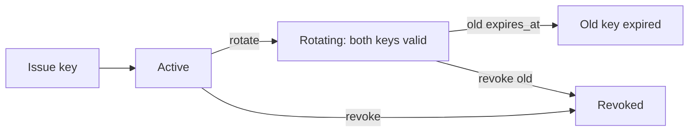
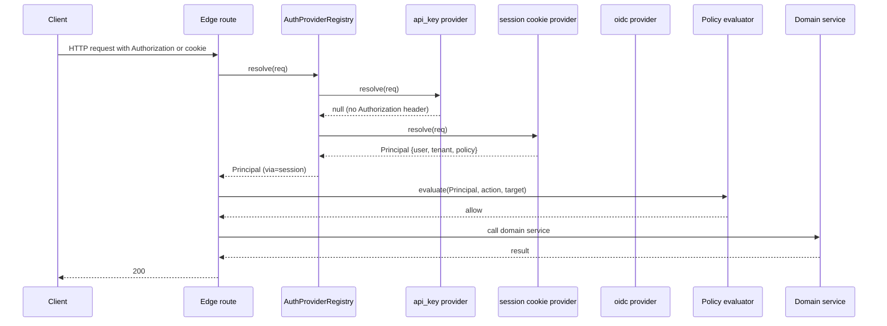

# 11 — Identity and Access

Identity is a single seam that every edge protocol funnels through. REST, MCP, inbound webhooks, the CLI, and chat adapters all resolve a request into a Principal through the same Auth Provider chain, then evaluate Policy, then call domain services. This file specifies the Principal model, the pluggable Auth Provider chain, the v1 providers, the API key lifecycle, sessions, Before-Request Hooks, the RBAC and ABAC layers, end-user credentials, and chat identity linking.

## Principals

A **Principal** is the resolved identity behind a request. Every Principal carries a `tenantId`, a `kind` (`user` or `system_account`), an `id`, an `effectivePolicy` blob, and a `via` provider tag for audit. Once a Principal is resolved, downstream code (Policy, Before-Request Hooks, audit log, Step Runner) is provider-agnostic — only the Auth Provider file knows how the Principal was produced.

| Identity | Created by | Authenticates via | Logs into a UI? |
|---|---|---|---|
| Tenant | Admin onboarding | n/a (boundary, not principal) | n/a |
| User | OIDC login | `oidc` provider, then session cookie | yes |
| System Account | Admin REST call | `api_key` provider only | no |
| Portal Token | Admin REST call (scoped to one end user) | `api_key` provider with portal scope | no |

Trade-off: keeping System Accounts disjoint from Users prevents an entire class of bugs where a machine token accidentally lands in a session cookie.

## The pluggable Auth Provider chain

The engine ships with a small TypeScript interface and a registry. Every provider lives in one file under `auth/providers/`. Adding a new provider in a future release is a single-file plugin: no changes to routes, no changes to the Policy evaluator, no changes to the Step Runner.

```ts
type AuthCapability = {
  machine: boolean;       // can resolve System Accounts
  human: boolean;         // can resolve Users
  interactive: boolean;   // supports redirect-based login
  refresh: boolean;       // supports session refresh
  revoke: boolean;        // supports explicit revocation
  mfa: boolean;           // supports a second factor
};

export interface AuthProvider {
  readonly name: string;
  readonly capabilities: AuthCapability;
  resolve(req: AuthRequest): Promise<Principal | null>;
  startLogin?(req: AuthRequest): Promise<LoginRedirect>;
  finishLogin?(req: AuthRequest): Promise<Principal>;
  refreshSession?(p: Principal): Promise<Principal>;
  revoke?(p: Principal): Promise<void>;
}
```

A registry walks providers in priority order per surface and short-circuits on the first non-null Principal:

```ts
class AuthProviderRegistry {
  constructor(private chain: AuthProvider[]) {}
  async resolve(req: AuthRequest): Promise<Principal | null> {
    for (const p of this.chain) {
      const out = await p.resolve(req);
      if (out) return { ...out, via: p.name };
    }
    return null;
  }
}
```

Trade-off: a tiny interface and a synchronous chain are easier to reason about than a plugin DAG; the cost is that a provider that needs another provider's output (rare) has to be modeled as a wrapper.

### Chain order per surface

The chain is configured per surface. The defaults are:

| Surface | Chain |
|---|---|
| REST | `api_key` → session cookie → `oidc` redirect |
| MCP | `api_key` only |
| CLI scripted | `api_key` |
| CLI interactive | `oidc` device flow |
| Webhook (inbound) | `api_key` (for the operator's own endpoints) plus per-row signature verification |

A provider declares its capability surface; the engine refuses to mount a provider on a surface whose required capabilities are missing (for example mounting an `api_key`-only provider as the CLI interactive provider would fail boot validation).

## v1 providers

### `oidc`

Built on `openid-client`. Performs authorization code with PKCE for human login, and uses the same library for headless Connector OAuth2 flows. Sessions issued by `oidc` use the app-owned session table and a cookie signed via `jose`. Trade-off: one library covers two concerns (user login plus Connector OAuth2); a dedicated OIDC-only library would shrink the API but force a second OAuth2 client just for Connectors.

### `api_key`

Self-implemented. Token format: `wf_live_<random32>` where `random32` is 32 base32 characters from a CSPRNG. The visible prefix `wf_live_` plus the first eight characters of the random portion form the public, indexable `prefix`; the full token is hashed with SHA-256 and stored as `token_sha256`. Verification is a single indexed lookup on `prefix`, then a constant-time comparison on `token_sha256`.

**Why SHA-256 and not Argon2id.** API keys are 160 bits of CSPRNG entropy. SHA-256 is the correct primitive for high-entropy random secrets — a brute-force attack on the hash is computationally infeasible regardless of how fast the hash is. Argon2id is designed to slow down attacks on **low-entropy passwords** by spending CPU and memory; running Argon2id on a 160-bit random token would add 50 to 200 milliseconds per verify for **zero** security benefit and would put a hard ceiling on authenticated request throughput. The future `password` provider (out of scope for v1) uses Argon2id because that is exactly what passwords need.

## API key lifecycle

| Operation | What happens |
|---|---|
| Issue | Generate token, write `prefix` + `sha256(token)` row, return token once. Audit row written. |
| Rotate (overlap) | Issue a new key, write the new row with `rotated_from_id` pointing at the old one, set `rotating_out_at` on the old row. Both keys verify until the old row's `expires_at` passes. |
| Revoke | Set `revoked_at`. The verifier rejects any row with a non-null `revoked_at`. |
| Last-used flush | Verifier writes to an in-memory map. The `apikey.last-used-flush` queue runs every 60 seconds and bulk-updates `last_used_at`. |
| Audit | Every issue, rotate, revoke, and explicit failure writes an immutable `audit_log` row. |

Trade-off: an in-memory `last_used_at` buffer keeps the hot path one indexed read instead of one read plus one write. The cost is that a crash drops up to 60 seconds of last-used data — acceptable for a column whose only consumer is the operator's UI.



## Portal Tokens

Portal Tokens are a scoped flavor of API keys, issued by the same `api_key` provider through a scoped code path. They differ from regular API keys in three ways: the default TTL is shorter (24 hours instead of unlimited), `allowed_workflows` is required and non-empty, and the `enduser_ref` column carries an opaque external id that lets the operator's own system attribute traffic to a specific end user without provisioning a full User row. Trade-off: reusing the API key primitive instead of inventing a new token kind keeps verification and audit identical for both, and rotation/overlap work without any additional code.

## Sessions

Sessions are minimal. The `sessions` table carries `session_id`, `user_id`, `expires_at`, and `revoked_at`. The session id is wrapped in a JWT signed by `jose` and set as an HTTP-only, secure, SameSite cookie. The TTL is sliding eight hours with a 30-day absolute ceiling. Refresh happens automatically on any authenticated request that finds the session within 60 seconds of expiry. Trade-off: an app-owned table (rather than stateless JWTs) lets the engine revoke a session immediately, which matters more than the slightly higher read load.

## Future provider ports (designed for, not in v1)

The `AuthProvider` interface is shaped so that each of these is a single-file addition. None of them ship in v1; the contract simply does not block them.

| Provider | Likely dependency | One-line rationale |
|---|---|---|
| `password` | Bun's built-in `Bun.password` (Argon2id) or `argon2` | Local accounts; Argon2id is correct here because passwords are low-entropy. |
| `saml` | `samlify` | Enterprise SSO integration. |
| `ldap` | `ldapjs` | Enterprise directory lookup. |
| `webauthn` | `@simplewebauthn/server` | Passkey and FIDO2 authentication. |
| `magic_link` | none new (delivered via Chat Adapter) | Passwordless one-time tokens; email is out of scope, so delivery is over chat. |
| Named OAuth presets | `openid-client` (already present) | Thin convenience wrappers for GitHub, GitLab, Google, Microsoft, Okta, Auth0. Zero new deps. |
| `mtls` | none new (Bun TLS layer) | Client-certificate auth for regulated M2M deployments. |

## Before-Request Hooks

A Before-Request Hook is a per-role JavaScript expression evaluated immediately before every outbound `request` Step. Hooks see the Principal, the Connector, the method, the URL, headers, query, body, the Step config, and an `is_mutating` flag, and they return either an allow signal or a structured deny.

Hooks run inside the same `quickjs-emscripten` sandbox the engine already uses for `transform` Steps — no new dependency, no new expression language to learn. The interrupt budget for hooks is roughly 100,000 opcodes (about 100x tighter than the 10 million opcode budget for `transform`), there is no FS, network, or host-globals access, and the sandbox is fail-closed: any throw, timeout, or unexpected return value denies the request.

Hooks are stored in the `request_hooks` table, versioned per role, and editable only by admins. The admin surface offers a dry-run mode that runs the hook against sample requests without committing anything, and a rollback to any previous version. Trade-off: reusing the existing sandbox keeps the dependency budget flat and lets hook authors test the same way they test `transform` code.

## RBAC and ABAC

Roles are flat: `admin`, `member`, `enduser`, `tunnel_agent`, `metrics_scraper`, `portal_token_user`. Roles map to default scopes. Tenants can override the role-to-scope mapping inside the Policy table. ABAC rules add fine-grained constraints on top of RBAC: a Policy row can require, for example, that a User can only call Workflows whose `tags` include their team name, or that an `enduser` can only invoke Workflows in the `allowed_workflows` set carried by their Portal Token.

The `conversation:*` permission family (`conversation:read/write/approve/cancel/commit/list`) plus `memory:write` and `mcp:read` were added for the `sk` end-user CLI (migration `0018_p2_sk_cli`). Conversation routes primarily gate on `conversation:*` and fall back to the legacy `workflow:*` permissions during the deprecation window via `requireAnyPermission`. Portal-token principals are granted `conversation:read/write/cancel` through the evaluator's allowlist branch so an end-user can chat about their approved workflows without inheriting the underlying user's role permissions. The portal-token branch deliberately excludes `conversation:commit` and `memory:write` — end-users cannot commit drafts or attach free-form memory.

Policy evaluation runs at two places:

1. At the edge, immediately after Principal resolution and before any domain service is touched.
2. Inside the Step Runner whenever a Step kind `call` invokes another Workflow — even if the parent Execution was already authorized, the child Workflow is re-checked against the same Principal.

Trade-off: re-checking inside the engine costs one extra evaluation per `call` step but eliminates a privilege escalation class (a low-privilege Workflow chaining into a high-privilege one).

## End-user credentials

End-user credentials are encrypted in `end_user_credentials` and combined with operator credentials at request time in one of two modes:

- **MERGE** — the operator credential supplies the base values (for example a base URL, a default header) and the end-user credential overlays specific fields (for example a per-end-user bearer token).
- **REPLACE** — the end-user credential fully overrides the operator credential. Used when each end user authenticates entirely with their own secret.

The combination happens once per Step inside the credential service, so the `request` Step driver always sees a single `ResolvedCredential`.

## Chat identity linking

Chat identity linking is **user-initiated**. The chat user runs `/subkit link` inside a Slack thread, Teams reply chain, or Google Chat thread. The engine replies ephemerally with a short-lived signed deeplink to `PUBLIC_BASE_URL/chat/link?state=<jwt>`. The JWT is signed by `jose` and carries `(platform, workspace_id, platform_user_id, nonce, expires_at)`. The link expires in 10 minutes and is single-use. The user clicks the link, completes the normal `oidc` login through `openid-client`, and the engine writes a `chat_identities` row binding their User to their platform identity.

Messages from an unmapped chat user receive an ephemeral reminder to run `/subkit link` and are otherwise ignored. No anonymous or guest policy is granted by default. Trade-off: forcing the user to initiate the link removes an entire class of impersonation bugs at the cost of one extra step on first use.

## Auth Provider chain — sequence diagram


