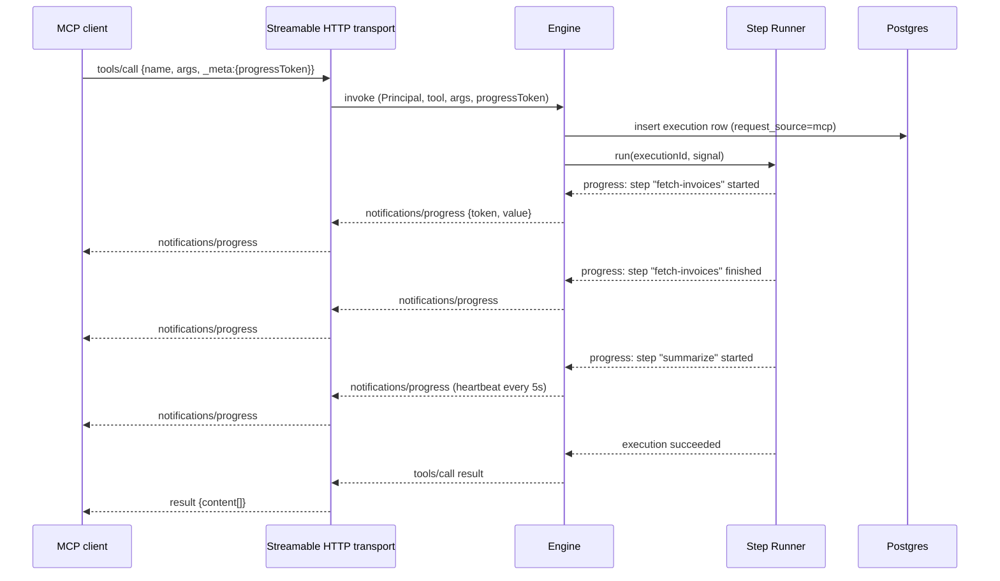

# 12 — MCP Server

The engine speaks the Model Context Protocol natively. MCP is not bolted onto the side; it is a first-class edge surface that funnels through the same Auth Provider chain, the same Policy evaluator, and the same Step Runner as REST. This file specifies the transports, the full surface, the domain mappings, the long-running tool-call streaming model, the result-size cap, and the auth parity with REST.

## Library

`@modelcontextprotocol/sdk` v1. Trade-off: using the official SDK keeps wire-format compliance free as the spec evolves, at the cost of one runtime dependency that the engine could in principle implement itself; the spec churn rate makes that the wrong trade.

## Transports

Two transports, mounted side by side from one MCP server instance:

| Transport | Mounted on | Used by |
|---|---|---|
| Streamable HTTP | Hono routes under `/mcp` | Remote agents and remote AI clients. |
| stdio | A subprocess channel | Local agents (the `subkit mcp` CLI command, IDE plugins). |

The plain SSE transport is **deprecated upstream** and is **not** mounted by this engine. Trade-off: dropping SSE simplifies cancellation and progress semantics; clients that need MCP must use Streamable HTTP or stdio, which is now the modern default.

`enableJsonResponse` is **off** on every endpoint that needs to emit progress notifications. Long-running `tools/call` requests must hold an open stream so the engine can interleave `notifications/progress` with the final result; turning JSON-mode on would force the request into a single response object and break the contract.

## Surface

The engine exposes the full MCP method set:

| Method | Behaviour |
|---|---|
| `tools/list` | Lists Workflows visible to the Principal as MCP tools. |
| `tools/call` | Invokes a Workflow as an Execution. Streams `notifications/progress`. |
| `resources/list` | Lists Connectors visible to the Principal as MCP resources. |
| `resources/read` | Reads a Connector's metadata, ingested documentation index, and health report. |
| `resources/subscribe` | Subscribes to Connector update events (OAuth refresh, schema-version drift, health changes). |
| `prompts/list` | Lists Skills visible to the Principal as MCP prompts. |
| `prompts/get` | Returns a Skill's body, examples, and best practices ready for prompt assembly. |
| `completion/complete` | Argument completion for tool inputs (Workflow names, Connector slugs, parameter names). |
| `notifications/progress` | Server-pushed progress for any in-flight `tools/call`. |
| Cancellation | Client-driven cancel propagates as an AbortSignal into the running Step Runner. |

## Domain mappings

The mapping from engine concepts to MCP primitives is fixed and explicit.

| Engine concept | MCP primitive | Notes |
|---|---|---|
| Workflow | tool | One MCP tool per active Workflow Version visible to the Principal. |
| Connector | resource | Connector metadata, ingested doc index, and current health. |
| Skill | prompt | Skill body and examples returned through `prompts/get`. |
| Conversation | tool cluster | A small fixed set of tools (`conversation.start`, `conversation.send_turn`, `conversation.approve`, `conversation.commit`) that drive the structured-intent loop. |

Trade-off: mapping Conversations to a tool cluster (rather than to a separate primitive) lets MCP clients drive the full authoring loop with the same `tools/call` plumbing they use for normal Workflow execution. The cost is that Conversation operations look like tools rather than a first-class chat surface; clients can still display them as chat by reading the cluster prefix.

## Long-running `tools/call` with progress

A Workflow run can take minutes or hours. The MCP `tools/call` invocation streams partial progress through `notifications/progress` keyed by a `progressToken`. The engine picks up the `progressToken` from the request envelope, attaches it to the Execution, and emits one notification per Step state transition plus periodic heartbeats every five seconds while a single Step is still running.

Clients are expected to use the SDK's `resetTimeoutOnProgress` option together with a generous `maxTotalTimeout`. Trade-off: leaving the per-notification timeout reset to the client (rather than disabling timeouts entirely on the server side) keeps long-running calls debuggable — a stuck Step still surfaces as a broken stream after the client's `maxTotalTimeout`.

If the client cancels mid-run, the SDK delivers a cancellation message; the engine maps it to the Execution's AbortSignal and the Step Runner unwinds at the next safe point. The Execution row transitions to `aborted` and the cancellation propagates through any in-flight `call` chain.

## Result size cap

A single `tools/call` result is capped at **20,000 characters** of inline content. Larger results are offloaded to object storage and the response carries a URI plus a short summary instead of the inline payload. The engine uses the same offload threshold and storage path as Step result offloading (`result_storage_uri` on the Execution row), so the URI returned to the MCP client is the same one a REST client would see.

Trade-off: a hard inline cap protects MCP clients (which are typically token-budgeted LLMs) from accidentally consuming a 5 MB response; the offload URI gives them a cheap escape hatch when they really do need the full payload.

## Auth parity with REST

MCP uses the **same Auth Provider chain** as REST. The chain configured for the MCP surface in v1 is `api_key` only — MCP clients always present a bearer token. Once the `api_key` provider returns a Principal, the rest of the surface (Policy, Before-Request Hooks, audit log) is provider-agnostic. Trade-off: not exposing session-cookie auth on MCP keeps the surface stateless and easy to debug; human users who want to drive MCP from a browser can do so through the CLI, which holds an API key locally.

The REST and MCP surfaces share the **same** Policy decisions. A Workflow that the Principal cannot run from REST is also invisible in `tools/list` and unreachable through `tools/call`. A Connector hidden from REST does not appear in `resources/list`. A Skill hidden from REST does not appear in `prompts/list`. There is no second policy table for MCP.

## What MCP does not do

The MCP surface does not run the structured-intent authoring loop autonomously — Conversations still move through the Conversation tool cluster, and human approval gates still apply. The MCP surface also does not stream LLM tokens directly; it streams **engine progress**. Token streaming for AI flows lives on the SSE/REST surface (and on chat platforms via the progressive-edit strategy).

Trade-off: keeping MCP focused on engine progress (and not on raw LLM token streaming) makes the surface usable from clients that have their own model — they call the engine for orchestration, not for inference.
