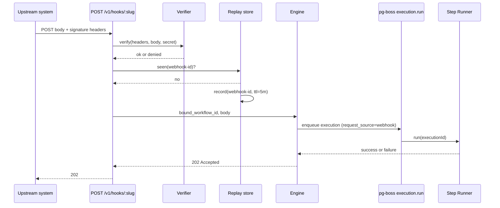
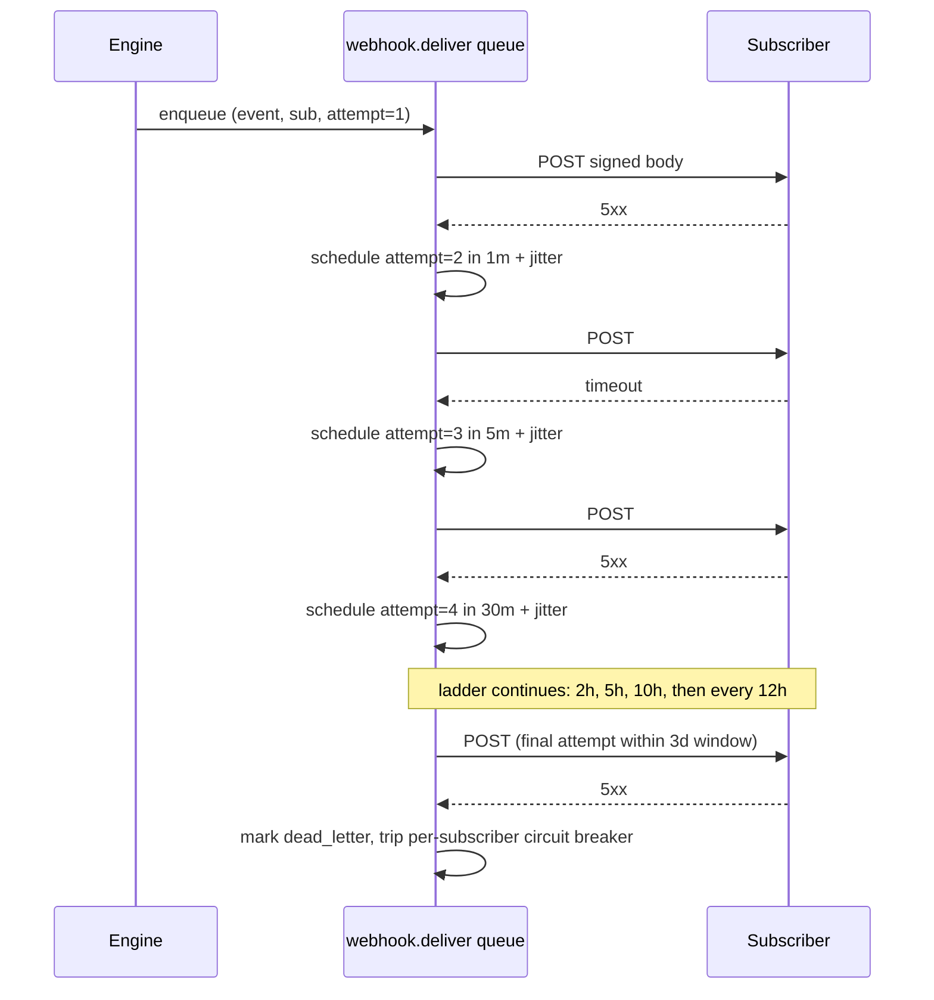

# 13 — Webhooks

The engine offers a full-flavored webhook API on both sides of the boundary. Inbound: external systems trigger Workflows by signing requests against the Standard Webhooks spec or a connector-native scheme. Outbound: the engine signs and delivers Events to tenant-owned subscribers with a retry ladder, multi-signature rotation, a circuit breaker, and a delivery log. This file specifies both directions, the verifier set, the retry cadence, and the first-party Event catalog.

## Inbound webhooks

### Endpoint

`POST /v1/hooks/:slug` is the single inbound entry point. The `:slug` resolves to a row in `webhooks_inbound` that carries the configured verifier, the encrypted shared secret, the bound Workflow id, and the active flag. The request body is forwarded verbatim as the Workflow input.

### Verifier set

Verification is plug-in style: one verifier per inbound row, selected at create time. Trade-off: per-row verifier (rather than per-tenant) lets a single tenant terminate webhooks from many different upstream systems, each with its own native scheme.

| Verifier | Headers consulted | Algorithm |
|---|---|---|
| `standard` | `webhook-id`, `webhook-timestamp`, `webhook-signature` | HMAC-SHA256 over `id.timestamp.body`, multi-signature aware. |
| `github` | `x-hub-signature-256` | HMAC-SHA256 over the raw body. |
| `stripe` | `stripe-signature` | HMAC-SHA256 over `timestamp.body`, with their tolerance window. |
| `custom` | configurable | A QuickJS-WASM expression executed with the same fail-closed sandbox used by Before-Request Hooks. |

The default verifier is `standard` per the standardwebhooks.com specification.

### Replay protection

Every verifier participates in replay protection. The engine accepts a request only if its declared timestamp is inside the replay window of **five minutes**. The `webhook-id` (or the verifier's equivalent) is recorded in a deduplication table for the same window; a duplicate id within the window is rejected with `409 Conflict` and never reaches the Workflow. Trade-off: a fixed five-minute window matches the canonical Standard Webhooks behavior and is short enough to keep the dedup table small while still tolerating clock skew.

### Trigger flow



The endpoint always responds `202 Accepted` once verification, dedup, and enqueue have completed; the actual Workflow run is asynchronous. Trade-off: returning early decouples upstream timeouts from Workflow runtime — a 6-hour Workflow does not block the inbound POST.

## Outbound webhooks

### Subscription model

A Subscription is a tenant-owned route:

```ts
type Subscription = {
  id: string;
  tenantId: string;
  eventPattern: string;     // glob, e.g. execution.* or patch.proposed
  targetUrl: string;
  secret: EncryptedBlob;
  filters?: Record<string, unknown>;
  active: boolean;
};
```

The engine matches every outbox Event against the active Subscription set; the matcher is a flat glob comparison on the Event `type`, with optional structural filters on `payload`. Trade-off: a flat glob is enough for the realistic event volume; a full predicate language would add a query planner the engine does not need.

### Standard Webhooks signing

Outbound deliveries are signed per the Standard Webhooks spec. Three headers are set on every request:

| Header | Value |
|---|---|
| `webhook-id` | A UUID v4 unique per delivery. |
| `webhook-timestamp` | Unix seconds at delivery time. |
| `webhook-signature` | `v1,<base64(HMAC-SHA256(secret, "id.timestamp.body"))>` |

During secret rotation the header carries multiple space-separated `v1,<sig>` tuples — one per active key — so consumers can verify with either the old or the new secret during the rotation overlap. Trade-off: multi-signature in one header (rather than separate headers per key) keeps the wire format identical to the spec and avoids consumers needing custom rotation handling.

### Retry cadence

Deliveries are owned by the `webhook.deliver` pg-boss queue. The retry cadence is fixed and matches the canonical Stripe-style ladder:

```
1 minute, 5 minutes, 30 minutes, 2 hours, 5 hours, 10 hours, then every 12 hours up to 3 days
```

Each delay carries jitter (uniformly sampled within ±20%) so a bursty failure does not synchronize retries. After the three-day window expires, the delivery transitions to `dead_letter` and stops being retried automatically. Trade-off: a deterministic, bounded ladder is easier to reason about than an exponential schedule with no ceiling, and three days catches every reasonable upstream outage.



### Manual replay and dead-letter

A delivery in any state can be replayed manually through `POST /v1/subscriptions/:id/deliveries/:delivery_id/replay`. Replay re-enqueues a fresh attempt with a new `webhook-id` and a fresh timestamp; the original delivery row is preserved for audit. Dead-lettered deliveries are listed under `GET /v1/subscriptions/:id/deliveries?status=dead_letter` and can be replayed in bulk.

### Circuit breaker

Every Subscription carries a `circuit_state` of `closed`, `half_open`, or `open`. After ten consecutive permanent failures (any non-2xx that exhausts the per-attempt retry slot) the breaker trips to `open` and stops dispatching to that target for a cool-off window of one hour, then enters `half_open` and lets a single probe delivery through. A success closes the breaker; a failure re-opens it. Trade-off: a per-subscriber breaker contains a misbehaving consumer to its own queue tail without affecting other deliveries.

### Delivery log

Every attempt writes a row to `deliveries` with the attempt number, the response code, and the next retry time. The log is the source of truth for both the API surface and the `webhook_delivery_total` metric. Trade-off: writing one row per attempt keeps the audit story simple at the cost of some volume; the table is partitioned by `created_at` in the migration recipe.

## Event catalog

These are the first-party Event types the engine emits to the outbox. All are matchable in Subscription `event_pattern` and Notification Rule patterns. Payloads are stable JSON with a small set of always-present fields (`tenant_id`, `event_id`, `at`) plus a per-type body.

| Event type | Payload shape (selected fields) |
|---|---|
| `execution.succeeded` | `{ executionId, workflowId, workflowVersionId, requestSource, executionMode, durationMs }` |
| `execution.failed` | `{ executionId, workflowId, requestSource, executionMode, error: { code, message, stepKey } }` |
| `workflow.updated` | `{ workflowId, workflowVersionId, authorKind, authorId }` |
| `connector.oauth.refreshed` | `{ connectorId, environment, expiresAt }` |
| `patch.proposed` | `{ patchId, workflowId, classification, fixtureId, summary }` |
| `apikey.rotated` | `{ apiKeyId, rotatedFromId, prefix, rotatingOutAt }` |
| `tunnel.connected` | `{ tunnelId, name, agentRemote }` |
| `tunnel.disconnected` | `{ tunnelId, name, reason }` |
| `conversation.committed` | `{ conversationId, targetWorkflowId, targetConnectorId, committedBy }` |

Trade-off: a small, curated catalog (rather than letting any internal event escape) means subscribers can rely on payload stability; new types are added through versioning notes in the changelog.
