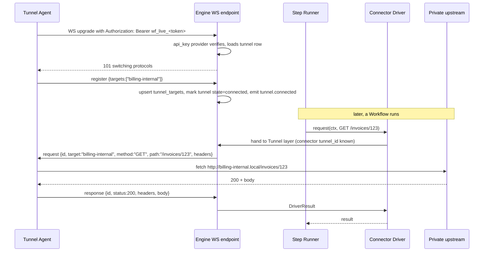

# 15 — Tunnels

A Tunnel is the engine's mechanism for reaching systems that live inside a private network: an internal database, an on-prem API, a service behind a corporate firewall. A small companion **Tunnel Agent** binary runs inside the customer network, opens a persistent authenticated WebSocket out to the engine, and registers one or more named targets. The engine routes Connector requests bound to that Tunnel through the open socket. Nothing about the customer's egress firewall changes — the agent dials out, the engine never has to dial in.

## Building blocks

| Concept | Lives in | Purpose |
|---|---|---|
| `tunnels` row | `tunnels` table | A registered Tunnel session, named per tenant. |
| `tunnel_targets` row | `tunnel_targets` table | Per-target routing entry with a concurrency cap. |
| Tunnel Agent | Separate Bun binary, same codebase | Dials out, registers targets, executes local fetches. |
| Connector binding | `connectors.tunnel_id` | A Connector whose driver routes through a Tunnel instead of the engine host. |

Trade-off: making the Tunnel a first-class row in the schema (rather than a configuration field on the Connector) keeps the operational surface clean — operators can list, rotate credentials for, and disconnect Tunnels independently of the Connectors they serve.

## The companion Tunnel Agent

The agent is built from the same codebase as the engine, with a separate Bun compile target:

```sh
bun build --compile --target=<triple> --outfile=tunnel-agent ./agent/entry.ts
```

It is distributed as a single binary per OS/arch. The CLI command `subkit tunnel-agent run` is the same binary under the engine repo. Operators drop it on a host inside the customer network with a TUNNEL_TOKEN environment variable and a list of target names; nothing else is required.

## WebSocket endpoint and auth

The engine exposes one WebSocket endpoint for tunnel agents under `PUBLIC_BASE_URL`. The agent connects with a bearer token in the `Authorization` header — a regular API Key issued to a **Tunnel-scoped System Account** (one per Tunnel). Verification uses the same `api_key` Auth Provider path REST and MCP use, so the token is hashed with SHA-256 and stored as `agent_token_sha256` in `tunnels`. Trade-off: reusing the API Key primitive means tunnel auth gets rotation, revocation, and audit for free, with no second token type to maintain.

A successful handshake updates `tunnels.state` to `connected`, sets `last_seen_at`, and emits a `tunnel.connected` Event onto the outbox. A disconnect emits `tunnel.disconnected`.

## Library choices

| Side | Library | One-line rationale |
|---|---|---|
| Engine | Bun's built-in WebSocket server | Already in the runtime; no extra dep, integrates with Hono's upgrade handler. |
| Agent | `ws` (npm) | The most stable Node-compatible WebSocket client; works under Bun without surprises. |

No `socket.io`. The framing layer is small enough that the additional features socket.io brings (rooms, ack semantics, transports) would only obscure it.

## Framing

The framing is a tiny request/response protocol. Every frame is a JSON envelope with a stable shape:

```ts
type TunnelFrame =
  | { kind: "register"; targets: string[] }
  | { kind: "ping"; t: number }
  | { kind: "pong"; t: number }
  | { kind: "request"; id: string; target: string; method: string; path: string; headers: Record<string, string>; body?: string }
  | { kind: "response"; id: string; status: number; headers: Record<string, string>; body?: string }
  | { kind: "error"; id: string; code: string; message: string };
```

Trade-off: a JSON envelope is slightly larger on the wire than a binary frame but trivial to debug, and the WebSocket transport already compresses with permessage-deflate when both sides agree.

The `id` on a `request` frame is a UUID generated by the engine; the `response` or `error` frame echoes it back so the engine can resolve the originating Connector call. Pending requests live in an in-memory map keyed by `id`, with a timeout that matches the request-step timeout (one hour). A `pong` resets the keepalive deadline; a missed `pong` for more than 60 seconds tears down the socket and triggers reconnect on the agent side.

## Routing a Connector request

A Connector with a non-null `tunnel_id` does not let its driver call upstream directly. Instead, the driver wraps the operation in a `request` frame and the Tunnel layer routes it through the open socket. From the driver's perspective the operation looks identical — same `request(ctx, op)` signature, same `DriverResult` — only the transport switches.



If the agent disconnects mid-flight, every pending `request` for that Tunnel resolves with a typed error (`tunnel_disconnected`) and the Step Runner's normal retry policy decides whether to wait for reconnect or fail the Step. Trade-off: failing pending requests immediately on disconnect (rather than parking them) keeps the Step Runner's state machine simple; retry handles the recovery.

## Keepalive and reconnect

The engine sends a `ping` every 15 seconds; the agent must reply `pong` within 60 seconds or the engine closes the socket. On the agent side, a closed socket triggers exponential-backoff reconnect (1s, 2s, 4s, ..., capped at 60s) with jitter. Trade-off: tight keepalive plus aggressive reconnect catches most NAT timeouts and intermittent network issues without operator intervention.

## Per-target concurrency cap

Each `tunnel_targets` row carries a `concurrency_cap` (default 16). The engine refuses to dispatch more than that many in-flight `request` frames against a given target, and queues additional work. Trade-off: a per-target cap prevents one busy Workflow from starving the rest of the agent's bandwidth on the customer network.

## Security posture

- **Tenant-scoped routing.** A Connector request is matched against `tenant_id` on both the Connector row and the Tunnel row before any frame is sent. A Connector in tenant A can never route through a Tunnel in tenant B, even if their slugs collide.
- **Token-scoped agents.** The API Key behind the agent is bound to a Tunnel-scoped System Account. Its scopes do not grant it access to any other engine surface. Compromise of the agent token only compromises that one Tunnel.
- **No raw customer traffic to anyone outside the tenant.** Tunnel frames carry exactly what the Connector driver requested and nothing else; there is no shared multiplexing across tenants.
- **Integrity-checked frames.** Every frame is parsed and validated against the typed schema before dispatch. Malformed frames terminate the socket and increment a per-Tunnel error counter that feeds the metrics surface.
- **No inbound holes.** The customer's firewall sees only an outbound WebSocket from the agent host to the engine; the engine never initiates a connection into the customer network.

Trade-off: tenant-scoped routing requires a row check on every frame, which is an indexed read into `connectors` that the engine already does for credential resolution; the marginal cost is effectively zero.

## What Tunnels do not do

- They do not act as a generic VPN. They route only Connector requests routed through the engine's driver layer.
- They do not store or cache responses. Every frame is one round trip.
- They do not give the agent any privilege on the engine side beyond accepting `request` frames for its registered targets.
