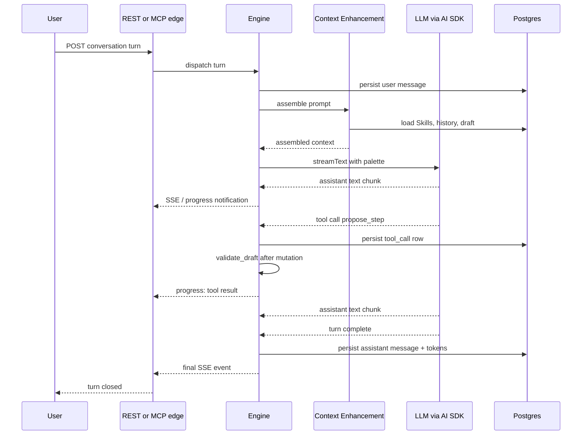

# 16 — AI Flows

The engine exposes four AI flows. Each flow is a bounded LLM tool loop wrapped around the same prompt-assembly pipeline (Context Enhancement) and the same model-routing layer. None of the flows ever execute user-defined Steps in the caller's tenant directly — they emit drafts, patches, schemas, or messages, and a separate commit path turns those into durable changes.

The flows share four invariants:

- Vercel AI SDK v6 (`ai` package) is the only LLM client.
- Tool palettes are tight and explicitly listed per flow; no flow is given the entire engine surface.
- A 120 s LLM request timeout is enforced at the SDK call site.
- Per-tenant monthly token budgets are accounted in `js-tiktoken` against the *effective* model and surface as a typed `llm_quota_exhausted` error when exhausted.

## The four flows

### `generate` — natural language to draft Workflow or Connector
- **Purpose**: turn a single prompt ("fetch yesterday's invoices and post a summary") into a draft Workflow DAG or a draft Connector definition.
- **Inputs**: free-text prompt, target kind (`workflow | connector`), optional seed (existing draft id, connector id).
- **Outputs**: a typed draft document emitted via `streamObject`. The document is validated against the same Zod schema the REST upsert endpoint uses.
- **Tool palette**: `list_skills`, `fetch_connector_docs`, `propose_step`, `update_param`, `connect_steps`, `validate_draft`. Sensitive tools (`commit_draft`, external writes) are not exposed here — generation only produces a draft.
- **Prompt assembly**: base system prompt → applicable Skills (global → connector → workflow) → ingested connector docs that match the prompt → user turn. No prior failures.
- **Streaming**: `streamObject` for the typed draft. Progressive UI updates render as the draft fills in.
- **Token budget**: tight; generation completes within `stepCountIs(20)`. Long generations split across follow-up `converse` turns rather than blowing the cap.

### `repair` — failing Step plus drift signal to a patch
- **Purpose**: produce a Patch Candidate when self-healing detects upstream drift.
- **Inputs**: the failing Step, the captured response, the diff against the last Schema Version, refreshed connector docs, and the matching Execution Fixture.
- **Outputs**: a Patch Candidate document (structured diff plus classification metadata) emitted via `streamObject`.
- **Tool palette**: `update_field_path`, `rename_param`, `change_type`, `add_header`. Deliberately narrow — the repair loop cannot rewrite the Step semantically, only correct shape and naming drift.
- **Prompt assembly**: base prompt → connector Skills → fresh connector docs → schema diff → prior failure samples → instruction to produce one minimal patch. The prior-failure section is only populated for `repair`.
- **Streaming**: object stream, no chat surface. The result lands in the `workflow.repair` queue handler, not in a user-visible Conversation.
- **Token budget**: capped at `stepCountIs(20)`. A repair run is metered and counts against the tenant budget like any other AI call.

### `extract` — unstructured sample to canonical schema
- **Purpose**: read an uploaded file (JSON, CSV, XML, YAML, Excel, HTML, PDF, DOCX, ZIP, GZIP, free text) and return a canonical structured representation.
- **Inputs**: the file (up to 100 MB, streamed from the `/v1/extract` endpoint), a target shape hint when provided.
- **Outputs**: `{id, success, data, startedAt, completedAt}` emitted via `streamObject`. Ephemeral — not persisted as a Workflow artifact.
- **Tool palette**: empty. Extract is a pure model call wrapped in `streamObject` with a target schema.
- **Prompt assembly**: base extraction prompt → relevant global Skills (data shape conventions, naming conventions) → user-supplied hint → file content.
- **Streaming**: `streamObject` so partial fields can render as they arrive.
- **Token budget**: extract is the most token-intensive flow. The extractor pre-chunks oversized inputs against the effective model's context window before the call.

### `converse` — multi-turn authoring
- **Purpose**: power the resumable Conversation that REST `subkit chat`, MCP tool clusters, and chat-platform threads share.
- **Inputs**: the persisted `conversations` row and its message history, the user's new turn.
- **Outputs**: streaming assistant text and structured tool calls. Mutations land on the draft document inside the Conversation row.
- **Tool palette**: full structured-intent palette — `list_skills`, `fetch_connector_docs`, `propose_step`, `update_param`, `connect_steps`, `dry_run_step`, `validate_draft`, `request_human_approval`, `commit_draft`. Sensitive tools (`commit_draft`, external writes) gate on a human approval row.
- **Prompt assembly**: base prompt → applicable Skills → ingested connector docs → conversation history → user turn. Repair-only sections are omitted.
- **Streaming**: `streamText` for assistant turns; tool calls and tool results are interleaved into the same stream and persisted to `conversation_messages` and `conversation_tool_calls` as they emit.
- **Token budget**: counted per turn against the tenant's monthly budget. Each turn enforces `stepCountIs(20–40)` so a single turn cannot recurse forever.

## Context Enhancement pipeline

Every flow walks the same prompt-assembly pipeline. Sections are appended in this fixed order; later sections see earlier sections.

```mermaid
flowchart LR
  A[Base system prompt] --> B[Skills: global]
  B --> C[Skills: connector]
  C --> D[Skills: workflow]
  D --> UM[User memory]
  UM --> E[Ingested connector docs]
  E --> F[Prior failures - repair only]
  F --> G[Conversation history]
  G --> H[User turn]
  H --> I[Effective context window check]
  I --> J[js-tiktoken accounting]
```



**User memory** is an optional per-call payload sourced from the caller-supplied `SUBKIT.md` file (the `sk` end-user CLI walks upward from cwd and merges with `~/.sk/SUBKIT.md`). It is slotted between workflow skills and ingested connector docs. Overflow trimming drops `failures → docs → user memory → workflow skills → connector skills → global skills`, preserving the invariant that Skills and the user turn are never trimmed.

- Skills are loaded in scope order (global → connector → workflow), each in descending version. Only `active` Skills are loaded.
- Ingested connector documentation is selected by relevance against the user turn — the ingestion pipeline produces semantic-search-ready chunks against the 90% similarity threshold.
- Prior failures are populated only on `repair` and only with the failing Step plus the diff against the last Schema Version.
- `js-tiktoken` measures the assembled prompt against the effective model's context length cap *before* the SDK call. Overflow trims earliest-first from ingested docs, then conversation history; Skills and the user turn are never trimmed.
- The same accounting writes to the tenant's monthly token ledger. Exhaustion fails the call with `llm_quota_exhausted`.

## Vercel AI SDK v6

The engine speaks to the LLM exclusively through the `ai` package.

| Flow | Primary call | Notes |
|---|---|---|
| `generate` | `streamObject` | Typed draft, `stepCountIs(20)`, narrow palette via `experimental_activeTools`. |
| `repair` | `streamObject` | Patch document, `stepCountIs(20)`, repair palette via `experimental_activeTools`. |
| `extract` | `streamObject` | Pure schema fill, no tools. |
| `converse` | `streamText` | Streaming chat surface, `stepCountIs(20–40)`, full structured-intent palette. |

The conversational loop uses `experimental_activeTools` to narrow the palette per phase: early authoring exposes `propose_step` and friends; once a draft is structurally complete, the palette swaps to `dry_run_step`, `validate_draft`, `request_human_approval`, `commit_draft`. Phase transitions are deterministic — driven by draft state, not by the model.

`experimental_createMCPClient` bridges the engine's own MCP surface back into the tool map for flows that need to query the engine's tools (for example `fetch_connector_docs` calling into the MCP resource layer). The MCP client is created once per flow invocation and torn down at the end.

```ts
// Skeleton of a converse turn. Trade-off: streamText keeps the surface
// uniform across REST SSE, MCP progress notifications, and chat updates.
const llm = resolveModelForTenant(tenantId);
const result = await streamText({
  model: llm.primary,
  abortSignal: AbortSignal.timeout(120_000),
  stopWhen: stepCountIs(turnPhaseStepCap(phase)),
  experimental_activeTools: paletteForPhase(phase),
  tools: structuredIntentTools,
  system: await assembleContext({ tenantId, conversationId, phase }),
  messages: history,
});
```

## Model routing

Models are resolved at the call site through a tenant-aware lookup.

- Deployment defaults come from environment variables: `LLM_PRIMARY` and `LLM_FALLBACK`.
- Tenant rows override the defaults via `llm_primary`, `llm_fallback`, and `llm_provider_credentials` (encrypted with the same AES-256-GCM helper as Connector Credentials).
- `llm_monthly_token_budget` lives on the tenant row and caps cumulative spend.
- Resolution order on every call: tenant → deployment default. The first non-null primary wins; the matching fallback is wired alongside it.

Fallback fires on three signals:

1. `rate_limit` — provider returned an explicit rate-limit error.
2. `overloaded` — provider returned a transient capacity error.
3. `context_length_exceeded` — the assembled prompt exceeds the primary's window after assembly-time trimming.

When neither primary nor fallback can handle the call, the SDK call fails with a typed `llm_quota_exhausted` or `llm_unavailable` error. Both surface cleanly in `subkit chat` and in chat platforms via the same error envelope.

```ts
// Trade-off: a tiny resolver beats a generic policy engine here — three
// signals, two slots, one ledger.
function resolveModelForTenant(tenantId: string) {
  const t = loadTenant(tenantId);
  const primaryId = t.llm_primary ?? env.LLM_PRIMARY;
  const fallbackId = t.llm_fallback ?? env.LLM_FALLBACK;
  return {
    primary: providerFor(primaryId, t.llm_provider_credentials),
    fallback: providerFor(fallbackId, t.llm_provider_credentials),
    contextCap: contextCapFor(primaryId),
    budget: t.llm_monthly_token_budget,
  };
}
```

The 120 s LLM request timeout is enforced at every SDK call via `AbortSignal.timeout(120_000)`. Per-model context-length caps are enforced at prompt-assembly time against the *effective* model — not the deployment default — so tenant overrides never trip on the wrong cap.

## Skill-less cold start

When a flow runs against a Connector that has no curated Skills yet, the engine does the following:

1. Load the global `cold-start` Skill, which carries safety-margin guidance (smaller batch sizes, more conservative retries, more aggressive validation between mutations).
2. Run the documentation ingestion pipeline against the Connector if it has a known docs source and ingested content is older than the freshness threshold.
3. Proceed with the flow at a tightened `stepCountIs` (the lower end of the 20–40 range for `converse`, fixed at 20 for `generate` and `repair`).
4. Mark the resulting draft or patch as "cold-start" in the audit trail so operators know to author Skills before promoting it.

The engine never fabricates a Skill from a successful cold-start run. Skill creation is always a human action.

## Sequence: a typical `converse` turn with a tool call and a progress notification


