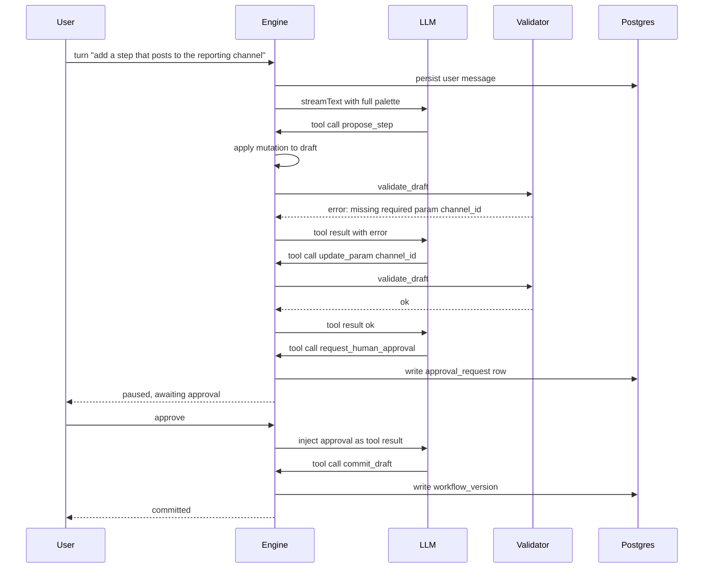
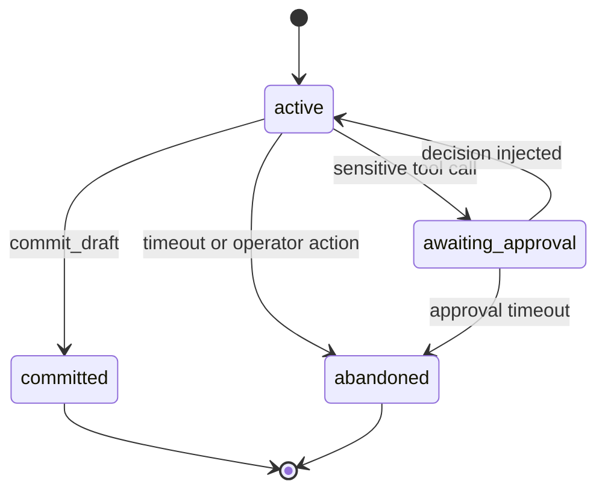

# 17 — Conversations

A Conversation is a persistent, resumable AI authoring session that targets exactly one draft Workflow or one draft Connector. The same Conversation primitive backs `subkit chat`, the MCP conversation tool cluster, and chat-platform threads. Every message and every tool call is persisted server-side, so a crashed client can rejoin by Conversation id without losing state.

## Data model

Conversations span three tables defined in `04-data-model.md`:

- **`conversations`** — one row per session. Carries the target draft, the lifecycle status (`active | awaiting_approval | committed | abandoned`), and the current `draft` JSON.
- **`conversation_messages`** — append-only per-turn log. One row per `user`, `assistant`, `tool`, or `system` message with `tokens_in` and `tokens_out` populated by `js-tiktoken` accounting.
- **`conversation_tool_calls`** — one row per structured-intent tool invocation. Holds the tool name, input, output, and approval bookkeeping (`approval_required`, `approved_at`, `approved_by_user_id`).

Snapshots of the draft are written after every LLM step that mutates it. Snapshots are kept on the Conversation row as a small ring buffer so `:undo` can roll back to the prior snapshot without a separate table.

## Structured-intent tool palette

The Conversation loop never lets the model emit free-form changes against a Workflow. Every mutation flows through one of nine tools:

| Tool | Purpose | Mutates draft? | Sensitive? |
|---|---|---|---|
| `list_skills` | Return Skills in scope for the current target. | No | No |
| `fetch_connector_docs` | Pull ingested documentation excerpts for a Connector. | No | No |
| `propose_step` | Add a Step to the draft DAG. | Yes | No |
| `update_param` | Update a parameter on a Step or on the Workflow root. | Yes | No |
| `connect_steps` | Add or remove an edge in the draft DAG. | Yes | No |
| `dry_run_step` | Execute a Step against synthetic or fixture input in an ephemeral scoped context. | No | No |
| `validate_draft` | Run the full draft validator and return errors. | No | No |
| `request_human_approval` | Open an approval row and pause the loop. | No | Yes |
| `commit_draft` | Persist the draft as a new Workflow Version. | No | Yes |

Every mutating tool runs the validator immediately after mutating the draft. If validation fails, the validator output is fed back to the model as a tool-result message and the loop retries. The model only sees the next user turn after the draft is in a valid shape (or after the loop's `stepCountIs(20–40)` cap is hit).

`dry_run_step` deserves a separate note: it runs a Step in an **ephemeral scoped execution context** that uses synthetic inputs (or recorded Execution Fixtures when the Step targets a known Connector endpoint). It never executes against the caller's tenant data and never writes outbox Events. Authoring tools cannot reach the production Step runner.

## Validation loop



## Human-in-the-loop gating

`request_human_approval` and `commit_draft` are the two sensitive tools. When the model calls either, the engine writes an `approval_request` row, transitions the Conversation to `awaiting_approval`, and stops the LLM loop. The pending request is broadcast on the conversation stream so all attached surfaces (CLI, REST SSE, MCP, chat-platform thread) render the approval prompt.

The decision arrives through whatever surface the user wants — REST endpoint, CLI keystroke, Slack button, Teams Adaptive Card action, Google Chat Card v2 button. The engine resolves the decision against the user's effective Policy and injects it back into the loop as a tool result. The Conversation flips back to `active` and the model continues from the next step.

External-write tools (any tool that would mutate state in the caller's tenant) are not present in the palette at all. Promoting a draft into production is exclusively the job of `commit_draft`.

## Streaming transports

The same Conversation surfaces over two transports.

| Surface | Transport | Resumption |
|---|---|---|
| REST | SSE via Hono `streamSSE` | `Last-Event-ID` rejoin against the persisted message log |
| MCP | `tools/call` with `notifications/progress` plus a final result | Reconnect and re-call with the same Conversation id |

Both transports project the same underlying event sequence: assistant text deltas, tool-call begin and end, validator results, approval-request opened, approval decision, and final commit. The chat-platform adapters consume the same internal event bus and project it as progressive message edits — they are not a third transport.

```ts
// Trade-off: SSE keeps the REST surface dependency-free; MCP progress
// notifications keep the agent surface canonical.
async function streamConversationTurn(c: Context, id: string) {
  return streamSSE(c, async (stream) => {
    for await (const evt of conversationEvents(id)) {
      await stream.writeSSE({ id: evt.id, event: evt.kind, data: JSON.stringify(evt) });
    }
  });
}
```

## Resume semantics

Every persisted artifact carries the Conversation id, so resumption is mechanical:

1. Client opens a stream against `/v1/conversations/:id/stream` (REST) or re-calls the MCP tool with the same id.
2. Engine replays any messages newer than the client's `Last-Event-ID` cursor (REST) or replays from the start of the current LLM step (MCP).
3. If the Conversation is `awaiting_approval`, the engine immediately re-broadcasts the pending approval prompt.
4. If the Conversation is mid-LLM-step when the client reconnected, the engine attaches to the in-flight stream rather than restarting it.

A crashed client can disappear for hours and rejoin without state loss. A crashed engine resumes at the next message after the last persisted tool call when it comes back up.

## Preview and test runs are scoped

`dry_run_step` is the only path the authoring loop has into the runtime. It executes through a separate scoped runner that:

- Runs in an ephemeral execution context with a fresh AbortSignal and a tightened budget.
- Reads inputs from synthetic fixtures or from recorded Execution Fixtures, never from live tenant data.
- Writes nothing to `executions`, `execution_steps`, the outbox, or any external system.
- Returns a small preview payload (truncated to the same depth-5, array-5, key-1000 rules as production previews).

Authoring tools never execute user-defined Steps in the caller's tenant. Trade-off: this costs a round-trip through fixtures for realistic previews, but it makes the authoring surface incapable of accidental side effects.

## Undo and rollback

The Conversation row keeps a small ring buffer of draft snapshots. After every mutating tool call, the engine pushes the prior draft onto the buffer. The CLI exposes this as `:undo` and `:reset`:

- `:undo` pops the most recent snapshot off the buffer and replaces the active draft.
- `:reset` clears the buffer and reverts to the original draft the Conversation started from.
- Both operations write a `system` message into `conversation_messages` so the audit trail is intact.

Once `commit_draft` succeeds, the Conversation transitions to `committed` and the snapshot buffer is sealed. Further authoring requires a new Conversation against the new Workflow Version.

## Lifecycle


