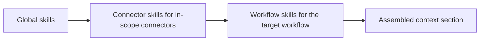

# 18 — Skills

A Skill is a hand-authored, statically curated LLM-context record. Skills are how operators put their domain knowledge in front of every AI flow without rebuilding prompts. The engine reliably loads the right Skills into every flow at the right scope order; it never authors them, never mutates them, and never proposes new ones.

**Skills are curated, never auto-generated.** This is a core invariant of the engine. There is no reflection job, no feedback-driven write path, no "skill candidate" promotion pipeline. The only automated improvement vector for AI grounding is periodic re-ingestion of connector documentation. Why: debuggable, reproducible, no silent drift. An operator who reads an audit trail today sees the same Skills the model saw, and a Conversation replayed tomorrow sees the same Skills it saw originally unless an operator edited them.

## Record shape

```ts
// Trade-off: keeping the row minimal means every authoring surface
// (REST, CLI, chat) edits the same five-or-six fields.
type Skill = {
  id: string;
  tenant_id: string;
  scope: "global" | "connector" | "workflow";
  connector_id?: string;        // required when scope = "connector"
  workflow_id?: string;         // required when scope = "workflow"
  title: string;
  body: string;                 // the rule itself, lead-with-the-rule
  examples: string[];           // at least one concrete example
  best_practices: string[];     // short bullets
  pitfalls: string[];           // 1-3 bullets
  doc_refs: string[];           // pointers into ingested docs or external URLs
  status: "draft" | "active" | "archived";
  version: number;              // bumped on every edit
  created_at: string;
  updated_at: string;
};
```

The persisted columns are listed in `04-data-model.md` under `skills`. The fields above are how operators reason about a Skill at the authoring surfaces; the persisted row collapses `examples`, `best_practices`, `pitfalls`, and `doc_refs` into a single `examples` JSONB blob plus structured fields where the schema warrants it.

## Taxonomy

Skills slot into one of eight buckets. The bucket is not a column — it is a convention reflected in titles and tags inside the body — so the taxonomy can grow without a schema migration.

| Bucket | What belongs here |
|---|---|
| Domain knowledge | Tenant-specific business rules, naming conventions, billing cycles, organizational vocabulary. |
| Connector quirks | Idempotency-key requirements, undocumented status codes, pagination edge cases, response-shape gotchas. |
| Security best-practices | What to mask, what to never log, which endpoints require step-up auth, sensitive header rules. |
| Performance best-practices | Batch sizes, parallelism caps, when to use cursor vs offset pagination, when to offload large payloads. |
| Data shape conventions | Canonical date formats, currency representation, how to flatten nested arrays, JSONata patterns the team prefers. |
| Naming conventions | Step naming patterns, slug conventions, version-note wording. |
| Rate-limit notes | Concrete per-endpoint limits and how to back off, per-account vs per-IP scoping. |
| Auth tips | OAuth scope requirements, refresh-token edge cases, how to attach a custom header for a tunnel target. |

## Scopes and attachment rules

Three scopes, in increasing specificity:

- **Global** — applies to every flow in the tenant. Use sparingly. Examples: "always prefer cursor pagination for endpoints that support it", "mask `customer.email` in all response_filters".
- **Connector** — applies whenever the prompt or draft touches a specific Connector. Required `connector_id`. Examples: "Stripe always requires an idempotency key on POST /charges", "the HubSpot API returns 200 with an error envelope on validation failures".
- **Workflow** — applies whenever the prompt or draft touches a specific Workflow. Required `workflow_id`. Examples: "this workflow runs at 06:00 UTC, never call endpoints that page-roll at midnight UTC".

A Skill cannot have both `connector_id` and `workflow_id` set. The engine validates the scope-to-id mapping at write time.

## Retrieval order

Context Enhancement loads Skills in a fixed order at every flow invocation:



Within each scope, Skills are ordered by descending `version` and only `active` rows are loaded. `draft` and `archived` Skills are skipped. The retrieval pass is deterministic — the same set of inputs always yields the same prompt section.

## Versioning and lifecycle

Every edit bumps the `version` integer on the row. The lifecycle is `draft → active → archived` with no other transitions:

- `draft` — visible to authors, never loaded into prompts.
- `active` — loaded into prompts in scope order.
- `archived` — preserved for audit, never loaded into prompts. Archive replaces deletion for Skills.

Edits never delete the prior row; the previous version is replaced in place because Skills are not historical artifacts in the same sense as Workflow Versions. Operators who need to roll back simply edit the body again. Audit-log entries record every transition for traceability.

## Authoring surfaces

Three surfaces edit Skills, all calling the same REST endpoints:

| Surface | How |
|---|---|
| REST | `POST /v1/skills`, `PATCH /v1/skills/:id`, `POST /v1/skills/:id/activate`, `POST /v1/skills/:id/archive`. |
| CLI | `subkit skills list`, `subkit skills create`, `subkit skills edit`, `subkit skills activate`, `subkit skills archive`. |
| Chat | `/subkit skills list` slash command on Slack, Teams, and Google Chat. Edit and create surface as a deeplink back to the engine's REST UI rather than as in-chat modals (Skill bodies are too long for native chat inputs). |

The chat surface intentionally stays read-and-list-only for body content. Skill bodies are markdown documents, not one-liners — editing them in a chat modal would be the wrong tool for the job.

## Importing connector documentation into a Skill

Operators routinely turn a connector's raw API documentation into Skills. The pattern:

1. Run the Documentation Ingestion pipeline against the connector. The engine stores the ingested chunks for retrieval at prompt-assembly time but does not turn them into Skills.
2. Open the relevant ingested chunk in the admin surface or CLI.
3. Read it. Prune anything that is reference material the LLM can already search. Summarize the remainder into a few sentences. Annotate edge cases the documentation author left implicit.
4. Author the result as a Skill at the appropriate scope.

The output is a small, curated rule — not a copy of the documentation. Trade-off: this is more work than a verbatim import, but it keeps Skill bodies short and forces the operator to think about which parts of the documentation actually drive correct generations.

## What belongs in a Skill versus what belongs in ingested documentation

This is the single most useful decision rule for operators.

| Belongs in a Skill | Belongs in ingested documentation |
|---|---|
| Human-curated rules and patterns | Reference material the LLM can search |
| "Always do X when calling Y" | The full schema for endpoint Y |
| Edge cases the docs leave implicit | The endpoint table |
| Naming and shape conventions | Auth flow tutorials |
| Pitfalls discovered in production | Generated SDK examples |
| Domain-specific vocabulary | Marketing and changelog content |

A Skill is dense, opinionated, and lead-with-the-rule. Ingested documentation is broad, neutral, and search-friendly. Both feed into the same prompt, but they answer different questions.

## Authoring guidelines

Six rules for writing Skills that pay their cost:

1. **Lead with the rule.** First sentence is the imperative. "Always pass an `Idempotency-Key` header on POST /charges." Not "Stripe supports idempotency keys."
2. **Include at least one concrete example.** A rule the model has never seen applied is a rule the model will misapply.
3. **List 1–3 pitfalls.** What goes wrong when this rule is not followed? Be specific.
4. **Keep bodies short.** A Skill body that runs more than ~200 words is usually two Skills.
5. **Cite `doc_refs` where useful.** Anchor the rule to the source so the next operator can verify it.
6. **Prefer the most specific scope that still applies.** Workflow scope before Connector scope before Global scope.

## Explicit non-goal: automatic skill evolution

The engine does not implement and will not implement:

- Reflection jobs that read execution outcomes and write back into Skills.
- Feedback-driven Skill writes from successful Conversations or successful Patch Candidates.
- "Skill candidate" rows that get promoted on a quality signal.
- Voyager / Reflexion / GEPA / Meta-Rewarding / generative-agent-memory-stream patterns of any kind.
- Shadow or canary promotion of model-authored Skill drafts.

The single automated improvement vector is **periodic re-ingestion of connector documentation**. That refresh updates the reference material the LLM can search; it never touches Skills. Operators who want a feedback loop read the audit log and the execution telemetry and edit Skills by hand.

This is a deliberate constraint. The trade-off is explicit: the engine gives up automated learning to gain a debuggable, reproducible AI surface with no silent drift between runs.
