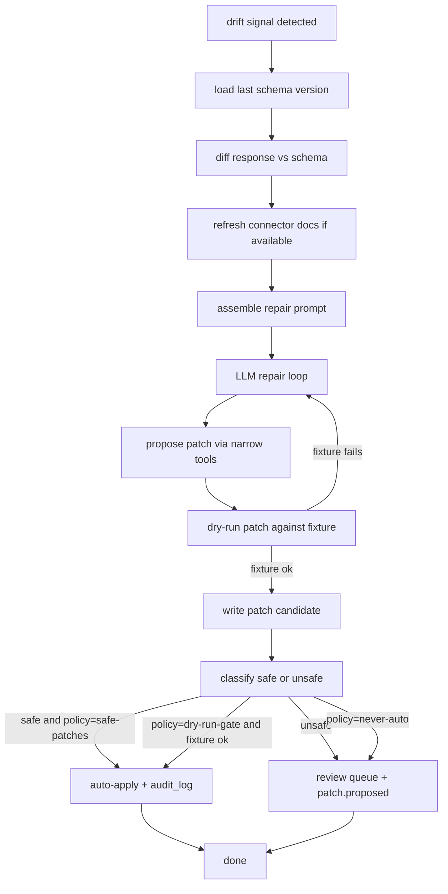
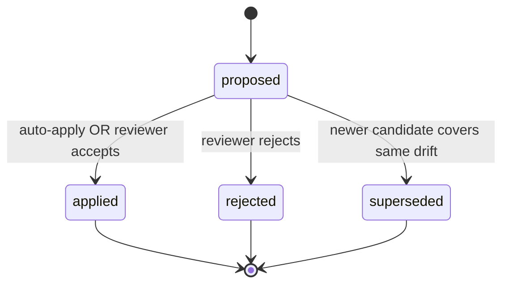

# 19 — Self-healing

Self-healing is the engine's bounded repair loop for upstream drift. When a Step fails with a recognized drift signal, the engine diffs the failing call against the last known Schema Version, refreshes upstream documentation, runs a tightly scoped LLM repair loop, dry-runs the candidate against a recorded Execution Fixture, and writes a Patch Candidate. Default policy auto-applies only `safe` patches; everything else parks for review and fires a `patch.proposed` chat notification.

## Drift signals

A Step failure becomes a self-healing trigger when the engine recognizes one of five drift signals. Anything else is a normal failure and follows the retry/backoff path.

| Signal | What the engine sees |
|---|---|
| **HTTP 4xx/5xx with a new error shape** | Status code in the error class, and the response body deviates from the recorded Schema Version for that endpoint. Most common with API providers that change error envelopes. |
| **JSONata path miss** | A `transform` Step's JSONata expression returns `undefined` against a path that resolved against the last known Schema Version. |
| **OAuth scope change** | The Connector Credential refresh succeeds but the new access token rejects an endpoint with `insufficient_scope` or equivalent. |
| **Schema introspection delta** | For drivers that introspect (Postgres, GraphQL), the introspection result differs from the previous snapshot in a way that touches a Step's projected fields. |
| **Response schema diff** | The driver records a schema version on every successful call; a new call's canonicalized schema diverges from the most recent `schema_versions` row for the same endpoint. |

Each signal is detected at the driver layer and surfaces to the orchestrator as a typed `drift` failure attached to the Step error. The repair queue is fed only by `drift` failures.

## The `workflow.repair` loop

The repair loop runs as a `workflow.repair` queue job. The job carries the failing `execution_id`, `step_key`, the captured drift signal, and the target Connector and endpoint.



Step by step:

1. **Detect.** The Step driver flags a `drift` failure and enqueues a `workflow.repair` job.
2. **Diff.** Load the last `schema_versions` row for the endpoint; canonicalize the failing response; produce a structured diff.
3. **Refresh upstream docs.** If the Connector exposes a documentation source, run an incremental ingestion pass for the affected endpoint. Skipped when the source is offline or unchanged within the freshness window.
4. **Assemble the repair prompt.** Walk the Context Enhancement pipeline with the repair-only "prior failures" section populated with the failing Step, the diff, and the failing response sample.
5. **Run the LLM repair loop.** `streamObject` against the repair palette with `stepCountIs(20)` and a 120 s timeout. The loop is bounded — no escape hatches into other tools.
6. **Dry-run.** The proposed patch is applied to a synthetic copy of the Step and executed against a recorded Execution Fixture for the same endpoint. The fixture dry-run is the final gate; a patch that fails the fixture is rejected and the loop iterates (within its step cap).
7. **Write a Patch Candidate.** Persist the diff, classification, fixture id, status, and provenance into `patch_candidates`.
8. **Apply or park.** Route based on the auto-apply policy (next section).

## Repair tool palette

Deliberately narrow. The repair loop can correct drift, not redesign the Step.

| Tool | Use |
|---|---|
| `update_field_path` | Rename or re-anchor a field path inside a Step's response selector or transform expression. |
| `rename_param` | Rename a request parameter (header, query, body field). |
| `change_type` | Widen or shift a type on a parameter or response field (`string → string | null`, `int → number`). |
| `add_header` | Add a new header to the request. |

Anything outside this palette is out of scope for an automated patch. Repairs that would require new Steps, new Connectors, new auth modes, or rewritten transform logic are surfaced as a `patch.proposed` notification with no auto-apply path — operators handle those in a regular `converse` Conversation.

## Patch classification

Every Patch Candidate carries a classification. The rule lives in app code as a small pure function that examines the structured diff.

| Classification | Examples |
|---|---|
| **`safe`** | Field renames inside response paths. Compatible type widenings (`string → string | null`, `int → number`). New optional headers. Added optional response fields the Step now reads when present. |
| **`unsafe`** | HTTP method change. Auth scheme change. Required-field removal. Status-code semantics change. Destination URL change beyond path segments. Format flips (JSON ↔ form-encoded, base64 ↔ binary). |

Classification is conservative by design. Anything the rule cannot prove is `safe` is `unsafe`.

```ts
// Trade-off: a small switch beats a generic policy DSL. New rules are
// one more case statement; the audit reads cleanly.
function classify(diff: PatchDiff): "safe" | "unsafe" {
  if (diff.method_change) return "unsafe";
  if (diff.auth_change) return "unsafe";
  if (diff.required_removed.length > 0) return "unsafe";
  if (diff.status_semantics_change) return "unsafe";
  if (diff.url_change_beyond_path) return "unsafe";
  if (diff.format_flip) return "unsafe";
  // What's left: renames, widenings, optional additions.
  return "safe";
}
```

## Auto-apply policy

The default policy is **`safe-patches only`**: a Patch Candidate is automatically applied if and only if its classification is `safe` *and* the fixture dry-run succeeded. Everything else lands in the review queue and fires a `patch.proposed` chat notification through the Notification Rule pipeline.

Tenants can override the policy per Workflow:

| Policy | Behavior |
|---|---|
| `safe-patches` *(default)* | Auto-apply `safe` patches whose fixture dry-run passed. Park `unsafe` patches. |
| `never-auto` | Never auto-apply. Every patch lands in the review queue. |
| `dry-run-gate` | Auto-apply any patch — `safe` or `unsafe` — whose fixture dry-run passed. Use only for non-critical workflows. |

The override is stored on the Workflow row. Trade-off: three named policies cover the practical operating modes without exposing a generic predicate language.

## Grounding

The repair prompt is grounded by the same Context Enhancement pipeline that powers conversational authoring, with two specifics:

- **Skills load in the same order** (global → connector → workflow), and only `active` Skills are considered. Connector quirks and security best-practices Skills do most of the work in repair runs.
- **Fresh connector documentation** for the affected endpoint is appended to the prompt section. If re-ingestion failed, the prompt still includes the most recent stored chunks and tags them with their `seen_at` so the model knows their age.

The fixture dry-run is the final gate. No Patch Candidate is written unless the dry-run against a recorded `(request, response)` sample succeeded. A Connector with no Execution Fixtures cannot benefit from auto-apply at all — its patches always park for review regardless of policy.

## Audit trail

Every Patch Candidate write and every auto-apply writes to `audit_log`:

| Event | What gets recorded |
|---|---|
| `patch.proposed` | Patch Candidate id, Workflow id, classification, drift signal, fixture id, full structured diff, repair prompt token usage. |
| `patch.applied` | Patch Candidate id, Workflow id, prior Workflow Version id, new Workflow Version id, applied-by `actor_kind = engine`, fixture id. |
| `patch.rejected` | Patch Candidate id, rejecting actor, optional reason. |
| `patch.superseded` | A newer Patch Candidate replaced this one before review. |

The `audit_log.meta` JSONB column carries the full diff and provenance, so a reviewer reading the audit trail sees exactly what the model produced and what the engine matched against. Every auto-apply is replay-safe — the prior Workflow Version is preserved in `workflow_versions` and a single `subkit workflows restore` call rolls back any patch the engine applied.

## Patch Candidate lifecycle



`proposed` is the only entry state; `applied`, `rejected`, and `superseded` are terminal. Superseding is automatic — when a fresh repair run produces a candidate covering the same `(workflow_id, endpoint_key)` pair as a still-pending one, the older candidate transitions to `superseded` and stops emitting notifications.
