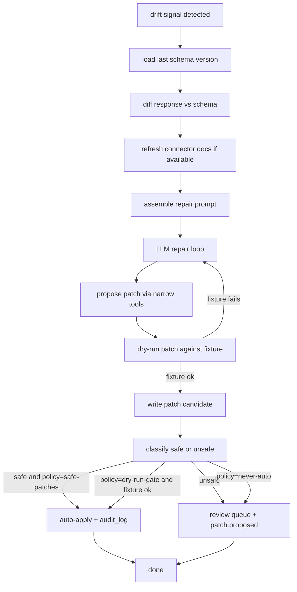
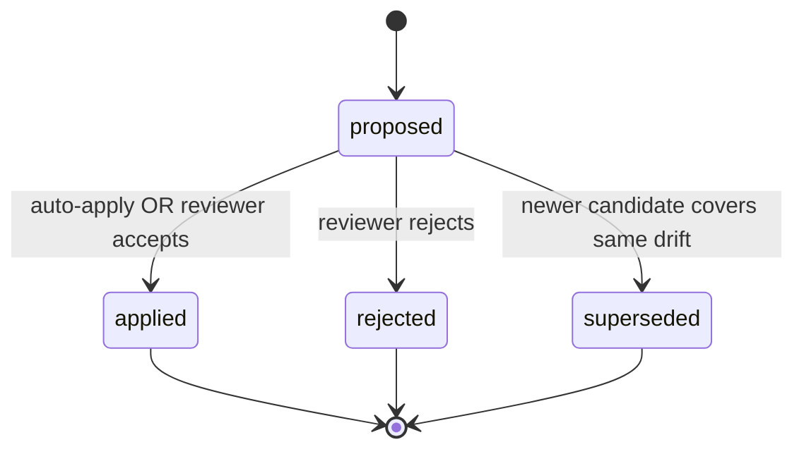

# 19 — Self-healing

- Self-healing is the engine's bounded repair loop for upstream drift.
- On a recognized drift signal: diff against last Schema Version, refresh upstream docs, run scoped LLM repair, dry-run against a recorded Execution Fixture, write a Patch Candidate.
- Default policy auto-applies only `safe` patches; everything else parks for review and fires a `patch.proposed` chat notification.

## Drift signals

- A Step failure triggers self-healing only when the engine recognizes one of five drift signals.
- All other failures follow the normal retry/backoff path.

| Signal | What the engine sees |
|---|---|
| **HTTP 4xx/5xx with a new error shape** | Status code in the error class, and the response body deviates from the recorded Schema Version for that endpoint. Most common with API providers that change error envelopes. |
| **JSONata path miss** | A `transform` Step's JSONata expression returns `undefined` against a path that resolved against the last known Schema Version. |
| **OAuth scope change** | The Connector Credential refresh succeeds but the new access token rejects an endpoint with `insufficient_scope` or equivalent. |
| **Schema introspection delta** | For drivers that introspect (Postgres, GraphQL), the introspection result differs from the previous snapshot in a way that touches a Step's projected fields. |
| **Response schema diff** | The driver records a schema version on every successful call; a new call's canonicalized schema diverges from the most recent `schema_versions` row for the same endpoint. |

- Each signal is detected at the driver layer and surfaces as a typed `drift` failure attached to the Step error.
- The repair queue is fed only by `drift` failures.

## The `workflow.repair` loop

- Runs as a `workflow.repair` queue job.
- Job payload: `execution_id`, `step_key`, drift signal, target Connector and endpoint.



The driver detects drift, diffs against the last `schema_versions` row, optionally refreshes upstream docs, then runs a bounded LLM repair loop (`stepCountIs(20)`, 120 s timeout) against the narrow repair palette. The proposed patch is dry-run against a recorded Execution Fixture; passing patches are written to `patch_candidates` and routed through the auto-apply policy, while failing patches re-enter the loop within its step cap.

## Repair tool palette

Deliberately narrow — the repair loop corrects drift, not redesigns the Step.

| Tool | Use |
|---|---|
| `update_field_path` | Rename or re-anchor a field path inside a Step's response selector or transform expression. |
| `rename_param` | Rename a request parameter (header, query, body field). |
| `change_type` | Widen or shift a type on a parameter or response field (`string → string | null`, `int → number`). |
| `add_header` | Add a new header to the request. |

- Anything outside this palette is out of scope for automated repair.
- Repairs requiring new Steps, Connectors, auth modes, or rewritten transforms surface as a `patch.proposed` notification with no auto-apply path.

## Patch classification

Every Patch Candidate carries a classification, determined by a small pure function that examines the structured diff.

| Classification | Examples |
|---|---|
| **`safe`** | Field renames inside response paths. Compatible type widenings (`string → string | null`, `int → number`). New optional headers. Added optional response fields the Step now reads when present. |
| **`unsafe`** | HTTP method change. Auth scheme change. Required-field removal. Status-code semantics change. Destination URL change beyond path segments. Format flips (JSON ↔ form-encoded, base64 ↔ binary). |

Classification is conservative by design. Anything the rule cannot prove is `safe` is `unsafe`.

```ts
// Trade-off: a small switch beats a generic policy DSL. New rules are
// one more case statement; the audit reads cleanly.
function classify(diff: PatchDiff): "safe" | "unsafe" {
  if (diff.method_change) return "unsafe";
  if (diff.auth_change) return "unsafe";
  if (diff.required_removed.length > 0) return "unsafe";
  if (diff.status_semantics_change) return "unsafe";
  if (diff.url_change_beyond_path) return "unsafe";
  if (diff.format_flip) return "unsafe";
  // What's left: renames, widenings, optional additions.
  return "safe";
}
```

## Auto-apply policy

- Default: auto-apply only `safe` patches whose fixture dry-run succeeded.
- Everything else lands in the review queue and fires a `patch.proposed` chat notification.
- Tenants can override the policy per Workflow:

| Policy | Behavior |
|---|---|
| `safe-patches` *(default)* | Auto-apply `safe` patches whose fixture dry-run passed. Park `unsafe` patches. |
| `never-auto` | Never auto-apply. Every patch lands in the review queue. |
| `dry-run-gate` | Auto-apply any patch — `safe` or `unsafe` — whose fixture dry-run passed. Use only for non-critical workflows. |

Trade-off: three named policies (stored on the Workflow row) cover practical operating modes without exposing a generic predicate language.

## Grounding

Grounded by the same Context Enhancement pipeline as conversational authoring:

- **Skills load in the same order** (global -> connector -> workflow); only `active` Skills are considered.
- **Fresh connector documentation** for the affected endpoint is appended. If re-ingestion failed, the most recent stored chunks are included and tagged with their `seen_at`.

- The fixture dry-run is the final gate — no Patch Candidate is written unless the dry-run against a recorded `(request, response)` sample succeeded.
- A Connector with no Execution Fixtures cannot benefit from auto-apply; its patches always park for review regardless of policy.

## Audit trail

Every Patch Candidate write and every auto-apply writes to `audit_log`.

| Event | What gets recorded |
|---|---|
| `patch.proposed` | Patch Candidate id, Workflow id, classification, drift signal, fixture id, full structured diff, repair prompt token usage. |
| `patch.applied` | Patch Candidate id, Workflow id, prior Workflow Version id, new Workflow Version id, applied-by `actor_kind = engine`, fixture id. |
| `patch.rejected` | Patch Candidate id, rejecting actor, optional reason. |
| `patch.superseded` | A newer Patch Candidate replaced this one before review. |

- `audit_log.meta` JSONB carries the full diff and provenance so reviewers see exactly what the model produced.
- Every auto-apply is replay-safe — the prior Workflow Version is preserved in `workflow_versions` and `subkit workflows restore` rolls back any patch.

## Patch Candidate lifecycle



- `proposed` is the only entry state; `applied`, `rejected`, and `superseded` are terminal.
- Superseding is automatic — a new candidate covering the same `(workflow_id, endpoint_key)` pair transitions the older one to `superseded`.
