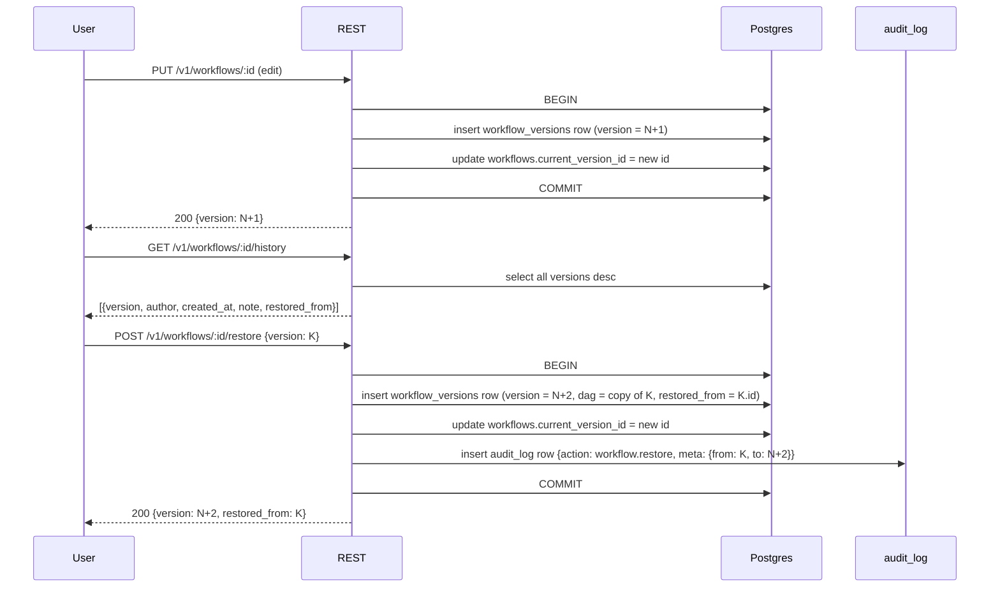

# 20 — Workflow Versioning and History

Workflows are versioned automatically. Every successful upsert against a Workflow writes a new immutable row to `workflow_versions` carrying a full snapshot of the DAG and metadata. The `workflows` row keeps a pointer to the active version through `current_version_id`. There is no separate "publish" action — saving and versioning are the same operation. This file specifies the lifecycle, the REST and CLI surface for browsing and restoring history, and the audit semantics that wrap restore.

## What gets versioned

Every Workflow upsert produces a `workflow_versions` row containing:

| Column | Meaning |
|---|---|
| `id` | Version row primary key. |
| `workflow_id` | Owning Workflow. |
| `version` | Monotonic integer, unique per `(workflow_id)`, starting at 1. |
| `dag` | Full snapshot: Steps, edges, input and output schemas, retry and timeout policies, response filters, data selectors. |
| `author_user_id` / `author_system_account_id` | Exactly one of the two is set, recording which Principal saved this version. |
| `note` | Optional free-text annotation from the author. |
| `restored_from` | Nullable pointer to another `workflow_versions.id` when this row was produced by a restore. |
| `created_at` | Insertion timestamp. |

The snapshot is the entire DAG, not a diff. Storage cost is acceptable because Workflow documents are small relative to Execution payloads, and immutability lets restore be a straight copy with no replay logic.

Trade-off: full snapshots simplify restore and history reads at the cost of duplication on tiny edits. The alternative — structural diffs — would shave storage but force every read path to walk a chain of patches; not worth it for documents that rarely exceed a few KB.

## Version numbering

`version` is monotonic and dense within a Workflow. The next version is assigned in the same transaction as the upsert through a `SELECT max(version) + 1 FROM workflow_versions WHERE workflow_id = $1 FOR UPDATE` lock, so concurrent writers serialize cleanly without losing numbers.

## Lifecycle and the active pointer



Restore never overwrites or deletes a previous row. It always produces a brand-new version whose `dag` is a copy of the target version and whose `restored_from` points at it. This keeps the version table append-only and makes the restore itself observable in audit and history listings.

## REST surface

| Method | Path | Purpose |
|---|---|---|
| `GET` | `/v1/workflows/:id/history` | List all versions newest-first with `version`, `author`, `created_at`, `note`, `restored_from`. |
| `GET` | `/v1/workflows/:id/versions/:version` | Fetch a specific version's full snapshot. |
| `POST` | `/v1/workflows/:id/restore` | Body `{ version: number, note?: string }`. Writes a new version copied from the target and points `current_version_id` at it. |

History is offset-paginated with the same defaults as Execution search — limit clamped 1 to 1000, default 50.

## CLI surface

```
subkit workflows history <workflow-slug>            # list versions newest first
subkit workflows history <workflow-slug> --version K # show one version
subkit workflows restore <workflow-slug> <version>  # restore version K, prints new version number
```

The CLI passes `--note "rolling back broken Stripe step"` through to `POST /v1/workflows/:id/restore` so the operator can annotate the restore in audit and history at the same time.

## Audit log entries

Every restore writes one `audit_log` row with `action = workflow.restore`, the actor's Principal id, and a `meta` blob carrying `{ from_version, to_version, restored_from_version_id }`. Regular saves write `workflow.upsert` rows. The two action types let an operator query "who restored this workflow and from where" without trawling the full version table.

## Diffing — out of scope for v1

There is no built-in structural diff endpoint in v1. The server returns full snapshots and the operator (or the CLI, in a future release) is expected to compute diffs client-side if they want to see them. The data model supports it cleanly: a future `GET /v1/workflows/:id/diff?from=A&to=B` endpoint can be added without any schema change. We deliberately ship without it to avoid bikeshedding the diff representation in v1.

Trade-off: shipping with no diff means operators read raw JSON snapshots when they need to compare versions. The alternative — picking and freezing a diff format now — would lock the engine into a representation that may not match how operators want to view changes (line-by-line, tree, semantic). The history surface is enough to know what changed and roll back; the visualization is a tooling concern, not an engine concern.

## Interaction with active Executions

Restoring or editing a Workflow never affects in-flight Executions. Each Execution row is bound to a specific `workflow_version_id` at the moment it was queued, and the Step Runner walks that frozen snapshot to completion. New runs picked up after a restore use the new `current_version_id`. This is also why `workflow_versions` is append-only: Execution rows reference it forever.
