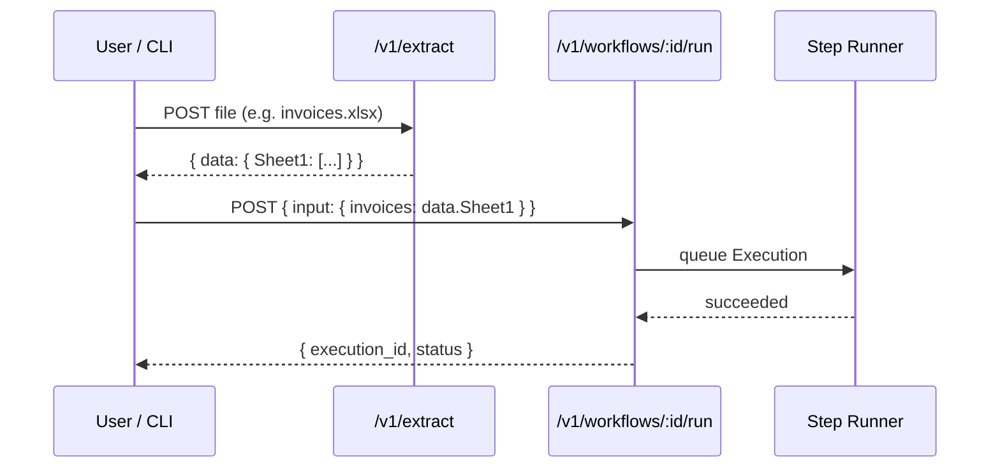

# 22 — Extract Endpoint

`/v1/extract` is a small utility that turns a file upload into structured JSON. It is intentionally not a Workflow Step — it is a one-shot pre-processing surface that gives operators (and the conversational authoring loop) a fast way to peek inside a file before deciding what Workflow to feed it to. Results are not persisted. Each request is independent.

## Contract

```
POST /v1/extract
Content-Type: multipart/form-data
```

| Form field | Required | Purpose |
|---|---|---|
| `file` | yes | The file to parse. |
| `format` | no | Force a parser. When omitted, the server detects from `Content-Type` and the file extension and falls back to MIME sniffing. |
| `options` | no | Parser-specific JSON options (sheet name for XLSX, root selector for HTML, etc.). |

The upload is capped at **100 MB**. Anything larger is rejected with `413 Payload Too Large` before the parser runs.

## Response shape

```ts
type ExtractResponse = {
  id: string;                  // request id, useful for log correlation
  success: boolean;
  data: unknown | null;        // parsed structured payload, or null on failure
  parser: string;              // resolved parser name
  size_bytes: number;
  started_at: string;          // ISO 8601
  completed_at: string;        // ISO 8601
  error?: { code: string; message: string };
};
```

`data` is whatever the parser returned: a JSON value for JSON inputs, an array of row objects for CSV and XLSX, a parsed object tree for XML and YAML, a structured representation for PDF and DOCX, or a list of files for ZIP and GZIP. The shape is parser-dependent and documented per parser below.

Trade-off: returning parser-specific shapes (instead of a forced common envelope) means a caller has to know which parser ran. That's fine because the caller is the one that picked the file in the first place; forcing a common envelope would discard structure that downstream Workflow Steps want to consume directly.

## Supported formats

| Format | MIME types | Parser output |
|---|---|---|
| JSON | `application/json` | Parsed JSON value. |
| CSV | `text/csv` | `Array<Record<string, string>>` with a header row, or `Array<Array<string>>` when no header. |
| XML | `application/xml`, `text/xml` | Object tree with attribute and text nodes flattened. |
| YAML | `application/yaml`, `text/yaml` | Parsed YAML value. |
| Excel | `application/vnd.openxmlformats-officedocument.spreadsheetml.sheet` (XLSX) | `Record<sheetName, Array<Record<string, unknown>>>`. |
| HTML | `text/html` | `{ title, headings, links, text, tables }`. |
| PDF | `application/pdf` | `{ pages: Array<{ index, text }>, metadata }`. |
| DOCX | `application/vnd.openxmlformats-officedocument.wordprocessingml.document` | `{ paragraphs, headings, tables }`. |
| ZIP | `application/zip` | `Array<{ path, size_bytes, parsed?: unknown }>`. Each entry is recursively parsed if its own MIME is supported. |
| GZIP | `application/gzip` | The decompressed payload, recursively parsed. |
| Raw text | anything else | `{ text: string }` fallback. |

The raw-text fallback ensures the endpoint never returns a hard failure on an unrecognized format — operators get the bytes back as a string and can decide what to do.

## Pluggable parser registry

The parser set is data-driven. Each parser declares the MIME types it owns and a single `parse(buffer, options)` function. Adding a new format is one entry in the registry plus one parser file.

```ts
type ExtractParser = {
  name: string;
  mimeTypes: readonly string[];
  parse(buffer: Uint8Array, options?: unknown): Promise<unknown>;
};

const registry = new Map<string, ExtractParser>();

export function registerParser(p: ExtractParser): void {
  for (const mime of p.mimeTypes) registry.set(mime, p);
}

export function pickParser(mime: string, ext: string): ExtractParser {
  return registry.get(mime) ?? registry.get(extToMime(ext)) ?? rawTextParser;
}
```

Trade-off: a flat `Map<string, parser>` keeps lookup O(1) and documentation trivial. The cost is that two parsers cannot register the same MIME type — the second `registerParser` call wins. That matches how the engine's parser set is curated: one parser per format, picked deliberately.

## Lifecycle

1. The request arrives, multipart is streamed to a temporary buffer with the 100 MB cap enforced incrementally.
2. The server detects the format, picks a parser, and calls `parse(buffer, options)`.
3. On success, the response is built and returned synchronously. The buffer and any parser intermediates are discarded.
4. On failure, the response carries `success: false` and a typed `error` object.

There is no row written to `executions`, no event on the outbox, no entry in `audit_log`. The endpoint is intentionally ephemeral. Operators who need durable extraction should call `/v1/extract` from a Workflow Step (the `request` driver supports it) and let the resulting structured payload flow into the next Step.

Trade-off: ephemerality keeps the endpoint cheap and predictable — there is no garbage collection problem and no privacy footprint inside the engine. The cost is that two identical extractions run twice; the caller is expected to cache results when they care.

## Typical usage pattern



Extract once, inspect the structured result, then feed it as the input to a Workflow run. The conversational authoring loop uses the same pattern: the assistant calls Extract through the CLI client to read a sample document, then drafts a Workflow that consumes the structured shape.

## CLI

```
subkit extract <file>                          # detect format, print JSON
subkit extract <file> --format csv             # force a parser
subkit extract <file> --options '{"sheet":"Q3"}'
```

The CLI streams the file directly to the endpoint and prints the JSON to stdout, suitable for piping into `jq` or another Workflow-trigger command.

## Limits and trade-offs

| Limit | Default |
|---|---|
| Upload size | 100 MB |
| Per-request wall clock | 120 seconds |
| In-process memory per request | bounded by upload size plus parser overhead |
| Parser concurrency | one parser invocation per request thread; concurrent extractions are independent |

Trade-off: 100 MB is large enough for the realistic cases (an Excel export, a multi-hundred-page PDF, a zipped batch of CSVs) and small enough that the engine never needs to stage intermediate state to disk. Above 100 MB the right answer is to split the file at the source, not to grow the cap.

## What `/v1/extract` does **not** do

- No OCR — image-only PDFs return empty `text` per page. OCR is a future Connector.
- No translation, summarization, or any LLM step. Extraction is purely structural.
- No persistence. Successive calls do not see each other's results.
- No streaming response. The endpoint returns one JSON payload when the parser finishes.
