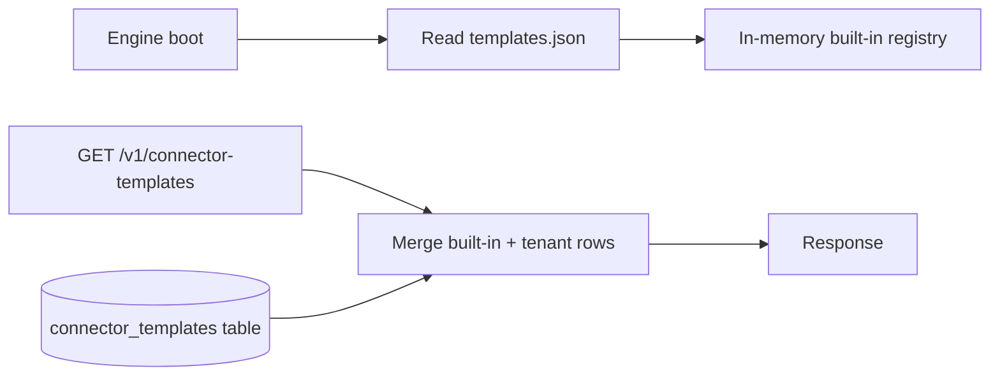
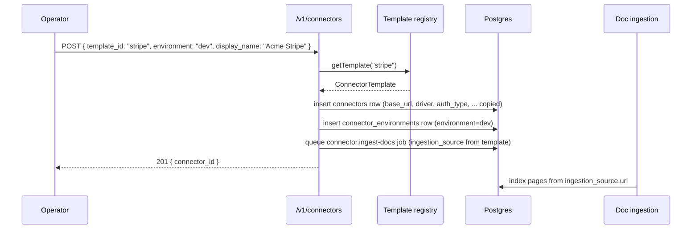

# 23 — Connector Template Registry

The engine ships a small, curated set of connector templates. A template is a pre-filled blueprint for a Connector against a popular SaaS API: base URL, authentication mode, OAuth configuration, default skill reference, documentation source, and an icon. Templates are **data, not code**. Creating a Connector "from a template" simply copies fields out of the template into a fresh `connectors` row that the operator can then customize.

This file specifies the template shape, where templates live, how tenants override them, and which providers ship in the v1 starting set. **Workflow templates are explicitly out of scope for v1** — only Connector templates exist.

## Template shape

```ts
type ConnectorTemplate = {
  id: string;               // stable slug, e.g. "stripe"
  name: string;             // display name
  description: string;      // one sentence, shown in pickers
  icon: string;             // URL or data URI
  base_url: string;
  driver: "http" | "graphql" | "postgres" | "s3";
  auth_type:
    | "none"
    | "header"
    | "query"
    | "bearer"
    | "basic"
    | "oauth2";
  oauth?: {
    authorization_url: string;
    token_url: string;
    scopes: readonly string[];
    client_id_env: string;       // env var name, never the secret itself
    client_secret_env: string;
    pkce: boolean;
  };
  default_skill_id?: string;     // global skill that ships with the template
  ingestion_source: {
    kind: "openapi" | "graphql_introspection" | "html" | "markdown";
    url: string;
  };
  tags: readonly string[];
};
```

Notable choices:

- The OAuth block carries env-var **names**, never values. A template is a public artifact that can ship in the binary; secrets are read from the operator's environment at install time.
- `default_skill_id` lets a template ship alongside a curated Skill (e.g. "Stripe API conventions and idempotency keys") that is loaded into prompt assembly automatically when the Connector is in scope.
- `ingestion_source` points the Documentation Ingestion pipeline at the right starting URL the moment the Connector is created.

Trade-off: keeping the template a flat record (rather than a code module that synthesizes a Connector at runtime) means a new template is one JSON entry, reviewable in a code review without reading any executable logic. The cost is that a template cannot encode runtime conditionals — anything dynamic belongs in the Connector itself, not the template.

## Where templates live

Two layers, evaluated in order at boot:

1. **Built-in `templates.json`** — a JSON file shipped inside the engine binary at `/var/templates/connectors.json` (read at startup). This file carries the curated v1 starting set.
2. **Per-tenant overrides in `connector_templates`** — a Postgres table that lets a tenant publish their own templates or override a built-in one by `id`. A tenant override completely replaces the built-in row of the same `id`.

The registry is the union of these two layers, with overrides winning on conflict. Reads against `/v1/connector-templates` return the merged view scoped to the calling tenant.



Trade-off: shipping built-ins inside the binary keeps the default experience zero-config (a fresh tenant can immediately create a Stripe Connector), and a database override layer keeps tenants in control of their own catalog without touching deployment.

## Starting set (v1)

Ten providers, picked because they cover the "first three integrations a real customer asks for" surface across product analytics, CRM, dev tools, support, and collaboration.

| Template | Auth | Notes |
|---|---|---|
| Stripe | bearer | Personal API keys; idempotency-key skill ships alongside. |
| Shopify | oauth2 | App OAuth scopes for products, orders, customers. |
| Slack | oauth2 | Workspace install with Bot scopes; reuses the same OAuth machinery as Chat Adapters. |
| GitHub | oauth2 | App-level OAuth; PAT also supported by switching `auth_type` after creation. |
| HubSpot | oauth2 | OAuth with refresh tokens, refresh handled by `openid-client`. |
| Airtable | bearer | Personal access token. |
| Salesforce | oauth2 | OAuth with PKCE; refresh tokens; tenant base URL captured at install time. |
| Google Workspace | oauth2 | Generic Google OAuth scopes; reuses the Google JWKS already used by the Chat Adapter. |
| Notion | oauth2 | Integration tokens via OAuth. |
| Linear | oauth2 | OAuth scopes for issues, projects, comments. |

Each entry is one row in `templates.json`. None of them carry executable logic. None of them carry tenant-specific values.

## Creating a Connector from a template



Important: the create endpoint **copies** fields from the template into a fresh Connector row. There is no live link back to the template; later edits to the template do not propagate to existing Connectors. This matches how operators actually work — they expect their Stripe Connector to keep working even if the engine ships a new Stripe template next month.

Trade-off: copy semantics break centralized updates, but they preserve the operator's ability to customize the Connector after creation without worrying that the engine will overwrite their changes. A future "template upgrade" command can be added if and when operators ask for it.

## REST surface

| Method | Path | Purpose |
|---|---|---|
| `GET` | `/v1/connector-templates` | List the merged set visible to the tenant. |
| `GET` | `/v1/connector-templates/:id` | Fetch one template by id. |
| `POST` | `/v1/connector-templates` | Tenant override: write a `connector_templates` row. Admin-only. |
| `DELETE` | `/v1/connector-templates/:id` | Remove a tenant override. Admin-only. The built-in (if any) becomes visible again. |
| `POST` | `/v1/connectors` with `{ template_id, environment, display_name }` | Create a Connector by copying the template's fields. |

## CLI

```
subkit connectors create --template stripe --environment dev --name "Acme Stripe"
subkit connectors create --template github --environment prod
```

The CLI calls `POST /v1/connectors` with the `template_id` field set; the server resolves the template and runs the same copy logic.

## Workflow templates — out of scope for v1

The v1 surface ships only Connector templates. There is no `workflow_templates` table, no `/v1/workflow-templates` endpoint, no built-in starter Workflows. The reasoning is that:

1. A Workflow encodes a customer's business logic and rarely matches another customer's needs verbatim.
2. The conversational authoring loop already turns "fetch yesterday's invoices and post a summary" into a runnable draft in a few minutes. A static template library would freeze the same idea worse.
3. Connector templates are reusable because the API surface is fixed by the upstream vendor; Workflow templates are not, because the surface is set by the customer.

Trade-off: skipping Workflow templates removes a feature operators sometimes ask for in early conversations. The mitigation is the conversational authoring surface, which is significantly more flexible. A future v2 can revisit this decision once the conversational pattern has logged enough usage to know where templates would actually save time.
