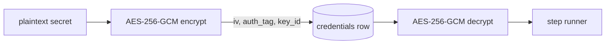
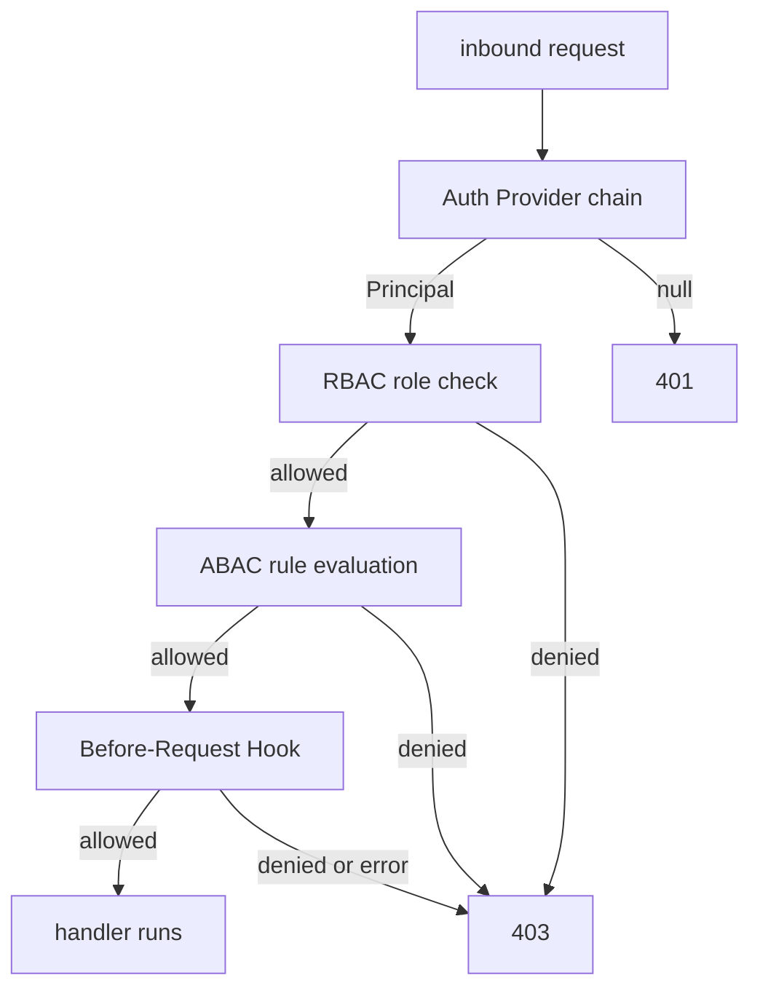

# 28 — Security

The engine is multi-tenant from the first row of every table to the last byte of every response. This document collects the cross-cutting security guarantees: how Credentials are encrypted, how Tenants are isolated, how every inbound request resolves to a Principal and Policy, how API Keys are stored and verified, how Standard Webhooks signing works in both directions, how outbound network traffic is policed, how sandboxes are confined, and how Tunnel agents are authenticated. Specific defaults and timeouts referenced here live in `30-defaults-and-limits.md`.

## Credential encryption at rest

Every Credential, every End-User Credential, every OAuth2 refresh token, and every chat workspace bot secret is encrypted at rest with AES-256-GCM. The encryption helper is the only code path allowed to touch plaintext secrets; everything else passes opaque ciphertext through the system.

| Field | Purpose |
|---|---|
| `ciphertext` | AES-256-GCM ciphertext of the secret. |
| `iv` | 12-byte nonce, generated per row from a CSPRNG. Never reused. |
| `auth_tag` | 16-byte GCM authentication tag, stored next to the ciphertext. |
| `key_id` | Identifier of the data-encryption key used. Enables rotation. |

Key material is bootstrapped from the `MASTER_KEY` environment variable (32 bytes, base64-encoded). The default deployment uses `MASTER_KEY` directly as the data-encryption key. An optional **envelope mode** stores per-tenant data keys, each wrapped with `MASTER_KEY`; the wrapped key is stored alongside `key_id`. Envelope mode trades one extra unwrap per decrypt for the ability to rotate `MASTER_KEY` without re-encrypting every row in the database.

Key rotation runs as a background worker that walks `credentials`, `end_user_credentials`, `chat_workspaces`, and any other encrypted table. For each row it decrypts under the old key, re-encrypts under the new key, and writes back inside a single transaction. The worker is incremental, idempotent, and pauses on backpressure from the queue so it never starves Execution traffic. Trade-off: re-encryption is O(rows) and runs hot for large fleets, so envelope mode is the recommended default once a deployment crosses tens of thousands of credentials.

## Tenancy enforcement

Tenancy is the single most important invariant the engine enforces. It is enforced in three places, redundantly, so a bug in any one layer cannot leak data between tenants.

1. **Row-level columns.** Every table except `tenants` itself carries a `tenant_id` column. The Drizzle schema marks it `NOT NULL`. Every index that supports a query path also includes `tenant_id` so the planner cannot accidentally scan another tenant.
2. **Service-method contracts.** Every service method takes an explicit `TenantContext` parameter — never an ambient global, never a thread-local. The compiler refuses calls that omit it. Internal helpers that accept a query builder require the caller to have already scoped the builder to a Tenant.
3. **Edge resolution.** The Auth Provider chain resolves the inbound request to a Principal whose `tenant_id` is then used as the only legitimate `TenantContext` for the lifetime of that request. Cross-tenant reads require an admin-scope System Account whose Policy explicitly carries the `tenant:cross` scope; such reads write a row to `audit_log` every time they fire.

Trade-off: redundant enforcement costs a few CPU cycles per query and a little extra column storage. The alternative — relying on a single layer — has historically been the source of the worst multi-tenant data leaks, so the redundancy is worth the cost.

## Policy evaluation order

Every inbound request walks the same ordered pipeline. The pipeline is short-circuiting: the first denial wins.

1. **Auth Provider chain** resolves the request to a Principal. v1 ships `api_key` and `oidc`. The chain is ordered per surface (REST, MCP, CLI). The first non-null provider wins.
2. **RBAC role check** verifies the Principal's role (`admin`, `member`, `enduser`, or System Account scope) against the route's required role. Roles are coarse-grained.
3. **ABAC rule evaluation** matches the Principal, target resource, action, Request Source, and `execution_mode` against tenant-defined rules. ABAC is fine-grained and rule-set-driven.
4. **Before-Request Hook** runs only for outbound `request` Steps. It is a per-role JavaScript function executed in the same `quickjs-emscripten` sandbox the engine already uses for `transform` Steps. It receives `(principal, connector, method, url, headers, query, body, step_config, is_mutating)` and returns either `allow` or a typed denial. It is **fail-closed**: any evaluation error, opcode-budget overrun, timeout, or unexpected throw denies the request and writes a row to `audit_log`. There are no host globals, no filesystem, no network. Trade-off: hooks can be slower than a static policy, so the budget is tight (~100k opcodes), but the expressive power of arbitrary JavaScript is the only thing that lets operators encode realistic per-role rules without a custom DSL.

## API-key hashing rationale

API Keys are stored as a public `prefix` (the first few characters, used to address the row) plus a `sha256(token)` digest of the rest. Verification is a constant-time compare against the digest.

The token itself is 32 bytes from a CSPRNG, base32-encoded with the prefix prepended. A 32-byte random secret has 256 bits of entropy. There is nothing for an attacker to brute-force at the token level — guessing the secret is computationally indistinguishable from guessing a private key.

This is why **SHA-256 is the correct hash for API Keys** and why **Argon2id would be the wrong choice here**:

| Concern | Random API Key | User-chosen Password |
|---|---|---|
| Entropy | 256 bits | typically 30–50 bits |
| Threat | Database disclosure | Database disclosure + offline cracking |
| Right hash | SHA-256 (fast, constant-time, no memory cost) | Argon2id (slow, memory-hard) |
| Cost per login | microseconds | hundreds of milliseconds |

A future `password` Auth Provider — explicitly out of scope for v1 — will hash low-entropy user passwords with Argon2id (likely via Bun's built-in `Bun.password`). The Auth Provider abstraction makes this a one-file plugin and does not affect API Key storage.

API Keys also carry `not_before`, `expires_at`, `scopes`, `allowed_workflows`, `allowed_connectors`, and `rotated_from_id`. The `rotated_from_id` column is the basis for the overlap-window rotation flow described in `11-identity-and-access.md`. `last_used_at` is updated through the batched `apikey.last-used-flush` queue so verification stays a single read.

## Standard Webhooks HMAC

The engine implements the Standard Webhooks specification for both inbound and outbound webhooks. The signature scheme is HMAC-SHA256 over the canonical input `id.timestamp.body`, base64-encoded, prefixed by a version tag, and carried in the `webhook-signature` header. The `webhook-id` and `webhook-timestamp` headers carry the message id and the Unix-second timestamp respectively.

**Outbound signing.** Every Subscription has one or more secrets. The current secret signs new deliveries; older secrets remain attached during a rotation overlap so consumers can roll their own verifiers without downtime. Multi-signature payloads carry one `v1,<base64>` token per active secret, separated by spaces.

**Inbound verification.** The `/v1/hooks/:slug` endpoint validates the timestamp is within a 5-minute replay window, looks up the secret, recomputes the signature, and compares it in constant time. Replay protection uses the `webhook-id` against a short-TTL `webhook_replay_seen` table. Connector-native verifiers (GitHub, Stripe, etc.) plug in per inbound row and bypass the Standard Webhooks path when the upstream provider uses its own scheme.

Trade-off: the 5-minute window is wide enough to absorb clock skew across cloud providers but tight enough that captured payloads cannot be replayed indefinitely. Tenants that need a tighter window can override per Subscription.

## Connector egress policy

Outbound `request` Steps are not free to talk to anything on the internet. Every outbound request walks an egress policy chain before the underlying `fetch` is issued.

| Layer | Rule |
|---|---|
| **Connector allow/deny** | Each Connector declares an allowlist of host patterns and an optional denylist. The default allowlist is `[connector.baseUrl host]`. |
| **Tenant egress policy** | Tenants can attach a global allowlist (typed `egress_allow`) and a global denylist (`egress_deny`) that override Connector lists. |
| **Private-IP block** | Direct fetches to RFC 1918 ranges, `127.0.0.0/8`, `169.254.0.0/16`, IPv6 link-local, and `::1` are blocked unless the request goes through a Tunnel. |
| **DNS rebinding guard** | Resolved IPs are checked against the same private-IP rules after DNS resolution and before `connect()`. |

The Tunnel exception exists because reaching a private network is the entire point of a Tunnel; the agent that opens the WebSocket is responsible for its own egress posture. Trade-off: blocking private IPs by default has caused real false-positives in the past (engineers running staging in a VPC), so the override exists, but it is gated behind the Tunnel mechanism rather than a free-form bypass.

## Sandbox network posture

Sandboxes have no implicit network access.

| Tier | Network |
|---|---|
| **`transform` JavaScript via `quickjs-emscripten`** | Zero. There is no `fetch`, no `XMLHttpRequest`, no socket primitive, no `process`, no host globals. |
| **`transform` JSONata via `jsonata`** | Zero. JSONata has no I/O. |
| **Custom-tool Docker container** | Restricted egress network attached to the tool sandbox bridge. The default network policy denies all egress; the operator opts in to specific destinations on a per-tool basis. |

Inside the JavaScript sandbox the engine also forbids `eval`, `Function`, `WebAssembly`, and dynamic module loading; the host bootstraps a clean global object with only the JSON, Math, Date, and `console.log` primitives plus the Step input.

## Tunnel socket authentication

The Tunnel agent authenticates the same way every other client authenticates: with an API Key. The key is issued to a System Account that exists for exactly one purpose — running this Tunnel — and carries a single scope (`tunnel:connect`). The agent presents the key in the `Authorization` header of the WebSocket upgrade request. The engine validates it through the normal API Key path before accepting the upgrade and before recording any `tunnel_targets` rows the agent registers.

If the key is unknown, expired, or scoped to anything other than `tunnel:connect`, the upgrade is refused with HTTP 401 and the failed attempt is written to `audit_log`. After the upgrade, the agent must complete a brief registration handshake within a short timeout; failure to register closes the socket. Trade-off: requiring a dedicated System Account adds a small operator step at provisioning time, but it keeps Tunnel access auditable and revocable independently of human users.

## Supply chain

| Concern | Practice |
|---|---|
| Container images | Pinned to immutable `sha256:` digests in `docker-compose.yml`. |
| Bun lockfile | `bun.lockb` is committed and verified in CI. |
| npm tokens | Scoped, read-only, project-bound, stored in CI as encrypted secrets. |
| Release artifacts | Built in a clean CI runner from a tagged commit; the binary is signed and the digest is published. |
| Third-party dependencies | The runtime budget is capped at the small set listed in `01-concept.md`; new additions require a written justification in the dependency review file. |

Trade-off: pinning image digests means every base-image security update has to be vendored deliberately, which slows down opportunistic updates but eliminates the entire class of "an upstream image got replaced under us" failures.

## Secret handling

Secrets enter the engine through environment variables. There are no secrets baked into the binary, no secrets in the Docker image, and no secrets in the source tree. The only secrets the engine itself reads from the environment are:

- `MASTER_KEY` — 32-byte base64 root key for AES-256-GCM.
- `LLM_PRIMARY` and `LLM_FALLBACK` — provider names; the per-provider API keys live alongside (`OPENAI_API_KEY`, `ANTHROPIC_API_KEY`, etc.) and are referenced explicitly in `32-deployment.md`.
- `SLACK_SIGNING_SECRET`, `SLACK_CLIENT_ID`, `SLACK_CLIENT_SECRET`, `TEAMS_APP_ID`, `TEAMS_APP_PASSWORD`, `GOOGLE_CHAT_PROJECT_ID`, `GOOGLE_CHAT_SERVICE_ACCOUNT_JSON` — chat platform installation secrets. Per-workspace secrets (the bot tokens themselves) are encrypted in `chat_workspaces`.
- `S3_ACCESS_KEY` / `S3_SECRET_KEY` — object storage credentials when payload offload is configured.

Trade-off: relying on environment variables is the simplest pattern that works on every container platform and every developer laptop. A more sophisticated deployment can layer a secret manager (Vault, AWS Secrets Manager, GCP Secret Manager) by injecting variables at boot; the engine does not need to know.
