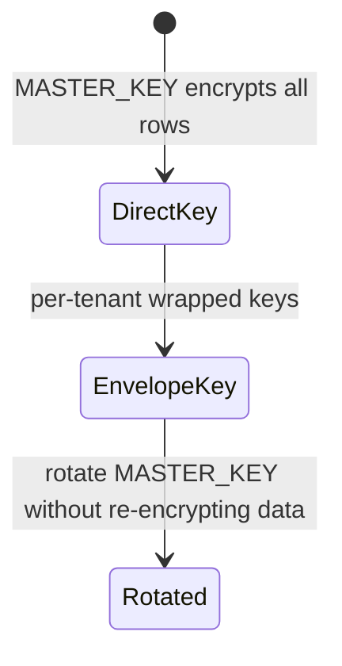
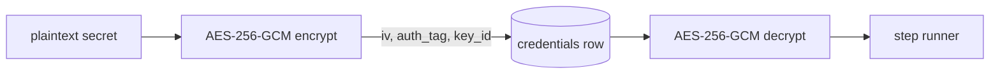
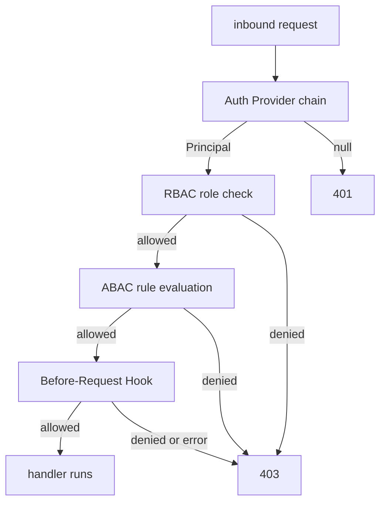

# 28 — Security

- Multi-tenant from the first row of every table to the last byte of every response.
- Covers: Credential encryption, Tenant isolation, Principal/Policy resolution, API Key storage, Standard Webhooks signing, egress policing, sandbox confinement, Tunnel authentication.
- Specific defaults and timeouts live in `30-defaults-and-limits.md`.

## Credential encryption at rest

- Every Credential, End-User Credential, OAuth2 refresh token, and chat workspace bot secret is encrypted at rest with AES-256-GCM.
- The encryption helper is the only code path allowed to touch plaintext secrets; everything else passes opaque ciphertext.

| Field | Purpose |
|---|---|
| `ciphertext` | AES-256-GCM ciphertext of the secret. |
| `iv` | 12-byte nonce, generated per row from a CSPRNG. Never reused. |
| `auth_tag` | 16-byte GCM authentication tag, stored next to the ciphertext. |
| `key_id` | Identifier of the data-encryption key used. Enables rotation. |

- Key material bootstrapped from `MASTER_KEY` environment variable (32 bytes, base64-encoded).
- Default: `MASTER_KEY` used directly as the data-encryption key.
- Optional **envelope mode**: per-tenant data keys, each wrapped with `MASTER_KEY`, stored alongside `key_id`.

Key rotation:
- Background worker walks `credentials`, `end_user_credentials`, `chat_workspaces`, and other encrypted tables.
- For each row: decrypt under old key, re-encrypt under new key, write back in a single transaction.
- Incremental, idempotent, pauses on backpressure to avoid starving Execution traffic.

Trade-off: re-encryption is O(rows) and runs hot for large fleets, so envelope mode is the recommended default once a deployment crosses tens of thousands of credentials.

## Tenancy enforcement

Tenancy is the single most important invariant. Enforced in three places redundantly so a bug in any one layer cannot leak data.

1. **Row-level columns** — every table except `tenants` carries a `NOT NULL` `tenant_id` column; every index includes `tenant_id` so the planner cannot scan another tenant.
2. **Service-method contracts** — every method takes an explicit `TenantContext` parameter (never ambient/thread-local); the compiler refuses calls that omit it.
3. **Edge resolution** — the Auth Provider chain resolves the request to a Principal whose `tenant_id` becomes the sole `TenantContext` for the request lifetime. Cross-tenant reads require `tenant:cross` scope and write to `audit_log`.

Trade-off: redundant enforcement costs a few CPU cycles per query and extra column storage, but eliminates the class of single-layer multi-tenant data leaks.

## Policy evaluation order

Every inbound request walks the same short-circuiting pipeline (first denial wins).

1. **Auth Provider chain** — resolves to a Principal. v1 ships `api_key` and `oidc`, ordered per surface (REST, MCP, CLI); first non-null wins.
2. **RBAC role check** — verifies Principal's role (`admin`, `member`, `enduser`, System Account scope) against the route's required role (coarse-grained).
3. **ABAC rule evaluation** — matches Principal, target resource, action, Request Source, and `execution_mode` against tenant-defined rules (fine-grained).
4. **Before-Request Hook** — per-role JavaScript in `quickjs-emscripten` sandbox, outbound `request` Steps only.
   - Receives `(principal, connector, method, url, headers, query, body, step_config, is_mutating)`, returns `allow` or typed denial.
   - **Fail-closed**: any error, opcode overrun, timeout, or throw denies and writes to `audit_log`.
   - No host globals, filesystem, or network.

Trade-off: hooks can be slower than static policy, so the budget is tight (~100k opcodes), but arbitrary JavaScript is needed to encode realistic per-role rules without a custom DSL.

## API-key hashing rationale

- Stored as public `prefix` (first few characters, used to address the row) plus `sha256(token)` digest; verification is a constant-time compare.
- Token is 32 bytes from a CSPRNG (256 bits of entropy) — brute-forcing is computationally indistinguishable from guessing a private key.
- SHA-256 is correct for high-entropy API keys; Argon2id is correct for low-entropy passwords:

| Concern | Random API Key | User-chosen Password |
|---|---|---|
| Entropy | 256 bits | typically 30–50 bits |
| Threat | Database disclosure | Database disclosure + offline cracking |
| Right hash | SHA-256 (fast, constant-time, no memory cost) | Argon2id (slow, memory-hard) |
| Cost per login | microseconds | hundreds of milliseconds |

- A future `password` Auth Provider (out of scope for v1) will use Argon2id via `Bun.password`; the Auth Provider abstraction makes this a one-file plugin.
- API Keys also carry `not_before`, `expires_at`, `scopes`, `allowed_workflows`, `allowed_connectors`, and `rotated_from_id` (basis for overlap-window rotation in `11-identity-and-access.md`).
- `last_used_at` is updated via the batched `apikey.last-used-flush` queue so verification stays a single read.

## Standard Webhooks HMAC

- Implements Standard Webhooks for both inbound and outbound.
- Signature: HMAC-SHA256 over `id.timestamp.body`, base64-encoded, version-prefixed, carried in `webhook-signature` header.

**Outbound signing:**
- Each Subscription has one or more secrets; current secret signs new deliveries.
- Older secrets remain during rotation overlap so consumers can roll verifiers without downtime.
- Multi-signature payloads carry one `v1,<base64>` token per active secret, space-separated.

**Inbound verification:**
- `/v1/hooks/:slug` validates timestamp within 5-minute replay window, recomputes signature, constant-time compare.
- Replay protection via `webhook-id` against a short-TTL `webhook_replay_seen` table.
- Connector-native verifiers (GitHub, Stripe, etc.) bypass Standard Webhooks when upstream uses its own scheme.

Trade-off: 5-minute window absorbs clock skew across cloud providers but prevents indefinite replay; tenants can override per Subscription.

## Connector egress policy

Every outbound `request` Step walks an egress policy chain before `fetch` is issued.

| Layer | Rule |
|---|---|
| **Connector allow/deny** | Each Connector declares an allowlist of host patterns and an optional denylist. The default allowlist is `[connector.baseUrl host]`. |
| **Tenant egress policy** | Tenants can attach a global allowlist (typed `egress_allow`) and a global denylist (`egress_deny`) that override Connector lists. |
| **Private-IP block** | Direct fetches to RFC 1918 ranges, `127.0.0.0/8`, `169.254.0.0/16`, IPv6 link-local, and `::1` are blocked unless the request goes through a Tunnel. |
| **DNS rebinding guard** | Resolved IPs are checked against the same private-IP rules after DNS resolution and before `connect()`. |

Trade-off: blocking private IPs by default causes occasional false-positives (e.g. staging in a VPC), so the override exists but is gated behind the Tunnel mechanism rather than a free-form bypass.

## Sandbox network posture

- Sandboxes have no implicit network access.

| Tier | Network |
|---|---|
| **`transform` JavaScript via `quickjs-emscripten`** | Zero. There is no `fetch`, no `XMLHttpRequest`, no socket primitive, no `process`, no host globals. |
| **`transform` JSONata via `jsonata`** | Zero. JSONata has no I/O. |
| **Custom-tool Docker container** | Restricted egress network attached to the tool sandbox bridge. The default network policy denies all egress; the operator opts in to specific destinations on a per-tool basis. |

- Inside the JavaScript sandbox: `eval`, `Function`, `WebAssembly`, and dynamic module loading are forbidden.
- Clean global object with only JSON, Math, Date, `console.log`, and the Step input.

## Tunnel socket authentication

- Tunnel agent authenticates with an API Key issued to a dedicated System Account with a single `tunnel:connect` scope.
- Key presented in the `Authorization` header of the WebSocket upgrade request; validated through the normal API Key path.
- Unknown, expired, or wrong-scope keys are refused with HTTP 401 and logged to `audit_log`.
- After upgrade, the agent must complete a registration handshake within a short timeout; failure closes the socket.

Trade-off: requiring a dedicated System Account adds a provisioning step but keeps Tunnel access auditable and revocable independently of human users.

## Supply chain

| Concern | Practice |
|---|---|
| Container images | Pinned to immutable `sha256:` digests in `docker-compose.yml`. |
| Bun lockfile | `bun.lockb` is committed and verified in CI. |
| npm tokens | Scoped, read-only, project-bound, stored in CI as encrypted secrets. |
| Release artifacts | Built in a clean CI runner from a tagged commit; the binary is signed and the digest is published. |
| Third-party dependencies | The runtime budget is capped at the small set listed in `01-concept.md`; new additions require a written justification in the dependency review file. |

Trade-off: pinning image digests slows opportunistic updates but eliminates "upstream image replaced under us" failures.

## Secret handling

- Secrets enter only through environment variables — none baked into binaries, Docker images, or source.
- Secrets the engine reads:

- `MASTER_KEY` — 32-byte base64 root key for AES-256-GCM.
- `LLM_PRIMARY` and `LLM_FALLBACK` — provider names; the per-provider API keys live alongside (`OPENAI_API_KEY`, `ANTHROPIC_API_KEY`, etc.) and are referenced explicitly in `32-deployment.md`.
- `SLACK_SIGNING_SECRET`, `SLACK_CLIENT_ID`, `SLACK_CLIENT_SECRET`, `TEAMS_APP_ID`, `TEAMS_APP_PASSWORD`, `GOOGLE_CHAT_PROJECT_ID`, `GOOGLE_CHAT_SERVICE_ACCOUNT_JSON` — chat platform installation secrets. Per-workspace secrets (the bot tokens themselves) are encrypted in `chat_workspaces`.
- `S3_ACCESS_KEY` / `S3_SECRET_KEY` — object storage credentials when payload offload is configured.

Trade-off: environment variables are the simplest pattern across all container platforms and developer laptops; a secret manager (Vault, AWS/GCP Secrets Manager) can layer on top by injecting variables at boot.
