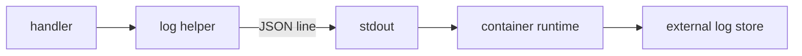
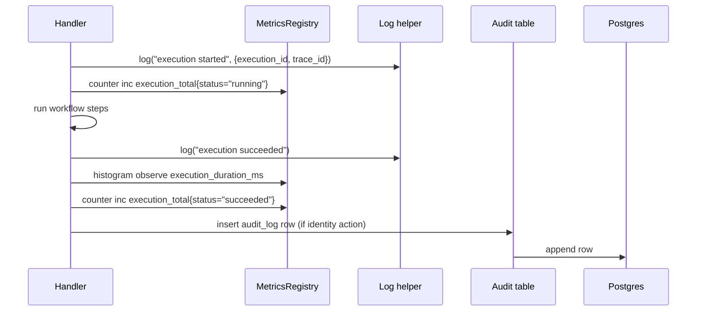

# 29 — Observability

The engine exposes three observability surfaces: a Prometheus-compatible metrics endpoint, structured JSON logs, and an immutable audit trail. All three are first-class and ship in the binary; none of them require external dependencies. Operational defaults referenced here (queue lag thresholds, replay windows, etc.) live in `30-defaults-and-limits.md`.

## Metrics

Metrics are exposed at `GET /v1/metrics` in Prometheus text-exposition format. The collector is hand-rolled in app code — under one hundred lines of TypeScript — so the engine ships without a `prom-client` dependency. Trade-off: a hand-rolled collector means the engine cannot lean on community-contributed instrumentation helpers, but in practice every series the engine cares about is something the engine writes anyway, and the dependency budget is more valuable than the syntactic sugar.

### Labels

Every series carries a small, fixed label set. Labels are intentionally low-cardinality so the time-series database does not explode.

| Label | Cardinality | Notes |
|---|---|---|
| `tenant_id` | bounded by tenant count | Always present. |
| `request_source` | 7 values | `api | cli | scheduler | mcp | webhook | tool-chain | ui` |
| `status` | 5 values | `queued | running | succeeded | failed | aborted | timed_out` |
| `workflow_id` | bounded by workflow count | Present on execution series only. |
| `connector_id` | bounded by connector count | Present on connector series only. |
| `queue` | one per named queue | Present on queue series. |
| `platform` | `slack | teams | google` | Present on chat series. |

### Core series

| Series | Type | Labels |
|---|---|---|
| `execution_duration_ms` | histogram | `tenant_id`, `workflow_id`, `request_source`, `status` |
| `execution_total` | counter | `tenant_id`, `workflow_id`, `request_source`, `status` |
| `request_retry_total` | counter | `tenant_id`, `connector_id`, `status` |
| `webhook_delivery_total` | counter | `tenant_id`, `subscription_id`, `status` |
| `chat_delivery_total` | counter | `tenant_id`, `platform`, `status` |
| `llm_tokens_total` | counter | `tenant_id`, `model` |
| `queue_depth` | gauge | `queue` |
| `queue_lag_ms` | gauge | `queue` |
| `outbox_cursor_lag` | gauge | `channel` |
| `tunnel_connected` | gauge | `tenant_id`, `tunnel_id` |

Histogram buckets default to `[10, 50, 100, 250, 500, 1000, 2500, 5000, 10000, 30000, 60000, 300000, 1800000]` milliseconds. Trade-off: the wide upper buckets are necessary because the largest Workflow Executions legitimately run for hours, and the lower buckets keep p50/p95/p99 latency for typical Steps readable.

### Collector interface

The collector is a single module with this shape (illustrative TypeScript, original to this document):

```ts
export interface MetricLabels {
  readonly [key: string]: string;
}

export interface Counter {
  inc(labels?: MetricLabels, by?: number): void;
}

export interface Histogram {
  observe(labels: MetricLabels | undefined, value: number): void;
}

export interface Gauge {
  set(labels: MetricLabels | undefined, value: number): void;
  inc(labels?: MetricLabels, by?: number): void;
  dec(labels?: MetricLabels, by?: number): void;
}

export interface MetricsRegistry {
  counter(name: string, help: string, labelNames: readonly string[]): Counter;
  histogram(name: string, help: string, labelNames: readonly string[], buckets: readonly number[]): Histogram;
  gauge(name: string, help: string, labelNames: readonly string[]): Gauge;
  render(): string; // Prometheus text exposition
}
```

The `render()` call walks the registered series, sorts label sets deterministically so scrapes are diff-friendly, and formats them in the standard `# HELP` / `# TYPE` / `metric{labels} value` shape. Trade-off: the deterministic label sort costs a small amount per scrape but makes regression testing trivial.

## Structured logging

Every log line is a single JSON object on `stdout`. There is no log shipper inside the engine — the operator's container runtime (`docker logs`, Kubernetes `kubectl logs`, journald) does the shipping. A thin helper wraps `console.log` so call sites do not have to assemble the JSON by hand. Trade-off: pushing log shipping out of the binary keeps the dependency budget zero and lets every existing observability stack ingest the engine's logs without adapter code.



Every line carries the same context fields:

| Field | Meaning |
|---|---|
| `ts` | RFC3339 timestamp with millisecond precision. |
| `level` | `debug | info | warn | error`. |
| `trace_id` | Per-request UUID. Propagated through queue jobs via the job payload and through tool-chain `call` Steps via the parent Execution. |
| `tenant_id` | Tenant the action belongs to. |
| `execution_id` | Set on Step-level lines. |
| `workflow_id` | Set on workflow-scoped lines. |
| `request_source` | One of the seven Request Source values. |
| `actor_id` | Principal id (User or System Account). |
| `msg` | Short human-readable message. |
| `data` | Free-form structured payload, scrubbed of secrets. |

The helper also masks any field whose key matches the configured sensitive-key set (`password`, `secret`, `token`, `authorization`, etc.) so a misplaced log call cannot leak a Credential into the log stream.

## Audit trail

Audit events live in the immutable `audit_log` table defined in `04-data-model.md`. Every identity action and every policy-affecting action writes one row. The table is append-only — it is never updated, never soft-deleted, and never purged by the application; operators set retention via standard Postgres tooling.

| Action | When |
|---|---|
| `auth.login` | Successful login through any Auth Provider. |
| `auth.login_failed` | Failed login or denied Auth Provider chain. |
| `apikey.issue` | A new API Key is created. |
| `apikey.rotate` | An API Key is rotated; the row records `rotated_from_id`. |
| `apikey.revoke` | An API Key is revoked. |
| `portal_token.issue` | A Portal Token is issued. |
| `policy.update` | An RBAC role, ABAC rule, or Before-Request Hook is changed. |
| `credential.update` | A Credential or End-User Credential is created, rotated, or deleted. |
| `patch.auto_apply` | A self-healing Patch Candidate is auto-applied under the `safe-patches` policy. |
| `tenant.cross_read` | A System Account with `tenant:cross` reads another Tenant's data. |
| `hook.fail_closed` | A Before-Request Hook denied an outbound request. |
| `tunnel.register` | A Tunnel agent registers a Tunnel Target. |

Each row carries `tenant_id`, `actor_id`, `actor_kind` (`user | system_account | hook`), `action`, `resource_kind`, `resource_id`, `request_source`, `trace_id`, a JSON `details` blob, and `created_at`. The `trace_id` joins back to the structured log stream so an investigator can pivot from an audit row to the full request context.

## Dashboards sketch

A typical operator dashboard wires the panels below from the metrics endpoint. These are recommendations, not a contract.

1. **Execution success rate by tenant** — `sum(rate(execution_total{status="succeeded"}[5m])) by (tenant_id) / sum(rate(execution_total[5m])) by (tenant_id)`.
2. **p95 execution duration** — `histogram_quantile(0.95, sum(rate(execution_duration_ms_bucket[5m])) by (le, workflow_id))`.
3. **Queue depth** — `queue_depth` panel grouped by `queue`. The relevant queues to watch are `execution.run`, `webhook.deliver`, `chat.deliver`, and `workflow.repair`.
4. **Outbox cursor lag** — `outbox_cursor_lag` per channel; alerts fire if any channel falls more than a few seconds behind for sustained periods.
5. **LLM tokens per tenant per day** — `sum(increase(llm_tokens_total[24h])) by (tenant_id, model)`. Joined client-side with the tenant's monthly token budget.
6. **Webhook delivery success rate** — `sum(rate(webhook_delivery_total{status="succeeded"}[5m])) by (subscription_id) / sum(rate(webhook_delivery_total[5m])) by (subscription_id)`.
7. **Chat delivery success rate by platform** — same shape, grouped by `platform`. Watches per-workspace circuit breakers as a side effect.
8. **Failed Patch Candidate review queue** — count of `patch_candidates` rows in `proposed` state, grouped by `tenant_id`. This is sourced from a Postgres metric exporter, not the engine, but is shown alongside the engine's series.

## Putting it together



Every observable signal lives in exactly one of those three places — a counter or histogram in the registry, a JSON line on stdout, or a row in `audit_log`. There is no fourth channel to reconcile.
