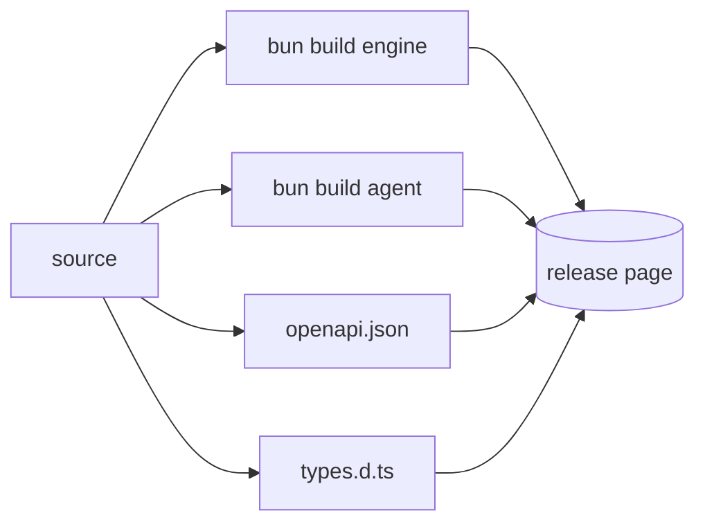

# 31 — Developer Tooling

This document captures every tool a contributor needs between editing source and shipping a release. Every choice is paired with a one-line trade-off; the alternative paths are documented so a contributor who prefers the classic toolchain is not blocked.

## Lint, format, import sort

**Biome** is the default. A single binary handles linting, formatting, and import sorting. It is fast enough that it runs in milliseconds on the whole tree, and it has zero JavaScript dependencies. Trade-off: Biome's rule set is smaller than ESLint's, so a project that depends on a specific niche ESLint plugin has to map it to Biome's equivalent or accept the gap.

**Alternative**: classic ESLint + Prettier with `@typescript-eslint`, `eslint-plugin-import`, and `prettier-plugin-organize-imports`. Documented as the fallback for contributors who already have their editor wired up to ESLint and don't want to reconfigure it.

## Type checking

**`tsc --noEmit`** is the type checker. Bun transpiles TypeScript on the fly but **does not type-check**, so the type checker has to run as a separate step. The repo carries a `tsconfig.json` tuned for strict mode (`strict: true`, `noUncheckedIndexedAccess: true`, `noImplicitOverride: true`, `exactOptionalPropertyTypes: true`).

Trade-off: running `tsc` separately costs a few seconds in CI and on the developer laptop, but it is the only tool that produces an authoritative type-error answer. Bun's transpiler treats type errors as warnings at best.

## Unit and integration tests

**Bun test** is the test runner for both unit and integration tests. It is built into the runtime, has Jest-compatible matchers, and runs TypeScript natively without a transform step.

Repository structure:

```
src/
  conversations/
    runner.ts
    runner.test.ts          # unit
  identity/
    api-key.ts
    api-key.test.ts         # unit
tests/
  integration/
    workflows.test.ts       # spins up Postgres
    webhooks.test.ts
  e2e/
    full-stack.test.ts      # spins up the compose file
  fixtures/
    llm/                    # recorded HTTP fixtures
    chat/                   # recorded Slack/Teams/Google Chat events
```

Unit tests live next to the file under test as `*.test.ts`. Integration tests live in `tests/integration/`. End-to-end tests live in `tests/e2e/`. Trade-off: co-located unit tests keep the test next to the implementation, integration tests stay separate so they don't run on every save in watch mode.

## Ephemeral Postgres for integration tests

**`testcontainers`** (npm) provides ephemeral Postgres instances for integration tests. A test helper boots a `postgres:16` container per test file (or per worker, configurable), runs the Drizzle migrations against it, and tears it down on `afterAll`.

```ts
// tests/integration/_helpers/postgres.ts (illustrative shape)
export async function startTestPostgres(): Promise<TestDatabase> {
  const container = await new PostgreSqlContainer("postgres:16").start();
  const url = container.getConnectionUri();
  await runMigrations(url);
  return {
    url,
    async stop() {
      await container.stop();
    },
  };
}
```

Trade-off: containers add a few seconds to each test file's startup. The win is that integration tests run against a real Postgres instead of a sqlite shim, and every test gets a clean schema.

## End-to-end tests

End-to-end tests compile the binary, bring up `docker-compose.test.yml` (Postgres plus optional MinIO and an optional `dockerd` for the custom-tool tier), and drive the running engine through `hono/client`. The assertion surface covers:

- **Outbox rows**: every domain write produces the expected `events` row.
- **Standard Webhooks deliveries**: the test harness signs up its own subscription endpoint and verifies the HMAC against the published Standard Webhooks scheme.
- **Executions**: state transitions match the expected sequence and Request Source.
- **Notifications**: chat deliveries land on a fake adapter mounted on the bus.
- **Tunnels**: the test harness spins up an in-process tunnel agent, registers a Tunnel Target, and asserts a routed request flows through it.
- **Patch Candidates**: a fixture-driven drift simulation produces a `patch_candidates` row with the expected classification.
- **MCP `tools/call` progress**: the harness opens a Streamable HTTP MCP session and asserts on `notifications/progress` events for a long-running workflow.

Trade-off: end-to-end tests are slow (tens of seconds per scenario). The win is that they exercise the binary the way an operator would, and they catch wiring bugs that unit tests cannot.

## CLI tests

**`ink-testing-library`** drives the `subkit chat` Ink-based screen. The library renders the React tree headlessly and lets the test inspect the frame buffer, simulate keystrokes, and snapshot the visible output.

```ts
// tests/integration/cli/chat.test.ts (illustrative shape)
import { render } from "ink-testing-library";
import { ChatScreen } from "../../../src/cli/chat/screen";

test("chat screen renders draft updates", async () => {
  const { lastFrame, stdin, rerender } = render(<ChatScreen sessionId="abc" />);
  stdin.write("create a workflow that fetches yesterday's invoices\n");
  await waitFor(() => expect(lastFrame()).toContain("propose_step"));
});
```

Other CLI commands (the `citty` ones, not the Ink one) are tested by invoking the command function directly with a mock `hono/client` so the assertion surface stays at the CLI/server contract.

## LLM test strategy

LLM-touching code paths are tested in two modes.

**Default mode**: recorded HTTP fixtures. Each test that exercises a Conversation, a `workflow.repair` loop, or an Extract pipeline records the LLM provider's HTTP traffic the first time it runs (against a real provider and a recording flag), then replays the fixture on every subsequent run. This makes the test deterministic, fast, and free.

**Live mode**: opt-in. Setting `LLM_TEST_LIVE=1` in the environment makes the LLM test helper bypass the fixture and hit the real provider. Live mode runs nightly in CI against a dedicated low-budget account so a provider-side regression surfaces within twenty-four hours.

Trade-off: recorded fixtures can drift from current provider behavior. The nightly live run is the safety net that catches drift before it lands in a release.

## Pre-commit (optional)

**Lefthook** is the optional pre-commit runner. It is a tiny Go binary with no Node dependency and a simple YAML config. The default config runs `biome check` and `tsc --noEmit` on changed files. Trade-off: pre-commit hooks slow down the commit step on large changes; they are optional precisely so contributors who prefer to lint in CI only can opt out.

```yaml
# lefthook.yml (illustrative)
pre-commit:
  parallel: true
  commands:
    biome:
      glob: "*.{ts,tsx,js,json}"
      run: bunx biome check --apply {staged_files}
    tsc:
      glob: "*.ts"
      run: bunx tsc --noEmit
```

## CI pipeline

GitHub Actions is the reference CI. The pipeline lives in `.github/workflows/ci.yml` and runs on every push and pull request. Trade-off: GitHub Actions is the path of least resistance for an open-source release; teams running on GitLab CI or Buildkite mirror the same step list with their runner of choice.

```yaml
# .github/workflows/ci.yml (illustrative shape)
name: ci
on:
  push:
    branches: [main]
  pull_request:
jobs:
  build-test:
    runs-on: ubuntu-latest
    services:
      postgres:
        image: postgres:16
        env:
          POSTGRES_PASSWORD: test
        ports: ["5432:5432"]
        options: >-
          --health-cmd pg_isready --health-interval 5s --health-retries 5
    steps:
      - uses: actions/checkout@v4
      - uses: oven-sh/setup-bun@v2
      - name: cache bun
        uses: actions/cache@v4
        with:
          path: |
            ~/.bun/install/cache
            node_modules
          key: ${{ runner.os }}-bun-${{ hashFiles('bun.lockb') }}
      - run: bun install --frozen-lockfile
      - run: bunx biome check
      - run: bunx tsc --noEmit
      - run: bun test
      - run: bun build apps/engine/src/index.ts --compile --outfile dist/engine
      - run: ./scripts/smoke.sh
```

The smoke script brings up `docker-compose.test.yml`, points the freshly-compiled binary at it, runs a tiny `hono/client` script that creates a Tenant and a Workflow, and asserts the binary responds on `/v1/health`.

## Release artifacts

Every tagged release publishes:

| Artifact | Contents |
|---|---|
| `engine_{os}_{arch}` | Engine binary for each platform (5 variants). |
| `sk_{os}_{arch}` | End-user CLI binary (5 variants). |
| `subkit_{os}_{arch}` | Operator CLI binary (5 variants). |
| `tunnel-agent_{os}_{arch}` | Tunnel agent binary (5 variants). |
| `SHA256SUMS` | Checksums for all 20 binaries. |
| `openapi.json` | The published OpenAPI contract, generated by `@hono/zod-openapi`. |



Trade-off: shipping a binary per target triple multiplies CI time and storage. The win is that operators install with a single download and zero runtime to manage.
