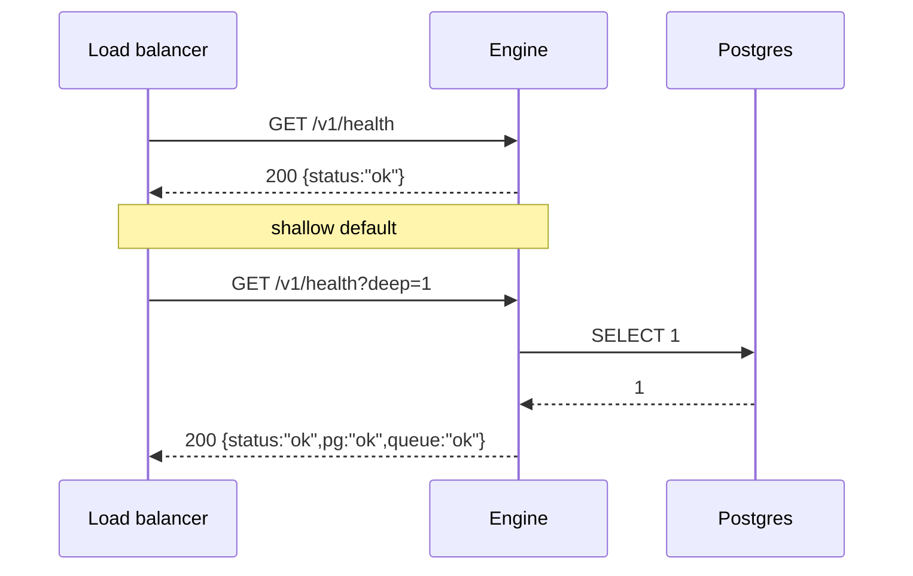
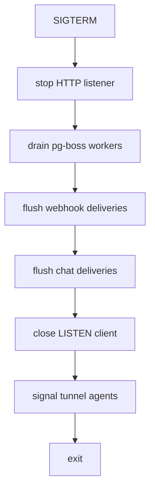

# 32 — Deployment

The engine ships as a single Bun-compiled binary that runs next to a Postgres instance.

- No application server, no language runtime to install, and no GUI.
- A `docker-compose.yml` is the canonical local and small-production layout.
- The Tunnel agent is a separate distributable binary that runs on the customer side.

## Compiling the binary

The engine and agent compile with one command per target triple. Version is injected at compile time via `BUILD_VERSION`.

- Trade-off: per-triple compilation multiplies build time, but the resulting artifact has zero runtime dependencies.

```sh
# Engine — Linux x64
bun build apps/engine/src/index.ts --compile --target=bun-linux-x64 \
  --define "BUILD_VERSION=\"$(node -p 'require(\"./package.json\").version')\"" \
  --outfile dist/engine-linux-x64

# Engine — Linux arm64
bun build apps/engine/src/index.ts --compile --target=bun-linux-arm64 \
  --define "BUILD_VERSION=\"$(node -p 'require(\"./package.json\").version')\"" \
  --outfile dist/engine-linux-arm64

# Engine — macOS x64
bun build apps/engine/src/index.ts --compile --target=bun-darwin-x64 \
  --define "BUILD_VERSION=\"$(node -p 'require(\"./package.json\").version')\"" \
  --outfile dist/engine-darwin-x64

# Engine — macOS arm64
bun build apps/engine/src/index.ts --compile --target=bun-darwin-arm64 \
  --define "BUILD_VERSION=\"$(node -p 'require(\"./package.json\").version')\"" \
  --outfile dist/engine-darwin-arm64

# Engine — Windows x64
bun build apps/engine/src/index.ts --compile --target=bun-windows-x64 \
  --define "BUILD_VERSION=\"$(node -p 'require(\"./package.json\").version')\"" \
  --outfile dist/engine-windows-x64.exe
```

The Tunnel agent compiles from the same source tree with a separate entry point:

```sh
bun build apps/agent/src/index.ts --compile --target=bun-linux-x64 \
  --define "BUILD_VERSION=\"$(node -p 'require(\"./package.json\").version')\"" \
  --outfile dist/tunnel-agent-linux-x64
```

### macOS: ad-hoc code signing

Bun-compiled binaries carry no code signature. On recent macOS (especially Apple Silicon) Apple Mobile File Integrity (AMFI) refuses to launch any unsigned executable and terminates the process before `main` runs.

- This is distinct from the Gatekeeper quarantine flag set by Safari downloads -- it applies to any unsigned binary, including ones compiled locally.
- Only ad-hoc code signing fixes it.

The repo ships a helper at `scripts/codesign-macos.sh` that ad-hoc signs a Mach-O with a synthetic identity and no-ops on non-Darwin hosts. The `build:engine`, `build:agent`, and `build:cli` package scripts chain it in automatically, so `bun run build:all` produces launchable binaries on macOS with no additional steps.

- Trade-off: ad-hoc signing is enough for local dev and trusted internal hosts, but public distribution still requires a real Developer ID signature plus notarization through Apple.

There is one Bun-specific quirk: a plain `codesign --sign - --force` on a freshly compiled Bun binary fails with `invalid or unsupported format for signature`, even though the Mach-O carries an `LC_CODE_SIGNATURE` load command. Calling `codesign --remove-signature` first resets the signature region and lets the subsequent sign succeed. The helper script does both steps. To sign an out-of-band binary manually:

```sh
codesign --remove-signature path/to/binary 2>/dev/null || true
codesign --sign - --force path/to/binary
codesign -dv path/to/binary 2>&1 | grep Signature   # expect: Signature=adhoc
```

## Container image

The container image uses a slim Debian base with the compiled binary copied in. There is no package manager and no language runtime in the runtime image.

- Trade-off: slim images shrink the attack surface while still providing basic debugging tools (`wget`, `sh`).

```dockerfile
# docker/Dockerfile.engine
FROM oven/bun:1.3-slim AS builder
ARG TARGETARCH
ARG ENGINE_VERSION=0.0.0-dev
WORKDIR /app

COPY package.json bun.lock bunfig.toml tsconfig.json tsconfig.base.json biome.json ./
COPY apps ./apps
COPY packages ./packages

RUN bun install --frozen-lockfile

RUN mkdir -p /out \
    && BUN_TARGET="bun-linux-$(if [ "$TARGETARCH" = "amd64" ]; then echo x64; else echo arm64; fi)" \
    && bun build apps/engine/src/index.ts \
        --compile \
        --target="$BUN_TARGET" \
        --outfile=/out/engine

FROM debian:bookworm-slim AS runtime
RUN apt-get update \
    && apt-get install -y --no-install-recommends ca-certificates tzdata wget \
    && rm -rf /var/lib/apt/lists/*
WORKDIR /app
COPY --from=builder /out/engine /usr/local/bin/engine
ENV NODE_ENV=production PORT=3000
EXPOSE 3000 3001
USER nobody
HEALTHCHECK --interval=10s --timeout=5s --start-period=15s --retries=5 \
  CMD wget -qO- "http://127.0.0.1:${PORT:-3000}/v1/health" >/dev/null 2>&1 || exit 1
ENTRYPOINT ["/usr/local/bin/engine"]
```

## docker-compose layout

The compose file defines a `subkit` bridge network. MinIO and the tunnel agent are optional and gated by the `storage` and `tunnel` profiles respectively. One-shot `migrate` and `seed` services run before the engine starts.

- Trade-off: profiles add a layer of indirection but let the same file serve both the minimal "just engine + Postgres" and the full stack.

```yaml
# docker-compose.yml (simplified)
networks:
  subkit:
    driver: bridge

volumes:
  subkit_pgdata:
  subkit_minio:
  subkit_blobs:

services:
  postgres:
    image: postgres:16-alpine
    restart: unless-stopped
    networks: [subkit]
    environment:
      POSTGRES_USER: ${POSTGRES_USER:-subkit}
      POSTGRES_PASSWORD: ${POSTGRES_PASSWORD:-subkit}
      POSTGRES_DB: ${POSTGRES_DB:-subkit}
    ports: ["5432:5432"]
    volumes: [subkit_pgdata:/var/lib/postgresql/data]
    healthcheck:
      test: ["CMD-SHELL", "pg_isready -U ${POSTGRES_USER:-subkit} -d ${POSTGRES_DB:-subkit}"]
      interval: 5s
      timeout: 5s
      retries: 20

  migrate:
    build:
      context: .
      dockerfile: docker/Dockerfile.migrate
    restart: "no"
    networks: [subkit]
    depends_on:
      postgres: { condition: service_healthy }
    environment:
      DATABASE_URL: postgres://${POSTGRES_USER:-subkit}:${POSTGRES_PASSWORD:-subkit}@postgres:5432/${POSTGRES_DB:-subkit}
      MASTER_KEY: ${MASTER_KEY}

  seed:
    image: subkit/migrate:local
    entrypoint: ["bun", "run", "apps/engine/src/db/seed.ts"]
    restart: "no"
    networks: [subkit]
    depends_on:
      postgres: { condition: service_healthy }
      migrate: { condition: service_completed_successfully }
    environment:
      DATABASE_URL: postgres://${POSTGRES_USER:-subkit}:${POSTGRES_PASSWORD:-subkit}@postgres:5432/${POSTGRES_DB:-subkit}
      MASTER_KEY: ${MASTER_KEY}

  engine:
    build:
      context: .
      dockerfile: docker/Dockerfile.engine
    restart: unless-stopped
    networks: [subkit]
    depends_on:
      postgres: { condition: service_healthy }
      seed: { condition: service_completed_successfully }
    environment:
      PORT: "3000"
      DATABASE_URL: postgres://${POSTGRES_USER:-subkit}:${POSTGRES_PASSWORD:-subkit}@postgres:5432/${POSTGRES_DB:-subkit}
      MASTER_KEY: ${MASTER_KEY}
      PUBLIC_BASE_URL: ${PUBLIC_BASE_URL:-http://localhost:3000}
      LLM_PRIMARY: ${LLM_PRIMARY:-}
      LLM_FALLBACK: ${LLM_FALLBACK:-}
    ports: ["3000:3000", "3001:3001"]
    volumes: [subkit_blobs:/var/data/blobs]
    healthcheck:
      test: ["CMD-SHELL", "wget -qO- http://127.0.0.1:3000/v1/health >/dev/null 2>&1 || exit 1"]
      interval: 10s
      timeout: 5s
      retries: 10
      start_period: 20s

  minio:
    image: minio/minio:latest
    profiles: ["storage"]
    networks: [subkit]
    command: server /data --console-address ":9001"
    environment:
      MINIO_ROOT_USER: ${S3_ACCESS_KEY:-subkit}
      MINIO_ROOT_PASSWORD: ${S3_SECRET_KEY:-subkitsubkit}
    ports: ["9000:9000", "9001:9001"]
    volumes: [subkit_minio:/data]

  agent:
    build:
      context: .
      dockerfile: docker/Dockerfile.agent
    profiles: ["tunnel"]
    networks: [subkit]
    depends_on:
      engine: { condition: service_healthy }
    environment:
      SUBKIT_ENGINE_URL: ${TUNNEL_ENGINE_URL:-ws://engine:3001}
      SUBKIT_API_KEY: ${TUNNEL_AGENT_KEY:-}
      SUBKIT_TARGETS: ${TUNNEL_TARGETS:-}
```

## Environment variables

The engine reads its configuration from environment variables. Per-Tenant and per-Workspace overrides live in the database; the environment carries only what the binary needs to bootstrap.

| Variable | Purpose |
|---|---|
| `DATABASE_URL` | Postgres connection string. |
| `MASTER_KEY` | 32-byte hex root key for AES-256-GCM. See `28-security.md`. |
| `LLM_PRIMARY` | Default primary LLM provider id. Per-Tenant override on the `tenants` row. |
| `LLM_FALLBACK` | Default fallback LLM provider id. |
| `S3_ENDPOINT` | Object storage endpoint for payload offload. Optional. |
| `S3_ACCESS_KEY` | Object storage access key. Optional. |
| `S3_SECRET_KEY` | Object storage secret key. Optional. |
| `S3_BUCKET` | Object storage bucket name. Optional. |
| `FILE_STORAGE_ENABLED` | Enable local file storage fallback. Optional. |
| `FILE_STORAGE_ROOT` | Path to local blob storage directory. Optional. |
| `PORT` | TCP port the HTTP server binds to (default `3000`). |
| `TUNNEL_PORT` | TCP port for tunnel WebSocket connections (default `3001`). |
| `PUBLIC_BASE_URL` | Externally reachable base URL. Used in webhook URLs, chat deeplinks, OIDC redirect URIs, MCP transport URLs. |
| `ANTHROPIC_API_KEY` | Anthropic API key for LLM calls. |
| `FIREBASE_PROJECT_ID` | Firebase project id for auth. |
| `FIREBASE_LOGIN_URL` | Firebase hosted login page URL. |
| `SLACK_SIGNING_SECRET` | Slack Events API signing secret. |
| `SLACK_CLIENT_ID` | Slack OAuth client id. |
| `SLACK_CLIENT_SECRET` | Slack OAuth client secret. |
| `TEAMS_APP_ID` | Bot Framework app id (Teams). |
| `TEAMS_APP_PASSWORD` | Bot Framework app password (Teams). |
| `GOOGLE_CHAT_PROJECT_ID` | GCP project id hosting the Google Chat bot. |
| `GOOGLE_CHAT_SERVICE_ACCOUNT_JSON` | Inline service-account JSON for Google Chat. |

**There is no SMTP configuration and no email provider environment variable.** Email is not a notification channel in v1. A Tenant that needs email delivery builds an email Connector itself and drives it from a Workflow.

Per-Workspace chat secrets (Slack bot tokens, Teams credentials, Google Chat tokens) are encrypted in `chat_workspaces` and never live in the environment after the install OAuth flow completes.

## Healthcheck

The engine exposes `GET /v1/health`.

- The check is shallow by default (process is up, HTTP server is listening).
- An optional `?deep=1` mode also pings Postgres and the configured queue.
- Trade-off: a deep check makes the orchestrator slower to mark the container ready; the shallow default is the right call for load-balancer health checks, with the deep variant reserved for operator monitoring.



## Graceful shutdown

On `SIGTERM` the engine starts a graceful drain:

1. Stop accepting new HTTP requests on the listener; in-flight requests complete normally.
2. Stop pulling new jobs from `pg-boss`; in-flight jobs run to completion or until the per-job timeout.
3. Flush queued outbound webhook deliveries and chat deliveries; anything that does not flush in time stays on the durable queue and is retried on the next instance.
4. Close the LISTEN connection on the dedicated `pg.Client`. The cursor is persisted so the next instance picks up where this one left off.
5. Send a `tunnel.shutdown` frame to every connected Tunnel agent so the agent reconnects to the next instance instead of timing out.
6. Close the Postgres pool, exit the process.

If the drain does not complete within the shutdown deadline the process is force-killed; the durable queue and the outbox cursor mean restart is still clean.



## Backup and restore

| Concern | Practice |
|---|---|
| Postgres backup | `pg_dump -Fc` on a schedule. The full state of the engine -- Workflows, Connectors, Credentials, Executions, audit log, queues -- lives in Postgres. |
| Postgres restore | `pg_restore -d subkit` against a fresh database. The engine restarts cleanly because the durable queue and the outbox catch up from the cursor table. |
| Object storage backup | If MinIO is in use, snapshot the `subkit_minio` volume on the same schedule. The offloaded payloads referenced by `result_storage_uri` live there. |
| Encryption keys | `MASTER_KEY` is **not** in the database backup. It must be backed up separately, in a secret manager, with the same rigor as a TLS private key. |

- Trade-off: separating the key from the data is the only safe place to be. A backup that contains both ciphertext and key is no better than plaintext.

## Publishing the Tunnel agent

The Tunnel agent compiles from the same source tree, with `apps/agent/src/index.ts` as the entry point and a separate `bun build --compile` invocation per target triple.

- The agent is published as a standalone binary that customers install on a host inside their private network.
- It does not ship as a container image because the entire point of the agent is to live on a customer-controlled host with outbound network access to the engine.
- However, the compose file does include an optional `agent` service under the `tunnel` profile for local development.

```sh
bun build apps/agent/src/index.ts --compile --target=bun-linux-x64 \
  --define "BUILD_VERSION=\"$(node -p 'require(\"./package.json\").version')\"" \
  --outfile dist/tunnel-agent-linux-x64

bun build apps/agent/src/index.ts --compile --target=bun-linux-arm64 \
  --define "BUILD_VERSION=\"$(node -p 'require(\"./package.json\").version')\"" \
  --outfile dist/tunnel-agent-linux-arm64

bun build apps/agent/src/index.ts --compile --target=bun-darwin-x64 \
  --define "BUILD_VERSION=\"$(node -p 'require(\"./package.json\").version')\"" \
  --outfile dist/tunnel-agent-darwin-x64

bun build apps/agent/src/index.ts --compile --target=bun-darwin-arm64 \
  --define "BUILD_VERSION=\"$(node -p 'require(\"./package.json\").version')\"" \
  --outfile dist/tunnel-agent-darwin-arm64

bun build apps/agent/src/index.ts --compile --target=bun-windows-x64 \
  --define "BUILD_VERSION=\"$(node -p 'require(\"./package.json\").version')\"" \
  --outfile dist/tunnel-agent-windows-x64.exe
```

- The CLI surfaces it as `subkit tunnel-agent run`, but the underlying binary is shippable on its own for customers who do not want the full CLI on the agent host.
- Trade-off: shipping a separate agent binary adds release surface; the gain is that the agent has a tiny attack profile and zero engine dependencies.

## Releasing

Two paths ship the same bits; both scp **`scripts/release/deploy-body.sh`** onto the droplet and pipe it into `bash -s`. One file, one behavior — local and CI cannot drift.

### Laptop path

```sh
bun run release          # patch bump (default), full pipeline
bun run release:minor    # 1.6.x → 1.7.0
bun run release:major    # 1.x.x → 2.0.0
bun run release:dry      # print each step, no side effects
bun run release:build    # just build + push engine/migrate images
bun run release:verify   # health poll + smoke + engine log scan
```

The orchestrator (`scripts/deploy.sh`) runs seven stages, abort-on-fail:

1. **preflight** — clean tree, `main` branch, `doctl` authed, SSH key present, `flock /tmp/subkit-deploy.lock`.
2. **gate** — `bun run lint && bun run typecheck && bun test apps/ packages/`. Skip with `--skip-tests` for hotfix iterations.
3. **bump** — `scripts/release/version.sh` writes both `.release-please-manifest.json` and `package.json` atomically; makes a local `chore(release)` commit and `subkit-v<X.Y.Z>` tag.
4. **build + push** — `scripts/release/build-push.sh` runs `docker buildx build --platform linux/amd64 --push` for engine (with `ENGINE_VERSION` build-arg) and migrate. Serial pushes — Docker Desktop's internal proxy drops concurrent large blob uploads. Auto-relogins DOCR once on 401.
5. **deploy** — `ssh $DROPLET_USER@$DROPLET_HOST 'ENGINE_VERSION=... bash -s' < scripts/release/deploy-body.sh`. The body: `doctl registry login → compose pull → up -d migrate → wait migrate → up -d --no-deps engine → 150s HEALTHCHECK poll → rollback on failure → caddy bounce → prune`.
6. **verify** — `scripts/release/verify.sh` polls `/v1/health` until the live `version` matches the tag, runs `scripts/smoke.sh`, then tails the engine log for any new `error|fatal` frames in the last 2 min.
7. **publish** — on success only, `git push origin main subkit-v<X.Y.Z>`. On any earlier failure the local bump commit is reset so `main` stays clean.

### CI path

Conventional commits on `main` → release-please PR → merge → tag push fires `.github/workflows/release.yml`:

1. **test** — lint, typecheck, db migrate, `bun test apps/ packages/`.
2. **build-and-push** — identical `docker buildx` commands; tags as `registry.digitalocean.com/subkit/{engine,migrate}:<ver>` and `:latest`.
3. **deploy** — checks out the tag, then `ssh ... 'ENGINE_VERSION=$VERSION bash -s' < scripts/release/deploy-body.sh`. Same file the laptop executes.
4. **smoke** — `scripts/smoke.sh`.

### Version source of truth

`.release-please-manifest.json` carries the canonical version; release-please's PR updates it along with `package.json`. The laptop `bump_version` writes both files atomically so a CI run and a laptop run that land the same tag read the same string. `version.sh current_version` returns `max(manifest, package.json)` — if the operator hand-bumped `package.json` for a hotfix, the next `bun run release` picks up from that number instead of downgrading.

Tag format is `subkit-v<semver>` (matches `release.yml:14` trigger and `googleapis/release-please-action` config).

### One-time operator setup

- DO PAT with `registry:update` scope: `doctl auth init --access-token <pat>`. A read-only PAT 403s at push time.
- Optional `.env.deploy` in the repo root to override defaults:
  ```
  DROPLET_HOST=46.101.236.142          # or leave unset to use `doctl compute ssh subkit-engine`
  DROPLET_USER=root
  SSH_KEY_PATH=~/.ssh/id_rsa
  DEPLOY_URL=https://subkit-api.mikebild.dev
  DROPLET_NAME=subkit-engine
  ```

### Recovery

- Local `bun run release` failed before publish → the orchestrator resets the local bump commit; re-run when the cause is fixed.
- Droplet went unhealthy mid-deploy → `deploy-body.sh` captures `PREV_VERSION` and re-executes `compose up -d --no-deps engine` with the old tag.
- CI workflow stuck → `gh workflow run release.yml --ref <tag>` or `gh workflow run release.yml --ref main -f tag=<tag>`; both paths re-run the same `deploy-body.sh`, which is idempotent.
