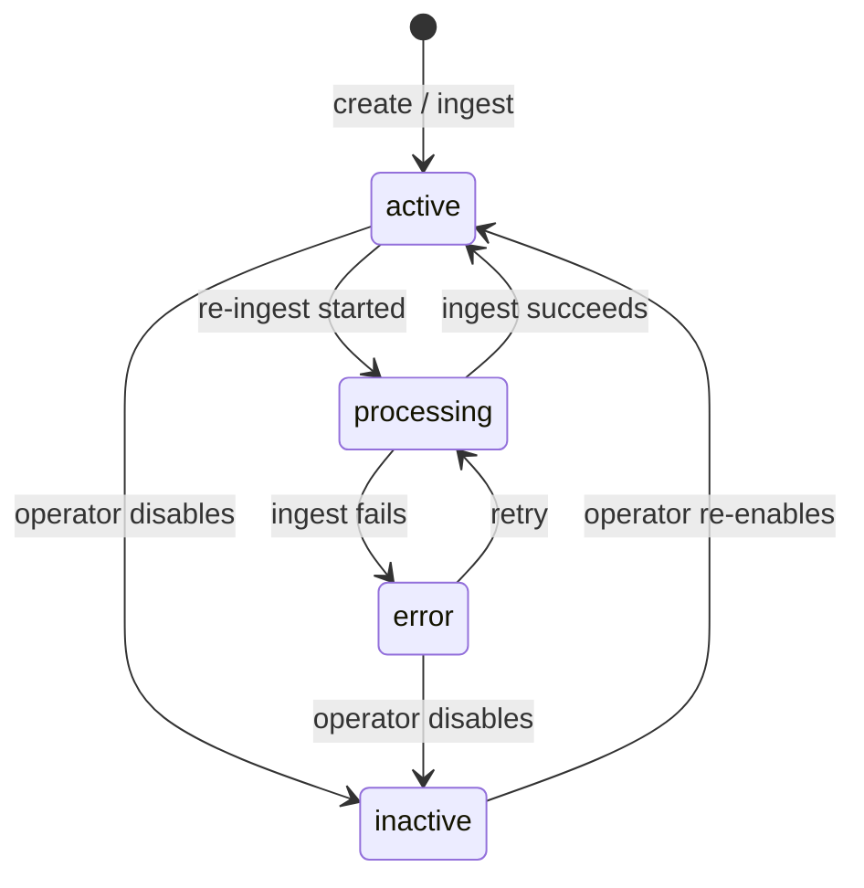

# 35 — Knowledge Sources

Knowledge Sources are persistent, tenant-scoped document stores that feed enterprise context into every AI flow. Operators upload files (Markdown, JSON, YAML, CSV, XML, plaintext), the engine chunks and indexes the content, and the search pipeline retrieves relevant snippets at prompt-assembly time. Unlike Skills (hand-curated rules), Knowledge Sources are bulk reference material the LLM can search.

## Context assembly

Knowledge Sources sit between curated Skills and auto-ingested Connector Docs in the context pipeline. Skills are dense, opinionated rules; Knowledge Sources are broad, searchable reference material; Connector Docs are auto-ingested API documentation.

## Schema

Two tables back the feature: `knowledge_sources` (metadata) and `knowledge_chunks` (indexed content).

### `knowledge_sources`

| Column | Type | Purpose |
|---|---|---|
| `id` | `uuid` PK | Unique identifier |
| `tenant_id` | `uuid` FK | Tenant isolation |
| `name` | `text` | Human-readable display name |
| `slug` | `text` | URL-safe identifier, unique per tenant |
| `description` | `text` | Optional summary |
| `scope` | `enum` | `global` or `workflow` |
| `workflow_id` | `uuid` FK | Required when scope = `workflow` |
| `status` | `enum` | Lifecycle state: `active`, `inactive`, `processing`, `error` |
| `source_type` | `text` | Origin kind: `file_upload`, `url`, `inline` |
| `source_uri` | `text` | Original filename or URL |
| `mime_type` | `text` | Detected MIME type |
| `version` | `text` | SHA-256 fingerprint of content (first 32 hex chars) |
| `bytes_total` | `integer` | Total byte size of accepted chunks |
| `chunk_count` | `integer` | Number of chunks produced |
| `refresh_strategy` | `enum` | `manual`, `scheduled`, `webhook` |
| `refresh_cron` | `text` | Cron expression (when strategy = `scheduled`) |
| `refresh_webhook_secret` | `text` | HMAC secret (when strategy = `webhook`) |
| `last_refreshed_at` | `timestamptz` | Last successful re-ingest |
| `created_at` | `timestamptz` | Row creation time |
| `updated_at` | `timestamptz` | Last modification time |
| `deleted_at` | `timestamptz` | Soft-delete marker |

### `knowledge_chunks`

| Column | Type | Purpose |
|---|---|---|
| `id` | `uuid` PK | Unique identifier |
| `tenant_id` | `uuid` FK | Tenant isolation |
| `knowledge_source_id` | `uuid` FK | Parent source (cascade delete) |
| `ordinal` | `integer` | Chunk position within source |
| `title` | `text` | Section heading (from Markdown H1/H2 splits) |
| `path` | `text` | Original filename |
| `content` | `text` | Chunk text |
| `byte_size` | `integer` | Byte length of content |
| `fingerprint` | `text` | Content hash for deduplication |
| `tsv` | `tsvector` | Generated column: `to_tsvector('english', coalesce(title,'') \|\| ' ' \|\| content)` |
| `created_at` | `timestamptz` | Row creation time |

Key indexes: unique `(tenant_id, slug)` on sources, GIN index on `tsv` for full-text search, B-tree on `(tenant_id, knowledge_source_id, ordinal)` for ordered retrieval.

## Scopes

- **Global** -- included in every flow for the tenant. Use for company-wide reference material (policies, glossaries, product specs).
- **Workflow** -- included only when the flow targets the specified `workflow_id`. Requires `workflow_id` to be set. Use for workflow-specific documentation.

When searching with a `workflow_id`, the engine returns matches from both global sources and workflow-scoped sources for that workflow.

## Lifecycle states

- **active** -- chunks are searchable and included in context assembly.
- **inactive** -- preserved but excluded from search results and context.
- **processing** -- re-ingest in progress; previous chunks remain searchable until replacement completes.
- **error** -- ingest failed; operator intervention required.

## Refresh strategies

| Strategy | Trigger | Configuration |
|---|---|---|
| `manual` | Operator re-uploads via CLI or REST | None (default) |
| `scheduled` | Cron-based periodic re-ingest | `refresh_cron` field (e.g. `0 2 * * *`) |
| `webhook` | External system calls refresh endpoint | `refresh_webhook_secret` for HMAC validation (reserved, not yet implemented) |

On refresh, old chunks are deleted and replaced atomically within a transaction. The `version` field (SHA-256 fingerprint) tracks content changes.

## Chunking and search

**Ingest pipeline:**

1. **Detect format** -- extension and MIME type map to a parser (`markdown`, `json`, `yaml`, `csv`, `xml`, `plaintext`).
2. **Parse to chunks** -- Markdown splits on H1/H2 headings; plaintext splits on paragraph boundaries (double newlines); structured formats (JSON, YAML, CSV, XML) produce a single chunk.
3. **Fingerprint** -- each chunk gets a content hash via the shared `fingerprintChunks` pipeline.
4. **Dedup** -- duplicate chunks (by fingerprint) are dropped before insert.
5. **Persist** -- accepted chunks are written to `knowledge_chunks` in a single transaction.

**Search:**

- PostgreSQL `tsvector` generated column combines `title` and `content`.
- GIN index on `tsv` powers full-text search via `plainto_tsquery('english', ...)`.
- Results are ranked by `ts_rank_cd` and snippets are generated with `ts_headline` (5-25 words).
- Search respects tenant isolation, scope filtering, and source status (`active` only).

## Budget enforcement

| Limit | Value |
|---|---|
| Max bytes per source | 50 MB |
| Max bytes per tenant (all sources) | 500 MB |
| Max files per conversation message | 10 |

- Per-source limit is checked before parsing.
- Per-tenant limit is checked inside a transaction to prevent concurrent inserts from exceeding the budget.
- Exceeding either limit raises `KnowledgeBudgetExceededError`.

## CLI commands

All commands are under `subkit knowledge-sources`.

| Command | Description | Key flags |
|---|---|---|
| `list` | List knowledge sources | `--scope`, `--status` |
| `get <id>` | Fetch a single knowledge source | |
| `create --file <path>` | Upload a file as a new knowledge source | `--name`, `--scope`, `--workflow-id` |
| `search <query>` | Full-text search across sources | `--limit` |
| `delete <id>` | Delete a knowledge source | |

## REST endpoints

All endpoints require bearer auth and the corresponding `knowledge:*` permission.

| Method | Path | Permission | Description |
|---|---|---|---|
| `GET` | `/v1/knowledge-sources` | `knowledge:read` | List sources (query: `scope`, `workflow_id`, `status`, `limit`, `offset`) |
| `POST` | `/v1/knowledge-sources` | `knowledge:write` | Upload file (multipart/form-data: `file` + `metadata` JSON) |
| `GET` | `/v1/knowledge-sources/search` | `knowledge:read` | Full-text search (query: `q`, `scope`, `workflow_id`, `limit`) |
| `GET` | `/v1/knowledge-sources/{id}` | `knowledge:read` | Get single source |
| `PATCH` | `/v1/knowledge-sources/{id}` | `knowledge:write` | Update metadata (name, description, scope, status, refresh) |
| `DELETE` | `/v1/knowledge-sources/{id}` | `knowledge:delete` | Soft-delete source |

The upload endpoint accepts `multipart/form-data` with a `file` field and an optional `metadata` field (JSON string). Max upload size: 50 MB.

## MCP integration

Knowledge Sources are exposed as MCP resources. Clients can discover and read them alongside connectors and skill candidates.

| Aspect | Detail |
|---|---|
| URI scheme | `knowledge://<id>` |
| List | Included in `resources/list` (active sources only) |
| Read | Returns JSON: `id`, `name`, `scope`, `source_type`, `bytes_total`, `chunk_count`, `status` |
| Permission | Gated by `knowledge:read` RBAC check |
| Subscribe | Supported via `resources/subscribe`; pushes `notifications/resources/updated` on knowledge source changes |
