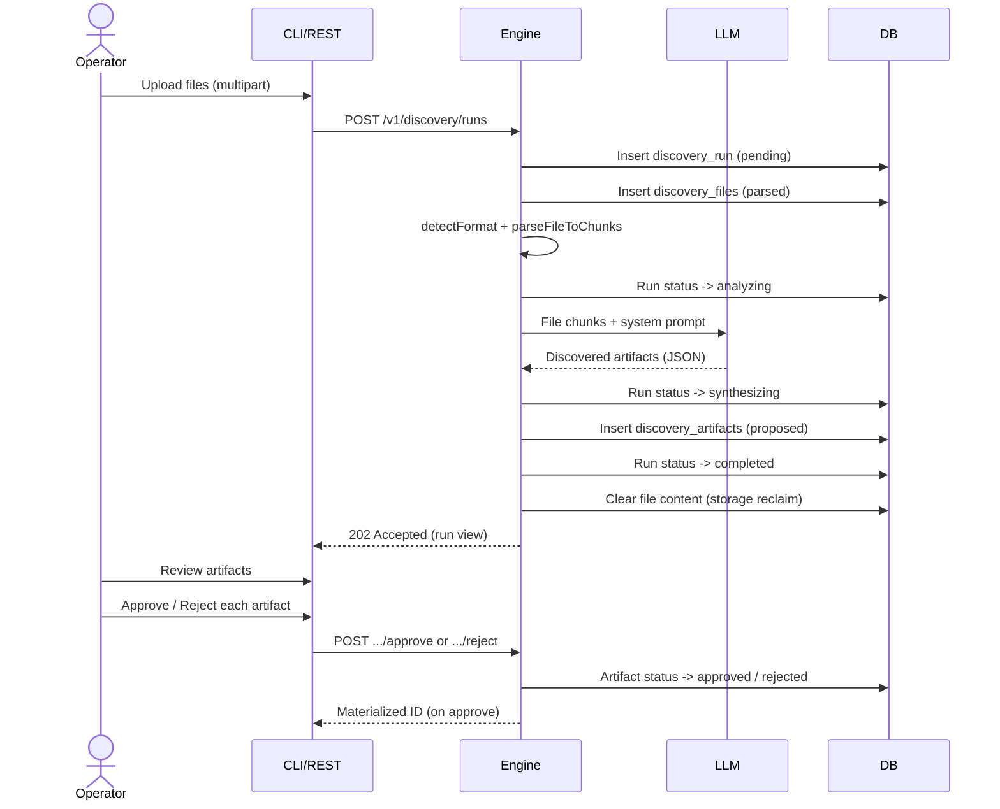
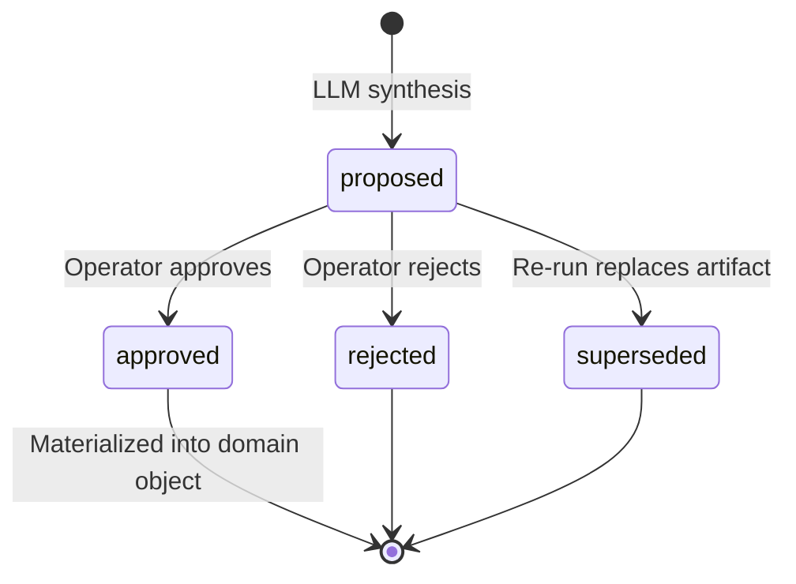

# 36 -- Discovery (H2.5)

Discovery is a one-shot, LLM-powered analysis pipeline that ingests enterprise files (API specs, config files, runbooks, CSVs) and infers domain artifacts -- Connectors, Skills, and Knowledge Sources -- for human review. Files are uploaded via REST or CLI, analyzed and synthesized by the LLM, and the resulting proposals enter a human-gated approval lifecycle before being materialized into real domain objects.

## End-to-end flow



## Database schema

### `discovery_runs`

| Column | Type | Default | Notes |
|---|---|---|---|
| `id` | `uuid` | `gen_random_uuid()` | PK |
| `tenant_id` | `uuid` | -- | FK -> `tenants.id` (cascade) |
| `conversation_id` | `uuid` | `null` | Links to conversation that triggered the run |
| `status` | `discovery_run_status` | `pending` | Enum: pending, analyzing, synthesizing, completed, failed |
| `label` | `text` | `null` | Optional human-readable label |
| `file_count` | `integer` | `0` | Total files submitted |
| `files_analyzed` | `integer` | `0` | Incremented as each file completes |
| `artifact_count` | `integer` | `0` | Set on completion |
| `token_usage` | `jsonb` | `{prompt_tokens:0,...}` | LLM token accounting |
| `error` | `text` | `null` | Populated on failure |
| `started_at` | `timestamptz` | `null` | Set at run creation |
| `completed_at` | `timestamptz` | `null` | Set on completed/failed |
| `created_at` | `timestamptz` | `now()` | -- |
| `updated_at` | `timestamptz` | `now()` | -- |

**Indexes:** `(tenant_id, status)`

### `discovery_files`

| Column | Type | Default | Notes |
|---|---|---|---|
| `id` | `uuid` | `gen_random_uuid()` | PK |
| `tenant_id` | `uuid` | -- | FK -> `tenants.id` (cascade) |
| `run_id` | `uuid` | -- | FK -> `discovery_runs.id` (cascade) |
| `filename` | `text` | -- | Original filename |
| `mime_type` | `text` | `null` | MIME type if provided |
| `byte_size` | `integer` | -- | Byte length of parsed content |
| `format` | `text` | -- | Detected: json, yaml, csv, xml, markdown, plaintext, openapi, unknown |
| `content` | `text` | `null` | Parsed text; cleared after analysis |
| `chunk_count` | `integer` | `0` | Number of chunks produced by parser |
| `status` | `text` | `pending` | pending, analyzed, failed |
| `error` | `text` | `null` | Parse/analysis error message |
| `fingerprint` | `text` | `null` | SHA-256 prefix (32 chars) for cross-run dedup |
| `created_at` | `timestamptz` | `now()` | -- |
| `updated_at` | `timestamptz` | `now()` | -- |

**Indexes:** `(run_id)`

### `discovery_artifacts`

| Column | Type | Default | Notes |
|---|---|---|---|
| `id` | `uuid` | `gen_random_uuid()` | PK |
| `tenant_id` | `uuid` | -- | FK -> `tenants.id` (cascade) |
| `run_id` | `uuid` | -- | FK -> `discovery_runs.id` (cascade) |
| `kind` | `discovery_artifact_kind` | -- | Enum: connector, skill, knowledge_source |
| `status` | `discovery_artifact_status` | `proposed` | Enum: proposed, approved, rejected, superseded |
| `title` | `text` | -- | Human-readable artifact name |
| `description` | `text` | `null` | What was detected and why |
| `draft` | `jsonb` | -- | Shape depends on `kind` (see below) |
| `evidence` | `jsonb` | -- | File excerpts linking back to source files |
| `confidence` | `integer` | `null` | 0--100 score |
| `materialized_id` | `text` | `null` | Set after approval; ID of created domain object |
| `materialized_type` | `text` | `null` | connector, skill, or knowledge_source |
| `rejection_reason` | `text` | `null` | Operator-supplied reason on reject |
| `created_at` | `timestamptz` | `now()` | -- |
| `updated_at` | `timestamptz` | `now()` | -- |

**Indexes:** `(run_id, kind)`, `(tenant_id, status)`

## Artifact types

Each artifact `kind` produces a different `draft` shape:

| Kind | Draft shape | What it creates |
|---|---|---|
| `connector` | `ConnectorDraft` -- name, slug, driver (`http`/`postgres`/`s3`/`graphql`), base_url, dsn, auth_type, detection_signal | A new Connector definition |
| `skill` | `SkillDraft` -- scope (`global`/`connector`/`workflow`), title, body, examples, best_practices, pitfalls, related_connector_slug | A new Skill (draft status) |
| `knowledge_source` | `KnowledgeDraft` -- category (`runbook`/`architecture`/`glossary`/`reference`/`other`), summary | A new Knowledge Source entry |

## Artifact lifecycle



- **proposed** -- initial state after LLM synthesis; awaiting human review.
- **approved** -- operator accepted; the `draft` is materialized into a real Connector, Skill, or Knowledge Source. `materialized_id` and `materialized_type` are set.
- **rejected** -- operator declined; optional `rejection_reason` is recorded.
- **superseded** -- a newer run produced a replacement artifact.

Only artifacts in `proposed` status can be approved or rejected.

## Confidence scoring

Each artifact carries a `confidence` score (0--100) assigned by the LLM:

| Range | Interpretation |
|---|---|
| 80--100 | High confidence -- clear evidence in source files |
| 50--79 | Medium confidence -- partial evidence, may need manual review |
| 0--49 | Low confidence -- speculative inference |

## Evidence model

Every artifact includes an `evidence` object that traces the inference back to source files:

```jsonc
{
  "file_ids": ["uuid-1", "uuid-2"],
  "excerpts": [
    {
      "file_id": "uuid-1",
      "filename": "openapi.yaml",
      "text": "paths:\n  /api/v1/orders:\n    post: ..."
    }
  ]
}
```

- `file_ids` -- references to `discovery_files.id` rows that contributed evidence.
- `excerpts` -- verbatim text snippets from the source files that justify the inference.

## Materialization

When an artifact is approved:

1. The artifact status transitions to `approved`.
2. The `draft` payload is used to create the corresponding domain object (Connector, Skill, or Knowledge Source).
3. `materialized_id` is set to the ID of the newly created domain object.
4. `materialized_type` records the object type (`connector`, `skill`, `knowledge_source`).
5. An audit event `discovery.artifact_approved` is emitted.

In the conversational flow, materialization goes through the `start_connector_from_description` / `start_connector_from_template` and `propose_skill` conversation tools, which stage the draft and then move through the normal confirmation flow before creating the domain object.

## Run status transitions

```
pending -> analyzing -> synthesizing -> completed
                \            \
                 `-> failed   `-> failed
```

| Transition | Trigger |
|---|---|
| pending -> analyzing | File analysis begins |
| analyzing -> synthesizing | All files analyzed, LLM synthesis starts |
| synthesizing -> completed | Artifacts inserted, file content cleared |
| * -> failed | Unrecoverable error at any stage |

## Supported file formats

| Format | Extensions |
|---|---|
| JSON | `.json` |
| YAML | `.yaml`, `.yml` |
| CSV | `.csv`, `.tsv` |
| XML | `.xml` |
| Markdown | `.md`, `.markdown` |
| Plaintext | `.txt`, `.text`, `.log` |
| OpenAPI | auto-detected from JSON/YAML content |

Binary files (containing null bytes) are rejected with a per-file error; they do not abort the run.

## CLI commands

| Command | Description | Key flags |
|---|---|---|
| `subkit discovery run --files <paths>` | Upload and analyze files | `--files` (comma-separated paths or directory), `--label` |
| `subkit discovery list` | List discovery runs | `--status` filter |
| `subkit discovery get <id>` | Get a single run | -- |
| `subkit discovery artifacts <run-id>` | List artifacts for a run | `--kind`, `--status` filters |
| `subkit discovery approve <artifact-id>` | Approve a proposed artifact | -- |
| `subkit discovery reject <artifact-id>` | Reject a proposed artifact | `--reason` |

All CLI commands accept standard `--profile`, `--json`, and `--server` flags.

## REST endpoints

| Method | Path | Auth | Description |
|---|---|---|---|
| `POST` | `/v1/discovery/runs` | `discovery:approve` | Create a run (multipart: `files[]`, optional `label`) |
| `GET` | `/v1/discovery/runs` | `discovery:read` | List runs; query: `status`, `limit`, `offset` |
| `GET` | `/v1/discovery/runs/{id}` | `discovery:read` | Get a single run |
| `GET` | `/v1/discovery/runs/{id}/artifacts` | `discovery:read` | List artifacts; query: `kind`, `status`, `limit`, `offset` |
| `GET` | `/v1/discovery/artifacts/{id}` | `discovery:read` | Get a single artifact |
| `POST` | `/v1/discovery/artifacts/{id}/approve` | `discovery:approve` | Approve a proposed artifact |
| `POST` | `/v1/discovery/artifacts/{id}/reject` | `discovery:approve` | Reject a proposed artifact; body: `{ reason?: string }` |

- Max 50 files per run (enforced at the HTTP layer).
- `POST /v1/discovery/runs` returns `202 Accepted`.
- List endpoints support pagination via `limit` (max 200) and `offset`.

## Conversation integration

Discovery integrates with the conversation system through two conversation tools:

- **`start_connector_from_description` / `start_connector_from_template`** -- invoked by the LLM when it identifies an API, database, or service in analyzed files. Produces a `ConnectorDraft` that then moves through probe/save confirmation.
- **`propose_skill`** -- invoked by the LLM when it identifies operational rules, best practices, or conventions. Produces a `SkillDraft` and triggers `request_human_approval`.

Flow within a conversation:

1. Operator attaches files to a conversation.
2. Engine creates a `discovery_run` linked via `conversation_id`.
3. LLM analyzes file content and calls `start_connector_from_description` / `start_connector_from_template` / `propose_skill`.
4. Each tool call creates an approval request -- the conversation pauses.
5. Operator approves or rejects each proposal inline.
6. Approved proposals are materialized into domain objects.

## Audit trail

| Event | Logged when |
|---|---|
| `discovery.run_created` | Run inserted with files |
| `discovery.run_completed` | Run finishes successfully |
| `discovery.run_failed` | Run fails |
| `discovery.artifact_proposed` | Artifact created by LLM |
| `discovery.artifact_approved` | Operator approves |
| `discovery.artifact_rejected` | Operator rejects |
