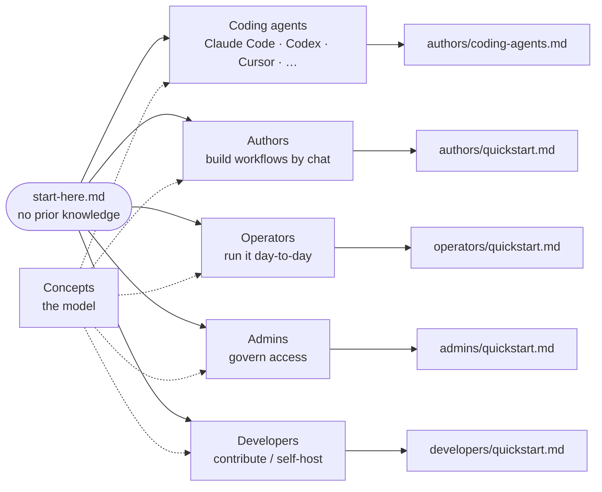
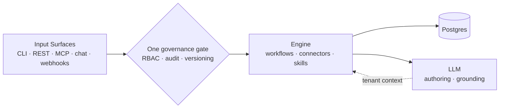

# sk Documentation

Everything you need to get work running by itself — described in plain language, reviewed
before it goes live, and recorded every time it runs.

**Never seen sk before?** [Start here](start-here.md) — no prior knowledge assumed, no code
on the page.

## Pick the result you want

| You want to | Go to | Roughly |
|---|---|---|
| **Understand what this is** before deciding anything | [Start here](start-here.md) | 10 min read |
| **Try it** — nothing to a running engine and a first workflow | [Self-host quickstart](developers/self-host.md) | 30 min |
| **Get a process running** on a system someone already connected | [Author quickstart](authors/quickstart.md) | 5 min |
| **Ground your coding agent** in your team's knowledge | [Use sk from a coding agent](authors/coding-agents.md) | 10 min |
| **Run sk for a team** — engine, connectors, schedules | [Operator quickstart](operators/quickstart.md) | 10 min |
| **Let people in safely** — identity, roles, credentials | [Admin quickstart](admins/quickstart.md) | 10 min |
| **Work out which door fits which job** | [Choosing your surface](authors/choosing-your-surface.md) | 9 min read |
| **Contribute** | [Developer quickstart](developers/quickstart.md) | 10 min |

Below that, the docs are organised by **audience**. Pick your lane.

## Find your lane

**I use a coding agent** — Claude Code, Codex, Cursor, Claude Desktop,
claude.ai, or ChatGPT — and want it grounded in my team's knowledge →
[Use sk from a coding agent](authors/coding-agents.md). Install, connect, import
your wiki, ask a grounded question — the whole path on one page.

## Section overviews

Each audience folder has a landing page that indexes its docs:

- [Start here](start-here.md) — what sk is and what it delivers, written for someone who has never seen it.
- [Concepts](concepts/README.md) — the domain model: surfaces, the governance gate, connectors, workflows, knowledge, and audit.
- [Coding agents](authors/coding-agents.md) — connect Claude Code, Codex, Cursor, Claude Desktop, claude.ai, or ChatGPT to your knowledge, end to end.
- [Operators](operators/README.md) — run sk day-to-day: credentials, scheduling, observability, drift-assisted repair, notifications.
- [Authors](authors/README.md) — build workflows by conversation: the REPL, the approval loop, recipes, skills, knowledge.
- [Developers](developers/README.md) — contribute and self-host: repo setup, input surfaces, the tool palette, the evidence process.
- [Admins](admins/README.md) — govern access: configuration, RBAC, credentials, and production hardening.

## The model in one picture

Want the model before the mechanics? Read the
[Architecture overview](concepts/overview.md) — otherwise pick your lane above
and start there.

## Pipe these docs into an LLM

Point any model at [llms.txt](llms.txt) for a flat, link-followed index of this
documentation set, or [llms-full.txt](llms-full.txt) for every page concatenated
into a single fetch (per [llmstxt.org](https://llmstxt.org)). To feed a single
page in verbatim, append `?raw=1` (or open the **Raw** view) on any `.md` file in
this directory — that gives the model the plain Markdown with no rendering chrome.

A running engine serves these unauthenticated, with the index's drill-down links
resolved to the engine's own origin: `/llms.txt` (also at `/.well-known/llms.txt`),
`/llms-full.txt`, and each page at `/llms/<path>` (e.g. `/llms/concepts/connectors.md`).
So MCP clients and the engine's own authoring loop can ground themselves on the live
deployment — index first, then fetch just the pages they need.

---

## Concepts — the model

| Doc | What it covers |
|---|---|
| [overview.md](concepts/overview.md) | The architecture at a glance: surfaces → one governance gate → engine → Postgres/LLM, and the tenant-context loop. |
| [glossary.md](concepts/glossary.md) | The authoritative glossary: every domain term defined exactly once — Tenant, Workflow, Skill, Connector, Execution, Audit Log, and more. |
| [connectors.md](concepts/connectors.md) | The integration fabric: Connectors, Drivers, Credentials, the vault, and the OAuth2 lifecycle. |
| [workflows.md](concepts/workflows.md) | The governed, version-bound execution engine: Workflow DAGs, Step types, Execution records, Schedules, and drift-assisted repair. |
| [knowledge-and-skills.md](concepts/knowledge-and-skills.md) | How organization-specific context compounds: Skills, Knowledge Sources, context assembly, Discovery. |
| [governance-and-audit.md](concepts/governance-and-audit.md) | Multi-tenancy, the append-only audit trail, what its guarantee covers, and conversational secret hygiene. |
| [reversibility-and-trust-domains.md](concepts/reversibility-and-trust-domains.md) | Reversibility × runtime judgment, why authoring and execution are different trust domains, and the readable-artefact test. |

---

## Authors — build workflows by conversation

| Doc | For |
|---|---|
| [quickstart.md](authors/quickstart.md) | You use sk through the CLI, chat, or an MCP client. Authenticated, first conversation open. 5 minutes. |
| [coding-agents.md](authors/coding-agents.md) | You use Claude Code, Codex, Cursor, Claude Desktop, claude.ai, or ChatGPT: connect it, import your wiki with a domain tag, and get grounded sessions + a review loop. 10 minutes. |
| [repl-tour.md](authors/repl-tour.md) | Author connectors and workflows by conversation in the `sk` REPL — the approve-to-commit loop, slash commands, headless `-p`. |
| [choosing-your-surface.md](authors/choosing-your-surface.md) | Which door for which job — changing a definition versus running one, with seven worked examples. |
| [authoring-workflows.md](authors/authoring-workflows.md) | The AI authoring loop, the human approval gate, probe/preview, and stage-aware prompting. |
| [recipes.md](authors/recipes.md) | Recipe authoring deep-dive: schema, intent matching, and worked walkthroughs. |
| [custom-skills.md](authors/custom-skills.md) | Author, scope, and promote Skills that encode your conventions. |
| [knowledge-sources.md](authors/knowledge-sources.md) | Upload, tag, and refresh the documents the AI grounds its proposals in. |

---

## Operators — run it day-to-day

| Doc | For |
|---|---|
| [quickstart.md](operators/quickstart.md) | You run sk for your team. Engine up, admin key minted, first connector registered. 10 minutes. |
| [connectors-and-credentials.md](operators/connectors-and-credentials.md) | Attach and rotate credentials, test connectivity, invoke endpoints ad-hoc. |
| [scheduling-and-hooks.md](operators/scheduling-and-hooks.md) | Trigger workflows by schedule or webhook; wire Before-Request Hooks. |
| [observability.md](operators/observability.md) | Metrics, structured logs, the telemetry surface, runtime stats, and resource limits. |
| [self-healing.md](operators/self-healing.md) | How connector drift becomes an operator-reviewed Patch Candidate. |
| [notifications.md](operators/notifications.md) | Notification rules, channels (Slack / Teams / Google Chat / webhook), rate limits, circuit breaker. |

---

## Admins — govern access

| Doc | For |
|---|---|
| [quickstart.md](admins/quickstart.md) | Wire configuration, roles, and keys for a production tenant. 10 minutes. |
| [configuration.md](admins/configuration.md) | The `sk settings` model: the config file, resolution order, bootstrap env. |
| [settings-reference.md](admins/settings-reference.md) | Generated per-leaf reference: path, type, default, scope, sensitive, requiresRestart. |
| [rbac-and-roles.md](admins/rbac-and-roles.md) | Identity (OIDC/SSO, API keys, portal tokens), RBAC/ABAC, Before-Request Hooks. |
| [credentials-and-keys.md](admins/credentials-and-keys.md) | The credential vault, master-key rotation, and release signing. |
| [production-hardening.md](admins/production-hardening.md) | The readiness checklist and backup/recovery before you go live. |

---

## Developers — contribute & self-host

| Doc | For |
|---|---|
| [quickstart.md](developers/quickstart.md) | You contribute to sk. Repo cloned, tests green, engine in watch mode. 10 minutes. |
| [self-host.md](developers/self-host.md) | Zero-to-running from the Docker image, plus production topology, installation, and the operator config reference. |
| [input-surfaces.md](developers/input-surfaces.md) | Every way users and systems reach sk: CLI, REST, MCP, chat, webhooks, schedules. |
| [tool-palette.md](developers/tool-palette.md) | The unified tool palette and dispatcher: registry, naming, policy gates. |
| [coding-agent-integration.md](developers/coding-agent-integration.md) | sk as the knowledge/skill source for Claude Code and Codex: session briefing, learning capture, human review, SKILL.md sync. |
| [evidence-process.md](developers/evidence-process.md) | The evidence-first development loop and two-tier test discipline. |

---

## Who Should Read What

**Claude Code / Codex users** — start at [authors/coding-agents.md](authors/coding-agents.md); it is the whole path on one page, and links onward to [knowledge-sources.md](authors/knowledge-sources.md) and the [loop's mechanics](developers/coding-agent-integration.md).

**Authors** — start at [authors/quickstart.md](authors/quickstart.md), then [authoring-workflows.md](authors/authoring-workflows.md) for what Conversations can do.

**Operators** — start with the [operator quickstart](operators/quickstart.md), then [observability.md](operators/observability.md) for monitoring and [self-healing.md](operators/self-healing.md) for drift.

**Admins** — start with the [admin quickstart](admins/quickstart.md), then [rbac-and-roles.md](admins/rbac-and-roles.md) and [credentials-and-keys.md](admins/credentials-and-keys.md).

**Developers** — start with [AGENTS.md](../AGENTS.md) for the subsystem map, then [developers/self-host.md](developers/self-host.md) and the [developer quickstart](developers/quickstart.md).

**Architects** — start with [concepts/overview.md](concepts/overview.md) and [glossary.md](concepts/glossary.md), then [governance-and-audit.md](concepts/governance-and-audit.md) for the security architecture.
